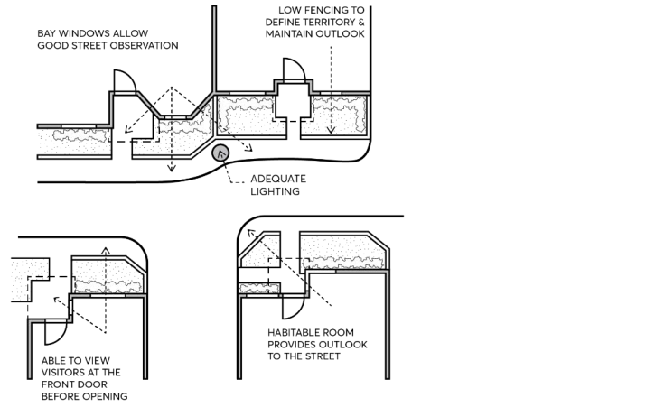

### 2.14 SAFETY AND SECURITY

The design of buildings and places has an impact on perceptions of safety and security as well as actual opportunities to commit crime. Design for safety works by enabling casual surveillance, reinforcing territory, controlling access, and managing space.

The application of the principles outlined in the NSW Police Service’s ‘Crime Prevention Through Environmental Design’ (CPTED), promotes physical conditions that deter opportunities for criminal behaviour and aims to make our communities safer places.

Objectives

O.01 Reduce crime risk and minimise opportunities for crime. O.02 Increase and contribute to the safety and perception of safety in public and semi-public spaces. O.03 Encourage the consideration and application of crime prevention principles when designing and siting buildings and spaces.

O.04 Encourage dwelling layouts that facilitate safety and encourage interaction and recognition between residents.

O.05 Incorporate and enhance opportunities for effective natural surveillance in development.

Controls

C.01 Casual surveillance is to be provided by designing buildings with a clear sense of address and orientating active uses or habitable rooms towards the street, as per Figure 2.14.1.

C.02 Buildings adjoining laneways and through block connections should be designed to activate these spaces at ground level and provide casual surveillance from ground and upper levels.

C.03 Clear sight lines must be provided between public and private places. C.04 Development should provide a clear definition and transition of boundaries between public and private spaces. Methods other than gates, fences, and enclosures are encouraged.

C.05 Physical or symbolic barriers should be used to attract, channel and/or restrict the movement of people. Landscaping and/or physical elements may be used to direct people to destinations, identify where people can and cannot go, and restrict access to high crime risk areas such as carparks.

C.06 Crime prevention measures in new buildings and spaces must not to detract from the quality of the streetscape. Subtle design techniques should be applied to blend into façades and places. The installation of solid security shutters will not be supported.

C.07 Design elements should contribute to community ownership of public and communal spaces, fostering a shared sense of responsibility for a place’s use and condition.

C.08 Reduce the attractiveness of crime by minimising, removing or concealing crime opportunities. The design of development should increase the possibility of detection, challenge and apprehension of persons engaged in crime.

SAFETY AND SECURITY

C.09 Public pedestrian areas within developments as well as communal access ways within multi-dwelling developments are to provide non-slip pavement surfaces.

C.10 A site management plan and formal crime risk assessment (Safer by Design Evaluation) involving the NSW Police Service may be required for large developments which, in Council’s opinion, would create a crime risk.

> [Picture on page 30: a picture, saved as a picture (images/part-02-design-in-context-page-30-7.gif, 150 dpi).]

Figure 2.14.1 – Design for natural surveillance (Source: AMCORD)

C.11 The principal entry to dwellings should not be provided off rear lanes except where:

a) the lane is well lit,

b) there is some natural surveillance of the lane from adjoining dwellings,

c) the lane provides access to other dwellings, and

d) the land is not regularly used by service vehicles.

C.12 Mailboxes are to be:

a) visually integrated with the development and have regard to the amenity of the streetscape. Design and location details are to be provided with the development application.

b) located for convenient access by residents and deliverers on main pathways, and

c) in compliance with Australia Post requirements for positioning and dimensions.

Further Information

NSW Police Service 2001, Safer by Design NSW Department of Urban Affairs and Planning 1979, Crime Prevention and the Assessment of Development Applications, Guidelines under Section 4.15 of the Environmental Planning and Assessment Act, 1979

SIGNAGE
