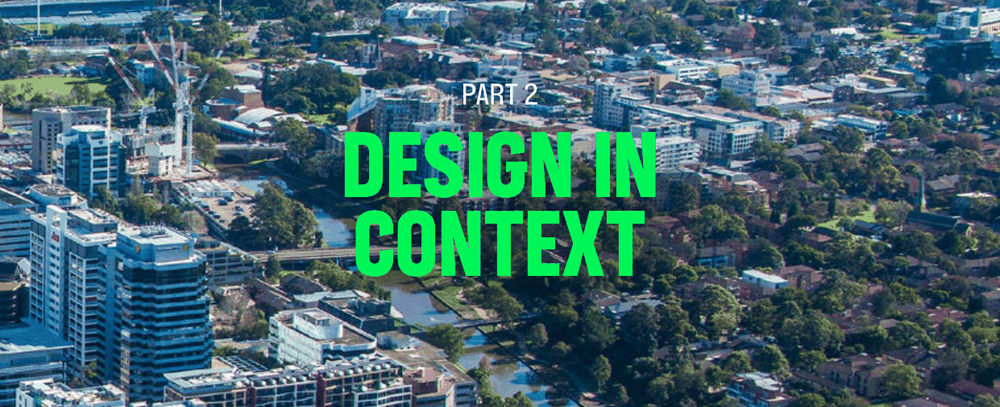

# Parramatta Development Control Plan 2023 - Part 2 Design in Context

> This chapter is split into 15 section file(s), one per numbered heading, in the order they appear in the PDF.

Source PDF: [dcp-part-2-design-in-context.pdf](dcp-part-2-design-in-context.pdf)

> [Picture on page 1: a picture, saved as a picture (images/part-02-design-in-context-page-1-1.gif, 150 dpi).]

## PART 2 DESIGN IN

### CONTEXT

The City of Parramatta (the City) is made up of a diverse natural and built environment. It is important that development is informed by a comprehensive understanding of the design context influenced by the City, neighbourhood, streetscape, and site. This is to ensure that design of the proposed development responds to the important features of the City and contributes to its future character. Good design incorporates an understanding that individual buildings should relate to each other and contribute to a larger whole. It is concerned not only with how buildings look, but how they respond to the local setting and place to generate sustainable living and working environments.

This Part of the DCP contains the overarching development controls, supported by a set of design objectives, that must be applied to all development types in the City. This is to ensure design outcomes are compatible with their surrounding context and promote quality design outcomes. The objectives state the desired outcome, while the controls show ways in which that outcome is to be achieved. This Part must be read in conjunction with the development types contained in Part 3 – Residential Development and Part 4 – Non-Residential Development.

TOC - 1

### CONTENTS

| 2.1 | DESIGN IN CONTEXT......................................................................................................................... 1 |
|---|---|
| 2.2 | CONTEXT ANALYSIS ..........................................................................................................................3 |
| 2.3 | PRELIMINARY BUILDING ENVELOPE .......................................................................................... 6 |
| 2.4 | BUILDING FORM AND MASSING .................................................................................................. 8 |
| 2.5 | STREETSCAPE AND BUILDING ADDRESS ................................................................................. 10 |
| 2.6 | FENCES ................................................................................................................................................ 14 |
| 2.7 | OPEN SPACE AND LANDSCAPE .................................................................................................. 16 |
| 2.8 | VIEWS AND VISTAS .......................................................................................................................... 19 |
| 2.9 | PUBLIC DOMAIN .............................................................................................................................. 20 |
| 2.10 | ACCESSIBILITY AND CONNECTIVITY ......................................................................................... 21 |
| 2.11 | ACCESS FOR PEOPLE WITH A DISABILITY .............................................................................. 22 |
| 2.12 | AMENITIES IN BUILDINGS AVAILABLE TO THE PUBLIC ...................................................... 23 |
| 2.13 | CULTURE AND PUBLIC ART ......................................................................................................... 24 |
| 2.14 | SAFETY AND SECURITY ................................................................................................................. 26 |
| 2.15 | SIGNAGE ............................................................................................................................................. 28 |

TOC - 2

<!-- sections -->
## Sections

1. [2.1 DESIGN IN CONTEXT](01-2-1-design-in-context.md)
2. [2.2 CONTEXT ANALYSIS](02-2-2-context-analysis.md)
3. [2.3 PRELIMINARY BUILDING ENVELOPE](03-2-3-preliminary-building-envelope.md)
4. [2.4 BUILDING FORM AND MASSING](04-2-4-building-form-and-massing.md)
5. [2.5 STREETSCAPE AND BUILDING ADDRESS](05-2-5-streetscape-and-building-address.md)
6. [2.6 FENCES](06-2-6-fences.md)
7. [2.7 OPEN SPACE AND LANDSCAPE](07-2-7-open-space-and-landscape.md)
8. [2.8 VIEWS AND VISTAS](08-2-8-views-and-vistas.md)
9. [2.9 PUBLIC DOMAIN](09-2-9-public-domain.md)
10. [2.10 ACCESSIBILITY AND CONNECTIVITY](10-2-10-accessibility-and-connectivity.md)
11. [2.11 ACCESS FOR PEOPLE WITH A DISABILITY](11-2-11-access-for-people-with-a-disability.md)
12. [2.12 AMENITIES IN BUILDINGS AVAILABLE TO THE PUBLIC](12-2-12-amenities-in-buildings-available-to-the.md)
13. [2.13 CULTURE AND PUBLIC ART](13-2-13-culture-and-public-art.md)
14. [2.14 SAFETY AND SECURITY](14-2-14-safety-and-security.md)
15. [2.15 SIGNAGE](15-2-15-signage.md)
