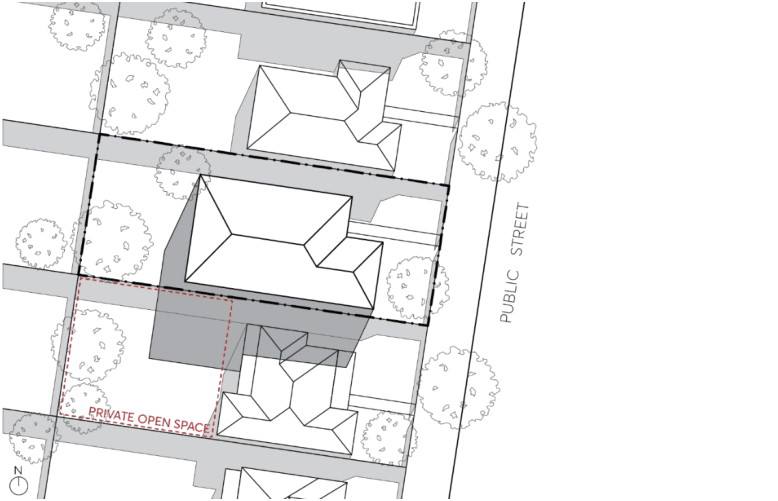
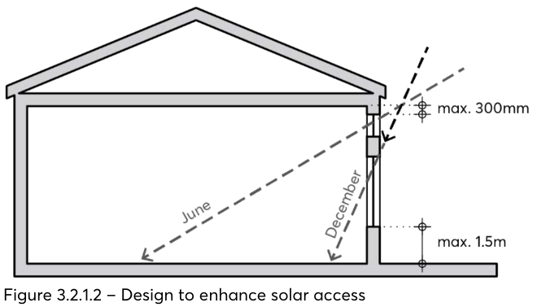
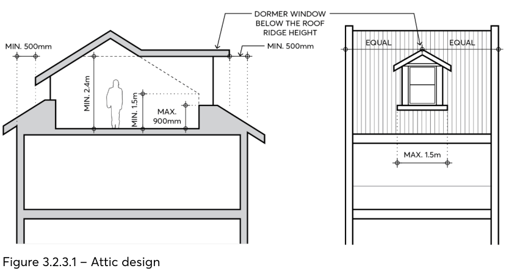
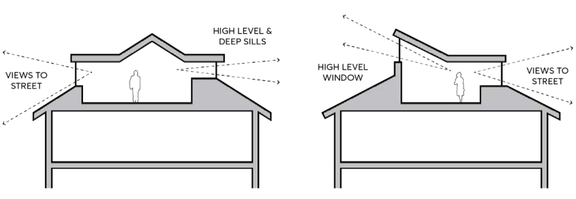

### 3.2 GENERAL RESIDENTIAL CONTROLS

The general objectives and controls in this Section are to be applied in conjunction with the specific controls for the relevant residential development types in Sections 3.3 to 3.5 of this DCP.

#### SOLAR ACCESS AND CROSS VENTILATION

Internal solar access and cross ventilation may be best enhanced through a combination of internal planning and building separation. Where possible, primary living areas are ideally located on the northern side of dwellings. The primary living area is the principal space in the household that is used for common social activities of the occupants and is collocated with the primary private open space. In all other habitable rooms, head and sill heights of windows should be sufficient to allow sun to penetrate rooms, while the depth and height of eaves should consider how to provide adequate shade in summer.

Development must also be designed and sited to minimise the extent of shadows that it casts on:

• private and communal open space within the development,

• private and communal open space of adjoining dwellings,

• public open space such as bushland reserves and parkland,

• solar collectors of adjoining development, and

• habitable rooms both within the development and in adjoining developments. Building elements such as operable louvres and screens, pergolas, blinds etc may be used to modify environmental conditions where required, such as maximising solar access in winter and sun shading in summer.

Objectives

O.01 Ensure daylight is provided to private open space and habitable rooms to improve amenity and energy efficiency.

O.02 Ensure sufficient volumes of fresh air circulate through buildings to create a comfortable indoor environment and to optimise natural cross ventilation.

O.03 Minimise overshadowing of the proposed development on surrounding residences and their private open space.

O.04 Preserve and improve solar access to public open space.

Controls

C.01 Dwellings within the development site and on adjoining properties are to receive a minimum 3 hours of sunlight to primary living areas between 9am and 3pm on 21 June.

GENERAL RESIDENTIAL CONTROLS

C.02 Private open spaces within the development site and on adjoining properties are to receive a minimum 3 hours of sunlight to at least 50% of the private open space area between 9am and 3pm on 21 June.

C.03 Where existing development currently receives less sunlight than the above requirements, this should not be reduced.

C.04 Solar collectors, such as photovoltaic solar panels, proposed as part of a new development or existing on adjoining properties, must not be subject to overshadowing for more than 3 hours between 9am and 3pm on 21 June.

C.05 The extent of shadows must consider the range of factors that impact on solar access, including the slope of the land, aspect, existing and proposed vegetation and the height and position of existing buildings and structures, including fences. Development application submission must demonstrate these factors have been considered.

C.06 Where necessary, building setbacks may need to be increased to maximise solar access and to minimise overshadowing from adjoining buildings.

> [Picture on page 8: a picture, saved as a picture (images/part-03-residential-development-page-8-16.gif, 150 dpi).]

Figure 3.2.2.1 – Solar access to adjoining properties and private open space

C.07 All rooms must contain an external window to provide direct light and ventilation. Exceptions may be considered for non-habitable rooms where this cannot be achieved practicably, and mechanical ventilation can be provided.

C.08 Windows of habitable rooms facing a public street, public space or principle private open space must have a sill height no higher than 700mm above finished floor level.

C.09 The head height of a window must be no less than 300mm below the ceiling. C.10 Skylights and high-level windows with sills of 1,500mm or greater are to be used as a secondary light source only in habitable rooms.

C.11 Translucent glazing must not be used for principal windows of habitable rooms.

GENERAL RESIDENTIAL CONTROLS

C.12 A combination of standard and highlight windows may be used to achieve thermal comfort throughout the year, as per Figure 3.2.1.2.

> [Picture on page 9: a picture, saved as a picture (images/part-03-residential-development-page-9-4.gif, 150 dpi).]

Figure 3.2.1.2 – Design to enhance solar access

C.13 Internal thermal comfort should be provided by orientating buildings to benefit from prevailing breezes.

C.14 Natural cross ventilation should be achieved by locating window openings in opposing walls and in line with each other.

C.15 Convective currents are to be facilitated through the following measures:

a) by locating small windows on the windward side and larger windows on the leeward side thereby utilising air pressure to draw air through the dwelling, or

b) by drawing cool air in at lower levels and allow warm air to escape at higher levels, for example through maisonette and two-storey dwellings.

C.16 New buildings and facades should not result in glare that causes discomfort or threatens safety of pedestrians or motorists. A reflectivity report that analyses the effects of potential glare from the proposed new development on pedestrian and motorists may be required.

Further Information

BASIX Assessment Tool National Trajectory for Low Energy Buildings Sustainable Buildings SEPP 2022 Apartment Design Guide Sustainable Energy Development Authority (SEDA)

GENERAL RESIDENTIAL CONTROLS

#### VISUAL AND ACOUSTIC PRIVACY

The primary method for achieving visual and acoustic privacy between dwellings should be through the location, orientation, and design of buildings. The internal layout of buildings and other elements such as balconies and decks are to be designed to minimise the overlooking of neighbouring living areas, private open spaces and adjoining sensitive uses such as schools.

Objectives

O.01 Balance the need for views and outlook with the need for privacy. O.02 Maximise visual and acoustic privacy both within a development lot and between a development and its neighbours.

O.03 Ensure that development does not cause unreasonable overlooking of habitable rooms and principal private open spaces of dwellings.

O.04 Ensure that the siting and design of development minimises the impacts of noise transmission between properties.

Controls

C.01 Development is to utilise site planning as the primary method for achieving visual and acoustic privacy. This may be realised through such measures as orientating living spaces to rear gardens or the street, collocating similar uses between dwellings, or providing greater separation to neighbouring sites. Ancillary measures such as screening should only be utilised where privacy cannot be achieved through site planning.

C.02 The internal layout of buildings is to be designed to reduce the effects of noise transmission. For example, dwellings with common partition walls should locate noise generating rooms such as living areas adjacent the noise generating rooms of other dwellings.

C.03 Locate windows so they do not provide direct and close views into the windows of other dwellings, particularly those of living areas.

C.04 Development is to contribute to minimising the impact of any local noise generating sources within a site’s vicinity such as traffic, rail, or industry.

C.05 Windows are to be located and designed to reduce the transmission of noise. C.06 Appropriate building materials should be used to provide acoustic privacy and double glazing utilised where required due to adjacent noise generating sources.

C.07 Increase visual and acoustic privacy through the building design elements such as recessed balconies and/or vertical fins between adjacent balconies, oblique windows, fencing, vegetation, louvres and pergolas which limit overlooking of lower dwellings, private open space, and adjoining school yards.

C.08 Landscaping should be used along site boundaries to obscure sight lines and improve visual privacy.

GENERAL RESIDENTIAL CONTROLS

C.09 Balconies above ground level are to face the street, the rear, or another element of the public domain such as a park. Balconies are to be designed to minimise their orientation to side boundaries.

#### ATTIC DESIGN

Objectives

O.01 Reduce the bulk and scale of roof forms which include attic spaces. O.02 Allow good light and ventilation. O.03 Ensure the inclusion of any attic space does not create out of character roof forms.

Controls

C.01 Attics are to be no greater than 30m² in floor area. C.02 Roofs (containing attics or otherwise) are not to exceed 32 degrees in pitch. C.03 Attics are to be designed to fit within the building and are not to increase the bulk and height of the roof.

C.04 Attics are to be cross ventilated using opposing windows, a whirlybird or similar. These should be positioned to maximize cross ventilation.

C.05 Attics are to have a minimum floor to ceiling height of 2.4 metres. C.06 Attic spaces are to have a minimum wall height of 1.5 metres at the edge of the room. C.07 Attics are to be centrally located with setbacks from the external facades of the dwelling. C.08 Dormer windows may be included in attics, provided they are no higher than the height of the main roof of the building, no greater than 1.5 metres in width and are not to incorporate access or a balcony.

C.09 A dormer window must be set back at least 500mm from the edge of the lower-level external wall face.

C.10 Dormer windows should have a sill height no greater than 900mm to allow for adequate light and cross ventilation.

C.11 Attic windows should face the front and rear boundaries of the site, or an element of the public domain such as a park.

GENERAL RESIDENTIAL CONTROLS

> [Picture on page 12: a picture, saved as a picture (images/part-03-residential-development-page-12-2.gif, 150 dpi).]

Figure 3.2.3.1 – Attic design

> [Picture on page 12: a picture, saved as a picture (images/part-03-residential-development-page-12-4.gif, 150 dpi).]

Figure 3.2.3.2 – Attic windows designed to enhance privacy and cross ventilation

#### SWIMMING POOLS

Controls

C.01 Ancillary development comprising a swimming pool for private use must be located on a lot behind the setback area from a primary road, or in the rear yard.

C.02 The swimming pool water line must have a setback of at least 1 metre from a side or rear boundary.

C.03 Decking around a swimming pool must not be more than 600mm above existing ground level. C.04 Coping around a swimming pool must not be more than 1.4 metres above existing ground level, or 300mm wide if the coping is more than 600mm above existing ground level.

C.05 Water from a swimming pool must be discharged in accordance with an approval under the Local Government Act 1993 if the lot is not connected to a sewer main.

C.06 A child-resistant barrier must be constructed or installed in accordance with the requirements of the Swimming Pools Act 1992.

GENERAL RESIDENTIAL CONTROLS

#### OUTBUILDINGS

Controls

C.01 Outbuildings are permitted to a maximum height of 1 storey and 4.5 metres. C.02 Outbuildings must not be constructed forward of the main building frontage. C.03 Outbuildings must be setback a minimum of 900mm from side boundaries. A greater setback may be required to preserve existing established trees or vegetation.

C.04 Outbuildings must provide a minimum 3 metre rear setback. A greater setback may be required to preserve existing established trees or vegetation.

C.05 An outbuilding with a maximum floor area of 25m² may be permitted within 900mm of the rear boundary (e.g., garden shed, garage, pergola), provided there is no loss of established trees or vegetation.

C.06 The construction of outbuildings must not reduce the deep soil, landscaped, or private open space area of the lot to less than the minimum required for the associated residential development type on that site.

C.07 Outbuildings must meet the design objectives of the relevant development type established on the subject lot.

DWELLING HOUSES, SECONDARY DWELLINGS AND DUAL OCCUPANCIES
