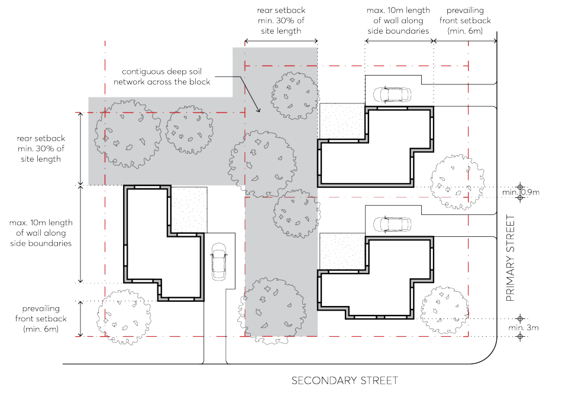

#### 3.3.1.2 PRELIMINARY BUILDING ENVELOPE

Objectives

O.01 Ensure development contributes to a visual cohesiveness along the streetscape through an identifiable uniformity in bulk, scale, setbacks, and height.

O.02 Provide adequate separation between buildings and protect adjoining buildings from overlooking and loss of amenity.

O.03 Provide space in residential areas for landscape amenity that contributes to both the public domain and private landscaping.

O.04 Ensure that built form setbacks enable a healthy environment for onsite large canopy tree planting and street trees.

Controls

Building Height C.01 The maximum building height is to be consistent with the Parramatta LEP 2023 Height of Buildings Map.

C.02 Notwithstanding the above, dwelling houses shall be a maximum of 2-storeys, with attic rooms permitted (see Section 3.2.3 – Attic Design of this DCP).

C.03 Any part of a basement or sub-floor area that projects greater than 1m above natural ground level comprises a storey.

C.04 The ground floor level (finished) of any building must not exceed 500mm above or below natural ground level.

Setbacks C.05 Buildings must be setback a minimum of 6 metres and be consistent with the prevailing setback along the street, as per Figure 3.3.1.2.1.

C.06 On corner lots, the secondary street setback must be a minimum of 3 metres, as per Figure 3.3.1.2.1.

C.07 Notwithstanding the above, the minimum setback to state and regional roads is 10 metres. C.08 Buildings must be setback a minimum of 900mm from side boundaries. C.09 The maximum length of wall along a side boundary is 10 metres. A minimum recess (measured from the face of the external wall) of 1.5 metres (depth) by 2 metres (length) is required to all storeys after 10 metres.

C.10 A rear setback equal to 30% of the site length, as measured perpendicular to the centre of the rear boundary, must be provided as per Figure 3.3.1.2.1.

DWELLING HOUSES, SECONDARY DWELLINGS AND DUAL OCCUPANCIES

> [Picture on page 16: a picture, saved as a picture (images/part-03-residential-development-page-16-2.gif, 150 dpi).]

Figure 3.3.1.2.1 – Key setback requirements for Dwelling Houses
