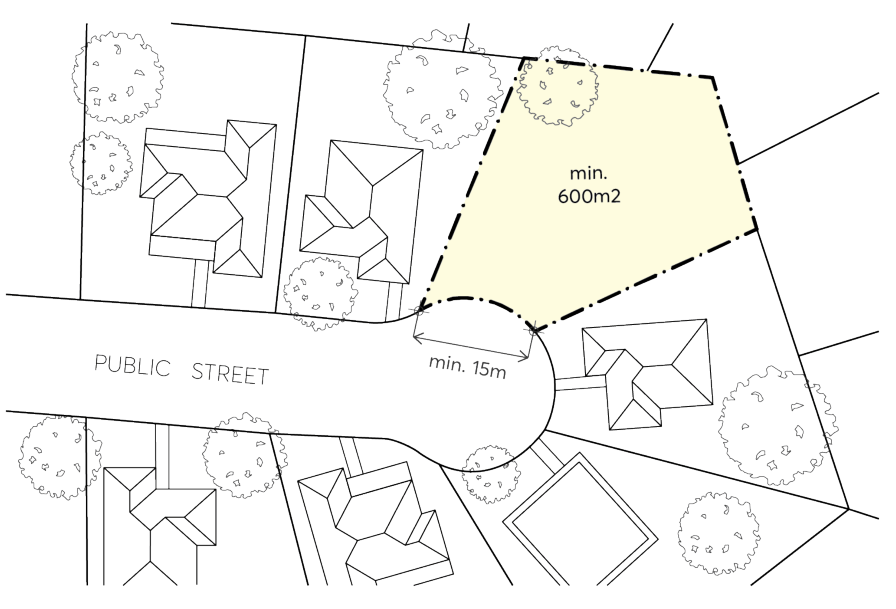
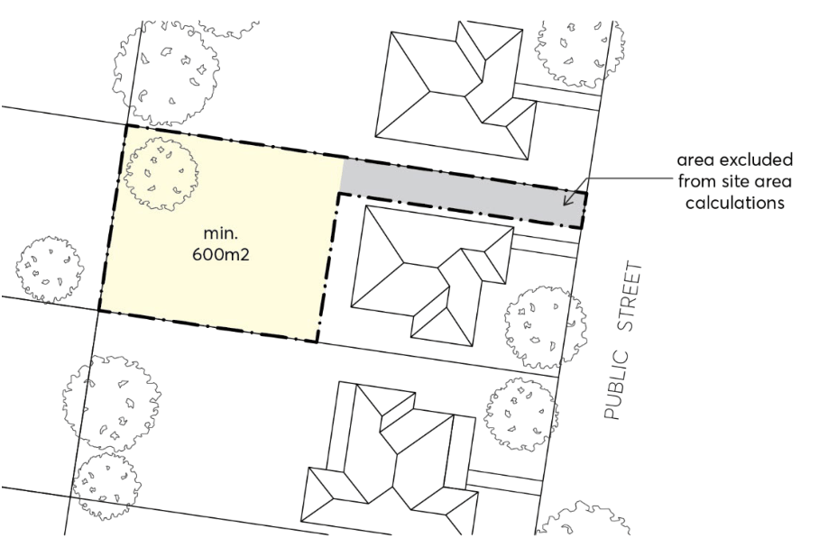

#### 3.3.2.1 MINIMUM SITE FRONTAGE AND SITE AREA

Objectives

O.01 Ensure sites are of sufficient width to achieve:

a) the necessary standard of amenity in relation to privacy, solar access, landscaping and private open space,

b) a sense of street address to both dwellings, and

c) safe and efficient pedestrian and vehicular access.

Controls

C.01 A development lot must have a minimum site frontage width of 15 metres, as per the Parramatta LEP 2023, as measured along the front boundary line.

C.02 For sites located within cul-de-sacs, the minimum site frontage width should be measured in a straight line from corner to corner along the front boundary line, as per Figure 3.3.2.1.1.

> [Picture on page 20: a picture, saved as a picture (images/part-03-residential-development-page-20-18.gif, 150 dpi).]

Figure 3.3.2.1.1 – Site frontage requirements for dual occupancies proposed within cul-de-sacs

DWELLING HOUSES, SECONDARY DWELLINGS AND DUAL OCCUPANCIES

C.03 A development lot must be a minimum of 600m², as per the Parramatta LEP 2023. The area of any access corridor, right of carriageway, battle-axe handle or the like will be excluded for the purpose of lot area calculations, as per Figure 3.3.2.1.2.

> [Picture on page 21: a picture, saved as a picture (images/part-03-residential-development-page-21-5.gif, 150 dpi).]

Figure 3.3.2.1.2 - Minimum site area for battle-axe lots
