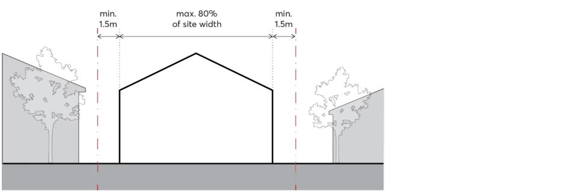
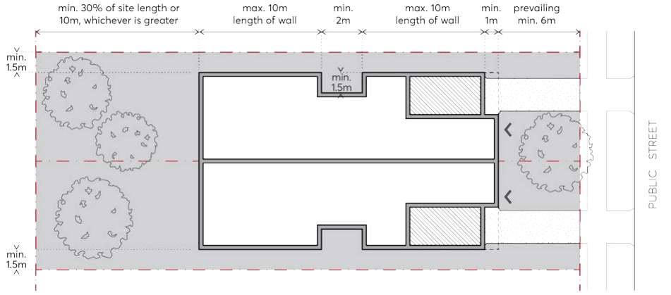
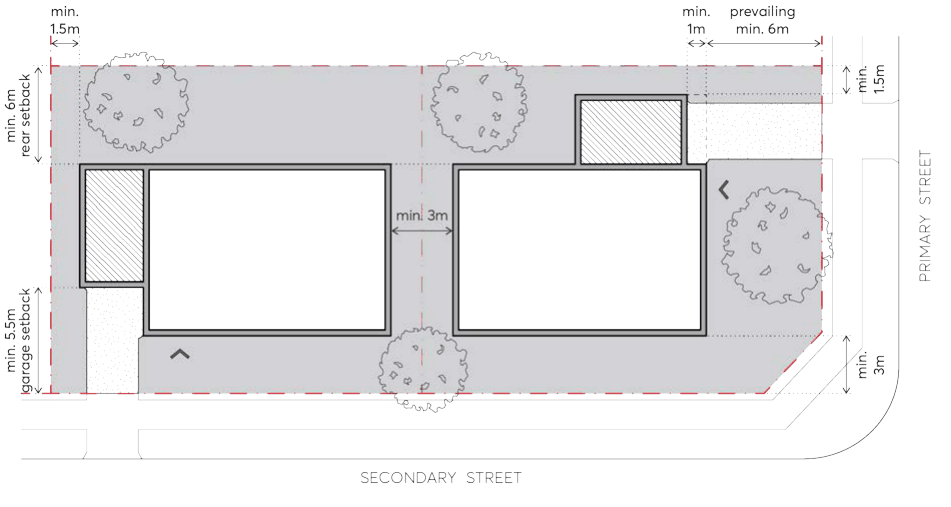

#### 3.3.2.2 PRELIMINARY BUILDING ENVELOPE

Objectives

O.01 Ensure development contributes to a visual cohesiveness along the streetscape through an identifiable uniformity in bulk, scale, setbacks, and height.

O.02 Provide adequate separation between buildings and protect adjoining buildings from overlooking and loss of amenity.

O.03 Provide space in residential areas for landscape amenity that also contributes to the public domain.

O.04 Ensure that built form setbacks enable a healthy environment for onsite large canopy tree planting and street trees.

DWELLING HOUSES, SECONDARY DWELLINGS AND DUAL OCCUPANCIES

Controls

Building Height C.01 The maximum building height is to be consistent with the Parramatta LEP 2023 Height of Buildings Map.

C.02 Notwithstanding the above, dual occupancies shall be a maximum of 2 storeys, with attic rooms permitted.

C.03 Any part of a basement or sub-floor area that projects greater than 1 metre above natural ground level comprises a storey.

C.04 The ground floor level (finished) of any building must not exceed 500mm above or below natural ground level.

Street Setback C.05 Buildings must be set back a minimum of 6 metres from the street boundary and be consistent with the prevailing setback along the street, as per Figure 3.3.2.2.1.

C.06 At the street, the upper level of any dual occupancy must be set back a further 2 metres (minimum) from the building line, excluding development on corner lots.

C.07 On corner lots, the secondary street setback must also be a minimum of 3 metres. C.08 Notwithstanding the above, the minimum setback to state and regional roads is 10 metres. Side Setbacks C.09 Buildings must be set back a minimum of 1.5 metres from side boundaries. C.10 Notwithstanding the above, buildings are to occupy a maximum of 80% of the width of the lot, as measured from the building line, as per Figure 3.3.2.2.1.

> [Picture on page 22: a picture, saved as a picture (images/part-03-residential-development-page-22-23.gif, 150 dpi).]

Figure 3.3.2.2.1 – Maximum building width of 80% of the site width

C.11 Additional upper-level setbacks to side boundaries are discouraged. Where a greater setback is required to improve privacy or solar access, an increased whole of building setback must be applied.

C.12 On corner lots, the separation between detached dual occupancy dwellings must be a minimum 3 metres.

DWELLING HOUSES, SECONDARY DWELLINGS AND DUAL OCCUPANCIES

C.13 The maximum length of wall along side boundaries is 10 metres. A minimum recess (measured from the face of the external wall) of 1.5 metres (depth) by 2 metres (length) is required to all storeys after 10 metres, as per Figure 3.3.2.2.2.

Rear Setback C.14 A rear setback equal to 30% of the site length or 10 metres, whichever is greater, must be provided, as per Figure 3.3.2.2.2. The rear setback is to be measured perpendicular to the centre of the rear boundary.

C.15 For corner sites, rear setbacks must be a minimum of 6 metres, as per Figure 3.3.2.2.3. Rear setbacks on corner sites are to be measured from the boundary parallel to the primary living spaces to accommodate the required private open space.

> [Picture on page 23: a picture, saved as a picture (images/part-03-residential-development-page-23-12.gif, 150 dpi).]

Figure 3.3.2.2.2 – Dual occupancy site setbacks

> [Picture on page 23: a picture, saved as a picture (images/part-03-residential-development-page-23-14.gif, 150 dpi).]

Figure 3.3.2.2.3 – Corner lot - detached dual occupancy site setbacks

DWELLING HOUSES, SECONDARY DWELLINGS AND DUAL OCCUPANCIES
