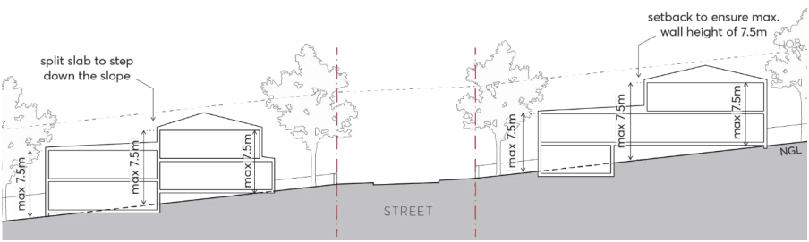

#### 3.3.2.3 STREETSCAPE AND BUILDING ADDRESS

Objectives

O.01 Ensure the appearance of buildings complement and enhance neighbourhood and streetscape character.

O.02 Integrate new development into the surrounding context by minimising proposed bulk and scale through consistent articulation, materials, and setbacks.

O.03 Deliver high-quality development with a clear sense of address from the street and visual prominence of dwelling entries in the front façade.

O.04 Improve casual surveillance by locating habitable rooms and dwelling entries along the street frontage.

O.05 Provide a sense of identity, whilst maintaining compatibility between the dwellings.

Controls

C.01 Both dwellings must be located at ground level and be orientated towards the street. C.02 Dwellings must provide direct access from the street and any stairs or other level changes must be contained within the building.

C.03 On corner lots, at least one dwelling is to face the primary street and one the secondary street, unless two dwellings facing the primary street frontage results in better outcomes for landscaping, deep soil, and private open space.

C.04 Where the side of a dwelling is fronting a secondary street, this façade should be articulated with windows and/or doors to address the street.

C.05 Features such as long, blank walls which restrict opportunities for casual surveillance of the street are to be avoided.

C.06 Dwellings are to be designed so that habitable rooms are orientated to overlook the street or other public spaces.

C.07 The ground floor level (finished) and/or entry level of any dwelling should not exceed 500mm above or below natural ground level. This may require buildings to utilise split slabs where necessary.

C.08 On sloping sites, any semi-undergrounded basements structures must provide level vehicular access from the street and must not result in a three-storey appearance from the street.

C.09 Wall heights must not exceed 7.5 metres, as measured from natural ground level, as per Figure 3.3.2.3.1. On sloping sites, this may require stepping of building form or setting back upper levels.

DWELLING HOUSES, SECONDARY DWELLINGS AND DUAL OCCUPANCIES

> [Picture on page 25: a picture, saved as a picture (images/part-03-residential-development-page-25-2.gif, 150 dpi).]

Figure 3.3.2.3.1 – Dual Occupancy - Sloping sites and maximum wall height

C.10 Dual occupancies should not be mirrored in their design. C.11 Porches or porticos should be considered to define the front entry of dwellings, as per Figure 3.3.2.6.1. Front porches are to have a minimum dimension of 2 metres by 2 metres, be limited to a single storey in height, and must not encroach on the front setback.

C.12 Balconies are permitted within the upper-level setback fronting the street. Balustrades on upper-level balconies should be a minimum 50% transparent to break down the visual bulk of the façade.

C.13 See Part 2 – Design and Place, Section 2.6 – Fences of this DCP for fence requirements within the front setback.
