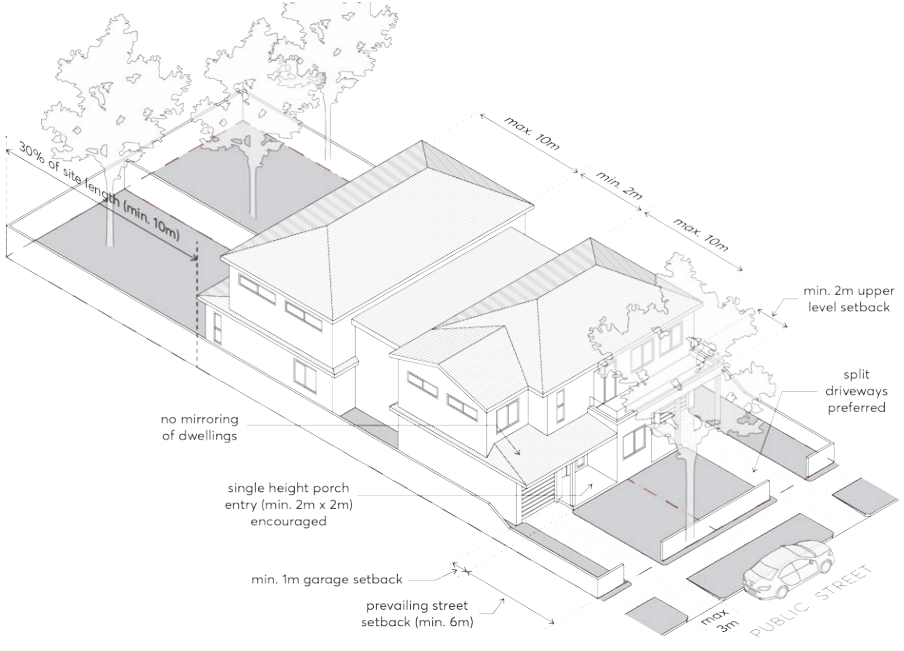
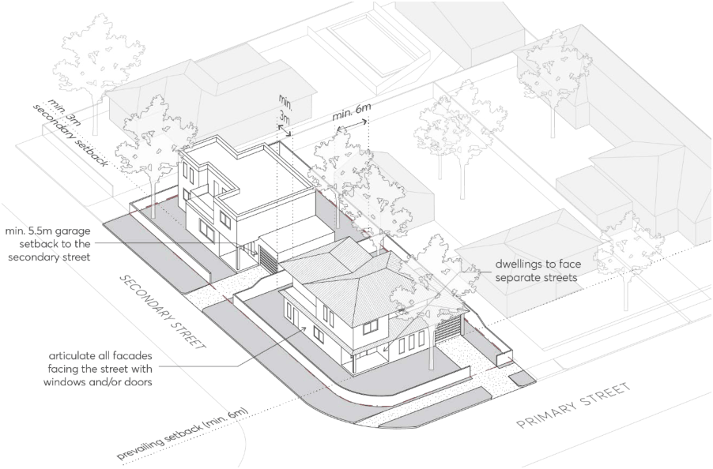

#### 3.3.2.6 INTERNAL AMENITY

Objectives

O.01 Provide habitable rooms that are of a height and size that is functional and provides a high standard of amenity for occupants.

Controls

C.01 The minimum floor to ceiling height is 2.7 metres on all storeys, excluding attics. Refer to Section

3.2.3 – Attic Design of this DCP for detailed attic controls.

C.02 Master bedrooms are to have a minimum area of 10m², and all other bedrooms are to be a minimum of 9m² (excluding wardrobe space).

C.03 Living rooms or combined living-dining spaces are to have a minimum internal width of 5 metres.

DWELLING HOUSES, SECONDARY DWELLINGS AND DUAL OCCUPANCIES

C.04 Refer to Section 3.2.1 of this DCP for solar access and cross ventilation requirements, and Section 3.2.2 of this DCP for visual and acoustic privacy requirements.

> [Picture on page 28: a picture, saved as a picture (images/part-03-residential-development-page-28-4.gif, 150 dpi).]

Figure 3.3.2.6.1 – Dual Occupancy Development

DWELLING HOUSES, SECONDARY DWELLINGS AND DUAL OCCUPANCIES

> [Picture on page 29: a picture, saved as a picture (images/part-03-residential-development-page-29-2.gif, 150 dpi).]

Figure 3.3.2.6.2 – Dual Occupancy - Corner Lot

DWELLING HOUSES, SECONDARY DWELLINGS AND DUAL OCCUPANCIES

#### KEY DEVELOPMENT STANDARDS FOR SECONDARY DWELLINGS

All controls in Section 3.3.3 – Key Development Standards for Secondary Dwellings must be read in conjunction with Part 3 – Residential Development, Section 3.2 – General Residential Controls, Part 2 – Design in Context, Part 5 – Environmental Management and Part 6 – Traffic and Transport of this DCP.
