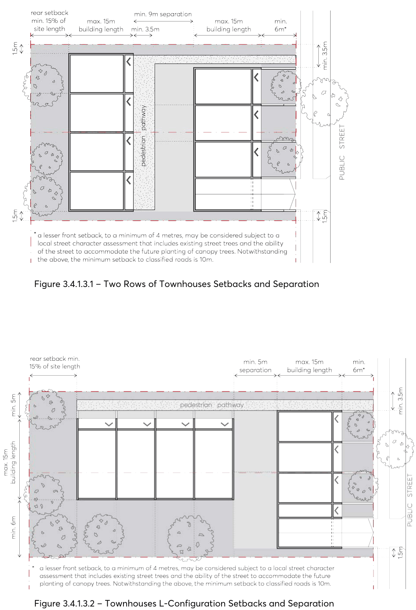
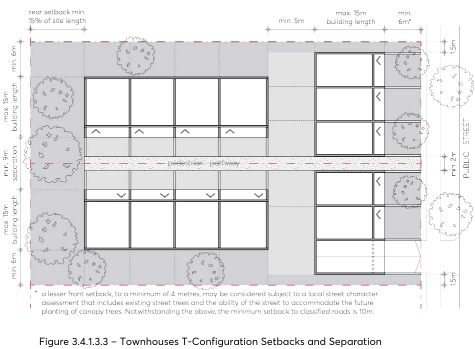

#### 3.4.1.3 BUILDING SEPARATION

Objectives

O.01 Provide adequate privacy, access to light, air and outlook for the occupants of the proposed development, neighbouring properties and future buildings.

O.02 Ensure development does not prejudice the redevelopment of adjoining sites in the future.

Controls

C.01 A minimum 9 metres separation must be provided on site between dwellings where habitable rooms face habitable rooms, as per Figure 3.4.1.3.1 to Figure 3.4.1.3.3.

C.02 A minimum of 3.5 metres separation must be provided between the rear fence of one row of townhouses to the front façade of the neighbouring row, as per Figure 3.4.1.3.1.

C.03 A minimum 5 metres separation must be provided on site where sides of dwellings are perpendicular to the principal private open space of another dwelling, as per Figure 3.4.1.3.2 and Figure 3.4.1.3.3.

C.04 Separation must be measured to the outside face of the building including balconies.

> [Picture on page 37: a picture, saved as a picture (images/part-03-residential-development-page-37-1.gif, 150 dpi).]

Figure 3.4.1.3.1 – Two Rows of Townhouses Setbacks and Separation

Figure 3.4.1.3.2 – Townhouses L-Configuration Setbacks and Separation

> [Picture on page 38: a picture, saved as a picture (images/part-03-residential-development-page-38-1.gif, 150 dpi).]

Figure 3.4.1.3.3 – Townhouses T-Configuration Setbacks and Separation
