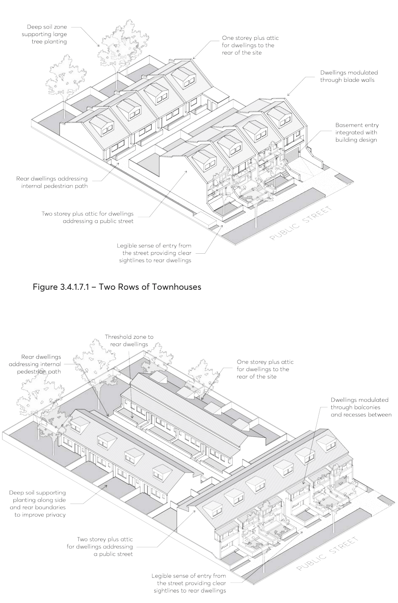

#### 3.4.1.7 INTERNAL AMENITY

Objectives

O.01 Provide habitable rooms that are of a height and size that is functional and provides a high standard of amenity for occupants.

Controls

C.01 Each dwelling addressing a public street or rear boundary must have a minimum internal width of 5 metres, measured from the internal face of external walls.

C.02 Each dwelling addressing side boundaries must have a minimum internal width of 6 metres, measured from the internal face of external walls.

C.03 The maximum length of dwelling is 15 metres. Townhouses at the end of a row may provide windows on side walls to articulate this facade provided the location of windows does not compromise visual and acoustic privacy requirements (refer to Section 3.2.2 of this DCP).

C.04 The minimum floor to ceiling height is 2.7 metres on all storeys, excluding attics. Refer to Section

3.2.3 of this DCP for detailed attic controls.

C.05 The depth of any habitable room should not exceed 8 metres from a source of daylight. C.06 In addition to storage in kitchens, bathrooms and bedrooms, all dwellings are to provide a secure storage space of at least 10 cubic metres. This may be located in the basement.

C.07 Refer to Section 3.2.1 of this DCP for solar access and cross ventilation requirements, and Section 3.2.2 of this DCP for visual and acoustic privacy requirements.

> [Picture on page 42: a picture, saved as a picture (images/part-03-residential-development-page-42-1.gif, 150 dpi).]

Figure 3.4.1.7.1 – Two Rows of Townhouses

Figure 3.4.1.7.2 – T-configuration Townhouses

#### KEY DEVELOPMENT STANDARDS FOR TERRACES

The repetitious form of terrace rows contributes significantly to the streetscape character; their strong visual presence is generated by the rhythm of equidistant vertical and horizontal elements. Terrace houses are distinct from other forms of multi-dwelling housing as direct street address is provided to all dwellings. This lends this development type to have better potential for future Torrens Title subdivision.

Areas characterised by shallow lots, or supported by rear lane access, are often more suitable for terrace housing. Terrace housing may also be utilised along sloping frontages by stepping along the street as a method for negotiating complex topographical conditions.

All controls in Section 3.4.2 – Key Development Standards for Terraces must be read in conjunction with Part 3 – Residential Development, Section 3.2 – General Residential Controls, Part 2 – Design in Context, Part 5 – Environmental Management and Part 6 – Traffic and Transport of this DCP.
