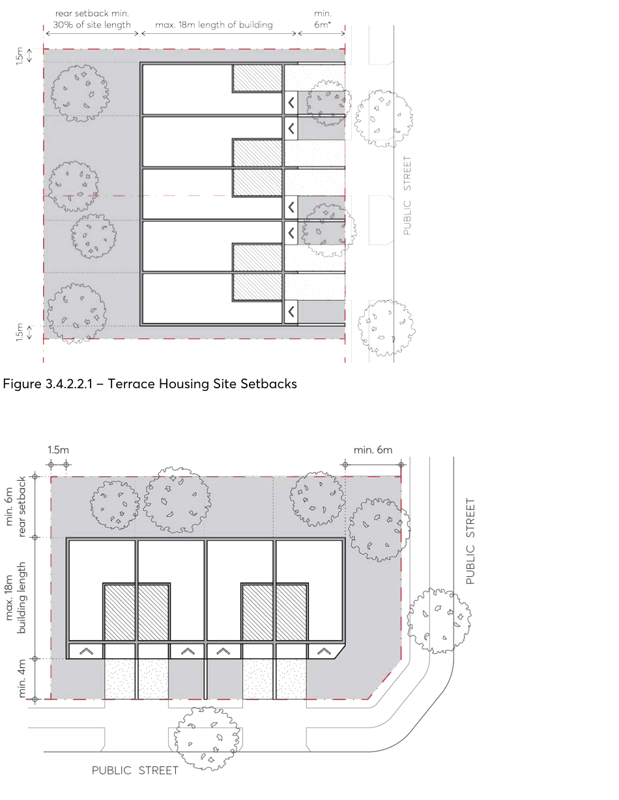
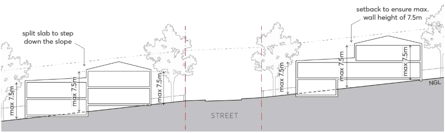

#### 3.4.2.2 PRELIMINARY BUILDING ENVELOPE

Objectives

O.01 Ensure development contributes to a visual cohesiveness along the streetscape and identifiable uniformity in bulk, scale, setbacks, and height.

O.02 Provide space in residential areas for landscape amenity that also contributes to the public domain.

O.03 Provide adequate separation between buildings and protect adjoining buildings from overlooking and loss of amenity.

O.04 Ensure new development relates to the surrounding setback patterns. O.05 Ensure that built form setbacks enable a healthy environment for onsite large canopy tree planting and street trees.

Controls

Building Height

C.01 The maximum building height is to be consistent with the Parramatta LEP 2023 Height of Buildings Map.

C.02 Notwithstanding the above, terrace housing shall be a maximum of 2-storeys, with attic rooms permitted (see Section 3.2.3 – Attic Design in this DCP).

C.03 Any part of a basement or sub-floor area that projects greater than 1m above natural ground level comprises a storey.

C.04 The ground floor level (finished) of any building must not exceed 500mm above or below natural ground level.

Street Setback

C.05 A minimum front setback of 6 metres is required however, a lesser front setback, to a minimum of 4 metres may be considered subject to a local street character assessment that includes existing street trees and the ability of the street to accommodate the future planting of canopy trees.

C.06 On corner lots, the secondary street setback must be a minimum of 4 metres. C.07 Where terraces are located on a laneway, buildings must be setback a minimum of 2 metres from the boundary.

C.08 Notwithstanding the above, the minimum setback to state and regional roads is 10 metres. C.09 Street setbacks must be measured perpendicular to the boundary and extending to the outer faces of the building including balconies, sunscreens and the like.

Side Setbacks

C.10 A minimum side setback of 1.5 metres must be provided, as per Figure 3.4.2.2.1 and Figure 3.4.2.2.2.

C.11 Driveways must be set back a minimum of 1 metre from side boundaries to allow for a landscape buffer between properties.

Rear Setback

C.12 The rear setback must be equal to 30% of the site length, as measured perpendicular to the centre of the rear boundary as per Figure 3.4.2.2.1.

C.13 On corner sites, the rear setback must be a minimum 6 metres, as measured perpendicular to the boundary proposed to support private open space as per Figure 3.4.2.2.2.

> [Picture on page 45: a picture, saved as a picture (images/part-03-residential-development-page-45-1.gif, 150 dpi).]

Figure 3.4.2.2.1 – Terrace Housing Site Setbacks

Figure 3.4.2.2.2 – Terrace Housing Corner Site Setbacks

Objectives

O.01 Respond to both the existing and expected future character of medium density development zones.

O.02 Ensure new development complements and enhances the neighbourhood and streetscape character, minimising proposed bulk and scale through consistent articulation, materials, and setbacks.

O.03 Deliver high-quality development with a clear sense of address from the street and visual prominence of dwelling entries in the front façade.

O.04 Improve casual surveillance by locating habitable rooms and dwelling entries along the street frontage.

O.05 Maximise opportunities for buildings to define the public domain.

Controls

C.01 All terraces must face a public street. No terrace may be located behind another dwelling on the same lot.

C.02 Terraces should be designed so that habitable rooms are orientated to overlook the street, public spaces, or communal areas.

C.03 On sites that slope along the street, each terrace module is to be stepped consistently across the site. Front fences should relate to this stepping by forming a horizontal line that remains parallel with the roofline of each dwelling.

C.04 On sloping sites, any semi-undergrounded basements structures must provide level vehicular access from the street and must not result in a three-storey appearance from the street.

C.05 Wall heights must not exceed 7.5 metres, as measured from natural ground level, as per Figure 3.4.2.3.1. On sloping sites, this may require stepping of building form or setting back upper levels.

> [Picture on page 46: a picture, saved as a picture (images/part-03-residential-development-page-46-24.gif, 150 dpi).]

Figure 3.4.2.3.1 – Terrace housing – sloping sites and maximum wall height

C.06 Terraces must be clearly and consistently modulated through the use of blade walls or building recesses between balconies to create a sense of continuity and rhythm to the streetscape, as per Figure 3.4.2.6.1.
