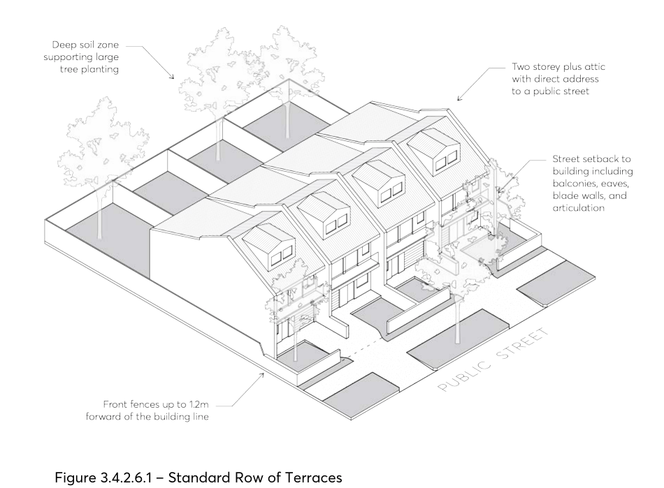

#### 3.4.2.6 INTERNAL AMENITY

Objectives

O.01 Provide habitable rooms that are of a height and size that is functional and provides a high standard of amenity for occupants.

Controls

C.01 Each dwelling addressing a public street or rear boundary must have a minimum internal width of 5 metres, measured from the internal face of external walls.

C.02 The maximum length of dwelling is 18 metres. Terraces at the end of a row may provide windows on side walls to articulate this facade.

C.03 The minimum floor to ceiling height is 2.7 metres on all storeys, excluding attics. Refer to Section

3.2.3 of this DCP for detailed attic controls.

C.04 In addition to storage in kitchens, bathrooms and bedrooms, all dwellings are to provide a secure storage space of at least 10 cubic metres.

C.05 Refer to Section 3.2.1 of this DCP for solar access and cross ventilation requirements, and Section 3.2.2 of this DCP for visual and acoustic privacy requirements.

> [Picture on page 49: a picture, saved as a picture (images/part-03-residential-development-page-49-1.gif, 150 dpi).]

Figure 3.4.2.6.1 – Standard Row of Terraces

#### KEY DEVELOPMENT STANDARDS FOR MANOR HOUSES

Manor houses are single buildings comprising of three or four dwellings on one lot, where each dwelling is attached to another by a common wall or floor and at least one dwelling is located above another.

Manor houses are a unique medium-density housing typology as they can often be delivered without lot amalgamation or basement carparking, though benefit from rear lane access or corner locations. They also offer a suitable medium-density response to sloping sites, as their smaller footprint is able to appropriately negotiate the topography.

Manor houses should be perceived as a single house from the street, built to a similar scale and character as surrounding residential homes, but are typically strata subdivided with common areas for circulation, parking, and shared gardens.

All controls contained in Section 3.4.3 – Key Development Standards for Manor Houses must be read in conjunction with Part 3 – Residential Development, Section 3.2 – General Residential Controls, Part 2 – Design in Context, Part 5 – Environmental Management and Part 6 – Traffic and Transport of this DCP.
