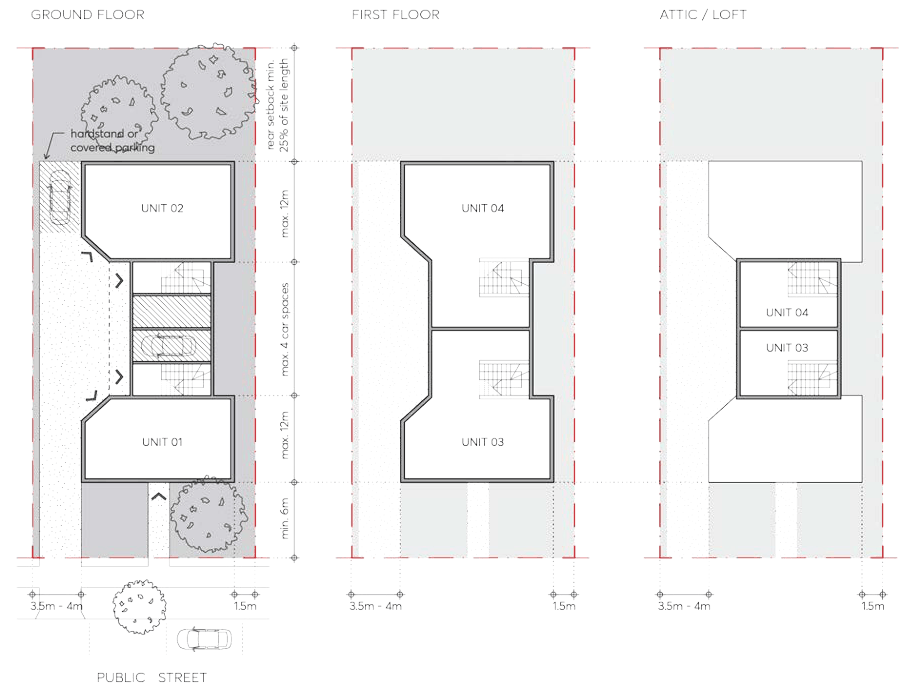
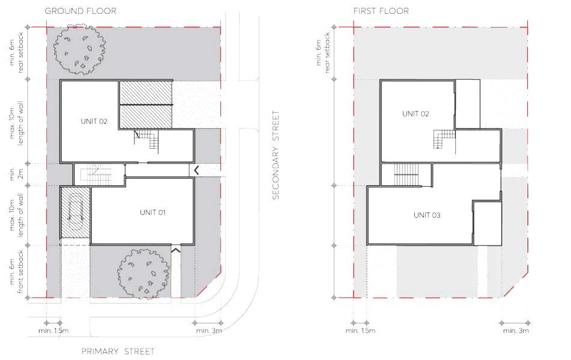

#### 3.4.3.1 MINIMUM SITE FRONTAGE AND LOT SIZE

Objectives

O.01 Ensure sites are of sufficient size to achieve:

a) the necessary standard of amenity in relation to privacy, solar access, private open space,

b) a sense of street address, and

c) safe and efficient pedestrian and vehicular access.

Controls

C.01 A development lot must be a minimum of 600m², as per the Parramatta LEP 2023. C.02 A development lot must have a minimum site frontage width of 15 metres as measured along the front boundary line.

C.03 A corner lot must have a minimum frontage width of 15 metres for the shortest street frontage. C.04 Where a site has the minimum frontage width or more, it must nonetheless be demonstrated that the objectives O.01 can be satisfied.

Objectives

O.01 Ensure development contributes to a visual cohesiveness along the streetscape and identifiable uniformity in bulk, scale, setbacks and height.

O.02 Provide space in residential areas for landscape amenity that also contributes to the public domain.

O.03 Provide adequate separation between buildings and protect adjoining buildings from overlooking and loss of amenity.

O.04 Ensure that built form setbacks enable a healthy environment for onsite large canopy tree planting and street trees.

Controls

Building Height

C.01 The maximum building height is to be consistent with the Parramatta LEP 2023 Height of Buildings Map.

C.02 Notwithstanding the above, manor houses shall be a maximum of 2-storeys, excluding any basement. Attics or loft spaces may be permitted where contained within the roof form. See Section 3.5.3 – Attic Design of this DCP and Figure 3.4.3.7.1.

C.03 Any part of a basement or sub-floor area that projects greater than 1m above natural ground level comprises a storey.

C.04 The ground floor level (finished) of any building must not exceed 500mm above or below natural ground level.

Street Setback

C.05 Buildings must be setback a minimum of 6 metres from the street boundary, as per Figure

3.4.3.2.1 and Figure 3.4.3.2.2, as measured perpendicular to the boundary and extending to the outer faces of the building including balconies, sunscreens, and the like.

C.06 On corner lots, the secondary street setback must be a minimum of 3 metres. C.07 Notwithstanding the above, the minimum setback to state and regional roads is 10 metres. Side Setbacks

C.08 A minimum side setback of 1.5 metres must be provided, as per Figure 3.4.3.2.1 and Figure 3.4.3.2.2.

C.09 Driveways must be set back a minimum of 1 metre from side boundaries to allow for a landscape buffer.

C.10 The maximum length of wall along the side boundary is 12 metres. A minimum recess (measured from the face of the external wall) of 1.5 metres (depth) by 2 metres (length) is required to all storeys after 12 metres, as per Figure 3.4.3.2.1 and Figure 3.4.3.2.2.

Rear Setback

C.11 The rear setback must be equal to 25% of the site length, measured perpendicular to the centre of the rear boundary, as per Figure 3.4.3.2.1.

C.12 On corner sites, the rear setback must be a minimum 6 metres, as measured perpendicular to the boundary proposed to support private open space as per Figure 3.4.3.2.2.

> [Picture on page 52: a picture, saved as a picture (images/part-03-residential-development-page-52-5.gif, 150 dpi).]

Figure 3.4.3.2.1 – Site setbacks for manor houses with at grade car parking

> [Picture on page 53: a picture, saved as a picture (images/part-03-residential-development-page-53-1.gif, 150 dpi).]

Figure 3.4.3.2.2 – Site setbacks for manor houses on a corner lot
