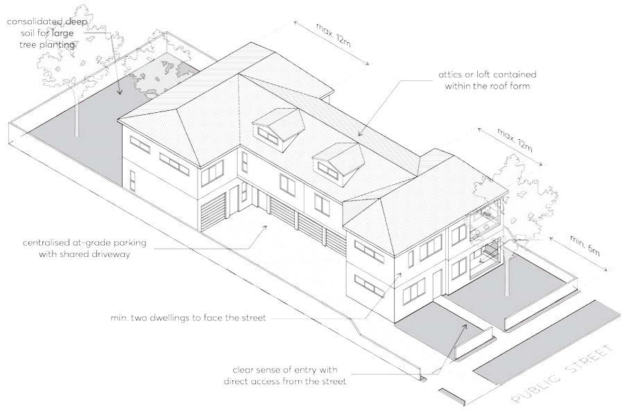
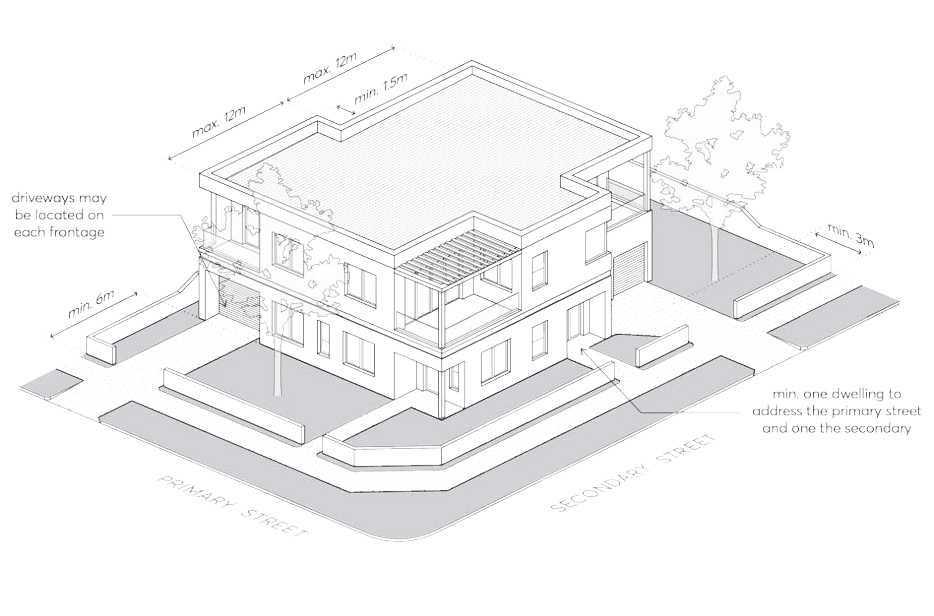

#### 3.4.3.7 INTERNAL AMENITY

Objectives

O.01 Provide habitable rooms that are of a height and size that is functional and provides a high standard of amenity for occupants.

Controls

C.01 Dwellings are to be consistent with the apartment size and layout requirements of the Apartment Design Guide published by NSW Department of Planning and Environment.

C.02 The minimum floor to ceiling height is 2.7 metres on all storeys. C.03 The maximum depth of open plan layouts that combine living, dining and kitchen spaces must be 8 metres from a window.

C.04 In addition to storage in kitchens, bathrooms and bedrooms, the following is required:

a) 1-bedroom units/studios must provide 6 cubic metres of storage with a minimum dimension of 500mm.

b) 2-bedroom units must provide 8 cubic metres of storage with a minimum dimension of 500mm.

c) 3 or more-bedroom units must provide 10 cubic metres of storage with a minimum dimension of 500mm.

C.05 Refer to Section 3.2.1 of this DCP for solar access and cross ventilation requirements, and Section 3.2.2 of this DCP for visual and acoustic privacy requirements.

> [Picture on page 57: a picture, saved as a picture (images/part-03-residential-development-page-57-7.gif, 150 dpi).]

Figure 3.4.3.7.1  – Manor Home with at Grade Parking

> [Picture on page 58: a picture, saved as a picture (images/part-03-residential-development-page-58-1.gif, 150 dpi).]

Figure 3.4.3.7.2 – Manor Home Corner Lot

APARTMENT BUILDINGS
