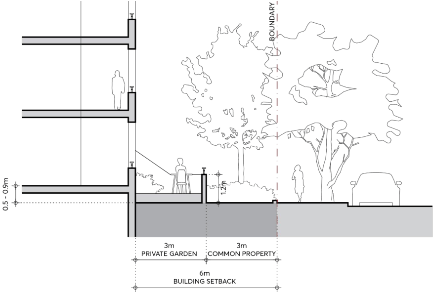

#### 3.5.1.2 PRELIMINARY BUILDING ENVELOPE

Objectives

O.01 Ensure development contributes to the visual cohesiveness of the streetscape with uniform bulk, scale, setbacks, and street wall height.

APARTMENT BUILDINGS

O.02 Provide adequate separation between buildings and protect adjoining buildings from overlooking and loss of amenity.

O.03 Provide space in residential areas for landscape amenity that also contributes to the public domain.

O.04 Contribute to the privacy of ground floor apartments along streets with landscape area and/or private open space.

O.05 Ensure that built form setbacks enable a healthy environment for onsite large canopy tree planting and street trees.

Controls

Building Height

C.01 The maximum building height must be consistent with the Parramatta LEP 2023 Height of Buildings Map and correspond in storeys as follows:

| Metres (as per the LEP) | Maximum number of storeys |
|---|---|
| 11 m | 3 storeys |
| 14 m | 4 storeys |
| 17 m | 5 storeys |
| 20 m | 6 storeys |
| 23 m | 7 storeys |
| 26 m | 8 storeys |

C.02 Any part of a basement or sub-floor area that projects greater than 1 metre above natural ground level comprises a storey.

Street Setback

C.03 Buildings must be set back a minimum of 6 metres from the street boundary and include a minimum 3m setback for common landscape area, as per Figure 3.5.1.2.1.

C.04 Buildings must be set back a minimum of 3 metres from the secondary street or laneway frontage to support an adequate threshold to ground floor apartments and boundary landscaping.

C.05 For sites that are zoned MU1 Mixed Use and are not required to have an active ground floor, an analysis of existing and likely future context must be submitted to determine the most appropriate ground floor uses, setbacks and built form at the street.

C.06 Notwithstanding the above, the minimum setback to state and regional roads is 10 metres. C.07 A minimum 3 metre upper-level setback to the street wall is to be provided where:

a) there is a need to respond to adjacent buildings of a lower-scale;

b) adjacent buildings include upper-level setbacks; and

c) new development is adjacent to a heritage item to reduce visual impact and to reflect the scale of the heritage item.

APARTMENT BUILDINGS

C.08 The street wall height of apartment buildings must generally be consistent with the predominant street wall height in storeys of adjacent buildings. An analysis of existing and likely future context must be submitted to determine the most appropriate street wall height and upper-level setback.

C.09 Street setbacks must be measured perpendicular to the boundary, extending to the outer faces of the building including balconies, sunscreens, and the like.

> [Picture on page 62: a picture, saved as a picture (images/part-03-residential-development-page-62-8.gif, 150 dpi).]

Figure 3.5.1.2.1 – Front setback to residential flat buildings

Side and Rear Setbacks

C.10 Side and rear setback are to be provided to ensure compliance with the residential privacy and separation requirements of the Apartment Design Guide.

C.11 Where a site adjoining the subject site does not contain an apartment building at the time the development application is being assessed, the separation required must be that specified for habitable rooms and balconies in Section 3F of the Apartment Design Guide.

C.12 The required separation distance must be equally apportioned between adjacent sites to determine the required side and rear boundary setbacks (for example, if two 4-storey apartment buildings have opposing balconies fronting a side boundary, then the separation must be 12m overall and be shared equally with a 6m side setback for both properties.).
