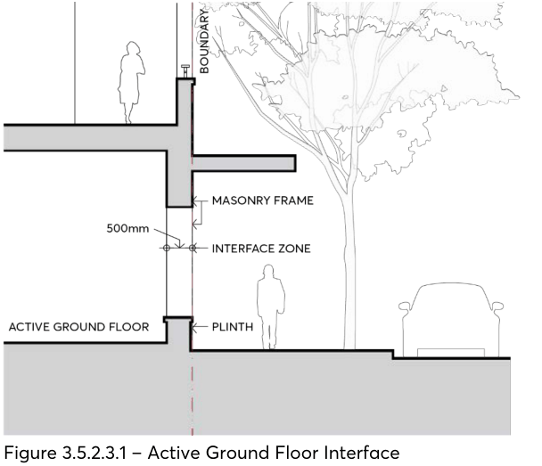

#### 3.5.2.3 STREETSCAPE AND BUILDING ADDRESS

Objectives

O.01 Maximise opportunities for buildings to define and activate the public domain. O.02 Encourage attractive street frontages and improve pedestrian amenity and safety.

Controls

C.01 In the E1 and MU1 zones, the ground floor frontage is to provide for non-residential uses with at-grade pedestrian access. Ground floor apartments are not permitted on primary street frontages.

C.02 Where buildings align to the front boundary, continuous awnings are to be provided, with new awnings the same height as, or the average of, the two adjacent awnings. Council may omit this requirement where an awning would otherwise affect street trees or heritage items.

C.03 Development should provide multiple building entries from the street. Each building entry and lift/stair core must not serve more than 25 dwelling per core for buildings up to 8 storeys.

C.04 Building entries and lobbies to residential apartments are to be separated from commercial entrances to provide secure and identifiable addresses.

C.05 Ground floor retail and business shopfronts are to involve minimal use of solid walls. Where sites are amalgamated, frontages are to be divided vertically into discrete sections to maintain a fine grain, human scaled streetscape.

C.06 An active ground floor frontage must be considered in detail and the following must be incorporated into its design, as per Figure 3.5.2.3.1:

a) A nominal 500mm interface zone at the frontage must be included to create interest and variety in the streetscape, to be used for setbacks for entries, openings of windows, seating ledges, benches, and general articulation.

b) The façade must have a high level of expressed detail and tactile material quality.

c) The base of the façade must achieve a well resolved meeting with the footpath that takes account of any slope. A horizontal plinth, integrated in the design, must be incorporated at the base of glazing to the footpath.

d) A clear path of travel must be provided in the public domain as defined in the Parramatta Public Domain Guidelines.

APARTMENT BUILDINGS

e) Legible entrances must be formed in the frontage.

f) Fire escapes and service doors must be seamlessly incorporated into the façade.

g) All required services must be integrated into the design of the ground floor frontage.

h) Parking security grilles or doors must be aligned to the building edge as closely as safety constraints permit.

i) Security doors or grilles must be designed to be fitted internally behind the shopfront, fully retractable and a minimum 50% transparent when closed.

> [Picture on page 70: a picture, saved as a picture (images/part-03-residential-development-page-70-9.gif, 150 dpi).]

Figure 3.5.2.3.1 – Active Ground Floor Interface

C.07 Development proposing outdoor dining is to comply with Council’s Outdoor Dining Guidelines. C.08 Residential dwellings may be located on the ground floor at the rear of larger properties where building separation and privacy, and private open space can be provided in accordance with the Apartment Design Guide.

C.09 The principal entry to dwellings should not be provided off rear lanes except where:

a) the lane is well lit,

b) there is some natural surveillance of the lane from adjoining dwellings,

c) the lane provides access to other dwellings, and

d) the land is not regularly used by service vehicles.

C.10 Site planning and the internal building layout of developments should minimise the need for pedestrian pathways that are segregated from street. Where such pathways are necessary, casual surveillance should be encouraged, they should be well lit at night and be clear of potential hiding or entrapment spots.

APARTMENT BUILDINGS

Objectives

O.01 Provide deep soil areas that support trees and landscaping that will mature and contribute to the amenity of the site and locality.

O.02 Design low maintenance communal open space areas for residents that facilitate opportunities for recreational and social activities, passive amenity, landscaping, and deep soil planting.

O.03 Provide communal open space that is proportionate with the height and length of development.

O.04 Ensure private open spaces are designed to provide residents with quality, usable private outdoor living areas for recreational and outdoor activities.

Controls

C.01 Private and communal open space must be provided to meet the objectives of the Apartment Design Guide.

C.02 The rear setback area must be provided as deep soil if:

a) part of the residential component is proposed at ground, or

b) the site adjoins a residential development or residential zone. Otherwise, deep soil may be provided on merit.
