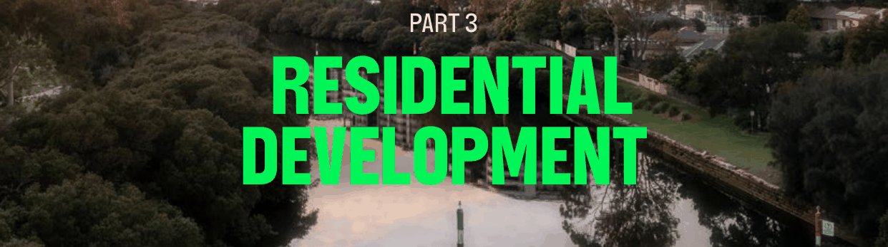

# Parramatta Development Control Plan 2023 - Part 3 Residential Development

> This chapter is split into 49 section file(s), one per numbered heading, in the order they appear in the PDF.

Source PDF: [dcp-part-3-residential-development.pdf](dcp-part-3-residential-development.pdf)

> [Picture on page 1: a picture, saved as a picture (images/part-03-residential-development-page-1-1.gif, 150 dpi).]

## PART 3 RESIDENTIAL

### DEVELOPMENT

The City of Parramatta (the City) is planning for strong housing growth, which must balance the need for housing and economic growth with the need to protect and enhance housing diversity, heritage, local character and the City’s environmental assets. Successful residential development champions quality design outcomes that are compatible with the surrounding context, creating a cohesive identity to the City’s residential areas.

The following Sections contained within this Part of the DCP have been organised by residential typology to provide type specific guidance to the various forms of housing possible in the City.

All controls contained in this Part must be read in conjunction with Part 2 – Design in Context, Part 5 – Environmental Management, and Part 6 – Traffic and Parking. Detailed controls that guide outcomes for sites within a heritage conservation area or containing a heritage item, refer to Part 7

– Heritage and Archaeology. For specific controls relating to residential development within an identified Growth Precinct or Strategic Centre, refer to Part 8 – Centres, Precincts, Special Character Areas and Specific Sites of this DCP.

TOC - 1

### CONTENTS

| 3.1 | HOUSING DIVERSITY AND CHOICE .............................................................................................. 1 DWELLING MIX ................................................................................................................................. 1 ACCESSIBLE AND ADAPTABLE HOUSING ............................................................................... 2 |
|---|---|
| 3.2 | GENERAL RESIDENTIAL CONTROLS ........................................................................................... 4 SOLAR ACCESS AND CROSS VENTILATION ........................................................................... 4 VISUAL AND ACOUSTIC PRIVACY .............................................................................................. 7 ATTIC DESIGN ................................................................................................................................... 8 SWIMMING POOLS .......................................................................................................................... 9 OUTBUILDINGS ............................................................................................................................... 10 |
| 3.3 | DWELLING HOUSES, SECONDARY DWELLINGS AND DUAL OCCUPANCIES ............... 11 KEY DEVELOPMENT STANDARDS FOR DWELLING HOUSES ........................................... 11 KEY DEVELOPMENT STANDARDS FOR DUAL OCCUPANCIES ....................................... 17 KEY DEVELOPMENT STANDARDS FOR SECONDARY DWELLINGS .............................. 27 |
| 3.4 | MULTI-DWELLING HOUSING....................................................................................................... 30 KEY DEVELOPMENT STANDARDS FOR TOWNHOUSES ................................................... 31 KEY DEVELOPMENT STANDARDS FOR TERRACES ........................................................... 40 KEY DEVELOPMENT STANDARDS FOR MANOR HOUSES ................................................ 47 |
| 3.5 | APARTMENT BUILDINGS ............................................................................................................... 56 KEY DEVELOPMENT STANDARDS FOR APARTMENT BUILDINGS ................................. 57 KEY DEVELOPMENT STANDARDS FOR SHOP TOP HOUSING AND MIXED-USE DEVELOPMENT ............................................................................................................................................ 64 |
| 3.6 | RESIDENTIAL SUBDIVISION .......................................................................................................... 71 SITE CONSOLIDATION AND DEVELOPMENT ON ISOLATED SITES .............................. 72 |
| 3.7 | BOARDING HOUSES ....................................................................................................................... 74 |

TOC - 2

HOUSING DIVERSITY AND CHOICE

<!-- sections -->
## Sections

1. [3.1 HOUSING DIVERSITY AND CHOICE](01-3-1-housing-diversity-and-choice.md)
2. [3.2 GENERAL RESIDENTIAL CONTROLS](02-3-2-general-residential-controls.md)
3. [3.3 DWELLING HOUSES, SECONDARY DWELLINGS AND](03-3-3-dwelling-houses-secondary-dwellings-and.md)
4. [3.3.1.1 MINIMUM SITE FRONTAGE](04-3-3-1-1-minimum-site-frontage.md)
5. [3.3.1.2 PRELIMINARY BUILDING ENVELOPE](05-3-3-1-2-preliminary-building-envelope.md)
6. [3.3.1.3 STREETSCAPE AND BUILDING ADDRESS](06-3-3-1-3-streetscape-and-building-address.md)
7. [3.3.1.4 OPEN SPACE AND LANDSCAPE](07-3-3-1-4-open-space-and-landscape.md)
8. [3.3.1.5 PARKING DESIGN AND VEHICULAR ACCESS](08-3-3-1-5-parking-design-and-vehicular-access.md)
9. [3.3.1.6 INTERNAL AMENITY](09-3-3-1-6-internal-amenity.md)
10. [3.3.2.1 MINIMUM SITE FRONTAGE AND SITE AREA](10-3-3-2-1-minimum-site-frontage-and-site-area.md)
11. [3.3.2.2 PRELIMINARY BUILDING ENVELOPE](11-3-3-2-2-preliminary-building-envelope.md)
12. [3.3.2.3 STREETSCAPE AND BUILDING ADDRESS](12-3-3-2-3-streetscape-and-building-address.md)
13. [3.3.2.4 OPEN SPACE AND LANDSCAPE](13-3-3-2-4-open-space-and-landscape.md)
14. [3.3.2.5 PARKING DESIGN AND VEHICULAR ACCESS](14-3-3-2-5-parking-design-and-vehicular-access.md)
15. [3.3.2.6 INTERNAL AMENITY](15-3-3-2-6-internal-amenity.md)
16. [3.3.3.1 MINIMUM SITE FRONTAGE AND LOT SIZE](16-3-3-3-1-minimum-site-frontage-and-lot-size.md)
17. [3.3.3.2 PRELIMINARY BUILDING ENVELOPE](17-3-3-3-2-preliminary-building-envelope.md)
18. [3.3.3.3 STREETSCAPE AND BUILDING ADDRESS](18-3-3-3-3-streetscape-and-building-address.md)
19. [3.3.3.4 OPEN SPACE AND LANDSCAPE](19-3-3-3-4-open-space-and-landscape.md)
20. [3.4 MULTI-DWELLING HOUSING](20-3-4-multi-dwelling-housing.md)
21. [3.4.1.1 MINIMUM SITE FRONTAGE](21-3-4-1-1-minimum-site-frontage.md)
22. [3.4.1.3 BUILDING SEPARATION](22-3-4-1-3-building-separation.md)
23. [3.4.1.4 STREETSCAPE AND BUILDING ADDRESS](23-3-4-1-4-streetscape-and-building-address.md)
24. [3.4.1.5 OPEN SPACE AND LANDSCAPE](24-3-4-1-5-open-space-and-landscape.md)
25. [3.4.1.6 PARKING DESIGN AND VEHICULAR ACCESS](25-3-4-1-6-parking-design-and-vehicular-access.md)
26. [3.4.1.7 INTERNAL AMENITY](26-3-4-1-7-internal-amenity.md)
27. [3.4.2.1 MINIMUM SITE FRONTAGE](27-3-4-2-1-minimum-site-frontage.md)
28. [3.4.2.2 PRELIMINARY BUILDING ENVELOPE](28-3-4-2-2-preliminary-building-envelope.md)
29. [3.4.2.4 OPEN SPACE AND LANDSCAPE](29-3-4-2-4-open-space-and-landscape.md)
30. [3.4.2.5 PARKING DESIGN AND VEHICULAR ACCESS](30-3-4-2-5-parking-design-and-vehicular-access.md)
31. [3.4.2.6 INTERNAL AMENITY](31-3-4-2-6-internal-amenity.md)
32. [3.4.3.1 MINIMUM SITE FRONTAGE AND LOT SIZE](32-3-4-3-1-minimum-site-frontage-and-lot-size.md)
33. [3.4.3.3 BUILDING SEPARATION](33-3-4-3-3-building-separation.md)
34. [3.4.3.5 OPEN SPACE AND LANDSCAPE](34-3-4-3-5-open-space-and-landscape.md)
35. [3.4.3.6 PARKING DESIGN AND VEHICULAR ACCESS](35-3-4-3-6-parking-design-and-vehicular-access.md)
36. [3.4.3.7 INTERNAL AMENITY](36-3-4-3-7-internal-amenity.md)
37. [3.5 APARTMENT BUILDINGS](37-3-5-apartment-buildings.md)
38. [3.5.1.1 MINIMUM SITE FRONTAGE](38-3-5-1-1-minimum-site-frontage.md)
39. [3.5.1.2 PRELIMINARY BUILDING ENVELOPE](39-3-5-1-2-preliminary-building-envelope.md)
40. [3.5.1.3 STREETSCAPE AND BUILDING ADDRESS](40-3-5-1-3-streetscape-and-building-address.md)
41. [3.5.1.5 PARKING DESIGN AND VEHICULAR ACCESS](41-3-5-1-5-parking-design-and-vehicular-access.md)
42. [3.5.1.6 INTERNAL AMENITY](42-3-5-1-6-internal-amenity.md)
43. [3.5.2.1 MINIMUM SITE FRONTAGE](43-3-5-2-1-minimum-site-frontage.md)
44. [3.5.2.2 PRELIMINARY BUILDING ENVELOPE](44-3-5-2-2-preliminary-building-envelope.md)
45. [3.5.2.3 STREETSCAPE AND BUILDING ADDRESS](45-3-5-2-3-streetscape-and-building-address.md)
46. [3.5.2.5 PARKING DESIGN AND VEHICULAR ACCESS](46-3-5-2-5-parking-design-and-vehicular-access.md)
47. [3.5.2.6 INTERNAL AMENITY](47-3-5-2-6-internal-amenity.md)
48. [3.6 RESIDENTIAL SUBDIVISION](48-3-6-residential-subdivision.md)
49. [3.7 BOARDING HOUSES](49-3-7-boarding-houses.md)
