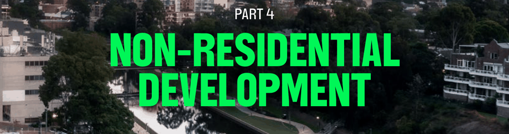

# Parramatta Development Control Plan 2023 - Part 4 Non-residential Development

> This chapter is split into 8 section file(s), one per numbered heading, in the order they appear in the PDF.

Source PDF: [dcp-part-4-non-residential-development.pdf](dcp-part-4-non-residential-development.pdf)

> [Picture on page 1: a picture, saved as a picture (images/part-04-non-residential-development-page-1-1.gif, 150 dpi).]

## PART 4 NON-RESIDENTIAL

### DEVELOPMENT

With more than 23,000 businesses that call Parramatta home (Local Strategic Planning Statement 2036), the City of Parramatta (the City) promotes diverse and active non-residential uses (where it is permissible). The City is building on its strengths as a focus of economic activity, essential services, natural assets, culture and creativity, to lead one of Australia’s fastest growing regions.

Council recognises the importance of non-residential uses to support and expand Parramatta’s economic role as the Central City of Greater Sydney. These include business and commercial development, industrial, educational establishments, and other non-residential uses that are outlined in this Section of this DCP.

This Part of this DCP applies to all non-residential types of development.

All controls contained in this Part must be read in conjunction with Part 2 – Design in Context, Part 5 – Environmental Management and Part 6 – Traffic and Parking. Detailed controls that guide outcomes for sites within a heritage conservation area or containing a heritage item, refer to Part 7 – Heritage and Archaeology. For specific controls relating to residential development within an identified Growth Precinct or Strategic Centre, refer to Part 8 of this DCP.

TOC - 1

### CONTENTS

| 4.1 | GENERAL NON-RESIDENTIAL CONTROLS ................................................................................ 1 |
|---|---|
| 4.2 | BUSINESS AND COMMERCIAL DEVELOPMENT .......................................................................3 |
| 4.3 | INDUSTRIAL DEVELOPMENT ......................................................................................................... 6 |
| 4.4 | PLACES OF PUBLIC WORSHIP ...................................................................................................... 8 |
| 4.5 | EDUCATIONAL ESTABLISHMENTS .............................................................................................. 13 |
| 4.6 | CENTRE-BASED CHILD CARE FACILITIES ................................................................................. 18 |
| 4.7 | SEX SERVICE PREMISES AND RESTRICTED PREMISES ....................................................... 23 |
| 4.8 | TELECOMMUNICATIONS FACILITIES ........................................................................................ 35 |

TOC - 2

GENERAL NON-RESIDENTIAL CONTROLS

<!-- sections -->
## Sections

1. [4.1 GENERAL NON-RESIDENTIAL CONTROLS](01-4-1-general-non-residential-controls.md)
2. [4.2 BUSINESS AND COMMERCIAL DEVELOPMENT](02-4-2-business-and-commercial-development.md)
3. [4.3 INDUSTRIAL DEVELOPMENT](03-4-3-industrial-development.md)
4. [4.4 PLACES OF PUBLIC WORSHIP](04-4-4-places-of-public-worship.md)
5. [4.5 EDUCATIONAL ESTABLISHMENTS](05-4-5-educational-establishments.md)
6. [4.6 CENTRE-BASED CHILD CARE FACILITIES](06-4-6-centre-based-child-care-facilities.md)
7. [4.7 SEX SERVICE PREMISES AND RESTRICTED PREMISES](07-4-7-sex-service-premises-and-restricted.md)
8. [4.8 TELECOMMUNICATIONS FACILITIES](08-4-8-telecommunications-facilities.md)
