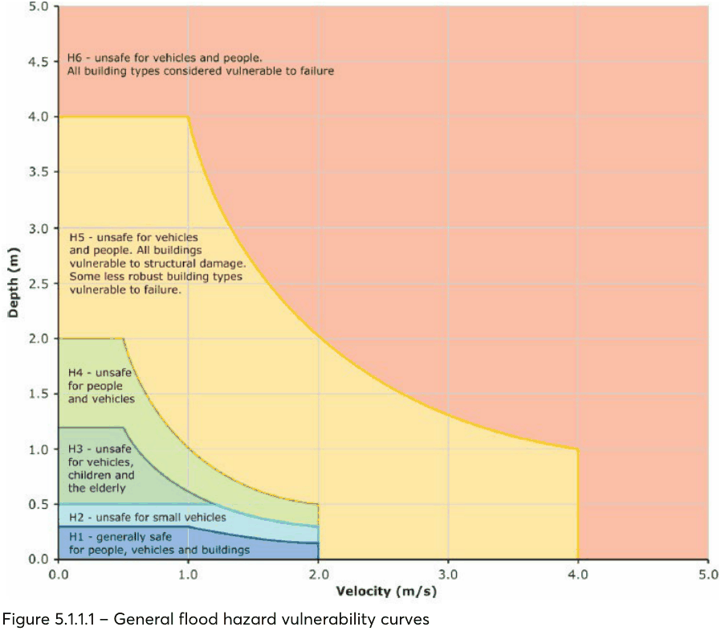

### 5.1 WATER MANAGEMENT

This Section of this DCP provides controls on critical site and environmental considerations to ensure appropriate measures are taken to address water management across the City. This includes flooding, water sensitive urban design, stormwater management, on-site detention and groundwater.

#### FLOODING

Flooding is a significant issue that affects existing property, future property, and infrastructure development in the City of Parramatta. This Section establishes Council’s development controls relating to flood prone land for the whole City. The controls in this Section are to be read in conjunction with the New South Wales Government’s Flood Policy, current Floodplain Development Manual, and Council’s Floodplain Risk Management Policy and Plan.

The criteria for determining applications for proposals potentially affected by flooding are risk-based and structured to recognise that different controls are applicable to different land uses and levels of potential flood inundation and hazard. Flood affectation can be a determinative issue in the assessment of a development which can lead to refusal. As a first step in the Development Application process, proponents are strongly advised to seek flood information for their site from Council and consult with Council Officers at a pre-lodgement stage, particularly for proposals located in the medium and high flood risk categories.

“Risk of harm” is the product of likelihood and consequence. The likelihood is usually 1% Annual Exceedance Probability (AEP) but may include rarer, more intense events up to the Probable Maximum Flood (PMF). The consequence or harm describes the impact of the flow of floodwaters on people, property, buildings, and the environment.

Hazard or ‘hydraulic hazard’ describes the behaviour of floodwaters and particularly the amount of flow, the extent, velocity and depth of that flow. This is primarily modelled for 1% AEP floods but may also be required for other floods up to the PMF, particularly in regard to shelter in place planning and for risk assessment of ‘sensitive’ and ‘critical’ uses.

The hazard categories H1-H6 briefly describe these impacts (see below) and show the relationships between floodwater velocity and depth and consequent hazard for each level. This methodology also summarises the risk of harm for each hazard level.

Such hazard, risk and safety assessments will underpin Development Application assessment by Council and must be adequately addressed in any Development Application affected by mainstream or overland flow flooding. Often more detailed examination of hazard, risk and potential harm for a specific site and its proposed development will be required. Council reiterates the need for discussion with Council at the pre-lodgement stage for sites affected by flooding.

Should there be an absence of site-specific flood controls in this DCP, flood impact will still require assessment against the flood objectives of this DCP. Should there be any inconsistency between this Section and any other part of this DCP, this Section prevails to the extent of the inconsistency.

#### FLOODPLAIN RISK MANAGEMENT

Objectives

O.01 Manage the floodplain in an economically, environmentally, and socially sustainable manner. O.02 Allow development in the floodplain that is appropriate to the flood hazard and risk at a particular location.

O.03 Ensure that development minimises the risk to life and property from flooding and its impacts. O.04 Deliver a risk-based approach to floodplain development and mitigation of potential harm based on a merit assessment consistent with the current Floodplain Development Manual.

O.05 Ensure the proponents of development and the community in general are aware of the potential flood hazard and consequent risk associated with the use and development within the floodplain.

O.06 Ensure that the proposed development does not expose existing development to unacceptable risks or impacts associated with flooding.

O.07 Require hazard, risk and safety assessments to demonstrate how risk and potential for harm to people, property, buildings, and the environment from floodwaters will be adequately mitigated.

O.08 Ensure development does not adversely increase the potential flood affectation on other development or properties, either individually or in combination with similar developments that are likely to occur within the same catchment.

O.09 Ensure development on flood prone land does not result in unreasonable impacts upon the amenity or ecology of an area.

O.10 Ensure buildings and uses are compatible with the identified flood risk. Development with a lower sensitivity to the flood hazard may be considered for location within the floodplain subject to appropriate design and siting controls provided that the potential risks and consequences that could still arise from flooding remain acceptable.

O.11 Ensure early site planning and consideration of flood conditions to achieve an integrated flood response that manages flood risk and provides optimum development design outcomes to provide adequate amenity on and off site, and interface with the public domain.

O.12 Avoid intensification of development and land use within high flood risk or floodways. O.13 Achieve adequate, safe flood conveyance and management of floodwaters while providing for the rehabilitation, conservation, embellishment, naturalisation of floodways and other flood affected lands where appropriate.

O.14 Ensure the risks associated with car park basements in flood prone areas are adequately mitigated.

O.15 Prevent any changes to landform that would adversely impact flood behaviour or the course of its natural conveyance.

Controls

C.01 Development is to be compatible with any relevant Floodplain Risk Management Plan and consistent with the current NSW Floodplain Development Manual, unless otherwise accepted by Council.

C.02 Any increased risk to life from development must be mitigated to Council’s satisfaction. C.03 The Flood Planning Level under normal circumstances shall be the higher of the 1% AEP riverine flood level or the 1% AEP overland flow flood level, as accepted by Council, plus a minimum 500mm freeboard safety factor. Council may require additional freeboard to manage risk in exceptional circumstances.

C.04 Significant filling or excavation of land below the Flood Planning Level is generally not permitted. If required by Council, development proposals must demonstrate, through detailed hydraulic modelling, that any proposed filling or excavation of land above the Flood Planning Level up to the Probable Maximum Flood (PMF) will not adversely impact flood behaviour.

C.05 Council may require proposals for raising structures to provide a report from a suitably qualified structural engineer demonstrating that the raised structure will not be at risk of failure from the forces of floodwaters.

C.06 Fencing, landscaping and public domain works are to be constructed in a manner that does not significantly affect the flow of floods.

C.07 New development is only permitted where reliable access is available for the evacuation of an area potentially affected by floods to an area free of risk from flooding. Evacuation should be consistent with any relevant flood evacuation strategy.

C.08 Council requires an applicant to make a Flood Enquiry Application where this information is available. The information supplied to an applicant via a Flood Enquiry Application will inform the applicants DA flood model where deemed necessary.

C.09 Where hydraulic flood modelling is required, flow hazard categories H1 to H6 as set out in Figure

5.1.1.1 must be identified and adequately addressed in the design of the development. Where available, Council will issue flood and hazard levels to be adopted in any hydraulic flood modelling, unless an alternative approach is agreed with Council. Flood modelling will need to account for any projected changes to flood levels or behaviour as a result of climate change over the design life of the development.

C.10 Council may require an additional overland flow study to support an application on sites where such flooding is expected to be dominant over flooding from waterways (riverine flooding). Increases in local rainfall intensity and other rainfall and flood behaviour resulting from climate change should be factored into any overland flow modelling undertaken.

C.11 Development with high sensitivity to flood risk (e.g. critical public utilities) must be sited and designed to provide reliable access and an acceptably minimal risk from flooding.

C.12 Design responses as part of flood mitigation measures associated with new and existing developments should not result in significant impacts upon the amenity of an area by way of unacceptable overshadowing of adjoining properties, privacy impacts (e.g. unsympathetic house raising) or by being incompatible with the streetscape or character of the locality (including heritage).

C.13 Development must be planned and designed to respond to both riverine (mainstream) flooding and overland flow flooding.

C.14 Development must not divert flood waters, nor interfere with floodwater storage, nor the natural function of waterways.

C.15 In general, Council will not support proposals for flood flow-through or flood storage chambers within or beneath a new building, and alternate design solutions will be required.

C.16 Sensitive Uses and Facilities’ and ‘Critical Uses and Facilities,’ as defined in Table 5.1.1.1, in general, not permitted on land subject to flooding in a PMF event.

C.17 The following ‘Sensitive Uses and facilities’ being centre-based child care and aged care facilities that occupy land subject to flooding in a PMF event, may be considered provided Council can be satisfied that:

• occupants and visitors will not be subject to significant risk of harm caused by flooding at or near the site in a PMF event.

• a Flood Emergency Response Plan is prepared, designed and implemented in perpetuity to provide adequate emergency services access and evacuation of the centre or facility.

• building access and egress does not require people to traverse hazardous floodwaters – that is Hazard Level H3 and above including any flood between the 1% AEP and the PMF.

C.18 Unless otherwise advised by Council, all development in the floodplain involving the construction of a new building or significant alterations to an existing building, and or intensification of a use must be supported by flood hazard modelling that is:

a) based on the ‘General Flood Hazard Vulnerability Curves’ in Figure 5.1.1.1 for the 1% AEP flood and the PMF.

b) is assessed in terms of the following hazard categories and risks of harm:

• H1 – generally safe for people vehicles and buildings.

• H2 – unsafe for small vehicles.

• H3 – unsafe for vehicles, children and the elderly. This includes all floodwaters greater than 0.5m depth.

• H4 – unsafe for people and vehicles.

• H5 – unsafe for vehicles and people. All buildings vulnerable to structural damage. Some less robust building types vulnerable to failure.

• H6 – unsafe for vehicles and people. All building types considered vulnerable to failure.

> [Picture on page 9: a picture, saved as a picture (images/part-05-environmental-management-page-9-1.gif, 150 dpi).]

Figure 5.1.1.1 – General flood hazard vulnerability curves

Source: Australian Disaster Resilience Guideline 7-3 Flood Hazard (AIDR 2017)

C.19 Unless otherwise advised by Council, all development in the floodplain involving the construction of a new building or significant alterations to an existing building, and or intensification of a use is to be supported by a merit-based flood hazard and flood impact risk assessment that:

a) Presents evidence-based analysis of the hazard, risk and harm to occupants and those in the surrounds and demonstrates how harmful factors will be mitigated.

b) Includes information on the following aspects as necessary, to enable Council to assess risk and potential for harm:

• 1% AEP and 5% AEP flood levels, flood extents, flow rates, depths and velocities for mainstream and overland flow floods;

• PMF levels, hazard, extent and behaviour for mainstream floods (not overland flow floods);

• modelled hydraulic hazard levels, (H1-H6), extent and behaviour for 1% AEP mainstream and overland flow floods;

• warning times and duration of flooding;

• available warning systems (if any);

• characteristics and vulnerabilities of future occupants;

• likelihood of multiple storms – and multiple flood peaks;

• ‘horizontal’ evacuation pathways including accessibility considerations;

• ‘vertical’ evacuation opportunities and shelter in place facilities above the PMF where permitted;

• emergency services access availability;

• local terrain;

• the development in context; and

• the proposed use and occupation of the development.

C.20 Basement car parks on properties within the floodplain are strongly discouraged and alternate design options should be discussed with Council at the pre-lodgement stage. Where a basement car park on a property within the floodplain is proposed, it must be demonstrated that the proposed basement car park has been protected from all flooding up to and including the PMF event. An adequate flood emergency and risk management plan must also be provided where basement car parks are proposed in the floodplain, please see Flood Warning and Emergency Response Planning section below for requirements.

C.21 Where Council allows basement car parking in flood prone land the proposal must demonstrate:

a) effective floodproofing and flood exclusion of the basement against all floods up to the PMF;

b) adequate safety for occupants of the basement and building including a flood free evacuation path (stairway or other suitable method) from the basement levels to a safe refuge above the PMF;

c) adequate safety for occupants at ground and ground floor levels of the building including a flood free evacuation path (stairway or other suitable method) from the ground floor levels to a safe refuge above the PMF; and

d) consistency with other Council objectives (such as traffic management).

C.22 Demonstrate the appropriateness of a basement car park within a flood prone area, the following details must be included as a minimum in the Development Application:

a) Demonstration that high hazard floodwaters (H3 or greater) will not occur in a 1% AEP event in the area adjacent to the driveway.

b) The basement must be protected from the ingress of floodwater by passive measures at least up to the flood planning level. These measures are likely to include provision of a driveway crest at or above the flood planning level with associated wing/or bund walls to this level to prevent floodwaters flowing into the basement.

c) The basement must be protected from the ingress of floodwater via the driveway up to the Probable Maximum Flood level. These measures are likely to include provision of a self-triggering and self-powered flood gate at or near the driveway crest that reaches the level of the PMF, together with corresponding wing wall bunds etc. to the same PMF level.

d) The basement must be protected from the ingress of floodwater via stairwells and other openings up to the Probable Maximum Flood level. These measures are likely to include a

combination of a self-closing flood doors, flood gates and bund walls. Flood doors may also be fire doors.

e) Provision of flood-free escape stairs from the basement up to a place of refuge within the building above the PMF level with adequate facilities for users during and after a flood.

f) Provision of adequate car parking for the disabled and an escape path that can be followed to safety.

g) Submission of a comprehensive Flood Emergency Response Plan incorporating all of the above.

C.23 The Building Management System and Plan for the development with a proposed basement car park within a flood prone area must include all necessary measures to maintain, test and operate the flood protection devices including flood gates, doors and barriers, flood sensors, flood refuges and FERP.

Floodplain Development Matrix C.24 All proposals are to have regard to the relevant controls applicable to the proposed land use category and flood risk category, as specified in Table 5.1.1.1. The procedure to determine which controls apply to proposed development involves: Step 1: Identify the land use category of the development from Table 5.1.1.1; Step 2: Determine which flood risk categories apply to the land (refer to Catchment Management Unit of Council for the relevant flood risk mapping or carry out flood modelling as required by Council) and then refer to Table 5.1.1.2. Step 3: Apply the relevant controls outlined in the planning matrix at Table 5.1.1.3 as applicable to the floodplain and land use category. Additional guidelines relating to flood risk management and flood prone land are contained in Council’s Local Floodplain Risk Management Policy.

Table 5.1.1.1 – Land Use Category Definitions

| Land Use Categories | Identifies Land Uses |
|---|---|
| Sensitive uses and facilities | • Community facilities or Public administration buildings which may provide an important contribution to the notification and evacuation of the community during flood events; • Early education and care facilities; • Hospitals; • Residential care facilities; • Seniors housing; • Educational establishments, • Emergency services facilities. |
| Critical uses and facilities | • Hazardous industries; • Heavy industrial storage establishments; • Offensive industries; • Public utility undertakings which may cause pollution of waterways during flooding, are essential to evacuation during periods of flood or if affected during flood events would unreasonably affect the ability of the community to return to normal activities after flood events; • Telecommunication facilities; • Waste management facilities. |
| Residential | • Attached dwellings; • Dual occupancies; • Multi dwelling housing; • Backpackers • Dwelling houses; • Neighbourhood shops; accommodation; • Group homes; • Residential flat buildings; |

| Land Use Categories | Identifies Land Uses • Bed and breakfast • Health consulting rooms; • Secondary dwellings; establishments; • Home based child care; • Semi-detached dwellings; • Boarding houses; • Home businesses; • Serviced apartments; • Camping grounds; • Home industries; • Public utility undertakings • Caravan parks; • Home occupations; (other than critical uses and • Community facilities (other • Hostels; facilities). than sensitive uses/facilities); |
|---|---|
| Commercial or Industrial | • Advertising structures; • Industrial retail outlets; • Restricted premises; • Agriculture; • Kiosks; • Retail Premises; • Amusement centres; • Landscape and garden • Service stations; • Business Premises; supplies; • Sex services premises; • Car parks; • Light industries; • Shop top housing; Signage; • Correctional centres; • Markets; Specialised retail premises; • Crematorium; • Materials recycling or • Storage premises; • Depots; recovery centres; • Transport depot; • Entertainment facilities; • Medical centres; • Truck depot; • Food and drink premises; • Mixed-use development; • Tourist and visitor • Freight transport facilities; • Mortuaries; accommodation; • Funeral homes; • Office premises; • Vehicle body repair • Function centres; • Passenger transport facilities; workshops; • Hardware and building • Places of public worship; • Vehicle repair stations; supplies; • Public administration • Vehicle showrooms; • Health consulting rooms; buildings (other than • Veterinary hospitals; • Heavy industries; essential uses and facilities); • Warehouse or distribution • Hotel accommodation; • Pubs; centres; • Industries; • Recreation facilities (indoor); • Waste or resource • Information and education • Recreation facilities (major); management facilities; facilities; • Registered clubs; • Wholesale supplies. |
| Open space or Non-urban uses | • Animal boarding and training • Environmental facilities; • Port facilities; establishments; • Environmental protection • Water recreation structures; • Boat launching ramps; works; • Recreation areas and minor • Boat repair facilities; • Helipad; ancillary structures (e.g. Toilet • Boat sheds; Cemetery; • Jetty; blocks or kiosks); • Charter and tourism boating • Marinas; • Recreation facilities (outdoor) facilities; • Mooring; |
| Subdivisions | Subdivision of land which involves the creation of additional allotments. |
| Filling of flood prone land | The net importation of fill material onto a flood prone site is not permitted, except where: i) final surface levels are raised by no more than 100mm over no more than 50% of the site; or ii) filling is to be no more than 800mm thick beneath a concrete building slab, provided this does not significantly affect the floodway conveyance or flood storage. |
| Concessional Development | Concessional development is any development or redevelopment that would normally not be permitted under this Plan, but may be permitted as a concession provided it: i) is kept clear of any floodway; and ii) involves an acceptably small (see below for limits) addition or alteration to an existing development that will not cause a significant increase in potential flood losses, risks or have an adverse impact on adjoining properties; or iii) redevelopment for the purposes of substantially reducing the extent of flood affectation to the existing building; provided that such redevelopments incorporate to the fullest extent practical, design features and measures to substantially reduce the existing potential for flood losses and personal risks, and avoid any adverse impacts |

| Land Use Categories | Identifies Land Uses on adjoining properties – especially obstruction or diversion of floodwaters and loss of flood storage. In the case of residential development, the maximum size of a concessional development is: i) a once-only addition or alteration to an existing dwelling of no more than 10% or 30m² (whichever is the lesser) of the habitable floor area which existed at the date of commencement of this Policy or Plan; or ii) the construction of an outbuilding with a maximum floor area of 20m². In the case of other development categories, the maximum size of a concessional development is a once- only addition to existing premises of no more than 10% of the floor area which existed at the date of commencement of this Policy or Plan. |
|---|---|

Note: Refer to the Parramatta LEP 2023 for definitions of each land use. Should a particular use not be identified in the table above, the nearest or closest best fit use would be applied.

Table 5.1.1.2 – Floodplain Matrix Planning and Development Controls

| Risk (FRPs) Flood Precincts | Planning Consideration | Level Floor | Building Components | Structural Soundness | Affectation Flood | & Parking Driveway Access Car | Evacuation | & Management Design |
|---|---|---|---|---|---|---|---|---|
| Risk Flood High | Sensitive Uses & Facilities Critical Uses & Facilities Residential* Commercial & Industrial Open Space & Non-Urban Subdivision Filling Concessional Development | X X X X 1 X X 4 | X X X X 1 X X 1 | X X X X 1 X X 1 | X X X X 1 X X 1 | X X X X 2, 4, 6, 7 X X 1, 5 | X X X X 1, 4 X X 3, 4, 6 | X X X X 2, 3, 4 X X 2, 3, 4 |
| Risk Flood Medium | Sensitive Uses & Facilities Critical Uses & Facilities Residential* Commercial & Industrial Open Space & Non-Urban Subdivision Filling Concessional Development | X X 2 2 1 X 4 | X X 1 1 1 X 1 | X X 1 1 1 X 1 | X X 1 1 2 1 X 1 | X X 1, 3, 5, 6, 7 1, 3, 5, 6, 7 2, 4, 6, 7 X 1, 5 | X X 3, 4, 6 3, 4, 6 1, 4 3, 4, 5 X 2, 5 | X X 2, 3, 4 2, 3, 4 2, 3, 4 1 X 2, 3, 4 |
| Risk Flood Low | Sensitive Uses & Facilities Critical Uses & Facilities Residential* Commercial & Industrial Open Space & Non-Urban Subdivision Filling Concessional Development | X 3 2 2 | X 2 | X 2 | X 2 2 2 2 1 | X 1, 3, 5, 6 1, 3, 5, 6 1, 3, 5, 6 2, 4, 6, 7 | X 2, 4, 6 3, 4 4 5 | X 2, 3, 4 1 |
| *For redevelopment of existing dwellings refer also to ‘Concessional Development” provisions. |  |  |  |  |  |  |  |  |
| Legend | Not relevant | X | Unsuitable Land Use |  |  |  |  |  |
| i. Freeboard equals an additional height of 500mm. ii. The flood level is usually the higher of that level adopted by Council for fluvial flooding (from rising rivers, creeks, tributaries) for a 1% Annual Exceedance Probability event (1% AEP), or the modelled overland flow flood level (from rainfall in the local catchment) for an event with the same probability (1% AEP). The Flood Planning Level is usually the 1% AEP Flood Level plus a 500mm freeboard safety factor. iii. The Parramatta LEP 2023 identifies development permissible with consent in various zones. Notwithstanding, constraints specific to individual sites may preclude Council granting consent for certain forms of development on all or part of a site. The above matrix identifies where flood risks are likely to determine where certain development types will be considered “unsuitable” due to flood related risks. iv. Filling of the site, where acceptable to Council, may change the FRP considered to determine the controls applied in the circumstances of individual applications. v. Any fencing that forms part of a proposed development is subject to the relevant Flood Effects and Structural Soundness planning considerations of the applicable land use category. vi. Development within the floodplain may be subject to Clause 6.7 Foreshore Building Line in the Parramatta LEP 2023. vii. Additional controls apply to basement carparking within the floodplain, please see Car Park Basements associated controls above. viii. Where a flood warning and emergency response plan is required, requirements set out below under ‘Flood Warning and Emergency Response Planning’ must be achieved. |  |  |  |  |  |  |  |  |

Table 5.1.1.3 – Matrix Development Controls

FLOOR LEVEL 1 All non-habitable floor levels (including in-ground swimming pools) to be equal to or greater than the 5% AEP (20 year ARI) flood level plus 0.5 metre freeboard. 2 All habitable floor levels to be equal to or greater than the 1% AEP (100 year ARI) flood level plus

0.5 metre freeboard. 3 All habitable floor levels to be equal to or greater than the Probable Maximum Flood levels. 4 Habitable floor levels to be equal to or greater than the 1% AEP (100 year ARI) flood level plus 0.5 metre freeboard. Where this is not practical due to compatibility with the height of adjacent buildings, or compatibility with the floor level of existing buildings, or the need for access for persons with disabilities, a lower transition floor level may be considered. In these circumstances, the transition floor level is to be as high as practical, and the transition floor area as small as practical, when undertaking alterations or additions, no lower than the existing floor level. BUILDING COMPONENTS AND METHOD 1 All structures to have flood compatible building components and construction below the 1% AEP (100 year ARI) flood level plus freeboard. 2 All structures to have flood compatible building components and construction below the PMF. STRUCTURAL SOUNDNESS 1 Unless otherwise approved by Council, a structural engineer’s report is required to certify that the structure can withstand the forces of floodwater, debris and buoyancy up to and including a 1% AEP (100 year ARI) flood level plus freeboard. 2 A structural engineer’s report is required to certify that the structure can withstand the forces of floodwater, debris and buoyancy up to and including the PMF level. FLOOD AFFECTATION 1 A hydraulic engineer’s report is required to certify that the development will not increase flood affectation elsewhere, having regard to: (i) loss of flood storage; (ii) changes in flood levels, flows and velocities caused by alterations to flood flows; and (iii) the cumulative impact of multiple potential developments in the vicinity. 2 The impact of the development on flooding elsewhere is to be considered having regard to: (i) loss of flood storage; (ii) changes in flood levels, flows and velocities caused by alterations to flood flows; and (iii) the cumulative impact of multiple potential developments in the vicinity. CAR PARKING AND DRIVEWAY ACCESS 1 The minimum surface level of unenclosed parking spaces or carports shall be as high as practical, but no lower than 0.1 metres below the 1% AEP (100 year ARI) flood level. In the case of garages and other enclosed parking areas for less than 3 motor vehicles, the minimum surface level shall be as high as practical, but no lower than the 1% AEP (100 year ARI) flood level, plus 0.15 metres freeboard. 2 The minimum surface level of unenclosed parking spaces or carports shall be as high as practical and shall not significantly interfere with the overland flow path. 3 Garages, and other enclosed car parking areas, capable of accommodating more than 3 motor vehicles, must be protected from inundation by floods equal to or greater than the 1% AEP (100 year ARI) flood. Ramp levels to be no lower than 0.5m above the 100 year ARI flood level. Where below ground car parking is proposed additional measures must achieve protection up to the PMF. 4 The driveway footpath crossing providing access between the road and property boundary shall be as high as practical and generally rising in the egress direction, providing this does not obstruct or displace floodwaters. 5 Unless otherwise approved by Council and provided this does not obstruct or displace

floodwaters, the level of the driveway providing access between the road and parking spaces shall be no lower than 0.2 metres below the 1% AEP (100 year ARI) flood level. 6 Enclosed car parking, and car parking areas accommodating more than 3 motor vehicles, with a floor below the 1% AEP (100 year ARI) flood level, shall have adequate warning systems, signage, exits and evacuation routes. Refer to Flood Warning and emergency Response Planning section for requirements. 7 Restraints or vehicle barriers to be provided to prevent floating vehicles leaving a site during a 1% AEP (100 year ARI flood.) EVACUATION 1 Reliable access and egress for pedestrians is required during a 5% AEP (20 year ARI) flood. 2  Reliable access for pedestrians and vehicles required to a publicly accessible location during the PMF peak flood. 3 Reliable access for pedestrians required from the site to an area of refuge (including shelter in place) above the PMF level, on site (e.g. second storey) or off site. 4 Applicant is to demonstrate the development is consistent with any relevant flood emergency response plan, flood risk management plan or similar plan. 5 Applicant is to demonstrate that evacuation in accordance with the requirements of this DCP is available for the potential development resulting from the subdivision. 6 Adequate flood warning is to be available to allow safe and orderly evacuation without increased reliance upon SES or other authorised emergency services personnel. MANAGEMENT AND DESIGN 1 Applicant is to demonstrate that potential development as a consequence of a subdivision proposal can be undertaken in accordance with this DCP and the relevant FRMS and FRMP. 2 Flood emergency response plan required where the site is affected by the 1% AEP (100 year ARI) flood level. Plan is to detail procedures that would be in place for an emergency (such as warning systems, signage and evacuation emergency drills) and should consider the following aspects: (i) preparing for a flood, (ii) responding when a flood is likely, (iii) responding during a flood, and (iv) recovery after a flood. Must be consistent with Flood Warning and Emergency Response Planning requirements outlined in DCP. 3 Applicant is to demonstrate that sufficient area is available to store goods above the 1% AEP (100 year ARI) flood level plus 0.5 metre freeboard. 4 No storage of materials below the Flood Planning Level (1% AEP flood plus 0.5 metre freeboard) which may cause pollution or be potentially hazardous during any flood.

#### FLOOD WARNING AND EMERGENCY RESPONSE PLANNING

Evacuation plans, flood warning systems and flood emergency response plans are all important elements for reducing risk of harm during a flood event. However, it is necessary to recognise that flood emergency response plans “…cannot be solely relied upon to be effective in all flood events and therefore cannot be considered to reduce the hydraulic hazard. At best they reduce flood risk in events where they operate effectively and as such, flood emergency response plans should not form the basis of development consent” – Floodplain Development Manual (2005).

Objectives

O.16 Ensure flood warning and emergency response planning is undertaken for flood prone developments to assist in reducing risk of harm. This includes:

• Flood Emergency Response Plan (FERP).

• Flood warning system.

• Evacuation planning (horizontal and vertical) and emergency access and Shelter In Place.

Controls

C.25 If required by Council all development in the floodplain involving the construction of a new building or significant alterations to an existing building, and or intensification of a use must be supported by a FERP.

C.26 FERPs submitted with Development Applications must include:

• both warning and evacuation measures (horizontal or vertical) for all building occupants (residents, workers and visitors) that include the most appropriate ‘safe areas’ and ‘safe evacuation routes’;

• measures to prevent evacuation from the site by private vehicle;

• the most appropriate emergency response for flood and fire events that occur together;

• a building flood emergency response plan, similar to a building fire evacuation drill, and measures to ensure this is tested at least annually;

• a statement about the consistency of the submitted FERP with any applicable Council FERP for the locality; and

• evidence of consultation undertaken with relevant state and local agencies in the preparation of the FERP.

C.27 Horizontal evacuation measures are preferred for all building occupants (residents, workers and visitors) where the following can be satisfied:

• Pedestrians can evacuate safely from a building via a flood free pedestrian access on a ‘rising road’ to an area of refuge located above the PMF. The evacuation pathway must not require passage through deepening or high hazard (H3 to H6) floodwaters.

• An exit from a building is provided above the PMF that is accessible internally to all occupants.

• Address requirements for accessibility and be available for all occupants.

• If feasible, beneficial and architecturally appropriate, provide a link to a neighbouring building by means of an internal access or a bridge, connecting buildings and leading occupants to an exit above the PMF.

• Not rely on lifts, elevators etc.

• Address access into the property during floods by Emergency Services such as SES, Ambulance, Fire and Rescue.

C.28 Where shelter in place or vertical evacuation is required and is permitted in the Floodplain Development Matrix, all building occupants (residents, workers and visitors) that offers access to a safe indoor area of refuge or ‘shelter in place’ above the PMF where they can remain until the flood event has passed and any subsequent disruption after the flood has been rendered safe and serviceable.

C.29 Shelter in place or vertical evacuation measures must satisfy the following requirements:

a) Refuge shelters must be adequate and fit for purpose (size, design, equipment, supplies) and maintained as such in perpetuity.

b) Unless otherwise advised by Council, facilities must be designed for a refuge stay of at least 72 hours, with longer time periods addressed in design, equipment, and provisioning.

c) It is recommended, and may in some cases be required, that large and high-rise residential buildings be provided with emergency back-up power, water supply and sewerage for all residential units and common facilities including lifts. This must be provided in the context of an overarching Emergency Response Plan that includes flooding, power outages, extreme weather events and other incidents.

d) Where the building design and back-up systems enable some residents to safely remain in their own apartments for extended periods during floods, all such residents must still have access to a communal refuge area of adequate size where support from other residents and emergency supplies are available.

e) The communal safe area of refuge must be permanently provided with as a minimum:

• emergency electricity supply, and lighting,

• clean water for drinking, washing and toilet flushing,

• working bathroom and toilets,

• suitable food,

• personal washing facilities,

• medical equipment including a first aid kit,

• a battery-powered radio and relevant communications equipment, and

• a comfortable, safe, indoor, sheltered environment (corridors, lobbies, balconies, al-fresco areas, car parks etc are not acceptable).

C.30 Requirements for the communal safe area of refuge must be detailed in the Flood Emergency Response Plan supporting the DA and must address:

• Numbers of people likely to need the facility and consequent size, equipment and provisioning requirements.

• Means to ensure ongoing services such as power, water disposal, wastewater disposal, and communications.

• Long term maintenance as part of the building management system.

• Dual use of the refuge area for other non-emergency communal functions (if practical).

C.31 All safe areas of refuge (residents own apartment or a communal area) must have:

a) fail safe access to the safe area of refuge from anywhere in the building including the basement (lift access is not allowed) that is protected from floodwaters up to the PMF by suitable flood doors, flood gates and the like; and

b) fail safe access to an exit/entry point located above the 1% AEP flood level plus 0.5m freeboard that enables people to exit the building during a fire and/or flood and allows emergency service personnel to enter a building to attend to a medical emergency.

C.32 Development is to be compatible with any relevant Floodplain Risk Management Plan and consistent with the current NSW Floodplain Development Manual, unless otherwise accepted by Council.

C.33 Any increased risk to life from a development must be mitigated to Council’s satisfaction.

Glossary

Annual Exceedance Probability (AEP) is the chance of a flood of a given or larger size occurring in any one year, usually expressed as a percentage.

Flood Hazard is a flood that has the potential to cause harm or conditions with the potential to result in loss of life, injury and economic loss.

Flood Planning Level (FPL) is the level of the governing 1% AEP flood event plus 500mm freeboard. The governing 1% AEP flood is the higher of the mainstream (river or creek) flood level and the overland flow flood level. The freeboard is a fixed safety factor which allows for modelling variation and factors such as waves and turbulence. It does not include an allowance for Climate Change.

Flood prone land is land susceptible to flooding by a PMF event.

Probable Maximum Flood (PMF) is the largest flood that could conceivably occur at a particular location, usually estimated from probable maximum precipitation (PMP), and where applicable, snow melt, coupled with the worst flood producing catchment conditions.

Further Information

Flood Risk Management Plan, Flood Studies, Sub-Catchment Management Plans and Council’s Floodplain Risk Management Policy (2014) are available from the City of Parramatta Council.

NSW Government’s Floodplain Development Manual 2005: www.dnr.nsw.gov.au/floodplains/manual.shtml

NSW Government, Floodplain Risk Management Manual 2022

Australian Rainfall and Runoff: A Guide to Flood Estimation, Commonwealth of Australia, 2019

Australian Disaster Resilience Handbook 7 – Managing the Floodplain: A Guide to Best Practice in Flood Risk Management in Australia, Australian Institute for Disaster Resilience.

#### WATER SENSITIVE URBAN DESIGN

In the City, all developments are required to implement the principles of Water Sensitive Urban Design (WSUD). This is an approach that aims to minimise the impacts of development upon the water cycle and achieve more sustainable forms of urban development. WSUD works at all levels including, individual lot, street, precinct and regional scales. It aims to integrate stormwater management systems into the landscape in a manner that provides multiple benefits including stormwater retention and detention, whilst addressing the pre-development considerations of flooding, waterways and groundwater protection, habitat, and improving visual amenity.

Objectives

O.01 Use WSUD to manage stormwater, particularly for rainfall events up to 1 in 1.5 year probability. O.02 Reduce overall discharge of stormwater from a site to less than pre-development levels where possible.

O.03 Ensure appropriate treatment and re-use of stormwater where possible. O.04 Implement successful WSUD and stormwater quality improvements for private developments and the public domain at all scales.

O.05 Ensure that on-site stormwater management measures can be operated and maintained in accordance with design specifications.

O.06 Use simple landscape-based WSUD solutions wherever appropriate that achieve water management objectives without unusual or complicated maintenance demands, and mindful of other stormwater management requirements outlined in this DCP.

O.07 Use WSUD to increase evapotranspiration, urban heat reduction and to reduce uncontrolled runoff.

Controls

C.01 All developments must implement rainwater retention and a WSUD approach. The extent and types of this will be proportional to the scale of development.

C.02 WSUD principles are to be integrated into the development through the design of stormwater drainage, on-site detention, and landscaping and in the orientation of the development rather than relying on ‘end of pipe’ treatment devices prior to discharge.

C.03 Impervious surfaces are to be minimised and soft landscaping used to promote infiltration and reduce stormwater run-off.  Permeable surfaces must be genuinely permeable in the long term and appropriately designed to withstand compaction, sediment accumulation and scour and be provided with adequate subsurface flow capture and drainage.

C.04 WSUD elements should be located and configured to treat as much impermeable area as possible.

C.05 Rainwater harvesting and use is encouraged in any water management system for individual lots and for the public domain. Development should maximise the capture and reuse of rainwater from roofs. Rainwater tanks must be connected to separate non-drinking water

systems including irrigation, car washing, toilets, water features, washing machines and cooling towers.

C.06 Rainwater storage and tanks are encouraged for all developments including provision of greater capacity than minimum BASIX requirement for residential developments.

C.07 Council may require that rainwater tanks or other alternative water sources are designed to meet the following criterion:

• Rainwater or other alternative water sources need to meet 80% of demands for irrigation, car washing, toilets, water features, washing machines and cooling towers.

C.08 Use WSUD to ensure runoff water quality is within acceptable limits and only rely on mechanical treatment technology if necessary.

C.09 Run-off entering directly to waterways or neighbouring bushland is to be avoided. Options may exist where run-off is treated to reduce weed invasion, nutrient and seed dispersal, erosion and sedimentation, scour and altered flow regimes.

C.10 Unless otherwise advised by Council, WSUD systems shall generally be designed to treat storm events up to the 1 in 1.5 year average recurrence interval. Low flows of this frequency must be separated from higher flows that will be diverted into OSD and other stormwater quantitative management systems.

C.11 Developments of any size that would affect rainwater and stormwater behaviour must use a range of practical measures to achieve WSUD Objectives and Controls. Landscape based WSUD measures are preferred. Methods to achieve this may include the following:

| Roof | • Compact development typologies/small footprints. • Rainwater and stormwater harvesting connected to appropriate use. • Green walls. • Roof gardens. • Roof rain storage for evaporative cooling systems. |
|---|---|
| Hardstand | • Diversion of runoff to deep soil/landscaped areas. • Bioretention. • Stormwater harvesting. • Permeable paving and absorption/infiltration. |
| Driveways, carparks, and footpath crossings | • Diversion of runoff to deep soil/landscaped areas. • Permeable paving and absorption/infiltration. • Bioretention • Stormwater quality treatment should not solely rely on Tree- Pits instead standard bio-retention need to be incorporated as far as practicable. |
| Landscaped areas | • Infiltration into deep soil. • Irrigation from on-site rainwater tanks. • Wetlands and waterbodies (where appropriate). • Bioretention. • Use of dips and concave spaces in the landscape to encourage water retention. |

| Open Space – Private and Public Domain provided by the developer. | • Infiltration into deep soil. • Irrigation with collected water from regional/precinct stormwater harvesting. • Estate/precinct scale stormwater harvesting and irrigation. • Wetlands and waterbodies. • Bioretention. • Except GPT, proprietary products are not supported as WSUD in public domain. If it is un-avoidable, prior consent is needed from Council. • Stormwater quality treatment should not solely rely on tree- pits. Instead, standard bio-retention need to be incorporated as far as practicable. |
|---|---|
| Roads – Private and Public Domain provided by the developer. | • Passively irrigated street trees. • Bioretention in medians and road edges. • Except GPT, proprietary products are not supported as WSUD in public domain. If it is un-avoidable, prior consent is needed from Council. • Stormwater quality treatment should not solely rely on tree- pits instead standard bio-retention need to be incorporated as far as practicable. |

C.12 Utilise the Model for Urban Stormwater Improvement Conceptualisation (MUSIC) (or equivalent modelling tool, subject to agreement by Council) to determine total runoff quantity for pre and post development scenarios and pollution load reduction, using suitable modelling parameters for the City; and the following requirements outlined in Table 5.1.2.1.

Table 5.1.2.1 – Required for specific development types

| Response Required | Land Use | Development Type | Water Sensitive Design measures |
|---|---|---|---|
| No Requirement | Residential | Minor alterations and additions with new roof less than 40m² – no requirements. | • A rainwater tank strongly encouraged. If installed must be connected for garden irrigation. Connection to toilet and laundry hot water is encouraged. |
| Minor WSD Response | Residential Residential Subdivision Commercial, Industrial and other non- residential | Alterations and additions with new roof area greater than or equal to 40m² but less than 150m². Alterations and additions with new roof area >150m² New single dwellings, dual occupancies and residential developments up to 4 dwellings including secondary dwellings with roof area >150m². Residential subdivision of 4 or more lots and including buildings. Minor development including alterations and additions where the increase in the roofed and/or impervious area* is less than 150m². | • Provide a rainwater tank connected to the roof area, with a volume of at least 2,000 litres, or compliance with BASIX if applicable which prevails in the event of any inconsistency. • WSUD principles followed where possible, particularly in landscape design. • Annual outflow equal or lower than pre development outflow where practicable. • A rainwater tank connected to the roof area, with a volume of at least 5,000 litres (2,000 litres for secondary dwellings), or compliance with BASIX which prevails in the event of any inconsistency. • WSUD principles followed where possible, particularly in landscape design. • Annual outflow equal or lower than pre development outflow where practicable. • Where an existing dwelling is to be retained on site, a rainwater tank connected to the roof area, with a volume of at least 5,000 litres for each dwelling, or compliance with BASIX which prevails in the event of any inconsistency. • A rainwater tank connected to the roof area, with a volume of at least 5,000 litres. WSUD principles followed where possible, particularly in landscape design and site planning |
| Major WSD Response | Residential | Residential development on lots of 750 – 1,499m², or consisting of 5 or more dwellings including multi dwelling house, residential flat buildings and mixed-use development (excluding dual occupancy). | • Annual outflow 10% or lower than pre development outflow where practicable. • A rainwater tank connected to the roof area, with a volume of at least 5,000 litres, or compliance with BASIX which prevails in the event of any inconsistency. Retention and WSUD measures must achieve the water pollution reduction targets listed below Table 5.1.2.2. |

| Response Required | Land Use Residential Commercial, Industrial and other non- residential | Development Type Residential development on lots of 1500m² or more, including any type of mixed-use development. New or altered commercial and industrial developments where the increase in the roofed and/or impervious area is equal to or greater than 150m². | Water Sensitive Design measures • A site-specific water sensitive urban design and management plan integrated with the site landscape design and stormwater system. • Annual outflow 10% or lower than pre development outflow where practicable. • A rainwater tank connected to the roof area, with a volume of at least 5,000 litres, or compliance with BASIX which prevails in the event of any inconsistency. Retention and WSUD measures must achieve the water pollution reduction targets listed below in Table 5.1.2.2. • A site-specific WSUD and management plan integrated with the site landscape design and stormwater system Annual outflow at least 10% less than pre development outflow where practicable. • Retention and WSUD measures to achieve the targets listed below in Table 5.1.2.1. • Include a rainwater tank or a water reuse device connected to at least 90% of the roof area and with a minimum volume of 10,000 litres. |
|---|---|---|---|
| Dependent WSD Response | Other development not listed above |  | • WSD response as determined by Council and dependent on development type. |

Note: *Additional impervious area includes building footprint (including roof area), vehicle access ways and parking space.

Table 5.1.2.2 – Water Pollution reduction targets

| Parameter | Water pollution reduction targets |
|---|---|
| Gross Pollutants | 90% Reduction in the post development mean annual load of total gross pollutants load (greater than 5mm). |
| Total Suspended Solids | 85% reduction in the post development mean annual load of Total Suspended Solids (TSS). |
| Total Phosphorus | 65% reduction in the post development mean annual load of Total Phosphorus (TP). |
| Total Nitrogen | 45% reduction in the post development mean annual load of Total Nitrogen (TN). |
| Hydrocarbons, motor oils, oil and grease | 90% reduction in the post development mean annual load of hydrocarbons, oils, and grease. |

Note: Reductions in pollutant loads are relative to the pollution generation from the same development without treatment.

#### STORMWATER MANAGEMENT

Stormwater management is a fundamental component of development and must be considered as early as possible by the proponent in the evolution of projects.

This Section of this DCP includes objectives and controls to support stormwater systems that provide an appropriate balance between engineering objectives, landscaping and general planning amenity principles.

Objectives

O.01 Manage and drain stormwater adequately to avoid or minimise local area flooding and associated damage to downstream properties and Council assets.

O.02 Protect waterways from erosion, pollution and sedimentation. O.03 Maintain or improve water quality in aquatic habitats and ensure that downstream flora and fauna are protected from stormwater impacts during and post construction.

O.04 Ensure that stormwater management is considered in a cumulative and long-term context to maintain and improve the flow of stormwater.

O.05 Ensure that stormwater runoff from the site is collected and conveyed to a legal point of discharge without adverse impacts in accordance with Council’s Development Engineering Design Guidelines.

O.06 Support the long-term viability of stormwater management measures within the City. O.07 Support the long-term viability of natural watercourses, ecosystems, and habitats in Parramatta and beyond.

O.08 Support the return of swimming to the Parramatta River and other waterways.

Controls

C.01 Development is to be sited and built to minimise disturbance of the natural drainage system. C.02 Operating practices and technology are to be employed to prevent contamination of stormwater.

C.03 Impervious surfaces are to be minimised and soft landscaping maximised to promote infiltration and reduce stormwater run-off.

C.04 Development should maximise the capture and reuse of rainwater from roofs. Rainwater tanks should be connected to irrigation, car washing, toilets, water features, washing machines and cooling towers.

C.05 Adequate provision is to be made for the control and discharge of stormwater run-off from the site to ensure that it has no adverse impact on Council’s stormwater drainage systems, waterways, the development itself, or adjoining properties.

C.06 Stormwater, including overland flows entering and discharging from the site, must be managed. The site drainage network must provide the capacity to safely convey stormwater run-off resulting from design storm events listed in Development Engineering Design Guidelines.

C.07 Council will generally not permit the construction of stormwater drainage lines through public reserves.

C.08 Minimise the spread of weeds caused by urban stormwater from urban areas flowing into bushland and waterways.

C.09 The discharge of polluted waters from the point sources to Council’s stormwater system is not permitted.

C.10 Run-off entering directly to waterways or bushland is to be avoided or treated to reduce erosion and sedimentation, nutrient and seed dispersal.

C.11 Stormwater drainage is to be designed in accordance with this DCP and Development Engineering Design Guidelines.

C.12 The location of the On-Site Detention System, WSUD and other water storage facilities shall not impact on the operation, functionality and safety of any proposed development.

C.13 Stormwater is to be discharged in the general direction as determined by the predevelopment topography of the site and within its natural catchment/sub-catchment. Filling of sites to achieve discharge by gravity is not supported.

C.14 Stormwater runoff must not adversely impact surrounding properties and Council infrastructure and assets through the diversion and concentration of flows.

C.15 For developments that connect to the existing site stormwater drainage system, a plan indicating the layout and details of the existing stormwater drainage system and a Certificate from a qualified and practicing plumber certifying the functionality and condition of the existing system must be submitted with the Development Application.

C.16 All systems (major/minor) shall be designed with consideration to the major/minor design principle in Australian Rainfall & Runoff as described in Council’s Development Engineering Design Guidelines.

C.17 All developments, where the site is to be disturbed, shall include details of Erosion and Sedimentation Control measures designed in accordance with the Soil and Water Management for Urban Development – NSW Department of Housing, as described in Council’s Development Engineering Design Guidelines.

C.18 Connection to Council’s Kerb and Gutter must comply with requirements outlined in Council’s Development Engineering Design Guidelines.

C.19 Connection to Council’s Underground Piped Drainage Network (inc. pits and pipes) in accordance with Council’s Development Engineering Design Guidelines.

C.20 Discharge to a natural waterway or creek in accordance with Council’s Development Engineering Design Guidelines.

C.21 Where no Council pipe exists in the immediate vicinity, disposal will require a suitably designed and constructed pipeline to the nearest available Council drainage system (generally not exceeding 15 metres).

C.22 Discharge of stormwater to Council infrastructure must be by gravity. Charged lines are only permitted for single dwellings and must be designed in accordance with the criteria outlined in Council’s Development Engineering Design Guidelines.

C.23 Absorption trenches are only permitted for single dwellings and must be designed in accordance with the criteria outlined in Council’s Development Engineering Design Guidelines.

C.24 Pump out systems can only be considered as a method of stormwater discharge for draining basement car parks and garages. Pump out systems must be designed in accordance with the criteria outlined in Council’s Development Engineering Design Guidelines.

C.25 Development that requires on site detention on sites that fall away from the street or are flat are required to drain via an easement over a downstream property (or properties) to a legal point of discharge and must be designed in accordance with Council’s Development Engineering Design Guidelines.

C.26 Private drainage easements must be designed and located in accordance with Council’s Development Engineering Design Guidelines.

C.27 Drainage through Council owned land (including parks, creeks and reserves) is not permissible unless determined by Council as outlined in Council’s Development Engineering Design Guidelines. Easements through Council land require a resolution of the elected Council.

C.28 Easements shall be located on the lower side of the property and must be designed to be free of any building encroachments, including eave overhangs and footings, and trees.

C.29 Standard easement widths must comply with requirements outlined in Council’s Development Engineering Design Guidelines.

C.30 Average recurrence intervals shall be used for stormwater drainage design and comply with Council’s Development Engineering Design Guidelines.

#### ON-SITE DETENTION MANAGEMENT

On-Site Detention (OSD) of stormwater helps reduce downstream flooding and avoids or minimises adverse impact upon natural and constructed drainage assets.

OSD is required for all multi-unit residential development, including dual occupancies, all commercial development and all community focused facilities, such as places of worship, community centres, childcare centres and the like, unless it can be demonstrated that OSD will increase flooding. In these circumstances alternate stormwater management is to be considered in line with WSUD principles and this Section of this DCP.

Objectives

O.01 Ensure OSD design and the method of discharge are appropriate to the site and its surroundings and consistent with Council design requirements.

O.02 Ensure OSD systems are designed to provide adequate hydraulic performance and longevity. O.03 Maximise soft landscaping by requiring on site detention systems to be provided in below ground tanks unless otherwise allowed with this DCP.

O.04 Maintain and improve the flow of stormwater in a cumulative and long-term context. O.05 Maintain an appropriate level of safety for persons and property. O.06 Prevent any increase in downstream peak flows resulting from new developments or redevelopments by temporarily storing on-site the additional and quicker runoff generated.

O.07 Integrate OSD systems with the architectural and landscape design and layout of the development.

Controls

C.01 Above ground OSD basins are not allowed for residential development, unless excepted by the provisions below.

C.02 On site detention systems are be designed in accordance with the Upper Parramatta River Catchment Trust (UPRCT) On Site Detention Handbook Editions 3 or 4, State Environmental Planning Policy (Building Sustainability Index: BASIX) 2004, Australian Rainfall and Runoff, and Council’s Development Engineering Design Guidelines unless otherwise exempted by other controls in this DCP.

C.03 OSD is to be in the form of below ground tanks for all dual occupancy and other forms of multi-unit residential and/or mixed-use residential development; however, where circumstances exist which physically prevent all volume being detained in a below ground tank, an OSD system can be a combination of above and below ground detention tanks (not basins), provided:

• the below ground tank holds a minimum 60% of the site’s required storage volume, and

• the above ground tank is located behind the front building line and away from rear yard outdoor recreation areas, where the design is as recessive and slimline as possible, and

• the tank is engineered for a product lifecycle matching that of the dwelling(s) on site, and

• the design parameters set out in Council design and development guidelines are fully complied with, and

• storage volume as calculated using the Upper Parramatta River Catchment Trust (UPRCT) On Site Detention Handbook (for areas covered by the Handbook) or, other applicable methodology, is fully achieved, and

• in addition to that provided for the underground detention tank, any above ground storage tank must include an orifice plate, discharge control pit and overflow and any other design requirements for OSD tanks required under Council design and development guidelines and for applicable areas, the UPRCT OSD Handbook, and

• designed by a registered and experienced hydraulic/civil engineer designs any OSD system, and

• all relevant LEP and DCP planning and landscaping requirements, including building envelope controls and soft and deep soil coverages are complied with, without exception.

C.04 For residential development on flat sites only, above ground basins up to a maximum depth of 300mm can be considered for ground level drainage. Other detention options could be considered for flat sites in conjunction with detention basins if needed to achieve appropriate detention volume.

C.05 The dedicated air space only of rainwater tanks may be considered as a partial offset for detention volume requirements in line with calculations and design requirements under the Upper Parramatta River Catchment Trust Handbook 4th Edition.

C.06 Above ground OSD basins can be considered for non-residential developments, provided the ponding depth of any above ground basin does not exceed 300mm.

C.07 The location of the On-Site Detention System, WSUD and other water storage facilities shall not impact on the operation, functionality and safety of the proposed development. In this regard On-Site Detention Systems and other water storage facilities shall not be located within the subfloor of any habitable areas of residential dwellings, commercial buildings and childcare facilities. Surcharging, ventilation and access grates of these systems shall not be located in, nor impact upon, required play areas for child care facilities.

C.08 All OSD Systems must discharge by gravity to Council’s stormwater infrastructure. C.09 Where discharge of OSD Systems by gravity to the street frontage of a site is not possible, an inter-allotment drainage easement/s will be required. Where the available drainage point is through Council land and is not permitted by Council due to classification of that land, applications will be assessed on individual merits and environmental constraints.

C.10 Stormwater is to be discharged in the general direction as determined by the predevelopment topography of the site and within its natural catchment/sub-catchment. Filling of sites to achieve discharge by gravity is not supported.

C.11 OSD design parameters are to be in accordance with:

a) Council Design and Development Guidelines.

b) For applicable areas, the Upper Parramatta River Catchment Trust Handbook and Council design and development guidelines.

c) Minimal landform modification, such as excavation (other than for below ground storage) and/or fill, is to be incorporated into any stormwater management system.

d) Pump out systems cannot be used in lieu of OSD or to drain OSD systems wholly or in part*.

e) Absorption trenches or similar cannot be used in lieu of OSD or to drain OSD systems wholly or in part.

f) For developments with a total site discharge greater than 30 l/s, discharge must be to Council’s piped street system.

g) Discharge of ground water into Council’s stormwater system, other than minor seepage, is not permitted. *Note: Pump-out is allowed for the drainage of basements only.

C.12 Standard easement widths must comply with requirements contained in Council’s Development Engineering Design Guidelines.

C.13 Pump out systems can only be considered for draining rainwater seepage and surface runoff into basements and garages. Pump out systems must be designed in accordance with the criteria outlined in Council’s Development Engineering Design Guidelines.  Pump out systems cannot be used in lieu of OSD or to drain OSD systems wholly or in part. Absorption trenches cannot be used in lieu of OSD or to drain OSD systems wholly or in part.

C.14 An OSD system comprising of only above ground tanks is not allowed as:

a) Above ground tanks can only capture roof area.

b) The size of above ground tanks to accommodate the site storage requirements will necessitate large structurally designed tanks located in areas where amenity, site function and landscaping are likely to be compromised.

C.15 OSD requirements apply to certain types of developments and redevelopment as outlined in Council’s Development Engineering Design Guidelines.

C.16 Ensure that the permissible site discharge and site storage requirements are aligned with the relevant catchment and parameters as outlined in Council’s Development Engineering Design Guidelines.

C.17 OSD design must comply with requirements as outlined in Council’s Development Engineering Design Guidelines.

C.18 Above ground storages must only apply and comply with requirements as outlined in Council’s Development Engineering Design Guidelines.

C.19 Underground tanks must comply with requirements as outlined in Council’s Development Engineering Design Guidelines.

C.20 OSD must be legally protected from alteration and regularly maintained to guarantee continued operation over the entire life of the development.

C.21 Emergency overflows must be accommodated and designed for and shall include such flows resulting from storm events that exceed the design capacity of the OSD system and for flows resulting from a failure of the system (incl. the OSD facility, pit and pipes belonging to and as part of the system and pit and pipes and flow paths within a stormwater drainage easement).

For additional references and definitions, refer to Council’s Development Engineering Design Guidelines.

#### GROUNDWATER

Groundwater is a valuable natural resource and its extraction and use requires careful consideration through the development process. The management of groundwater can have implications for design and construction requirements for developments where interception of groundwater will occur. Pre-lodgement discussions should be held with Council for any development which may encounter groundwater.

This Section must be read in conjunction with Council’s “Groundwater Management Guidelines” which contains requirements that applicants must consider as part of the development assessment process.

Objectives

O.01 Protect and/or improve groundwater quality, flows and drainage patterns during demolition, construction and ongoing operation phases of a development.

O.02 Control and regulate groundwater usage in a sustainable manner. O.03 Ensure that long term protection of groundwater quality is an essential consideration for all development.

O.04 Ensure Council stormwater drainage infrastructure is not used for the discharge of ground water.

O.05 Ensure adequate treatment of groundwater prior to discharge and/or re-use of groundwater. O.06 Design development to avoid or minimise interception of groundwater.

Controls

C.01 All Development Applications proposing excavation for below ground structures such as basements must demonstrate whether or not they will encounter groundwater.

C.02 Discharge of groundwater into council stormwater infrastructure is not permitted post development.

C.03 Council may permit discharge of managed groundwater into Council’s drainage system only during construction for a specified period of time, and provided certain safeguards are met, including as follows:

a) Operating practices and technology including dewatering shall not contaminate groundwater or adversely impact adjoining properties and infrastructure.

b) Council infrastructure can accommodate anticipated groundwater volumes over the period of construction.

c) Council may require the preparation of a Construction Environmental Management Plan (CEMP) to support a DA which will include management, storage, monitoring, treatment and disposal of groundwater in the construction phase. Such a CEMP will also seek to mitigate other environmental impacts of construction including those required to be addressed by Council and other Government Agencies. The CEMP must be consistent with Council’s ‘Groundwater Management Guidelines’ and ‘Minimum requirements for building site

groundwater investigations and reporting’, NSW DPIE 2021 and any other necessary approvals and licences.

C.04 Where groundwater will be encountered, the proposal must demonstrate that the below ground structures will be constructed in a water-proof manner (e.g. tanked construction) at all levels where groundwater could be encountered. Water-proofed basements are required because:

• Council stormwater infrastructure has limited capacity.

• Drained basements require ongoing maintenance for the treatment and pump out of groundwater with energy use and operational cost implications for occupiers.

• Failure of mechanical systems to treat and pump groundwater creates structural and environmental risks.

• Retention of natural groundwater levels is environmentally sustainable.

C.05 Council may consider drained basements where it can be demonstrated that all groundwater taken can be re-used on site for irrigation and/or other uses such as toilet flushing. All groundwater must be treated to the relevant standard for the intended re-use. Where this option is proposed it must also consider potential loss of opportunity for rainwater re-use on site and adjust the proposal accordingly to minimise increased stormwater flows off site. Excess groundwater cannot be discharged to Council stormwater infrastructure.

Further Information

NSW DPIE 2021 – Minimum requirements for building site groundwater investigations and reporting.

HAZARD AND POLLUTION MANAGEMENT
