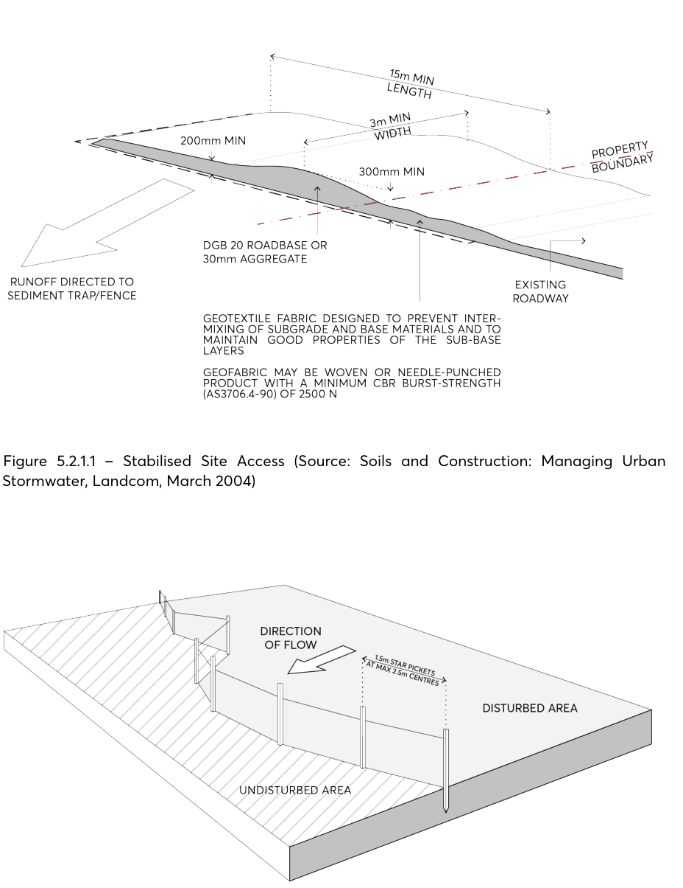
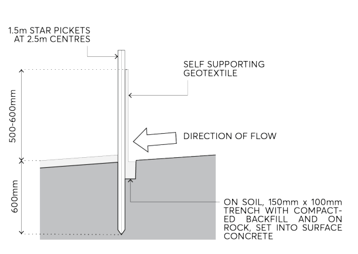
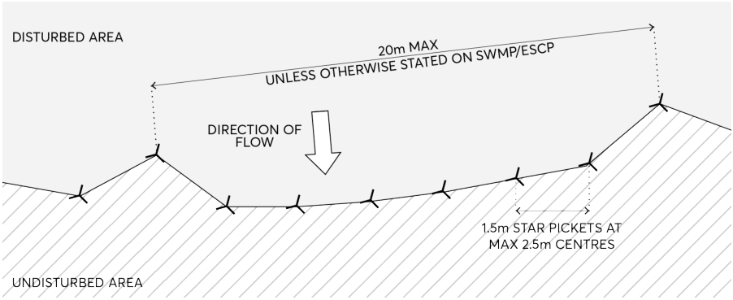
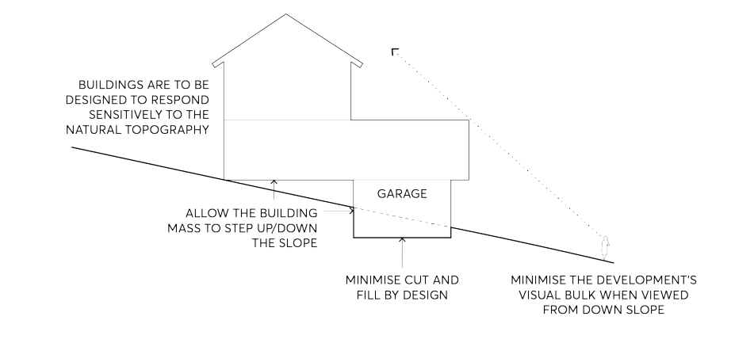
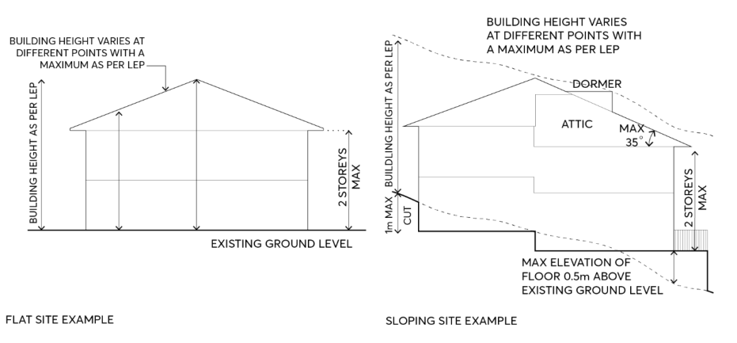

### 5.2 HAZARD AND POLLUTION MANAGEMENT

This Section of this DCP provides controls to address the environmental impact of development on sites and surrounding areas to ensure hazard and pollution is managed appropriately throughout the City. These include:

• Developmental impact on soils. Controlling the erosion of soil and sedimentation run off during and after construction is addressed in this Section. As well as this, the impacts of acid sulfate soils, salinity, earthworks and sloping sites and land contamination are further addressed within this Section. While this Section addresses the impact that development may have on these matters, it also addresses the impact that poor land management may have when developing on affected sites.

• Air quality and ensuring that appropriate site controls are implemented to reduce the impact that development has on its surroundings.

• Bush fire prone land. With areas of the City at risk of bush fire, ensuring protection through controls designed in compliance with relevant NSW Rural Fire Service publications has been essential.

HAZARD AND POLLUTION MANAGEMENT

#### CONTROL OF SOIL EROSION AND SEDIMENTATION

Earthworks and development which expose soil to the elements have the potential to run off site and impact adjoining properties, water systems and impact habitats for plants and animals.

This Section of this DCP includes controls to help minimise erosion and manage development to avoid potential adverse impacts on the City’s waterways and drainage systems, environmental health, and biodiversity.

Objectives

O.01 Ensure through effective site controls during, and after demolition and construction, that development does not contribute to sedimentation of waterways and drainage systems, or cause windblown soil loss.

O.02 Ensure that development does not result in environmental damage of waterways and bushland in the City.

Controls

C.01 Development is to be designed and constructed to integrate with the natural topography of the site so as to minimise the need for cut and fill.

C.02 Soil loss from development is to be minimised through effective site management practices that reduce the impact of sedimentation on downstream waterways and drainage systems and that minimise windblown soil loss.

C.03 Development is to minimise site disturbance, including impact on vegetation and significant trees. Construction, particularly on larger sites, is to stage site disturbance so as to minimise the area of the site that is not stabilised and exposed to erosion at any one time. Overland stormwater flow must be diverted around any exposed areas of the site.

C.04 Development that is likely to result in erosion and sedimentation is to be accompanied by details of the proposed method of on-site erosion and sediment control. Such details are to follow the guidelines in the NSW Landcom (2004) Managing Urban Stormwater: Soils and Construction and Council’s Design and Development Guidelines, as per Figure 5.2.1.1 – Figure 5.2.1.4.

HAZARD AND POLLUTION MANAGEMENT

> [Picture on page 37: a picture, saved as a picture (images/part-05-environmental-management-page-37-2.gif, 150 dpi).]

Figure 5.2.1.1 – Stabilised Site Access (Source: Soils and Construction: Managing Urban Stormwater, Landcom, March 2004)

Figure 5.2.1.2 – Sedimentation Fencing (Source: Soils and Construction: Managing Urban Stormwater, Landcom, March 2004)

HAZARD AND POLLUTION MANAGEMENT

> [Picture on page 38: a picture, saved as a picture (images/part-05-environmental-management-page-38-2.gif, 150 dpi).]

Figure 5.2.1.3 – Section – Sedimentation Fencing (Source: Soils and Construction: Managing Urban Stormwater, Landcom, March 2004)

> [Picture on page 38: a picture, saved as a picture (images/part-05-environmental-management-page-38-5.gif, 150 dpi).]

Figure 5.2.1.4 – Plan – Sedimentation Fencing (Source: Soils and Construction: Managing Urban Stormwater, Landcom, March 2004)

HAZARD AND POLLUTION MANAGEMENT

#### ACID SULFATE SOILS

Acid sulfate soils are a result of soil that is close to sea level and is impacted by minerals which alter its pH. When the pH raises significantly, these soils may impact on development and risk damaging structural integrity, environmental and conservation works and public facilities.

This Section of this DCP includes controls to ensure the effective management and monitoring of acid sulphate soils to reduce risk and impacts on development.

Objectives

O.01 Ensure the environmental value and ecological health of waterways are protected from the release of acid water from exposed acid sulfate soils.

Controls

C.01 Development is to ensure that sites with potential to contain acid sulfate soils are managed in a manner consistent with the provisions contained in the Parramatta LEP 2023.

HAZARD AND POLLUTION MANAGEMENT

#### SALINITY

Salinity in urban areas is recognised as an issue that can potentially cause significant economic, environmental, and social costs in many areas of NSW. The build-up of salt in soils can have adverse impacts on native flora and fauna habitat, the quality of water systems, and structural integrity of buildings.

This Section of this DCP includes controls to ensure the effective management of salinity within both the natural and built environment.

Objectives

O.01 Ensure that soil or groundwater salinity does not impact on the structural integrity of a development.

O.02 Control the impact of the development on prevailing and potential soil or groundwater salinity in the City.

Controls

C.01 Construction techniques are to be employed that prevent structural damage to the development as a result of salinity. Where the potential risk of salinity is identified by using the Map of Salinity Potential in Western Sydney 2022 further investigations in accordance with the Western Sydney Salinity Code of Practice 2003 are to be undertaken.

C.02 Protection measures to mitigate the impact of the development on soil salinity are to be employed.

Further Information

Map of Salinity Potential in Western Sydney, (former) Department of Infrastructure, Planning and Natural Resources, 2003

Western Sydney Salinity Code of Practice, Western Sydney Regional Organisation of Councils, 2003

HAZARD AND POLLUTION MANAGEMENT

#### EARTHWORKS AND DEVELOPMENT ON SLOPING LAND

Development on land which is sloping has an increased risk of erosion of soil and run-off into surrounding waterways. Cut and fill increases the risk of this occurring and determining the appropriate earthworks on sites, if required, can reduce this impact.

This Section of this DCP includes controls to ensure the effective management of earthworks resulting from development to minimise impact on the natural and built environment.

Objectives

O.01 Protect and minimise disturbance to natural landforms. O.02 Encourage buildings that are designed to respond sensitively to natural topography. O.03 Minimise the amount of cut and fill and therefore disruption to natural drainage patterns. O.04 Maintain privacy for adjoining residents. O.05 Reduce bulk and scale of dwellings. O.06 Minimise soil loss through effective site management practices. O.07 Reduce the impact of sedimentation on downstream waterways and drainage systems.

Controls

C.01 Sloping sites with a gradient in excess of 20% require certification from a geotechnical engineer as to the stability of the slope in regard to the proposed design.

C.02 Cut and fill shall not create a detrimental impact on overland flows through the site. C.03 Cut and fill should not occur on or adjacent to, or have adverse impacts on, sensitive environments, such as waterways, riparian land, wetlands, bushland or significant vegetation.

C.04 Cut is restricted to a maximum of 1 metre from the existing ground level when it is not for the provisions of a basement. Refer to Figure 5.2.4.2.

C.05 Notwithstanding the above, cut is limited to a maximum of 450mm from existing ground level where it occurs within 900mm of rear or side boundaries.

C.06 Fill is restricted to a maximum of 500mm from the existing ground level. Refer to Figure 5.2.4.2. A maximum fill of 1 metre may be considered where;

a) it is demonstrated that site conditions require it, and

b) fill does not create any adverse effects to adjoining properties, and

c) objectives O.01 – O.07 above are demonstrated to be achieved, and

d) any fill above 500mm is contained within the building envelope.

C.07 Notwithstanding the above, fill is limited to a maximum of 300mm from existing ground level where it occurs within 900mm of rear or side boundaries.

C.08 Contaminated fill, either imported or found on site, is not permitted.

HAZARD AND POLLUTION MANAGEMENT

> [Picture on page 42: a picture, saved as a picture (images/part-05-environmental-management-page-42-2.gif, 150 dpi).]

Figure 5.2.4.1 – Development on sloping land

> [Picture on page 42: a picture, saved as a picture (images/part-05-environmental-management-page-42-4.gif, 150 dpi).]

Figure 5.2.4.2 – Explanation of building height controls

C.09 Buildings are to be sited and designed to take into account the slope of the land to:

• minimise the visual bulk of the development, particularly when viewed from down slope,

• minimise the need for cut and fill by designs which minimise the building footprint and allow the building mass to step up/down the slope, and

• minimise the impact of development on the privacy of adjoining land. Refer to Figure 5.2.4.1.

HAZARD AND POLLUTION MANAGEMENT

#### LAND CONTAMINATION

‘Contaminated land’ has the same meaning as in the Environmental Planning and Assessment Act 1979 and is defined as follows:

Contaminated land means land in, on or under which any substance is present at a concentration above the concentration at which the substance is normally present in, on or under (respectively) land in the same locality, being a presence that presents a risk of harm to human health or any other aspect of the environment.

Land contamination is most often the result of past uses. It can occur as a result of poor environmental management and waste disposal practices or accidental spills in industrial or commercial activities. The poor planning and management of contaminated land can present a risk to public health and the environment.

Development proposals for land that is or has previously been used for a purpose which is likely to have contaminated the site must address the requirements of State Environmental Planning Policy (Resilience and Hazards) 2021 (Resilience and Hazards SEPP). References are made to the Resilience and Hazards SEPP in the following provisions and should be referred to for further information and clarification.

This Section of this DCP provides controls to ensure land contamination is appropriately managed across the development process to manage and mitigate any risk from previous land uses.

Objectives

O.01 Ensure that changes of land use will not increase the risk to public health or the environment. O.02 Ensure that any redevelopment of land for sensitive uses considers the potential contamination of the land.

O.03 Avoid inappropriate restrictions on land that could otherwise be remediated. O.04 Consider the likelihood of land contamination as early as possible in the planning process. O.05 Link decisions about the development of land with the information available about contamination.

Controls

C.01 Prior to the submission of a Development Application an assessment is to be made by the applicant under Clause 4.6 of the Resilience and Hazards SEPP as to whether the subject land is contaminated. Note: The following guidelines prepared by NSW Environmental Protection Authority, where relevant, must be used in preparing preliminary assessments and all levels of contaminated site reports:

• Contaminated Sites: Sampling Design Guidelines, 1995

HAZARD AND POLLUTION MANAGEMENT

• Contaminated Land: Guidelines: for Consultants Reporting on Contaminated Land, 2020

• Contaminated Sites: Guidelines for Assessing Service Station Sites, 1994

• Contaminated Land Guidelines: Assessment and Management of Hazardous Ground Gases 2020

• Contaminated Land Guidelines: Guidelines for the Assessment and Management of Groundwater Contamination 2007

• Contaminated Land Management: Guidelines for the NSW Site Auditor Scheme, (3rd Edition) 2017

C.02 Council under Clause 4.6 (1) of the Resilience and Hazards SEPP a consent authority must not consent to development unless it has considered whether land is contaminated, and if the land is contaminated is suitable for the proposed purpose or is satisfied that the land will be appropriately remediated. Where land is proposed to be subject to remediation, adequate documentation is to be submitted to Council supporting the categorisation.

Development consent for remediation work C.03 Development consent is required for remediation work in sensitive areas (Category 1 remediation works) under Clause 4.8 of Resilience and Hazards SEPP.

C.04 Development consent is not required for other remediation work (Category 2 remediation work) under Clause 4.11 of Resilience and Hazards SEPP. However, under Clause 4.13 of the Resilience and Hazards SEPP, notice is required to be given of the proposed work to Council before commencement of works.

Activities that may cause contamination C.05 Some activities that are likely to cause land contamination are listed below. For further information, refer to the Managing Land Contamination Planning Guidelines. Some activities that may cause contamination include:

• Asbestos production and disposal

• Acid/alkali plant and formulation

• Agricultural/horticultural activities

• Airports

• Chemicals manufacture and formulation

• Defence works

• Drum re-conditioning works

• Dry cleaning establishments

• Electrical manufacturing (transformer)

• Electroplating and heat treatment premises

• Engine works

• Explosives industry

• Gas works

HAZARD AND POLLUTION MANAGEMENT

• Iron and steel works

• Metal treatment

• Mining and extractive industries

• Oil production and storage

• Paint formulation and manufacture

• Pesticide manufacture and formulation

• Power stations

• Railway yards

• Scrap yards

• Service stations

• Sheep and cattle dips

• Smelting and refining

• Tanning and associated trades

• Waste storage and treatment

• Wood preservation

• Works on known James Hardie Legacy Contamination sites, such as earth works Source: The Australian and New Zealand Guidelines for the Assessment and Management of Contaminated Sites, ANZECC and NHMRC 1992. Note: It is not sufficient to rely solely on the contents of this list to determine whether a site is likely to be contaminated or not. The list is a guide only. A conclusive status can only be determined after a review of the site history and, if necessary, sampling.

Further Information

Contaminated Land Management Act 1997 Contaminated Land Management Regulation 2022 National Environment Protection (Assessment of Site Contamination) Amendment Measure 2013 (No. 1) National Environment Protection Council (NEPC 2013) Managing Land Contamination – Planning guidelines, Department of Urban Affairs and Planning (DUAP), NSW Environment Protection Authority (NSW EPA), 1998 (DUAP 1998) Contaminated Sites: Sampling Design Guidelines, NSW EPA, 2022 (EPA 2022) Australian & New Zealand Guidelines for Fresh & Marine Water Quality, Water Quality Australia (ANZG 2018) PFAS National Environmental Management Plan (NEMP), Heads of EPAs Australia and New Zealand (HEPA), January 2022 (NEMP 2022) Contaminated Land Management: Guidelines for the NSW Site Auditor Scheme, 3rd Edition, NSW EPA, 2017 (EPA 2017) Contaminated Sites: Guidelines for the Assessment and Management of Groundwater Contamination, NSW DEC, March 2007 (DEC 2007)

HAZARD AND POLLUTION MANAGEMENT

Guidelines for Managing Risks in Recreational Water, NHMRC, 2008 as amended 2019 (NHMRC 2008) Contaminated Land Guidelines: Consultants Reporting on Contaminated Land 2020

HAZARD AND POLLUTION MANAGEMENT

#### AIR QUALITY

Promoting healthy air quality for the protection of residents and visitors to Parramatta can be achieved through appropriate land use planning.

This Section of this DCP includes controls to protect air quality and reduce exposure to air pollution.

Objectives

O.01 Protect air quality and enhance environmental amenity. O.02 Minimise air quality impacts on the occupants of residential development and other sensitive land uses.

Controls

C.01 Development that is likely to result in the emission of atmospheric pollutants, including odours, is to include operating practices and technology to ensure that the development does not contribute to increased air pollution.

C.02 Effective site controls during and after demolition and construction are to ensure that development does not contribute to increased air pollution.

C.03 Sensitive land uses adjoining a major road are to include siting and design measures to ameliorate the potential air quality impact of vehicle emissions on the site.

C.04 An Air Quality Assessment report that takes into account the provisions of State Environmental Planning Policy (Transport and Infrastructure) 2021 be provided for ‘air quality sensitive land uses’ within 100 metres of a classified road. ‘Air quality sensitive land uses’ include residential accommodation (excluding a single dwelling house on an existing lot), early education and care facilities, seniors housing, hospitals, offices or public recreation areas.

C.05 All development must be undertaken in accordance with the Protection of the Environment Operations Act 1997 No 156, the Protection of the Environmental Operations (Clear Air) Regulation 2021, State Environmental Planning Policy (Transport and Infrastructure) 2021, relevant Australian Standards and any other requirements of the NSW Environmental Protection Authority, such as Protection of the Environment Operations (Clean Air) Regulation 2021 and the Technical Framework: Assessment and Management of Odour from Stationary Sources in NSW and Approved Methods of Modelling and Assessment of Air Pollutants in New South Wales.

C.06 Discharges from premises of any matter, whether solid, liquid, or gaseous is required to conform to the Protection of the Environment Operations Act 1997 and its Regulations, or a pollution control approval issued by the NSW Office of Environment and Heritage for Scheduled Premises.

HAZARD AND POLLUTION MANAGEMENT

#### BUSH FIRE PRONE LAND

With the risk of bush fires in parts of the City, ensuring that development complies with the NSW Rural Fire Services’ Planning for Bush Fire Protection 2019 is essential to minimise the risk to life and property.

This Section of this DCP provides general controls for bush fire hazard and applies to all forms of development.

Objectives

O.01 Ensure that development is located and designed to minimise the risk to life and property from bush fires.

O.02 Ensure that development balances the conservation of tree canopy, native vegetation, and bush fire hazard management.

Controls

C.01 Development on land identified as bush fire prone on Council’s Bush Fire Prone Lands Map should address the bush fire protection measures in the publication Planning for Bush Fire Protection 2019.

C.02 Development should be located and designed to minimise the need for bush fire hazard reduction within native vegetation.

C.03 Bush fire asset protection zones should be located entirely within the development site. C.04 Measures, such as higher fire-resistant construction standards, improved access and water supplies should be considered for infill developments where they would reduce the need for removal of significant vegetation, provided the development still complies with Planning for Bush Fire Protection 2019.

PROTECTION OF THE NATURAL ENVIRONMENT
