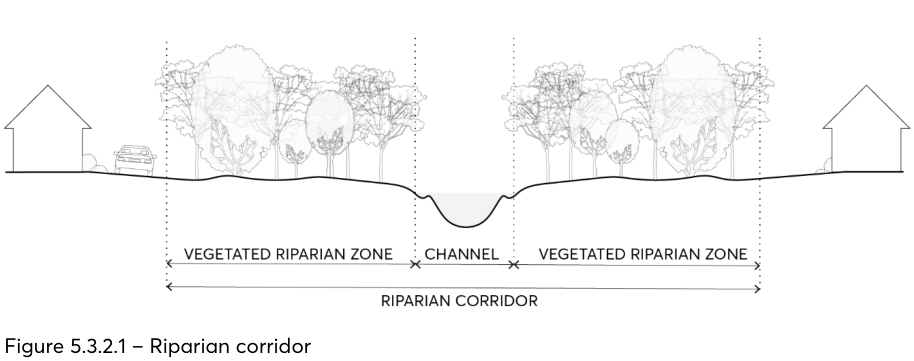
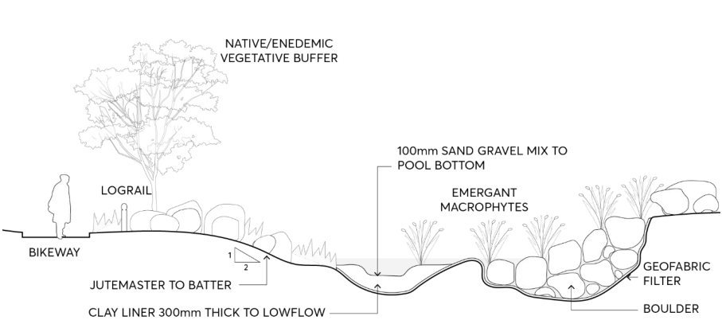
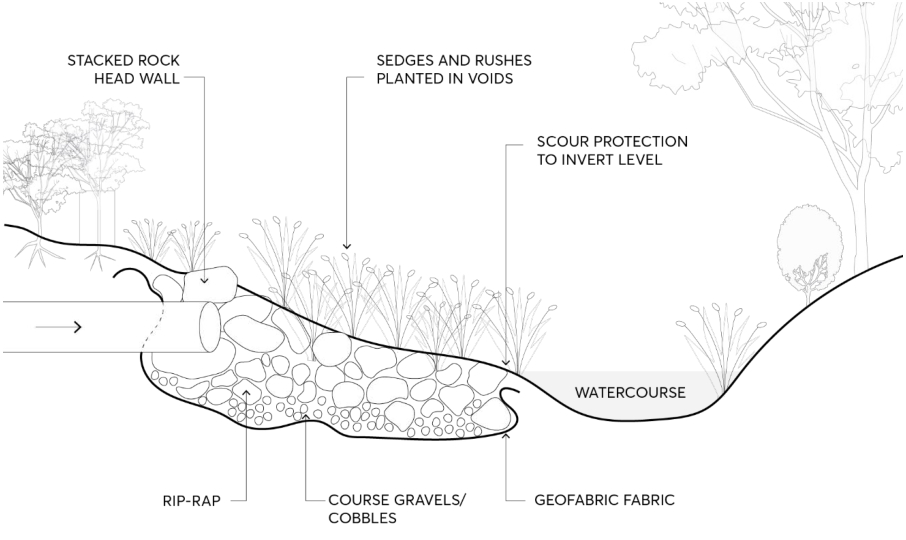

### 5.3 PROTECTION OF THE NATURAL ENVIRONMENT

The City of Parramatta (the City) has approximately 820 hectares of bushland made up of important remnant native vegetation. This is almost 10% of all land within the City, and includes critically endangered ecological communities, endangered populations, and threatened flora and fauna species.

There are also significant remnants of ecologically significant trees and vegetation present in parks, along streets, and on private property. This vegetation all contributes to the City of Parramatta’s biodiversity and provide important habitat.

The City also has over 65 kilometres of creeks and rivers, including significant assets like Parramatta River and Lake Parramatta. These waterways are valuable natural assets that contribute a range of economic, social, and environmental benefits that are essential to support our quality of life and sustain native flora and fauna.

Council recognises the importance of protecting and conserving its locally occurring plants, animals, and other living organisms. This includes their habitat, and the way they interact, to ensure that biodiversity is sustained and enhanced now and in the future. Council also has the ambition to significantly improve water quality and make the Parramatta River swimmable again.

This Section of this DCP is designed to ensure the City’s natural environment is sustainably managed as part of the development process; and measures are implemented to minimise the impact of development on the City’s unique biodiversity, waterways and riparian zones, and trees and vegetation.

PROTECTION OF THE NATURAL ENVIRONMENT

#### BIODIVERSITY

The City’s natural environment is home to 600 unique species of flora and 230 unique species of fauna. Of these, 12 species are considered endangered ecological communities and 32 are considered threatened species of fauna. The protection and maintenance of the City’s unique flora and fauna is important in conserving the City’s biodiversity, environmental health, and wellbeing.

This Section of this DCP includes controls to ensure the protection of the City’s biodiversity remains a primary consideration during the assessment of development. Development should aim to avoid potential adverse impacts on the City’s flora and fauna, and where not possible, should aim to minimise and/or mitigate its impact on the City’s biodiversity.

Objectives

O.01 Minimise the impact of development on the City’s biodiversity by:

• minimising the removal of native vegetation and naturally occurring soils;

• conserving significant locally indigenous trees, particularly remnant and hollow bearing trees; and

• establishing buffer zones and encouraging planting of locally indigenous plants, including trees on private property.

O.02 Retain and protect areas of existing biodiversity value, particularly key vegetation links, threatened ecological communities, and fauna corridors.

Controls

C.01 In relation to locally indigenous flora and fauna (including canopy trees and understorey vegetation), development is to be sited and designed to:

• avoid potential adverse impacts;

• minimise impacts, if impacts cannot be avoided;

• mitigate impacts, if the impacts cannot be minimised.

C.02 Development is to have regard to direct and indirect impacts on biodiversity and natural areas. Council will require the submission of a Statement of Flora and Fauna Impact (SFFI) for all development in or adjacent to bushland and/or waterways, including vegetation mapped as ‘Biodiversity’ or ‘Riparian Land and Waterways’ on the Parramatta LEP 2023 Natural Resources Map. The SFFI is to be prepared by a suitably qualified ecologist and must determine whether the development triggers the Biodiversity Offsets Scheme (BOS) as per Part 7 of the Biodiversity Conservation Regulation 2017.

C.03 Where the BOS is triggered, a Biodiversity Development Assessment Report (BDAR) must be prepared following the Biodiversity Assessment Method (BAM) by an accredited assessor.

C.04 Where a SFFI identifies species, populations or ecological communities listed under Schedules 1 and 2 of the Biodiversity Conservation Act 2016 and/or Schedules 4, 4A and 5 of the Fisheries Management Act 1994, and the BOS is not triggered, a ‘Test of Significance’ must be prepared by

PROTECTION OF THE NATURAL ENVIRONMENT

a suitably qualified ecologist as per Section 7.3 of the Biodiversity Conservation Act 2016 and submitted to Council in addition to the SFFI.

C.05 Development should avoid the fragmentation of existing native vegetation. C.06 Development should seek to retain unique environmental features of the site, including:

• rock outcrops,

• wetlands and the like,

• watercourses,

• drainage lines and riparian land,

• groups of significant trees and vegetation, and

• mature hollow-bearing trees and other fauna habitat features on the site.

C.07 Preference is to be given to landscaping elements that provide and promote native faunal habitats, e.g. natural rock and frog ponds.

C.08 Preference is to be given to the planting of species indigenous and/or endemic to the vegetation communities of the local area as per Table 5.3.1.1. However, exotic species appropriate to the landscaping setting may also be considered. Table 5.3.1.1 – Endemic species to be considered in planting in the City of Parramatta.

| Botanical Name | Common Name |
|---|---|
| Acmena smithii | Lillypilly |
| Angophora costata | Smooth-barked Apple |
| Angophora floribunda | Rough-barked Apple |
| Angophora hispida | Dwarf Apple |
| Banksia serrata | Old Man Banksia |
| Callicoma serratifolia | Callicoma |
| Ceratopetalum apetalum | Coachwood |
| Ceratopetalum gummiferum | NSW Christmas Bush |
| Corymbia gummifera | Red Bloodwood |
| Elaeocarpus reticulatus | Blueberry Ash |
| Glochidion ferdinandi | Cheese Tree |
| Eucalyptus amplifolia | Cabbage Gum |
| Eucalyptus baueriana | Blue Box |
| Eucalyptus botryoides | Southern Mahogany |
| Eucalyptus crebra | Narrow-leaved Ironbark |
| Eucalyptus eugenioides | Thin-leaved Stringybark |
| Eucalyptus fibrosa | Broad-leaved Ironbark |
| Eucalyptus haemastoma | Scribbly Gum |
| Eucalyptus moluccana | Grey Box |
| Eucalyptus paniculata | Grey Ironbark |
| Eucalyptus pilularis | Blackbutt |
| Eucalyptus piperita | Sydney Peppermint |
| Eucalyptus resinifera | Red Mahogany |
| Eucalyptus robusta | Swamp Mahogany |
| Eucalyptus saligna | Sydney Blue Gum |
| Eucalyptus sieberi | Silver-top Ash |
| Eucalyptus tereticornis | Forest Red Gum |

PROTECTION OF THE NATURAL ENVIRONMENT

| Botanical Name | Common Name |
|---|---|
| Eucalyptus umbra | Broad-leaved White Mahogany |
| Livistona australis | Cabbage-tree Palm |
| Melaleuca decora | White Feather Honeymyrtle |
| Melaleuca linarifolia | Snow-in-summer |
| Melaleuca styphelioides | Prickly-leaved Paperbark |
| Syncarpia glomulifera ( | Turpentine |
| Tristaniopsis laurina | Water Gum |

All suitable trees must be planted with a minimum setback of 3.5 metres to the outside wall of a legally constructed building and be a minimum 2 metres from any proposed or existing drainage line.

C.09 Development is to be sited and designed to minimise the impact on cultural heritage trees and plantings and consideration is to be given to further planting of cultural landscapes where appropriate.

C.10 Pruning or removal of trees and vegetation must be in accordance with Section 5.3 – Protection of the Natural Environment and Section 5.3.4 – Tree and Vegetation Preservation of this DCP.

C.11 Development should not compromise the ability of native flora and fauna to respond to climate change.

C.12 Consideration must be given to the impacts of lighting and overshadowing on flora and fauna species and their habitat.

C.13 Development is to provide and maintain a setback of at least 10 metres from land zoned C2 Environmental Conservation or identified as ‘Biodiversity’ on the Parramatta LEP 2023 Natural Resources Map. Development should not include buildings, structures and earthworks within the required buffer zone. Refer to further controls in Part 5 – Environmental Management, Section 5.3.3 – Development on Land Adjoining Land Zoned C2 Environmental Protection or

W1 Natural Waterways Zone of this DCP.

C.14 Landscaping within the buffer zones should comprise trees, shrubs, understorey and groundcover indigenous to the adjoining vegetation community.

PROTECTION OF THE NATURAL ENVIRONMENT

#### WATERWAYS AND RIPARIAN ZONE

The City of Parramatta has 65 km of waterways traversing through its natural and built environment. These include rivers, creeks, streams, gullies, and wetlands, with two of the largest being the Parramatta River and Duck River. The land alongside the waterways (known as the riparian zones) help support vegetation, waterway bank stability, and biodiversity. Both waterways and riparian zones are vulnerable to the impacts of development on surrounding land both during the development stage but also from pollution that may result from certain land uses.

The health of the City’s interconnected network of waterways and riparian zones is dependent on the effective management of development to minimise the risk of erosion, waste, and pollution entering the water system. This Section of this DCP includes controls designed to mitigate the impact of development near waterways and riparian zones and promote ecological sustainability.

Objectives

O.01 Ensure development contributes to the protection and rehabilitation of waterways in order to:

• improve waterway health, and

• develop and maintain ecologically sustainable waterways.

O.02 Development in and near floodways, riparian zones and naturalised channels requires careful planning and detailed design to protect occupants and people in the locality while supporting flood conveyance requirements, beneficial environmental outcomes and optimising development opportunities.

O.03 Encourage naturalisation and semi-naturalisation of concrete floodway channels and creeks where feasible.

Controls

C.01 Development is to make provision for buffer areas for the preservation and maintenance of floodway, riparian corridors and habitat protection. Refer to Clause 6.7 Foreshore Building Line and Clause 6.5 Water Protection in the Parramatta LEP 2023.

C.02 Development on land subject to Clause 6.5 Water Protection in the Parramatta LEP 2023 or that abuts a waterway is to provide and maintain a vegetated riparian zone (VRZ) landscaped with local indigenous species, to protect bushland, aquatic habitat, wildlife corridors and soften the interface between the natural landscape and the urban environment. This riparian vegetation is also important to stabilise the bed and banks of waterways and attenuate flood flows.

C.03 A VRZ of at least 10 metres, measured from the top of the highest bank, is to be provided to creeks (1st order waterways). A larger VRZ will be required to higher order waterways, such as Parramatta River, consistent with the NSW Department of Industry’s Guidelines for controlled activities on waterfront land – Riparian corridors:

PROTECTION OF THE NATURAL ENVIRONMENT

> [Picture on page 54: a picture, saved as a picture (images/part-05-environmental-management-page-54-2.gif, 150 dpi).]

Figure 5.3.2.1 – Riparian corridor

Source: Guidelines for controlled activities on waterfront land – Riparian corridors (NSW Department of Industry, 2018)

C.04 Works should not cause bed and bank instability and any bank stabilisation measures should preferably use soft engineering techniques.

C.05 The piping, enclosing or artificial channelling of natural watercourses and drainage channels is not permitted. Consideration is to be given to naturalising piped or lined drainage systems wherever feasible.

C.06 Opportunities for fauna habitat are to be considered in the design of any waterway protection measures. Watercourses should be linked with other areas of indigenous vegetation, wildlife corridors and/or natural or visually important site features.

C.07 Development is to ensure that natural channel design principles are incorporated in any works on or in waterways. Refer to Figure 5.3.2.2.

> [Picture on page 54: a picture, saved as a picture (images/part-05-environmental-management-page-54-16.gif, 150 dpi).]

Figure 5.3.2.2 – Elements of the Natural Drainage System

Source: Stormwater outlets in parks and waterways (Brisbane City Council, 2011)

C.08 Ongoing maintenance costs are to be considered in the design of any waterway protection measures.

PROTECTION OF THE NATURAL ENVIRONMENT

C.09 New stormwater outlets into natural waterways within Council parks and reserves will generally not be permitted. Any stormwater outlets proposed in the vicinity of a natural watercourse should:

• point downstream to minimise the potential for erosion and scouring,

• be located to avoid existing native vegetation and significant trees,

• provide a natural and stable transition from a constructed drainage system to a natural flow regime, and

• be designed in accordance with NSW Office of Water Guidelines for outlet structures on waterfront land. Refer to Figure 5.3.2.3.

> [Picture on page 55: a picture, saved as a picture (images/part-05-environmental-management-page-55-11.gif, 150 dpi).]

Figure 5.3.2.3 – Stormwater outlets into natural waterways

Source: Guidelines for outlet structures on waterfront land (NSW Office of Water)

C.10 Design of new waterways and rehabilitation of existing waterways and creeks must maximise habitat, ecological and landscape values, both in the aquatic and riparian environments, while ensuring hydraulic functions are not diminished.

C.11 Development adjoining creeks and rivers must incorporate protection and conservation of riparian zones, as well as facilitating human access, amenity and public safety as appropriate.

C.12 The overall development must provide for public safety, evacuation and such matters as bank stability and erosion control, riparian vegetation and so on.

C.13 Design must provide for effective flood warning and evacuation pathways suitable for the frail, disabled and other vulnerable people.

Further Information

Natural Channel Design Guidelines, Brisbane City Council, 2000.

PROTECTION OF THE NATURAL ENVIRONMENT

Guidelines for Controlled Activities on Waterfront Land: Riparian Corridors, NSW Department of Industry 2018.

PROTECTION OF THE NATURAL ENVIRONMENT

#### DEVELOPMENT ON LAND ADJOINING LAND ZONED C2 ENVIRONMENTAL PROTECTION OR W1 NATURAL WATERWAYS ZONE

Further to the controls contained in Section 5.3.2 – Waterways and Riparian Zones designed to manage waterways and riparian zones, this Section of this DCP includes specific controls to manage development on land adjoining land zoned C2 Environmental Protection or W1 Natural Waterways under the Parramatta LEP 2023. The objectives of these zones broadly are to protect and manage areas of high ecological and aesthetic value and prevent development that could have an adverse effect on those values.

This Section of this DCP includes controls designed to reduce the impact of development on land adjoining these protected land uses, and to support the continued protection and management of the City’s natural environment.

Objectives

O.01 Preserve aquatic biodiversity, protect and enhance water quality, and maintain the stability of a creek and its bank.

Controls

C.01 Development on land abutting land within the C2 Environmental Protection zone and W1 Natural Waterways zone must take into consideration all of the following:

• the need to retain and protect any bushland and/or marine vegetation on or adjoining the land;

• the effect of the proposed development on bushland and/or marine vegetation, including the erosion of soils, the siltation of creeks and waterways and the spread of weeds and exotic plants within the bushland, overshadowing, overland flows and stormwater runoff, and the removal or degradation of existing vegetation;

• the requirement for provision of a buffer zone on the abutting land to protect the bushland and/or riparian corridor;

• the protection of threatened ecological communities, populations, and species listed under the Biodiversity Conservation Act 2016 and/or Fisheries Management Act 1994; and any other matters which are relevant to the protection and preservation of the bushland and/or riparian areas.

Further Information

Environmental Planning and Assessment Act 1979 (Section 1.7)

Environment Protection and Biodiversity Conservation Act 1999 (Cth.)

Biodiversity Conservation Act 2016

PROTECTION OF THE NATURAL ENVIRONMENT

Fisheries Management Act 1994

City of Parramatta Environmental Sustainability Strategy 2017

State Environmental Planning Policy (Biodiversity and Conservation) 2021

State Environmental Planning Policy (Resilience and Hazards) 2021

PROTECTION OF THE NATURAL ENVIRONMENT

#### TREE AND VEGETATION PRESERVATION

Trees play an important role in ‘greening’ the City of Parramatta (the City). Trees provide many benefits to residents and the community by:

• contributing to the amenity and green leafy character of local neighbourhoods;

• helping to keep communities cool by mitigating the impact of urban heat; and

• maintaining natural ecosystems to provide habitats for native fauna.

Preserving the City’s well-established tree coverage is important in protecting the amenity, character, and liveability of neighbourhoods. As almost half of the of City’s tree coverage is located within private land, tree and vegetation preservation controls are critical in protecting the City’s mature trees and green corridors.

This Section of this DCP is made in accordance with Chapter 2 of the State Environmental Planning Policy (Biodiversity and Conservation) 2021 (Biodiversity and Conservation SEPP) and aims to protect the biodiversity values and amenity of trees and other vegetation within the City. This Section of this DCP describes the trees and vegetation that require a permit or approval for clearing to occur to a tree specified in these controls. The trees and vegetation declared by this Section of this DCP are protected under Part 2.3 of the Biodiversity and Conservation SEPP and consent from Council must be obtained before any works can occur to a tree as specified in these controls.

Table 5.3.4.1 – Type of Tree Application required

| Location | Extent of Works | Form of Application |
|---|---|---|
| Heritage Item | Council is satisfied that the works to a tree are minor (considered pruning in excess of exemptions prescribed in DCP section below) as described by Section 2.10 (3) of the Biodiversity and Conservation SEPP and Clause 5.10(3) of the Parramatta LEP 2023. Major work to any tree (considered removal of tree) | Tree Permit Development Application |
| Land within a Heritage Conservation Area | Council is satisfied that the works to a tree are minor (considered pruning in excess of exemptions prescribed in DCP section below) as described by Section 2.10 (3) of the Biodiversity and Conservation SEPP and Clause 5.10(3) of Parramatta LEP 2023. Major work to any tree (considered removal of tree) | Tree Permit Development Application |
| Other land - tree removal or pruning | Removal or pruning of trees (considered pruning in excess of exemptions prescribed in DCP section below) not subject to Biodiversity Offsets Scheme | Tree Permit |

PROTECTION OF THE NATURAL ENVIRONMENT

| Location | Extent of Works | Form of Application |
|---|---|---|
| Other land - work within a Tree Protection Zone of a protected tree and/or a tree located on other land. Work includes Construction (driveways, concrete slabs, retaining walls) and earthworks (changes in soil levels, embankments, trenching) | Work within the Tree Protection Zone not subject to Biodiversity Offsets Scheme | Tree Permit |
| Work that is contrary to a development consent that requires trees to be retained | Work to any prescribed tree | Section 4.55 Application |

Objectives

O.01 Maintain and enhance the amenity of the City through the preservation of appropriate trees and vegetation.

O.02 Retain the City’s urban forest cover particularly its street tree and parkland tree population to alleviate urban heat impact.

O.03 Appropriately manage trees and vegetation in order to ensure their health and long-term retention.

O.04 Conserve trees of ecological, heritage, aesthetic and cultural significance. O.05 Protect and manage individual and stands of trees as an important community asset. O.06 Establish the procedural framework and requirements governing the pruning, removal and subsequent replacement of trees and vegetation within the City.

O.07 Ensure all new development considers and protects existing trees and vegetation on development sites and provides opportunity for the healthy growth of newly planted trees to reach maturity.

O.08 Protect native fauna habitat.

Controls

Prescribed trees and vegetation C.01 The prescribed trees and vegetation protected by Chapter 2 of the Biodiversity and Conservation SEPP and/or Clause 5.10 of the Parramatta LEP 2023 and this Section of this DCP include:

• Any tree or palm - whether indigenous, endemic, exotic or introduced species with a height equal to or exceeding five (5) metres;

• Any tree, bushland, or mangrove vegetation located on public land, irrespective of size.

• Any tree that is or forms part of an Aboriginal object, or that is within an Aboriginal place of heritage significance, or that is located on land mapped ‘high sensitivity’ on the Aboriginal sensitivity map.

PROTECTION OF THE NATURAL ENVIRONMENT

• Any tree with a height equal to or exceeding three (3) metres or any tree capable of growing to a height of 3 metres (where the tree with a height less than 3 metres has been intentionally planted; and/or is required to be planted and maintained as part of a development consent or tree permit determination notice):

- that is or forms part of a heritage item, or

- that is within a heritage conservation area; or

- that is located within a Special Character Area as defined by this DCP.

• Vegetation on land identified as ‘Biodiversity’ on the Parramatta LEP 2023 Natural Resources Map.

C.02 To damage, prune, or remove any prescribed trees or vegetation identified in C.01 in this Section of this DCP is prohibited without the written consent of Council (via either a Tree Permit Application or Development Application for tree works subject to location of tree).

• An arboricultural assessment report by a suitably qualified Australian Qualification Framework (AQF) Level 5 Arborist, and other specialist reports and information may be required to be submitted as part of the application assessment process as evidence to support the pruning or removal of the tree(s).

• If works are carried out in accordance with the exemptions prescribed in this Section of this DCP, written consent from Council is not required. Further information regarding tree management consent process may be found in https://www.cityofparramatta.nsw.gov.au/living/trees.

Offset Program C.03 Where a tree is approved to be removed, Council will seek the replanting of a suitable canopy replacement tree or trees in a suitable location on the site. Any replacement trees will need to be grown to maturity and replaced if the planting fails to survive and thrive. In circumstances when there is no suitable location on site (for example, in the case of small backyards), a financial contribution will be required to be paid to support public tree planting. Offset fees are contained within Council’s published fees and charges. Notes: Under the Biodiversity and Conservation SEPP, clearing of NSW native vegetation above certain thresholds triggers an alternate approval pathway through the Native Vegetation Panel and will require a Biodiversity Development Assessment Report (BDAR) prepared by an accredited assessor using the Biodiversity Assessment Method. The thresholds (i) the clearing of ANY NSW native vegetation in areas that have been mapped on the Biodiversity Value Map by the Department of Planning and Environment (http://www.lmbc.nsw.gov.au/BVMap), or (ii) clearing an area of NSW native vegetation that exceeds the area threshold trigger (generally more than 2,500m²). More information on the Policy and the Native Vegetation Panel is available online at the NSW legislation webpage for State Environmental Planning Policy (Biodiversity and Conservation) 2021 and https://www.nvp.nsw.gov.au/. Trees on sites listed on the New South Wales State Heritage Register require Heritage Council approval or exemption from this approval prior to any pruning or proposed removal. Exemptions may be granted for pruning up to 30% of the canopy of a tree on a State Heritage Register listed site within a two year period. More information on Heritage Council approvals and exemptions is available onne at the NSW Environment and Heritage webpage.

PROTECTION OF THE NATURAL ENVIRONMENT

Penalties, including fines, may be issued to a person found guilty of contravening these controls. In addition to a penalty, the Court may also order the repair, remedial pruning or replacement of a damaged, destroyed, poisoned or severely pruned or removed tree and impose an order to maintain such replacement to maturity.

Exempt tree and vegetation works C.04 Tree works on a tree on land under the care, control or management of Council are exempt works and do not require a tree permit, provided the works are undertaken by Council or Council authorised agents.

C.05 The following are exempt tree and vegetation works and do not require approval from Council, subject to the criteria at C.06:

a) The tree is of a species Populus spp. - (Poplar), Salix spp. - (Willow), Cinnamommum camphora

- (Camphor Laurel) and Liquidambar styraciflua - (Sweetgum), where the trunk of such tree is located within 5 metres of any sewer pipe or:

• the outside enclosing wall of a legally constructed building; or

• the outside edge of the coping of a legally constructed in-ground swimming pool.

b) Neighbour’s trees - This exemption does not apply to a tree on adjoining land. The tree and the building or other structure referred to above must both be on the same land for the exemption to apply.

c) Tree works on any tree listed in Table 5.3.4.2. Table 5.3.4.2 – Exempt tree species in City of Parramatta LGA

| Botanical Name | Common Name |
|---|---|
| Ailanthus altissima | Tree of Heaven |
| Celtis sinensis | Hackberry |
| Cotoneaster spp. | Cotoneaster |
| Eriobotrya japonica | Loquat |
| Erythrina spp. | Coral Trees |
| Gleditsia triacanthos | Honey Locust |
| Ligustrum lucidum & cvs | Large Leafed Privet |
| Ligustrum sinense | Small Leafed Privet |
| Nerium oleander | Oleander |
| Olea europaea var. africana | African Olive |
| Populus nigra Italica | Lombardy Poplar |
| Pyracantha spp. | Firethorn |
| Rhus toxicondendron | Rhus/Sumac Tree |
| Schefflera actinophylla | Umbrella Tree |
| Syagrus romanzoffianum | Cocos Island/Queen Palm |

Note: The trees listed above are identified by their botanical name (common names are provided as reference only). Cultivated varieties (cvs.) of the trees listed are not included for exemption except where specified.

C.06 The exemptions above listed in C.05(a) do not apply to:

PROTECTION OF THE NATURAL ENVIRONMENT

• Any work to a tree that is or forms part of a heritage item, heritage conservation area, Aboriginal object or Aboriginal place of heritage significance, or The exemptions listed at C.05(a) and C.05(b)above do not apply to:

• All lands mapped as ‘Biodiversity’ on the Parramatta Local Environmental Plan 2023 Natural Resources Map; or

• Threatened ecological communities or land that provides or has the potential to provide habitat for native fauna or fauna classified as vulnerable or threatened under the Biodiversity Conservation Act 2016 or the Environmental Protection and Biodiversity Conservation Act 1999 (Commonwealth); or

• Work that is contrary to a development consent that requires trees to be retained, or

• A tree and vegetation on public land. Note: Certain legislation allows trees to be removed under certain circumstances without the need for a Tree Permit. This includes:

• Tree works carried out on a tree by the State Emergency Service or Rural Fire Service in response to an emergency or severe natural event,

• Tree works required under the provisions of the Electricity Supply Act 1995.

• Trees that are required to be removed as part of a Section 66 Directive under the Rural Fires Act 1997 or the provisions provided under the 10/50 Vegetation Clearance Code of Practice for New South Wales. Exemptions apply to trees which are considered to be dangerous.

C.07 A tree permit application is not required to be submitted to Council for removal of a tree if Council is satisfied a tree is considered to be:

• Dead or dying, and is not required as the habitat of native animals and/or not located on land mapped as ‘Biodiversity’ under Parramatta Local Environmental Plan 2023; or

• Posing an imminent risk to human life or property as per Clause 2.7 Clearing that does not require permit or approval of the Biodiversity and Vegetation SEPP.

C.08 Before any tree works are undertaken, Council will issue a letter to the owner of the tree confirming that the tree is exempt from the requirement for a tree permit and tree works may be undertaken. Council may require a replacement tree to be planted to ensure that in time this tree is replaced.

C.09 Trees removed under this clause are required to be supervised by an Australian Qualification Framework (AQF) Level 3 Arborist in accordance with Safe Work NSW Code of Practice ‘Amenity Tree Industry’ – 1998 to manage the risk of tree removal and pruning work. In determining if the tree is posing an imminent risk to human life or property, a tree risk assessment will be undertaken that will consider:

• likelihood of failure

• likelihood of impacting a target

• consequences of impact

Exempt Pruning Works

PROTECTION OF THE NATURAL ENVIRONMENT

C.10 The following pruning works do not require approval from Council if carried out in accordance with Australian Standard AS4373 – 2007, ‘Pruning of Amenity trees’ and SafeWork NSW Code of Practice ‘Amenity Tree Industry’ – 1998:

• The removal of dead branches from a tree, or

• Selective pruning for building clearance, being only minor pruning to remove branches no larger than 50mm diameter at the nearest branch collar where branch encroachment is within 2m of such, and where the owner of the land where the tree originates, provides written consent, or

• Pruning of trees to remove branches no larger than 50mm diameter at the nearest branch collar to maintain distance clearances to powerlines as set out under the Electricity Supply Act 1995, or

• Crown modification pruning of a hedge by no more than 20% of its height and or width in any one year, or

• Crown maintenance pruning of trees in accordance with the Roads Act 1993 and in accordance with AS4373 2007, or

• Selective pruning of branches or foliage emanating over public land from privately owned trees where access is required to be restored or created by Council or the State Emergency Services, or

• Selective pruning to remove any species of parasitic mistletoe or parasitic plant from any part of a tree.

C.11 The following issues do not usually warrant removal/pruning of trees:

• A tree is shedding leaves, fruit, bark, cones, twigs or minor dead wood.

• A tree is causing minor damage, such as footpaths or driveways.

• There are fears about healthy trees failing.

• A tree is causing shading to structures such as to solar panels and washing lines.

• A tree is causing blockage to pipes, unless the damage is serious and recurring. Root pruning, replacement of old dilapidated pipes, concrete encasing or use of root barriers may solve the problem (evidence would need to be provided with a tree permit application if the problem is serious).

• A tree is blocking or partially blocking amenity views.

• A tree that is dead or dying that provides habitat to native animals and is not posing a risk to human life or property.

• There are concerns about bush fire hazard, where the land is not within bush fire prone land, as defined by Council’s Bush Fire Prone Land Map (removal of trees or other vegetation for bush fire hazard reduction is governed by the Rural Fires Act 1997).

Publicly Owned Land C.12 The following provisions apply to trees located on publicly owned land, including council parks, reserves and road reserves:

PROTECTION OF THE NATURAL ENVIRONMENT

• Council, or its duly authorised servants or agents, may carry out the pruning or removal of a tree(s) including bushland vegetation from Council owned or controlled land.

• All tree works conducted by Council will comply with relevant Australian Standards and specifications as determined by the Council policies. The cost of all non-essential tree works for trees located on public land will be the responsibility of the applicant. Council or an authorised agent will carry out any such approved works.

• Where a Council Public Works project requires tree/s to be pruned or removed, consent must be sought at the planning stage in consultation with Council’s Parks and Open Space Group. Any removals will be subject to offset planting to ensure canopy replacement.

C.13 Public consultation on the removal of public trees will be undertaken in accordance with City of Parramatta Council’s Community Engagement Strategy. Note: Tree permit applications will not be accepted for trees on publicly owned land.

Definitions

In this Part:

Aboriginal Object means any deposit, object or other material evidence (not being a handicraft made for sale) relating to the Aboriginal habitation of an area of New South Wales, being habitation before or concurrent with (or both) the occupation of that area by persons of non-Aboriginal extraction and includes Aboriginal remains.

Aboriginal Place of Heritage Significance means an area of land, the general location of which is identified in an Aboriginal heritage study adopted by the Council after public exhibition, that is:

• The site of one or more Aboriginal objects or a place that has the physical remains of pre- European occupation by, or is of contemporary significance to, the Aboriginal people. It may (but need not) include items and remnants of the occupation of the lands by Aboriginal people, such as burial places, engraving sites, rock art, midden deposits, scarred and sacred trees and sharpening grooves; or

• A natural Aboriginal sacred site or other sacred feature. It includes natural features such as creeks or mountains of long-standing cultural significance, as well as initiation ceremonial or story places or areas of more contemporary cultural significance.

Note: The term may include (but is not limited to) places that are declared under Section 84 of the National Parks and Wildlife Act 1974 to be Aboriginal places for the purposes of that Act.

The Aboriginal Heritage Information Management System includes all registered sites of significance. For more information, visit https://alc.org.au/ahims/.

Biodiversity Offsets Scheme (BOS) is the legislated framework established under Biodiversity Conservation Act 2016 (BC Act) for offsetting unavoidable impacts on biodiversity from development or vegetation clearing approvals. Applications for development or clearing approvals must set out how impacts on biodiversity will be avoided and minimised. The remaining residual impacts will need to be offset through the purchase and/or retirement of biodiversity credits or payment to the Biodiversity Conservation Fund.

PROTECTION OF THE NATURAL ENVIRONMENT

Bushland has the same meaning as that defined in State Environmental Planning Policy (Biodiversity and Conservation) 2021.

Contributory Item means a tree that makes a contribution to a heritage item or conservation area including streetscape and parkland trees. This contribution may be visual, aesthetic functional (e.g. wind protection, provision of scale, shelter, etc.).

Dangerous Tree means a tree that will inflict imminent liability or harm to a person’s life or property.

Dead Tree means a tree that is no longer capable of performing any of the following processes:

• Photosynthesis via its foliage crown (as indicated by the presence of moist, green or other coloured leaves);

• Osmosis (the ability of the roots system to take up water);

• Turgidity (the ability of the plant to hold moisture in its cells);

• Epicormic shoots (the production of new shoots as a response to stress, generated from buds under the bark or from a lignotuber – an underground stem); or is exhibiting any of the following symptoms:

• Permanent leaf loss in both deciduous and evergreen plants;

• Permanent wilting (the loss of turgidity which is marked by drying out of stems, leaves and roots);

• Shedding of the epidermis (bark dries out and peels off to the beginning of the sapwood – new wood).

Damage means to weaken the health or normal function of a tree through means such as administering of a chemical or artificial substance to a tree or part of a tree or, the alteration of the natural ground, level or soil hydrology which causes long-term damage to the tree (foliage, branches, trunk or roots). This includes any physical wounds especially by machinery on construction sites.

Destroy means any immediate or ongoing process or activity leading to the death of a tree.

Dying Tree means a tree that has entered senescence and is unable to be restored to a former healthy condition.

Exempt means not subject to protection by Councils DCP controls.

Hedge means a dense line or row of trees planted as a screen, fence line or boundary indicator.

Height means the distance measured vertically between the horizontal plane of the lowest point of the base of the tree which is immediately above ground and the horizontal plane of the uppermost point of the tree.

Heritage Conservation Area means an area of land of heritage significance shown on a heritage map and described in a heritage schedule in a Local Environmental Plan, and includes any heritage items situated on or within that area.

PROTECTION OF THE NATURAL ENVIRONMENT

Heritage Item means a building, work, place, relic, tree, object or archaeological site the location and nature of which is identified in a Heritage Study, described in a heritage schedule in a Local Environmental Plan, or the NSW State Heritage Register.

Imminent means a tree which is about to fall over, a tree which is heaving (moving at the base/ground level) or a large part of a tree which is broken and/or hanging about to fall and injure persons or property.

Legally constructed means built in compliance with environmental and planning legislation and instruments in force within the City of Parramatta Council at the time of construction.

Marine vegetation means mangroves, seagrasses or any other species of plant that at any time in its life cycle must inhabit water (other than fresh water).

Native vegetation has the same meaning as in State Environmental Planning Policy (Biodiversity and Conservation) 2021.

Owner has the meaning ascribed to it in the Local Government Act 1993.

Pruning means the removal of any stem/s back to the intersection of another stem/s to a swollen area of the intersection called the branch collar. This also means any act or acts of severing any part of a tree so as to cause reduction of the air space occupied by the branches and foliage of a tree. All pruning is to conform to Australian Standard AS 4373 – 2007 “Pruning of amenity trees”.

Removal and Cutting Down means the cutting down or dismantling of a tree so that the tree, including its branches, foliage, trunk, stump and root system will not regrow. This includes the poisoning of the stump and/or roots and/or removal or grinding out of its remains to prevent regrowth.

Transplant or Transplanting is the removal of a tree that is excavated from its place of origin from within the ground and is relocated within the ground of the same property or re-establishment within the ground or a container within another property.

Tree is a long-lived woody perennial plant with one or relatively few main stems with the potential to grow to a height greater than 3 metres (Australian Standard AS 4373-2007 “Pruning of amenity trees”).

Tree Works means:

• any pruning of the crown of a tree;

• any removal of a tree;

• any pruning or removal of roots (greater than 30mm in diameter); and/or

• any alteration (excavation, compaction or fill) to the natural ground and soil level within the Tree Protection Zone of a tree on the land or on adjoining land.

Tree Protection Zone or TPZ is a zone around a protected tree on, or adjacent to, a development site. The TPZ is a combination of the root area and canopy requiring protection from construction disturbance so that the tree remains healthy and viable.

Urban Forest is defined as the totality of trees and shrubs on all land around urban areas and is measured as a canopy cover percentage of the total urban area.
