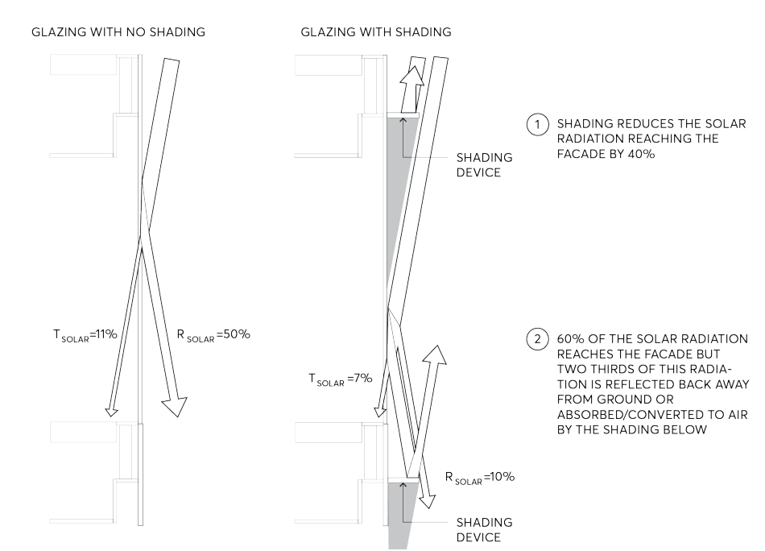
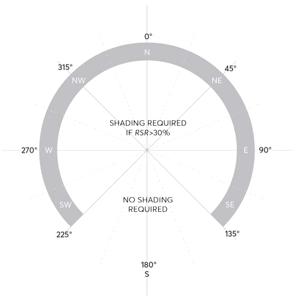

#### 5.4.3.3 FACADES

Objectives

O.01 Minimise the reflection of solar heat downward from the building façade into communal/private open space or the public domain.

Controls

C.01 The facades must demonstrate a minimum percentage of shading calculated on 21 December and evidenced with the provision of shadow diagrams with the Development Application. The time and extent of shading required for each façade orientation is detailed in the Technical Requirements UHI façade shading as included in this DCP.

C.02 Shading may be provided by:

• External feature shading with non-reflective surfaces;

• Intrinsic features of the building form such as reveals and returns; and

• Shading from vegetation such as green walls that is consistent with the controls in Section

– 5.4.4.5 Green Roofs or Walls of this DCP.

C.03 Where multiple reflective surfaces or concave geometry of reflective surface introduce the risk of focusing of solar reflections into the public spaces:

• Solar heat reflections from any part of a building must not exceed 1,000W/m² in the public domain at any time;

• A reflectivity modelling report may be required to qualify extent of reflected solar heat radiation. The modelling is required to consider all aspects that influence the amount of solar heat reflected at any point in time, including three-dimensional geometry, façade articulation specularity and angular dependent reflectivity of surfaces.

TECHNICAL REQUIREMENTS - UHI FAÇADE SHADING

The following technical requirements provides the details for demonstrating the minimum required shading under C.05 above. The detailed technical requirements are provided to allow non-prescriptive design solutions to meet the minimum shading requirements for façade orientation and extent of Reflective surfaces and provide a simple means of confirming adequacy at the time of application.

Background

Unshaded facades reflect solar heat into streets and open space where is can be absorbed and contribute to the energy imbalance that causes the urban heat island effect. Modern glass often achieves energy efficiency by maximizing the amount of non-visible heat that is reflected from the glass, which reduces energy into the building but magnifies the amount of heat that is reflected into streets and open space. All glass and similar reflective materials also increase reflectivity of light and heat and low angles of incidence. It is these low angles of incidence where solar shading is most effective. Figure 5.4.4.1 below shows the amount of solar heat that 50% of solar heat would typically be reflected from best case untreated clear glass at a 10º angle of incidence without shading. Solar shading (right) performs well to reduce the amount of solar radiation that will be reflected into the streets and open space as it blocks both the sun from hitting the façade and solar reflections from the façade.

> [Picture on page 78: a picture, saved as a picture (images/part-05-environmental-management-page-78-1.gif, 150 dpi).]

Figure 5.4.3.1 – Benefit of shading to reduce solar reflectance

FACADES REQUIRING SHADING

Facades with reflective surfaces must demonstrate a minimum percentage shading as determined in Table 5.4.4.1 and Table 5.4.4.2 for the 21 December, at the reference times included in Table 5.4.4.3.

Shading is not required on facades:

• Where the Reflective Surface Ratio (RSR) is less than 30%.

• That are orientated south of south-southeast and south-southwest.

> [Picture on page 79: a picture, saved as a picture (images/part-05-environmental-management-page-79-1.gif, 150 dpi).]

Figure 5.4.3.2 – Orientation and shading required

Figure 5.4.4.2 confirms the shading requirements for each facade orientation. Elements which can be counted to shading the facade may be:

• External feature shading with non-reflective surfaces

• Intrinsic features of the building form such as reveals and returns

• Shading from vegetation such as green walls that are consistent with the controls on green roofs and walls.

The following elements cannot be counted as shading to the shading requirements:

• Existing buildings.

• Existing structures.

PERCENTAGE OF SHADING REQUIRED

The percentage shading required to the Reflective surfaces to be shown in the shadow diagram is determined by the Reflective Surface Ratio (RSR) of each façade and the calculation tables below. Reflective surfaces on street walls (or if no street wall, as measured from the first 21 meters from the ground plane) are to be provided with the minimum percentage shading in Table 5.4.3.1.

Table 5.4.3.1 – Calculation of minimum percentage shading for Reflective surfaces on street walls

| Reflective Surface Ratio (RSR) | <30% | 30%-70% | >=70% |
|---|---|---|---|
| Minimum percentage shading (%) | 0 | (1.5*RSR)-45 | 75 |

Reflective surfaces on tower façades (above the street wall or if no street wall, as measured above the first 21 metres from the ground plane) are to be provided with the minimum percentage shading in Table 5.4.3.2.

Table 5.4.3.2 – Calculation of minimum percentage shading for Reflective surfaces on tower facades

| Reflective Surface Ratio (RSR) | <30% | 30%-70% | >=70% |
|---|---|---|---|
| Minimum percentage shading (%) | 0 | (0.8*RSR)-24 | 40 |

SHADOW DIAGRAM REQUIREMENTS

Shadow diagrams must be submitted with the Development Application showing the extent of shading of Reflective surfaces at the nominated time for each relevant façade. The shadow diagrams are to include a calculation of the percentage of shading provided and the RSR for each façade. Table 5.4.3.3 provides the nominated sun angles and shadow diagram reference times for each façade orientation where shadow diagrams are required.

Table 5.4.3.3 – Shading sun angles

| Orientation of façade | Time | Sun Angles |
|---|---|---|
| East ± 22.5° | 10am AEDT | Sun elevation: 51° Sun Azimuth: 86° |
| Northeast/Southeast ± 22.5° | 11:30am EDT | Sun elevation: 69° Sun Azimuth: 66° |
| North ± 22.5° | 1pm AEDT | Sun elevation: 80° Sun Azimuth: 352° |
| Northwest/Southwest ± 22.5° | 2:30pm AEDT | Sun elevation: 67° Sun Azimuth: 290° |
| West ± 22.5° | 4pm AEDT | Sun elevation: 48° Sun Azimuth: 272° |

Where it is demonstrated that shading cannot be achieved in accordance with the shading controls, a Maximum External Solar Reflectance as defined in Table 5.4.3.4 is generally acceptable.

Table 5.4.3.4 – Calculation of Maximum External Solar Reflectance

| Reflective Surface Ratio (RSR) | <30% | 30%-70% | >=70% |
|---|---|---|---|
| Maximum External Solar Reflectance (%) | No Max. | 62.5-0.75*RSR | 10 |
