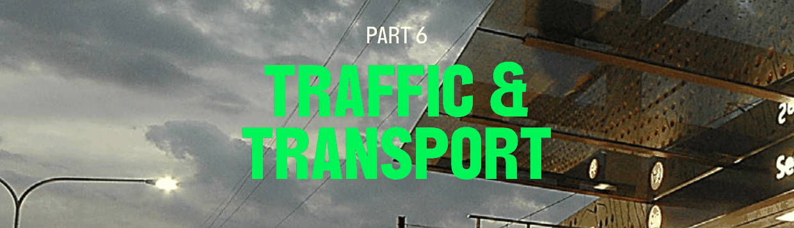

# Parramatta Development Control Plan 2023 - Part 6 Traffic & Transport

> This chapter is split into 4 section file(s), one per numbered heading, in the order they appear in the PDF.

Source PDF: [dcp-part-6-traffic-and-transport.pdf](dcp-part-6-traffic-and-transport.pdf)

> [Picture on page 1: a picture, saved as a picture (images/part-06-traffic-transport-page-1-1.gif, 150 dpi).]

## PART 6 TRAFFIC &

### TRANSPORT

Traffic and transport considerations are a major contributor to the design of place and city. Transport to, from and within the City of Parramatta (the City) are key to ensuring the economic potential can be realised without detracting from the City’s amenity. The City benefits from frequent rail services, bus services and major road corridors that allow people to access areas both within and outside of the City.

This Part of this DCP provides traffic and transport requirements, including sustainable transport measures, electric vehicle charging infrastructure, parking and vehicular access, loading and servicing requirements for all types of development across the City. The controls contained within this part of this DCP apply to all development types and need to be considered as part of any development application.

TOC - 1

### CONTENTS

| 6.1 | SUSTAINABLE TRANSPORT ............................................................................................................. 2 6.1.1 CARSHARE .......................................................................................................................................... 2 6.1.2 TRAVEL PLANS .................................................................................................................................. 3 6.1.3 ELECTRIC VEHICLE CHARGING INFRASTRUCTURE .............................................................4 |
|---|---|
| 6.2 | PARKING AND VEHICULAR ACCESS ........................................................................................... 6 |
| 6.3 | BICYCLE PARKING ............................................................................................................................ 15 |
| 6.4 | LOADING AND SERVICING ............................................................................................................ 17 |

TOC - 2

SUSTAINABLE TRANSPORT

<!-- sections -->
## Sections

1. [6.1 SUSTAINABLE TRANSPORT](01-6-1-sustainable-transport.md)
2. [6.2 PARKING AND VEHICULAR ACCESS](02-6-2-parking-and-vehicular-access.md)
3. [6.3 BICYCLE PARKING](03-6-3-bicycle-parking.md)
4. [6.4 LOADING AND SERVICING](04-6-4-loading-and-servicing.md)
