### 7.4 GENERAL PROVISIONS

The City offers a significant amount of heritage and cultural landscapes. It is important to ensure that any development both on or near a heritage item or within a heritage conservation area is carefully considered. The provisions outlined in this Section guide development to ensure that the City’s existing rich heritage and culture heritage is respected and appropriately managed.

For further guidance on terms used throughout this Section, please refer to the glossary.

This Section of the DCP should be read in conjunction with the additional provisions that apply to Heritage Conservation Areas (HCAs) as outlined in Section 7.10 of this DCP.

Objectives

O.01 Ensure the appropriate management of heritage in the City. O.02 Retention and reinforcement of the attributes that contribute to the heritage significance of items, areas and their settings.

O.03 Ensure development is compatible with the significance and character of the area so that the new work does not detract from the historic buildings and their amenity to/or from the streetscape.

Scale O.04 The scale and bulk of any new work is the most important issue to get right. In the case of infill work in a conservation area, the scale of the new building needs to be similar to those surrounding it. In the case of renovations and extensions, the new work should not overwhelm the original building, and would almost certainly need to be no larger in size than the original building.

Siting O.05 In the case of infill work in a conservation area, the new building needs to have a similar orientation on the block and similar setbacks as those around. In the case of renovations and extensions, new work is best located to the rear or possibly the side of the building in order to minimise changes to the appearance of the building from the street.

Architectural Form O.06 The basic architectural form of any new work needs to respect that which exists. Issues to consider include the pitch and form of the roof, and the size, proportion and location of windows and doors.

Architectural Detailing O.07 Applicants need to be aware of the particular era and architectural style of the building or buildings, and make sure that any proposed changes respect this. For example, it is not appropriate to mix Victorian features with say California Bungalow and overuse of historical architectural details on new work should be avoided.

Materials and Finishes

GENERAL PROVISIONS

O.08 New materials need not always match the existing exactly but need to be compatible, with consideration being given to the colour, texture, and type of materials and finishes.

Use O.09 The best use for a building is usually the one for which it was built. Where this is not possible, a use which requires minimal alterations will be more compatible.

Original Fabric O.10 It is important to minimise alterations to the original fabric. Where possible, it is preferable to repair rather than replace individual elements such as windows and doors.

The Aging Process O.11 The ‘patina’ of age on a building adds much to its character and significance. A worn step, for example, demonstrates the many years of feet crossing a threshold. Such features add to the uniqueness and character of the place and should be retained.

Curtilage O.12 The majority of built heritage items in the City are listed with their curtilage contained within the lot boundary containing the item. In some cases, there is a reduced curtilage where the significance of the item and its interpretation is not dependant on having a large curtilage extending to the lot boundary. In such cases it is necessary to identify a curtilage that enables the heritage significance of the item to be retained. It is also possible that there will be an expanded curtilage for some items where the curtilage is greater than the property boundary. An expanded curtilage may be required to protect the landscape setting or visual catchment of an item. For example, the significance of some properties includes a visual link between the property itself and a river or topographical feature.

Siting O.13 An infill building adjacent to a heritage item should not precisely imitate its neighbour but use recognisable tools such as massing, scale, setback and orientation, details and materials, roof forms and coursing lines to complement adjacent heritage items.

GENERAL PROVISIONS

Controls

Landform/Natural characteristics C.01 Maintain the natural landform and character of the area: avoid any cut and fill to land when constructing an addition, a new building and improving landscaping grounds. Refer to Figure 7.4.1.

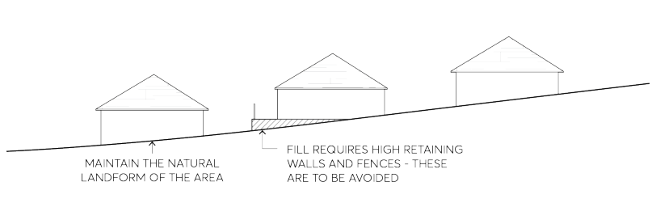

> [Picture on page 10: a picture, saved as a picture (images/part-07-heritage-archaeology-page-10-7.gif, 150 dpi).]

Figure 7.4.1 – Landform/Natural Characteristics

Subdivision Pattern C.02 Maintain the historical pattern of subdivision. C.03 Where development is proposed that adjoins a heritage item identified in the Parramatta LEP 2023, the building height and setbacks must have regard to and respect the value of that heritage item and its setting.

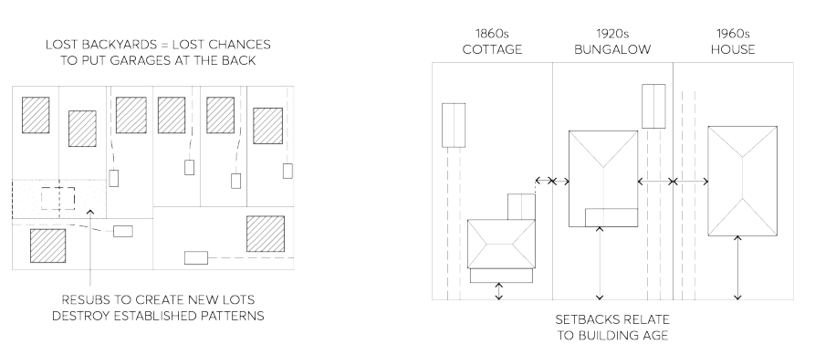

> [Picture on page 10: a picture, saved as a picture (images/part-07-heritage-archaeology-page-10-14.gif, 150 dpi).]

Figure 7.4.2 – Subdivision patterns

C.04 Adequate open space areas around the heritage item should be retained to facilitate its ongoing use or allow for flexible adaptive reuse in a manner compatible with its history and heritage significance.

GENERAL PROVISIONS

C.05 Subdivision should minimise interference with the visual setting of the heritage item the lot containing the heritage item should have sufficient curtilage to provide a visual setting that is proportional to the size and design of the building.

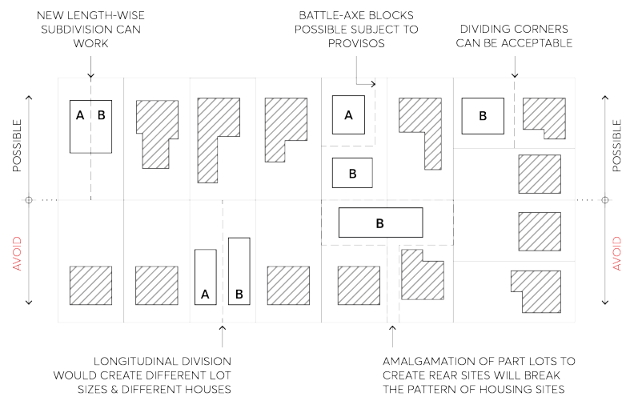

> [Picture on page 11: a picture, saved as a picture (images/part-07-heritage-archaeology-page-11-5.gif, 150 dpi).]

Figure 7.4.3 – New subdivision, battle-axe and amalgamation of lots

Existing Buildings C.06 Retain all buildings and ancillary structures that explain the history of the area and contribute to its significance.

C.07 Avoid re-roofing the main body of the building except:

• to match the original materials, or

• where re-roofed in non-original fabric such as modern corrugated metal roofing.

C.08 New technologies and additions (such as an array of solar panels, satellite dishes, etc.) on heritage listed items and properties located within heritage conservation areas that are visible from the public domain are generally not supported.

Alterations and Additions C.09 Before any changes are made to a building, consideration should be given to whether increasing the bulk will adversely impact its heritage significance and public domain appearance. Additions to small buildings could easily overwhelm the heritage character while occupy significant portions of the garden and open spaces. Garden space is required for private outdoor living areas. Private and open space is a distinctive characteristic in many conservation areas that retains the historic pattern of subdivision and preserves the setting for each house.

C.10 Any alterations and additions must be consistent with the scale, form and materials used in the existing building so as not to detract from its visual importance to the area while enhancing the area’s visual consistency with the amenities. Materials selection should be sympathetic to the

GENERAL PROVISIONS

existing house, or otherwise lighter weight materials such as painted timber, fibro, iron or timber cladding could be adopted.

C.11 Generally, modest additions work best in heritage sensitive contexts. Modest and proportionated additions can be designed as wings or pavilions connected by a “link” structure to complement the existing building. Refer to Figure 7.4.4.

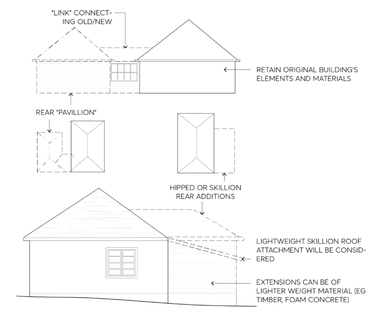

> [Picture on page 12: a picture, saved as a picture (images/part-07-heritage-archaeology-page-12-7.gif, 150 dpi).]

Figure 7.4.4 – Additions

C.12 All the proposed additions must be located at the rear of the property, never at the front or on the side of existing retained items. Additions should be linked to the original main part of the existing building by way of pavilions or skillions at the back of the house. Refer to Figure 7.4.4 and Figure 7.4.5.

GENERAL PROVISIONS

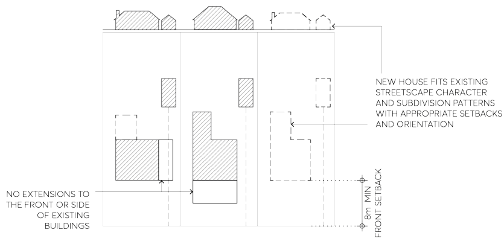

> [Picture on page 13: a picture, saved as a picture (images/part-07-heritage-archaeology-page-13-2.gif, 150 dpi).]

Figure 7.4.5 – Alterations and additions

C.13 Additions should not be designed to appear higher than the ridgeline of the existing buildings and to complement the existing roof form. The main body of the building should be retained, restored, and kept in good condition to extend its life and use of materials.

C.14 In general, where an extension is proposed to a single storey dwelling the extension should also be designed as single storey, unless flooding concerns would be identified and the proposed development must comply with the flooding requirements of this DCP.

C.15 Where an upper storey extension is proposed to a single storey heritage item, the extension should be contained within the roof form. This may mean constructing an addition that has a minimum ceiling height (compliant with Building Code of Australia requirements) on the ground floor or an attic-style pitched ceiling on the first floor. Where this is not possible to achieve compliance, the extension should be located to the rear of the property and incorporate a transition from the single storey scale of the original house (at the front) to the two-storey scale of the new structure at the rear. This transitional form may be conceived as a building form (such as roofs that step up progressively) or may be a space or void which helps to separate the two height forms. Refer to Figure 7.4.6.

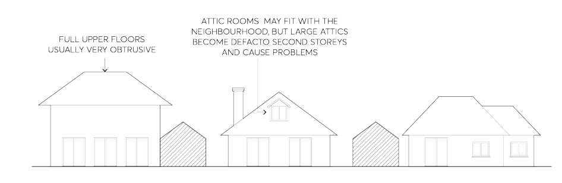

> [Picture on page 13: a picture, saved as a picture (images/part-07-heritage-archaeology-page-13-19.gif, 150 dpi).]

Figure 7.4.6 – Upper storey additions and attics

GENERAL PROVISIONS

C.16 Rear second storey additions should use recessive colours and should not visually dominate the side and front elevations of the existing retained building.

C.17 Any proposed roof extensions should be carefully designed to ensure that its form is compatible with the original building. Roofs which are part of additions should be consistent with the existing roof in terms of its form, pitch, eaves and ridge height and should be designed in high quality and standards with proportion, symmetry and alignments sympathetic to the existing buildings. Refer to Figure 7.4.7.

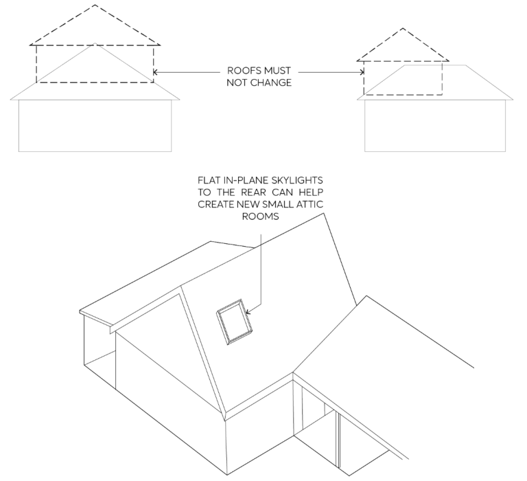

> [Picture on page 14: a picture, saved as a picture (images/part-07-heritage-archaeology-page-14-9.gif, 150 dpi).]

Figure 7.4.7 – Roof alterations and additions

Note: Skylights are less visible than dormer windows. Their heritage impacts are less invasive and could better support light access to attic rooms.

C.18 The treatment of design elements, such as verandah posts details, new doors or windows, on new extensions to heritage items should be consistent with those of the original building. It is inappropriate to use a simpler version of the design details used in the original building so that the new additions are in keeping with, and still able to be differentiated, from the original structure.

C.19 Council does not generally support demolition of heritage items. Poor structural condition or costs associated with restoration and conservation works are not sufficient justifications. Demolition by neglect is also a serious issue and a concern for Council, the poor conditions could affect not only the subject site liveability but also the safety and liveability of the nearby

GENERAL PROVISIONS

properties. Unkempt items negatively impact the character of the conservation area, as well as the context and view surrounding heritage items.

C.20 Servicing, fire safety or Building Code of Australia compliance upgrades for a new use should not impact on the heritage significance of the item. Refer to Fire and Heritage Guidelines 2021 by the Heritage Council of NSW.

C.21 Unsympathetic elements should be removed when the opportunity arises, especially where substantial changes are proposed to a heritage item and the reversal will assist an improved heritage outcome.

C.22 Alterations and additions to a retained contributory or heritage items should be designed in scale, generally smaller and with suitable length and width to complement and not obstruct views between the existing buildings.

C.23 Changes to the interior and original layout which contribute to the significance of the existing buildings should be minimal so that the evolution of the building remains recognisable. Development should retain significant interior elements, i.e. wall nibs, decorative ceilings and cornices, fireplaces and chimneys, lead light windows and timber and architraves, and the like.

C.24 Rendering or painting original face brick is not supported. Conservation works should re-establish building’s integrity by brick pointing the existing bricks with lime mortar. If historic evidence are in support, tuck-pointing the mortar joints of brickworks assists with protecting the structure from water damage. Stone and marble elements, if present in the building façade, must be treated as required. Original rendering is to be retained and/or consolidated with like for like materials.

New Buildings C.25 New developments on a site that is individually heritage listed, in a heritage conservation area, or is located in the vicinity of a heritage listed item or heritage significant area is to be designed and constructed in a manner that does not detract from the historic significance of that item or the area. Refer to Figure 7.4.5.

C.26 Applicants should concentrate on suitable design solutions that would adequately address the height, siting, shape and materials sympathetically to blend the new buildings with its heritage or significant context without pursuing imitation of period details. Design in context considerations include:

• the proposed heights of the new building compared to those nearby – the new building should be no higher than the majority of the buildings in its vicinity;

• the proposed setbacks of the new building from the street and from its side and rear boundaries compared to its neighbours on either side;

• whether the proposed building’s massing and features has a similar shape of the other buildings in its vicinity – in a street with hipped or gable roofs, in a street of commercial buildings, a parapet roof form might help the new building fit better within its neighbourhood; and

• whether the proposed building materials will complement those material used nearby -most houses in the City are of brick or weatherboard so bagged and painted brick walls might not be suitable for proposed new buildings within the same district.

GENERAL PROVISIONS

C.27 In some areas including conservation area and special character areas the pattern of development is an important element which plays a role in the history and heritage significance of the place. New development which would alter this distinctive pattern of development is unlikely to be supported, even if the proposed development is designed low and not visible from the street.

C.28 In areas where the lots pattern of development is not part of the heritage significance of the place, new buildings at the rear of old buildings might be considered if the proposal is designed and sited successfully to not disrupt the streetscape, affect the setting of the heritage item or undermine the amenity of the area.

C.29 The important design principles to consider when designing a new building in a heritage sensitive context are:

• Repeat the same size of driveways and pattern of openings.

• Avoid large, impermeable paved areas.

• Keep new buildings bulk low so it can be screened by the existing building, and supplemented by existing or new trees to mitigate its visual prominence.

• Consider new planting in suitable locations adjacent to driveways to help screen views between buildings.

• Adequately position the building to achieve a better relationship between old and new buildings.

• Site new building to minimise adversely impacting sunlight and views enjoyed by neighbours.

• Consider all site potential and constraints, such as archaeological deposits that might exist within the site.

• Avoid introducing new large buildings that cannot be screened and which would overwhelm old buildings and detract from their setting. Refer to Figure 7.4.8.

GENERAL PROVISIONS

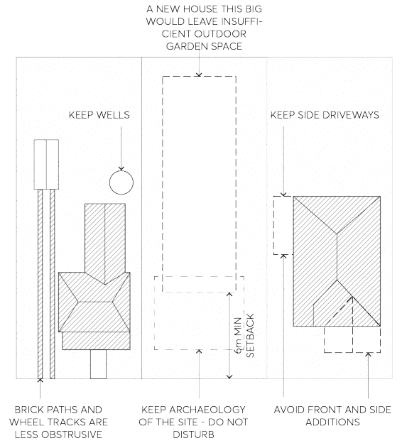

> [Picture on page 17: a picture, saved as a picture (images/part-07-heritage-archaeology-page-17-2.gif, 150 dpi).]

Figure 7.4.8 – New additions to be considerate of site’s heritage context, including archaeology (Aboriginal and European).

C.30 Buildings with wall heights below 9m can be screened by trees and this helps new and old blend better together.

C.31 New buildings need to conform to existing subdivision patterns. C.32 Buildings which cut across lots or cover a large amalgamated lot will be at odds with the regular subdivision pattern in conservation areas. Such outcomes will be obvious from the street and will most likely not be supported by Council.

C.33 New development near a heritage item needs to be carefully designed to not compete with it. The new building must align with the character of the surrounding neighbourhood, allowing the heritage item to preserve its visual and spatial curtilage.

C.34 A new building in heritage context needs to follow or establish the same front and side setbacks as the existing adjoining buildings. If the neighbour items are heritage listed or contributory to the streetscape, the new building should be of a similar scale and built form and utilise sympathetic materials which fit in with those already in the street.

C.35 Large openings such as glass windows or glazed walls are not appropriate in a heritage context. Garages, carports and other ancillary buildings C.36 Unless otherwise stated in other Sections of this DCP, all new carports, garages and other ancillary buildings (such as sheds) should complement heritage listed buildings and conservation areas by complying with the following controls.

C.37 All new ancillary buildings including garages and carports must be detached from the main building and located in the rear yard so as not to disturb the streetscape or compete with the

GENERAL PROVISIONS

appearance of the house. Where it is not possible to locate the building at the rear of the property, they should be located at the side of the house and setback at least 1m from the front the building line (wall of the house, not the verandah) so it does not become a feature in the streetscape. Refer to Figure 7.4.9. Where there is no room to build a garage or carport behind or beside the house, a simple paved standing area at the front is better than a carport or garage.

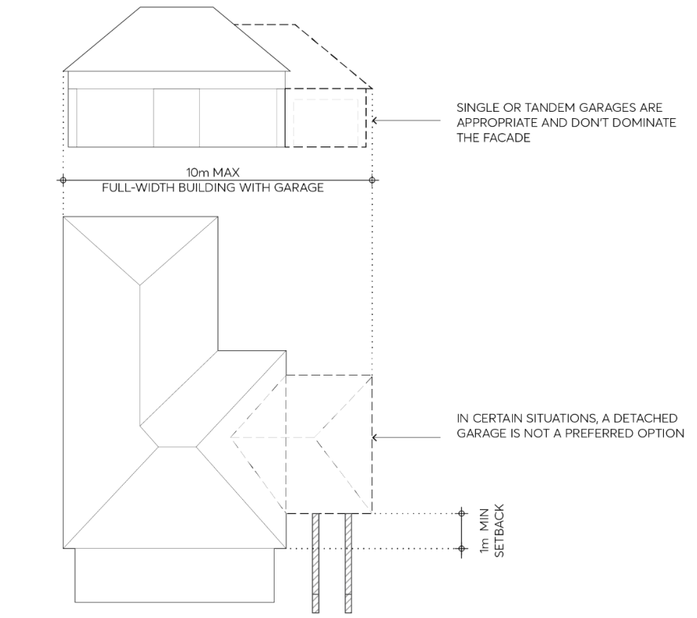

> [Picture on page 18: a picture, saved as a picture (images/part-07-heritage-archaeology-page-18-8.gif, 150 dpi).]

Figure 7.4.9 – Alternate garage scenario where a detached addition is not possible

C.38 Carports and garages should be designed as simple, useful structures to shelter the car. It is important to reduce the scale and bulk of the roof form so that the garage does not compete with the house character. A single car garage is more appropriate than a double size garage, however a tandem option might be considered if suitable for the site. The materials, colours, and door type of the garage structure should fit with the character of the area. Decorative details should be avoided.

C.39 Ancillary buildings including driveways and carports should be designed as secondary utility buildings with no inclusion of unnecessary architectural details such as repurposing period decorative features.

C.40 Ancillary buildings should be constructed of lightweight materials such as timber or metal.

GENERAL PROVISIONS

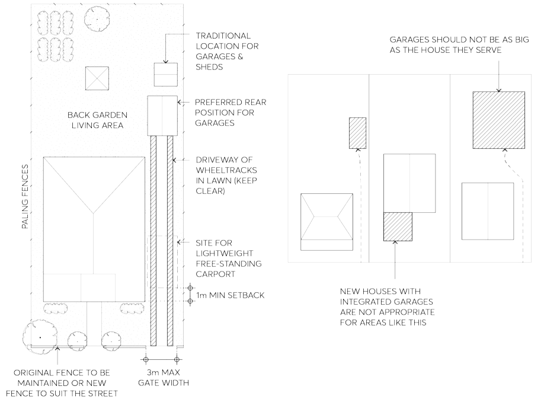

> [Picture on page 19: a picture, saved as a picture (images/part-07-heritage-archaeology-page-19-2.gif, 150 dpi).]

Figure 7.4.10 – Siting of garages, carports, and other ancillary buildings within existing patterns and new subdivisions

Driveways C.41 Driveways should be constructed of a non-obtrusive material such as concrete, bitumen, gravel, or common or dark bricks.

C.42 Two wheel tracks with planting (e.g. lawn) in between are preferable to a full-width driveway. C.43 Driveways are to be no greater than the width needed for a single vehicle and any necessary turning space.

C.44 Existing sandstone kerbs are considered highly significant and part of the street character and/or complement the siting of heritage listed sites. These road features and elements, including guttering and stone kerbs, are often impacted by public domain or development works.

• Original and well-preserved sandstone elements should be retained and protected, especially if a large section is still visible and intact. Where only small sections are remaining in situ or when it is not possible to reinstate a consistent portion of these sandstone features, a salvaging procedure should allow its re-use on site or elsewhere.

• Avoid changes to existing stone kerbs and gutters in areas that are not required. If repairs are needed, maintain and restore (where they remain beneath the bitumen) or reuse the sandstone for both kerbs and gutters.

GENERAL PROVISIONS

• Reuse of significant sandstone kerbing must always be considered in the upgrading and cut existing stone to install new stormwater kerb’s outlet connection. As part of the proposed upgrading works, it is recommended that adverse impacts on the existing adjoining kerb stones and gutters (i.e. the stones get disconnected from its bed), is mitigated with a cautious approach. This means changing as much as necessary but as little as possible, with surrounding areas repaired using suitable materials (such as lime mortar).

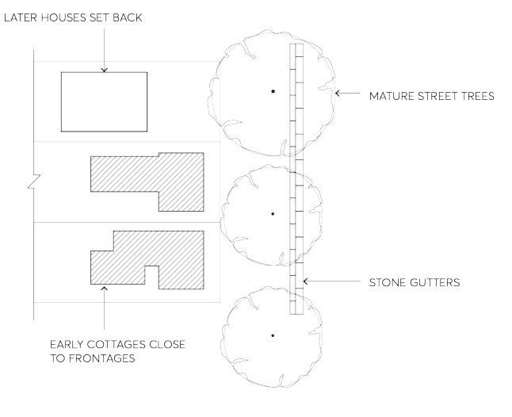

> [Picture on page 20: a picture, saved as a picture (images/part-07-heritage-archaeology-page-20-8.gif, 150 dpi).]

Figure 7.4.11 – Stone kerbs

Fences C.45 Keep all existing fences that are original and or contemporary with the building type, and which visually contribute to an understanding of the history of the development of the area.

• An early fence should be regularly maintained, repaired, and kept where possible.

• If the fence level of decay is beyond repair, it should be replaced in its original form with like for like materials, technology, and colours. Fences are also typically associated with the building’s period style and, in conservation areas and heritage items, might represent a distinctive character which enhance the heritage significance.

C.46 For all front boundaries where there is no existing front fence or the existing fence is a later addition and not contemporary with the house, a new low fence could be constructed.

• Materials used for the proposed fences should be similar to those of the building in the locality or those for which there is historical evidence in support of the proposed design.

• Fences on nearby similar buildings or old neighbourhood photographs will indicate how an early fence would have looked; the right period style of fence to suit the age, materials and social standing of house may also be identified from Figure 7.4.12 and books in the local library.

GENERAL PROVISIONS

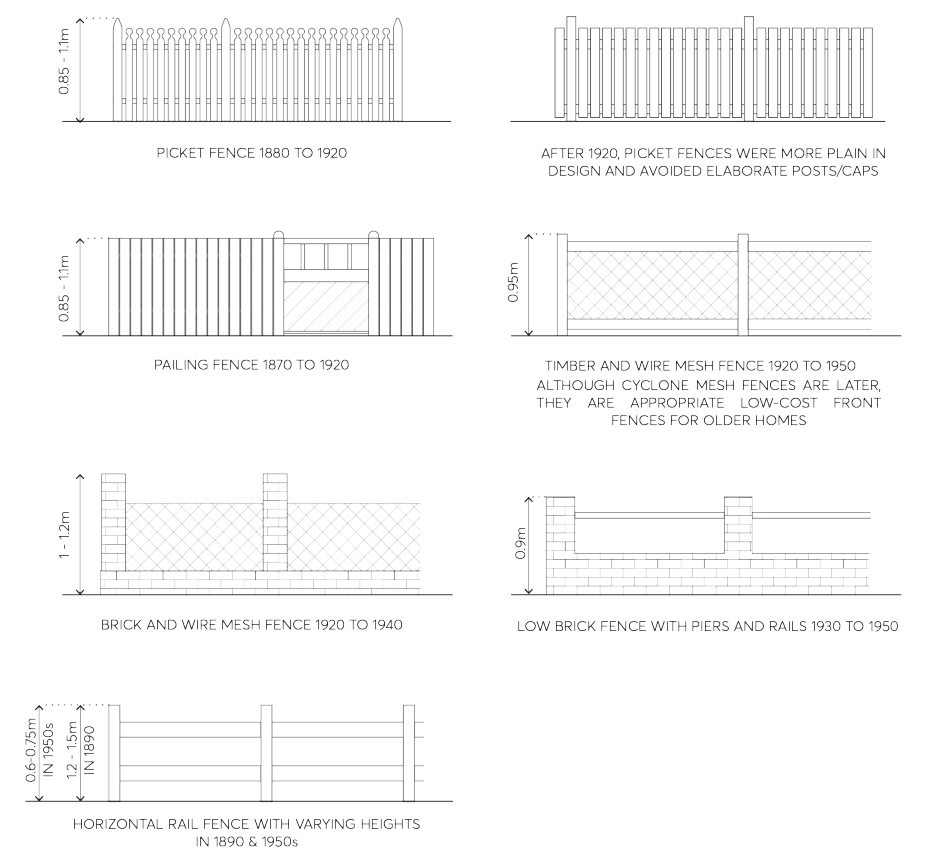

> [Picture on page 21: a picture, saved as a picture (images/part-07-heritage-archaeology-page-21-2.gif, 150 dpi).]

Figure 7.4.12 – Typical and most common built fences

Note: Applicants are encouraged to engage with external professional heritage consultants to seek advice on the most suitable design solution for their specific development.

C.47 Keep street amenity by continued use of low front fences which allow each garden to be viewed from the street. Fences greater than 1.2 metres in height should be avoided.

C.48 Encourage retention and use of timber paling fences to side and back boundaries and replacement, where necessary, with fences of similar height and materials. Side and back boundary fences of modern metal clad fencing systems such as Colorbond are not permitted and must be avoided as they are detracting and not appropriate to heritage items or to the streetscape of the conservation areas.

C.49 Front fence and openings for cars access must not exceed 3m in width and not disrupt the visual continuity of an existing fence along the streetscape with no more than a single opening per allotment.

C.50 New fences should match as closely as possible to the original fencing, and should complement the period and style of the building as indicated in Figure 7.4.12. If the original fence type is not

GENERAL PROVISIONS

known, it should specifically relate to the architectural style, character and period of the existing heritage building with respect to design, materials, colour, and height.

C.51 Mechanical and automated opening mechanisms for existing gates are not supported. General Maintenance C.52 Regular maintenance of heritage buildings is essential for their conservation and protection. Buildings should be kept structurally sound, habitable and weather proofed. Landscaped areas must also be maintained within the site to facilitate the ongoing maintenance of the buildings. Refer to the Maintenance Series by Heritage NSW as the principal resource for technical information on conservation and maintenance works in heritage buildings.

Maintenance of Roof Roofs protect buildings from the weather. They must be kept waterproof and in good functional condition with adequate level of services, maintenance and repair to all its component including gutters and downpipes. The shape, guttering, and cladding of the roof are also an important part of its streetscape presentation. Lack of repair accelerate the decay of the roofing and its structural and physical capability to protect the building and its amenities. C.53 The original shape of the roof should not be changed or altered. Suitable alteration could be considered where the original roof fabric is respected and the proposal aligns with the general controls.

C.54 The original roof cladding of a building (slate, shingle, tiles or corrugated metal) should not be changed if it is in good repair conditions.

C.55 Any necessary repairs should be matched like for like with the original cladding – e.g. terracotta tiles with same or similar commercially available terracotta tiles, corrugated metal roof with identical or similar commercially available metal cladding, Welsh tone slate with a similar material slate of a similar grade. If repairs of an existing roof is not achievable due to material costs or scarce availability of materials (e.g. slates or flat tiles) repairs should be made so that the original material is salvaged and reused for the most visible areas. A similar material is to be used in the portions or areas of the roof that is not directly visible from the public domain.

C.56 Chimneys must not be removed as it is part of a house. Existing chimneys and fireplace could be converted and used in conjunction with installation of a gas fireplace. Restoration and conservation of dismissed chimneys could represent an opportunity for a better and sustainable heritage outcome.

C.57 Details and specially shaped gutters are important to the street appearance of historic houses and might require advice from a heritage consultant on the supply or fabrication of those specific elements.

Maintenance of Walls C.58 Timber walls and existing cladding is best maintained with regular painting. The colour scheme for a house should be appropriate to its age, context, and location. The style and historic colour scheme could be identified with paint scrapes to inform decisions about repainting or to find evidence of original or earlier colour schemes. Refer to heritage guidelines and publications on the Heritage NSW website. Applicants are encouraged to

GENERAL PROVISIONS

engage with a professional heritage consultant to seek advice on the most suitable solution for their specific development.

C.59 Face brickwork or stone should not be painted. Cleaning, repointing, and tuck-pointing are common conservation practices that would preserve and enhance the heritage fabric.

C.60 There are several techniques to restore original brickworks. Sandblasting to remove paint from brick or stone is extremely dangerous for old buildings; it could remove both paint and the outer skin of the brick, exposing it to weathering and changing its appearance. Only careful chemical treatment should be used to remove paint. Expensive treatment could be prohibitive, and it is sometimes preferable to keep existing painting of the brick walls.

Maintenance of Doors and Windows C.61 Original doors and windows should be kept. They are valuable and an important part of the historic appearance of a house or shop. Regular maintenance including treatment of the timber elements, repairs, and painting are necessary and are the most effective way to maintain and protect doors and windows’ structural and visual integrity.

C.62 If the original doors or windows have been lost, those should be replaced with the correct size and type for the age and style of the house or shop. Nearby or adjoining heritage houses or shops could retain original and significant features that could inform the appropriate size and type of the new doors or windows.

Landscaping and Gardens C.63 Heritage houses (including houses in heritage conservation areas) in residential use require at least 50% of the site to be used as garden space, in keeping with traditional lot use and typical ratio of built and open space. Lots over 700m² may require 60% of the site to be used as landscaping and garden space and retained between front, rear and side area.

C.64 Heritage listed gardens or significant landscape should retain layouts and primary features and structures, including native or indigenous species or exotic species such as mature trees, gardens shrubs, outbuildings, fences, stonework, pathways and the like.

C.65 Trees and garden elements which contribute to the significance of a heritage listed item should be retained, maintained, and conserved for their important relationship with the dwelling and the biodiversity values within its greater context.

C.66 Established gardens within the curtilage of a heritage listed item should be retained and new designed elements including planting should complement the period and style of the item. Historical value could be documented in archival documentation, period photographs, or aerial images that often confirm the long existence of such features.

C.67 Alterations and additions should be located to avoid adverse impacts on significant trees and garden areas. Consistent and generous deep soil and tree planting are to be considered with any alteration and additions of existing sites.

C.68 The removal of existing exotic, native, or indigenous trees that are identified as heritage items or are within the curtilage of heritage items should be avoided unless the tree is:

• deceased, dying, or dangerous, and

• is not required as the habitat of native animals.

GENERAL PROVISIONS

Refer to Part 5 – Environmental Management of this DCP for tree and vegetation preservation controls.

C.69 Site works, including driveways, should be located and designed to avoid damage to significant trees. A Tree Protection Zone (TPZ) should be established with any work occurring in proximity of those areas. Connectivity of large street trees with adjoining or nearby remnant groups should be protected.

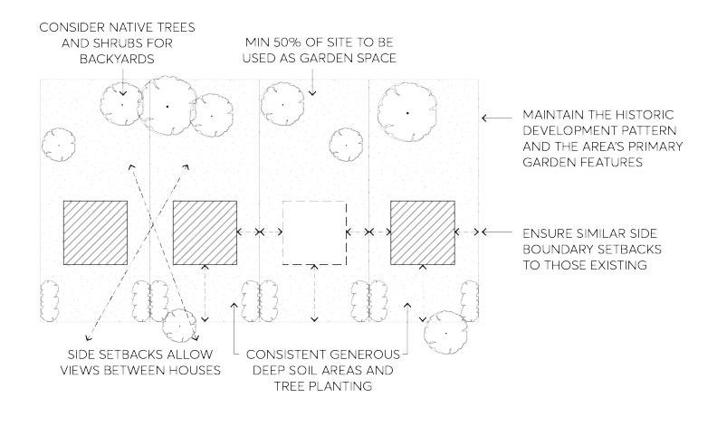

> [Picture on page 24: a picture, saved as a picture (images/part-07-heritage-archaeology-page-24-8.gif, 150 dpi).]

Figure 7.4.13 – Landscaping and gardens

Civic, Commercial Development and Adaptive Reuse C.70 Retention of the original streetscape facades is required, with extensions or redevelopment to be located to the rear of the property.

C.71 Development should be compatible with the existing height, scale, massing, detailing, setbacks and orientation of existing development within the streetscape. New extensions should be recessive to the original buildings.

C.72 Colours and materials should be carefully selected so that they do not visually dominate, or overly contrast with that of the existing heritage item. New development such as new infill shall utilise compatible colour schemes and materials in keeping with the original building.

C.73 For development involving churches or schools, the removal of more recent structures may be considered acceptable where it is demonstrated that they are not critical to the heritage significance of the property. The proposed new addition should preserve the values, consistency, and visual connection of the buildings in a compatible and suitable manner.

C.74 New development should be located to the side or rear of the heritage item and the original building should visually dominate.

C.75 Development should not impact upon the sight lines from public areas to the original building.

GENERAL PROVISIONS

C.76 Development should minimise any changes to the significant fabric of the building and, in particular, its relationship to the streetscape appearance of the heritage item.

C.77 Signage, lighting, materials, and colours used should be unobtrusive and compatible with the overall style and design of the building and in accordance with Section 7.9 – Signs on Heritage Buildings and Heritage Conservation Areas of this DCP.

C.78 Infilling or enclosing of original verandahs is generally not supported.

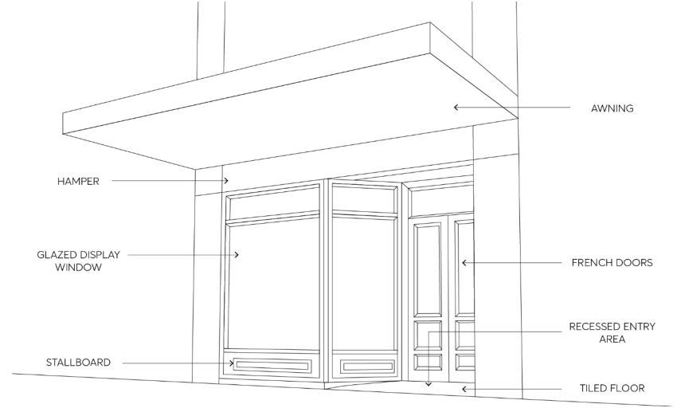

> [Picture on page 25: a picture, saved as a picture (images/part-07-heritage-archaeology-page-25-8.gif, 150 dpi).]

Figure 7.4.14 – Elements of a traditional early 20th century shop front

DEVELOPMENT IN THE VICINITY OF HERITAGE
