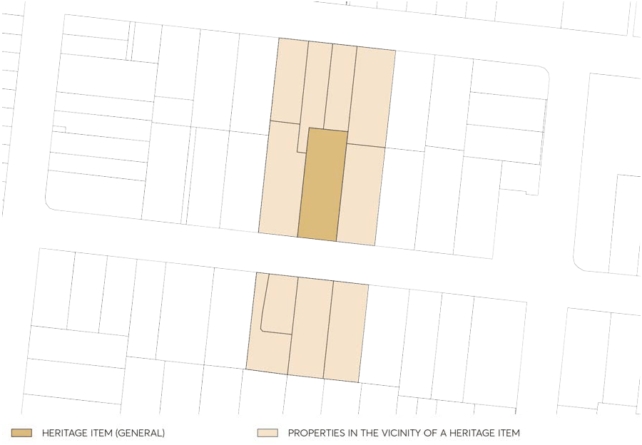

### 7.5 DEVELOPMENT IN THE VICINITY OF HERITAGE

The setting of a heritage item or heritage conservation area often extends beyond current property boundaries, and can be influenced by historic subdivision patterns, topography, vegetation, and views to and from the heritage item or heritage conservation area. It is important to understand the relationship of a heritage item, or heritage conservation area, to adjoining land. Relevant factors include:

• Is the site within historic property boundaries of the heritage item;

• Could development on the site affect views to or from the heritage item or heritage conservation area;

• Could development on the site change the visual backdrop of the heritage item or heritage conservation area;

• Is the heritage item or heritage conservation area physically separate from the development site by a road, gully or escapement, creek or similar; and

• Are there any trees or remnant features on the development site that may have had an association with the heritage item. This Section applies to land that is adjoining, or across the road from a heritage item or a heritage conservation area (HCA).

Objectives

O.01 Ensure that new work is sympathetic to the heritage significance of nearby heritage items, or adjoining heritage conservation area, and their settings.

Controls

Development in the Vicinity of Heritage Items C.01 Design and siting of new work should complement the form, orientation, scale, and style of the heritage item.

C.02 Adequate space should be provided around the heritage item to allow for its interpretation. C.03 Development should maintain significant or historic public domain view to and from the heritage item.

C.04 Original or significant landscape features that are associated with the heritage item and which contribute to its setting should be retained.

Development in the Vicinity of Heritage Conservation Areas C.05 Development in the vicinity must respect the curtilage and setting of the HCA and protect views into and from the HCA.

DEVELOPMENT IN THE VICINITY OF HERITAGE

> [Picture on page 27: a picture, saved as a picture (images/part-07-heritage-archaeology-page-27-2.gif, 150 dpi).]

Figure 7.5.1 – Properties in the vicinity of a heritage item

C.06 Development is to be sympathetic to the primary characteristics and heritage values of the HCA with regards to proposed:

a) Context, including backdrop to places in the HCA.

b) Bulk, height alignment form and roofline of new development.

c) Proportions such as windows and door openings (number and location) and balconies.

d) Interface façade materials, treatments and palette.

e) Compatible fencing and screening.

C.07 Development Applications for multi-unit developments adjacent to HCAs must include a construction impact report demonstrating that the construction process will not detrimentally or indirectly adversely impact places in the HCA at the time of construction or over time.

SOLAR ENERGY SYSTEMS
