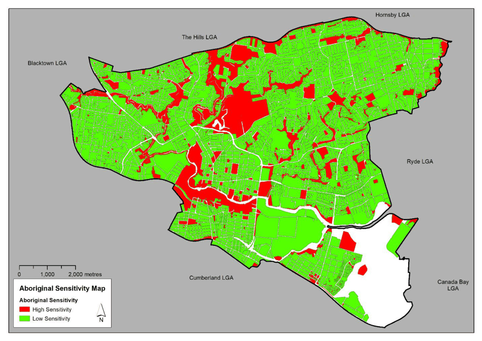

### 7.8 ABORIGINAL CULTURAL HERITAGE

Aboriginal heritage includes places and items that are important to the local Aboriginal community or to Aboriginal people of NSW. These are places or objects that people have a connection to, both physically and spiritually and can include natural features such as creeks or mountains, ceremonial or story places or areas of more contemporary cultural significance such as Aboriginal missions or post contact sites. Council has a database of known Aboriginal archaeological sites and information about the location of land that could contain Aboriginal sites or may have historical or cultural associations for Aboriginal people.

Aboriginal heritage is protected in The City under the Parramatta LEP 2023. Planning controls of this LEP require the Council to consider the impact of development on known or potential Aboriginal archaeological sites or sites of cultural or historical significance to Aboriginal people. When Development Applications are lodged for such sites, the Council will seek advice from the NSW Office of Environment & Heritage and local Aboriginal communities and may request an Aboriginal Heritage Assessment.

This Section is intended to guide the appropriate management of Aboriginal and Cultural heritage, particularly in areas shown on the Aboriginal Sensitivity Map (Figure 7.8.1).

Objective

O.01 Ensure that appropriate consideration is given to the impact of development on known or potential Aboriginal archaeological sites or sites of cultural or historical significance to Aboriginal people in the City.

O.02 Minimise the likelihood of disturbance to protect Aboriginal sites and archaeological relics.

Controls

C.01 Before lodging a Development Application for development that may have an impact on known or potential Aboriginal sites, NSW Office of Environment and Heritage Aboriginal Heritage Information Management System and Council’s information on known Aboriginal sites and potential heritage sensitivity should be consulted. Refer to Figure 7.8.1 below for the Aboriginal Sensitivity map.

ABORIGINAL CULTURAL HERITAGE

> [Picture on page 32: a picture, saved as a picture (images/part-07-heritage-archaeology-page-32-2.gif, 150 dpi).]

Figure 7.8.1 – Aboriginal Sensitivity Map

C.02 For properties identified with Low Aboriginal Heritage Sensitivity no Aboriginal Heritage Assessment is required.

C.03 For properties identified with High Aboriginal Heritage Sensitivity, a Due Diligence assessment and/or an Aboriginal Heritage Assessment is required, in accordance with the NSW OEH Office of Environment and Heritage guidelines and particularly where a development site:

• Is within 200 metres of the centreline of a creek.

• Has not been previously developed and contain undisturbed original landform.

• Is within 50 metres of a known Aboriginal site.

• Is of historical heritage with archaeological potential and is within the area of the Parramatta Sand Body.

C.04 In general, an Aboriginal Heritage Assessment will not be required if the land has been previously substantially developed, excavated to bedrock, and retains no undisturbed original landform.

C.05 For properties within 50 metres of a known Aboriginal site the Office of Environment & Heritage’s Aboriginal Heritage Information Management System should be consulted to determine whether the Aboriginal site is located on the property. If the known Aboriginal site is located on, or extends into the property, the development may become Integrated Development.

SIGNS ON HERITAGE BUILDINGS AND HERITAGE

CONSERVATION AREAS
