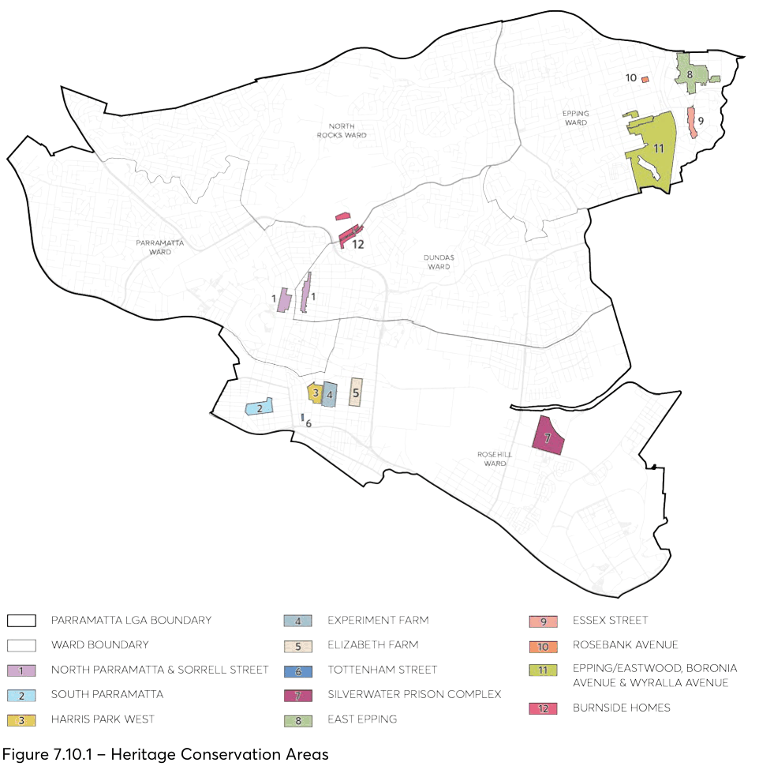

### 7.10 HERITAGE CONSERVATION AREAS

Heritage Conservation Areas (HCAs) are areas of land which have been recognised as having specific and significant historical value which should be protected. Features which influence protection include patterns of subdivision, building style, landscaping and streetscapes. HCAs are listed and mapped under the Parramatta LEP 2023 and, therefore, protected by the legislation. The HCAs have been ordered by ward boundary.

The HCAs shown in Figure 7.10.1 contain specific objectives and controls for the specific areas which may vary between each other. Alongside the specific HCA controls, the General Heritage objectives and controls are to be applied when preparing plans for development. This DCP identifies existing significant buildings that collectively demonstrate the history of a conservation area and contribute to its significance. These are known as Contributory items. Contributory items may not be individually listed as heritage items but, by virtue of their age, scale, materials, details, design style or intactness, make a significant contribution to the character of the heritage conservation area and therefore reinforce its heritage significance. Contributory items are required to be retained.

Non-contributory items may be described as neutral or intrusive. A neutral building is one that does not adversely or beneficially impact upon the character and heritage significance of the area in which it is sited or for which it is proposed. An intrusive building is disruptive because its visual character, form, scale or use is in conflict with the values of the area or setting. This conflict may mean that it adversely impacts on the heritage significance of the area or setting. Non-contributory items are not identified as existing significant buildings in the specific heritage conservation areas and are not required to be retained.

This Section should be read in conjunction with the general provisions outlined in Section 7.4 of this DCP. In the event of any inconsistency between the general objectives and controls and the objectives and controls listed in specific heritage conservation areas, the specific controls will prevail.

> [Picture on page 37: a picture, saved as a picture (images/part-07-heritage-archaeology-page-37-1.gif, 150 dpi).]

Figure 7.10.1 – Heritage Conservation Areas

#### PARRAMATTA WARD
