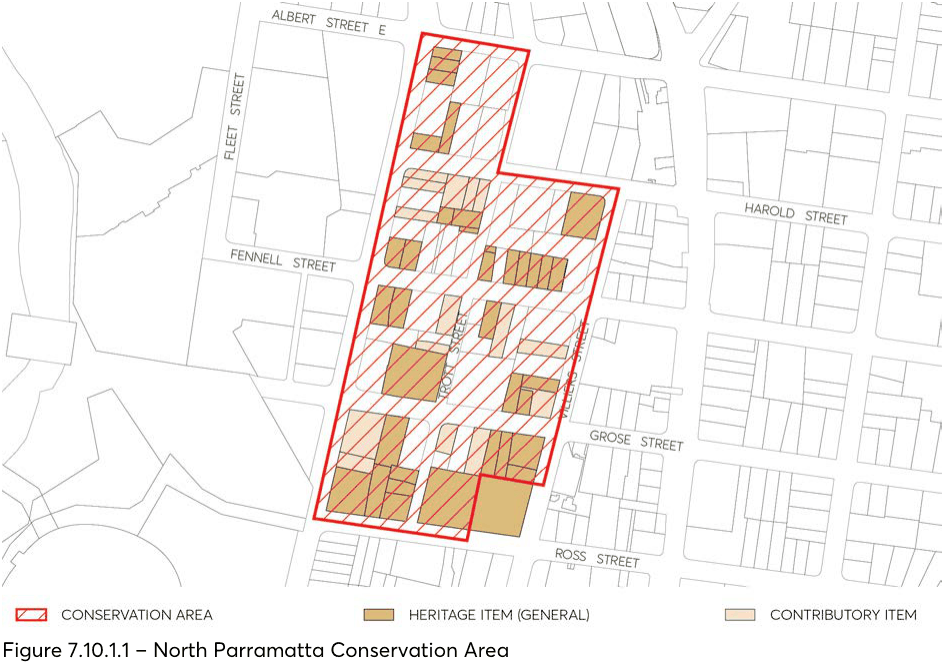
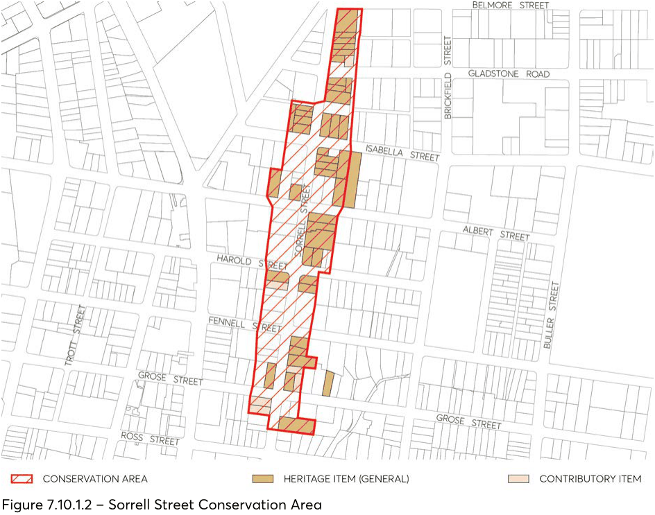
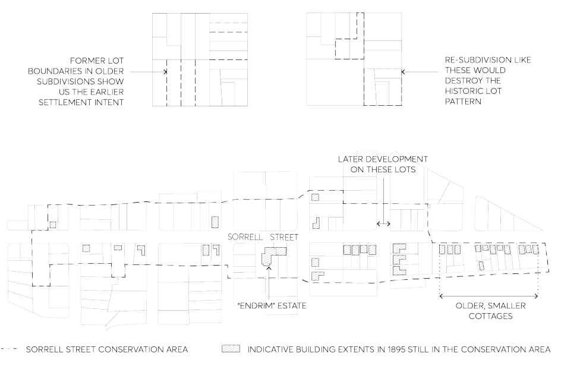

#### 7.10.1 NORTH PARRAMATTA AND SORRELL STREET CONSERVATION

#### AREAS

The location of North Parramatta Conservation Area is depicted in Figure 7.10.1.1 and the location of Sorrell Street Conservation Area is depicted in Figure 7.10.1.2.

#### 7.10.1.1 HISTORY

NORTH PARRAMATTA

By 1846, there was little development north of Fennell Street, apart from along Church Street. The only building from this period is Roseneath, built c 1837, but there are likely to be some belowground archaeological deposits. A decade later, when the streets were surveyed to enable them to be officially aligned, more cottages had been erected. Several dwellings remain from the 1860s and 1870s.

The 1880s was the most intensive period of development. The economic confidence of the time encouraged speculative builders and landowners to construct houses. By 1895, when the area was surveyed for the sewerage system, a relatively dense pattern of houses had developed, with only a few pieces of vacant land west of Church Street.

The area retained its character as an area for cottages, with some houses built each decade. From the 1960s onwards, Council approved two and three storey residential flat buildings in North Parramatta, most of which involved the demolition of two or more small old dwellings.

Archaeological investigations in Parramatta have shown that there is a high likelihood of valuable archaeological material below ground that is worthy of investigation and archaeological excavation if and when development occurs.

SORRELL STREET

Sorrell Street was one of the early streets developed north of the Parramatta River. Its southern end between Palmer and Grose Streets was shown on a map of 1825, and the Brownrigg Map of 1844 shows the full extent of the street as it is today. At this time there were few buildings, mostly south of Grose Street, none of which remain today. There has been considerable re-subdivision including the creation of allotments to face Sorrell Street, whereas most originally faced north or south to Ross, Grose or Fennell Streets.

Most buildings were constructed before 1895. Development was underway here in the 1840s as land in the centre of Parramatta was occupied. Building continued steadily from the 1860s to the 1880s. By the late nineteenth century, the original houses had been replaced by larger houses, some of which replaced two smaller houses. New houses were occasionally built in the subdivided grounds of existing houses with several houses built every decade. From the 1960s, Council approved

residential flat buildings on the western side of Sorrell Street that required the amalgamation of several properties and the demolition of small houses.

Today the area includes houses in a range of scales and materials, dating from the 1830s to the 1950s, and residential flat buildings dating from the late 1950s to the 1990s. Buildings and grounds vary in scale from Endrim (the oldest house in the street), a two-storey villa with a large garden that occupies most of the land on the eastern side between Albert and Harold Streets, to small cottages built close to the street.

#### 7.10.1.2 STATEMENT OF SIGNIFICANCE

NORTH PARRAMATTA

An area of early government subdivision in Parramatta that retains a considerable number of small dwellings and houses built from the mid-nineteenth century until the early twentieth century. In the nineteenth and early twentieth century this area was popular with the proprietors of businesses in Parramatta and it retains much of its residential character from this period. The predominance of small single storey cottages on their own allotments reflects the character of Parramatta north of the river from the mid nineteenth century until redevelopment for residential flats started in the 1960s. This area contains 46% of the dwellings that existed here in 1895.

> [Picture on page 39: a picture, saved as a picture (images/part-07-heritage-archaeology-page-39-17.gif, 150 dpi).]

Figure 7.10.1.1 – North Parramatta Conservation Area

SORRELL STREET

An important local road in Parramatta north of the river, together with street trees and houses dating from the mid-nineteenth century to the mid-twentieth century. The Sorrell Street area demonstrates the variety of small and large dwellings built in Parramatta, north of the river, in the nineteenth and early twentieth century. The predominance of small single storey cottages on their own allotments reflects the character of Sorrell Street from the mid-nineteenth century until redevelopment for residential flats started in the 1960s. This area contains 63% of the dwellings that existed here in 1895

.

> [Picture on page 40: a picture, saved as a picture (images/part-07-heritage-archaeology-page-40-9.gif, 150 dpi).]

Figure 7.10.1.2 – Sorrell Street Conservation Area

#### 7.10.1.3 DISTINCTIVE CHARACTERISTICS

• Gently sloping landform.

• Pattern of development from the nineteenth and early twentieth centuries of mostly small single-storey dwellings on their own allotments, in a variety of forms and styles with front verandahs, sited close to the street, together with a small number of larger houses with gardens.

• Twentieth century houses built on undeveloped land or replacing early small dwellings set further back than earlier houses with small front gardens.

• Gardens/yards at the rear of small dwellings that are likely to retain old wells from the era before the installation of a town water supply.

• Residential flat buildings dating from the 1960s onwards, two to four storeys in scale with driveways and ground level garages: these developments involved the amalgamation of two or more small allotments and the demolition of small dwellings.

• Absence of driveways across footpaths and hence the absence of garages at the front of lots and in the street scene.

• Stone kerbs and gutters and street trees.

• Street pattern from original government subdivision.

• Archaeological evidence of early dwellings constructed in Parramatta before the present buildings.

#### 7.10.1.4 PROVISIONS

Development should be in accordance with the general provisions under Section 7.4 of this DCP and the additional specific provisions below:

Objectives

The following objectives are applicable to both North Parramatta Conservation Area and Sorrell Street Conservation Area. O.01 Reinstatement of residential use in buildings originally constructed as dwellings. O.02 Ensure residential development are compatible with the small scale of its significant buildings. O.03 Retention of all buildings that contribute to the history of the area as a residential area from the mid-nineteenth century up to 1945.

O.04 Retention of the existing pattern of allotments of North Parramatta and Sorrell Street Conservation Areas.

O.05 Continued use for residential purposes and the re-establishment of residential use within buildings originally constructed as dwellings.

O.06 To avoid disturbance of significant archaeological deposits without investigation in accordance with the provisions of the Heritage Act 1977.

Controls

The following controls are applicable to both North Parramatta Conservation Area and Sorrell Street Conservation Area. Subdivision C.01 Maintain the historical pattern of subdivision and re-subdivision to form allotments for small dwellings.

C.02 Allow re-subdivision of lots that have been amalgamated in the past along the north-south line, or along previous boundaries as shown in the 1895 plan.

C.03 Avoid re-subdivision across the line of subdivision or by amalgamation of rear garden space.

C.04 Avoid development that involves the amalgamation of allotments and buildings that cross allotment boundaries.

> [Picture on page 42: a picture, saved as a picture (images/part-07-heritage-archaeology-page-42-3.gif, 150 dpi).]

Figure 7.10.1.3 – Subdivision - Sorrell Street Conservation Area, 1895

Existing Significant Buildings C.05 Consider removal of metal cladding followed by repair or reinstatement of weatherboards or other original cladding for buildings that have been clad in metal weatherboards.

C.06 Consider reinstatement of residential use in buildings built as dwellings but now in commercial use.

C.07 Avoid removal of stucco from buildings that were originally constructed with a stucco exterior. C.08 Avoid re-skinning of brick walls. C.09 Avoid removal of original details, except where they are decayed beyond repair and are to be replaced with an identical detail.

C.10 Avoid adding new period details for which there is no evidence in the existing fabric or in historical photographs.

C.11 Avoid covering original timber walls with another building material, such as imitation brickwork or metal cladding.

C.12 Avoid altering the roof form above the main body of the building, other than to reinstate an original roof form.

C.13 Avoid adding rooms above the main body of the house which require alterations to the existing roof height or shape. Rooms in the roof may be considered but only where ventilated by flat in-plane skylights at the rear of the roof.

Siting and Garden Area C.14 Maintain the historical pattern of development of detached dwellings with garden space around, with the oldest dwellings close to the front boundary and later dwellings and other buildings with larger setbacks.

C.15 At least 40% of the site must be garden area. Ensure a high level of amenity with garden spaces suitable for outdoor living, clothes drying, children’s play, etc.

C.16 Maintain features of heritage value in the garden area. C.17 Keep brick paving for paths and driveways. C.18 Keep all mature trees. Alterations and Additions C.19 Additions, limited to one storey, may occur at the rear of heritage buildings to increase the facilities available, provided the original character of the building is retained, the works do not involve demolition of significant parts of the building, and are in scale with the existing buildings. For most cottages, the roof space is too small for rooms to be accommodated without changing the roof scale and form.

C.20 Keep the existing form of the roof above the main body of the existing building. C.21 Avoid additions higher than the ridgeline of the existing building. C.22 Additions at the rear are encouraged in linked pavilions or skillions. New Dwellings A new small dwelling may be permissible in the rear garden of an historic building. Provided substantial land is retained around the existing building, car access can be obtained using an existing driveway, or from a rear lane or right of way from an adjoining property. Rooms in the roof may be permissible in the new dwelling provided the total height of the building does not exceed the height of the ridge of the existing building by more than 1m. C.23 New rear buildings should be single storey scale with a wall height not greater than 3.6 metres. C.24 Avoid hearted or speckled bricks in light colours. C.25 Avoid using brightly-coloured or shiny roof coverings, excepting corrugated iron. The following controls apply to development on properties listed under ‘Existing Significant Buildings’ at the end of this Section.

C.26 Avoid placing new buildings closer to the front boundary than the existing adjoining buildings and no closer than 6 metres.

C.27 New buildings to be set back from the rear of existing buildings by a minimum of 10 metres. C.28 Investigate archaeological potential of area where new buildings are sited. C.29 Keep and repeat the existing form of the roof above the main body of building. C.30 Hipped or gabled pitched roofs should not exceed 35 degrees.

C.31 Materials for new buildings to be rendered brick, common or face bricks, with tiles or corrugated iron roof.

C.32 Keep significant archaeological deposits intact unless excavated in accordance with the provisions of the Heritage Act 1977.

The following controls apply to new development on all properties not listed under ‘Existing Significant Buildings’ at the end of this Section. C.33 The building should have a residential use. C.34 Keep and repeat the existing setback from the front boundary (or minimum setback of 6m whichever is the greater).

C.35 Keep and repeat verandahs at the front of buildings. C.36 Keep and repeat the scale of nearby historic buildings, with no building exceeding 10m in width at the front wall.

C.37 Avoid having rooms in the roof which are larger than 60% of the floor area of the ground floor covered by the same roof.

C.38 Avoid constructing buildings of similar scale to the existing residential flat buildings. Character of Additions and New Dwellings C.39 New building works should respect the scale of historic buildings but should not copy their style or details (such as by reproducing small panel windows). It is appropriate for the new work to be in a contemporary style.

Utilities C.40 Aerials, antennae, air conditioning units, hot water systems, communication devices, rainwater tanks, roof vents, skylights, solar panels and the like should not be visible from the streetscape or a public place.

Garages, carports and other ancillary development C.41 Garages and carports should not become a prominent part of the streetscape. C.42 Back garden placement of garages, carports and other utility buildings must be separate from the main building.

C.43 Carports may be sited beside the house but only where they:

i) are constructed of lightweight frame of timber or metal

ii) stand at least 1 metres back from the front wall of the building and would not be a feature in the streetscape, and

iii) are not attached to the building and would not obstruct light and air into the building.

C.44 Avoid creating new vehicular access driveways off Sorrell Street or anywhere in the North Parramatta Conservation Area.

C.45 Avoid integrating garages into the facades of new buildings, except at the rear of allotments with access to two street frontages (eg laneway frontage) or with access to Trott Street.

Fences

C.46 Use low light-weight fences along the front boundary, such as timber picket fences with square tops, or timber frame fences with wire panels, which are common in the area.

C.47 Front fences are not to exceed 1.2 metres in height. C.48 Open wire or other metal fences are permissible provided shrubs, hedges or vines are planted to cover the fence.

Public Lands C.49 Avoid change to existing stone kerbs and gutters. If repairs are needed, reuse stone for both kerbs and gutters.

C.50 Avoid planting of shrubs and trees that will obscure the views along the streets for pedestrians. C.51 Avoid designs that involve major changes to the street pavement, such as chicanes, wide paved speed bumps or decorative paving.

#### 7.10.1.5 EXISTING SIGNIFICANT BUILDINGS

The following buildings together demonstrate the history of the area and contribute to its significance. They must be retained, together with their original features.

NORTH PARRAMATTA CONSERVATION AREA

• Fennell Street: 2*, 4*, 9*, 11*, 12*, 16*, 17, 18*, 20*, 21*, 23, 22*, 24*

• Grose Street: 1*, 6*, 8*, 9, 10*, 12*, 13, 15*, 17*, 19*, 20*, 22*, 24

• Harold Street: 1, 2, 3, 5

• O’Connell Street: 40-42*, 44, 46, 48, 56, 60, 62*, 72*, 74*, 76*

• Trott Street: 1*, 2*, 3*, 3c*, 5, 9*

• Villiers Street: 1, 3, 9

SORRELL STREET CONSERVATION AREA

• Albert Street: 44*, 54*

• Gladstone Street: 1, 4

• Grose Street: 44*, 46*, 48.

• Isabella Street: 8*, 10*, 12A*, 14*, 25*

• Sorrell Street: 31, 33, 36, 40*, 42, 44*, 48, 50*, 51A, 52*, 53*, 54*, 54A (north of Endrim) 56, 60*, 62*, 63*, 64*, 66*, 68A*, 70*, 72*, 75*, 76*, 77*, 78*, 79*, 80*, 81*, 82*, 86*, 88*, 90* * Heritage Item

#### ROSEHILL WARD
