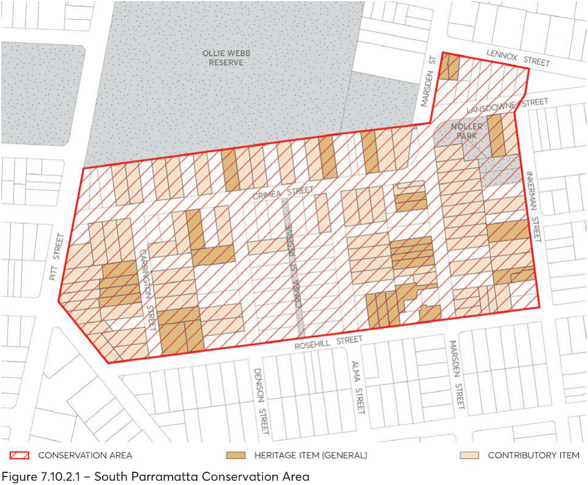
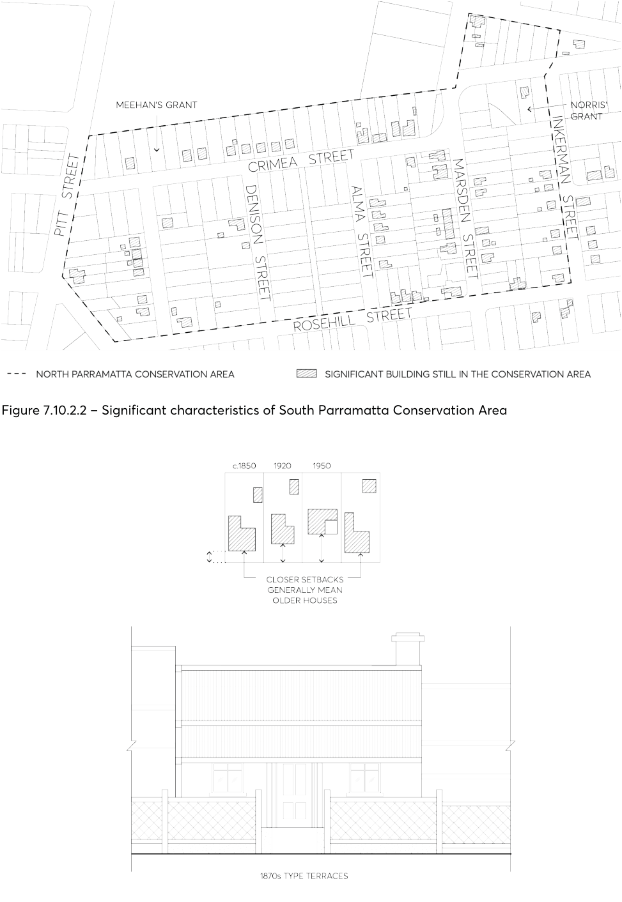
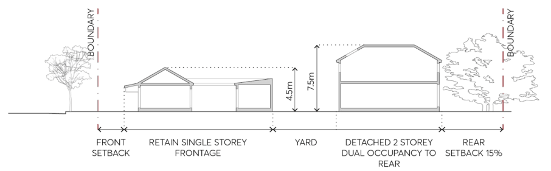

#### 7.10.2 SOUTH PARRAMATTA CONSERVATION AREA

The location of South Parramatta Conservation Area is depicted in Figure 7.10.2.1.

#### 7.10.2.1 HISTORY

This area includes two rural grants to Meehan and to Norris. Development to the south of Parramatta township occurred later than that to the north, and the 1855 Street Alignment Plan shows very few buildings in this area. In 1855 the railway from Sydney to Parramatta Junction (now Granville) terminated near Meehan’s grant. Anticipating a demand for housing close to the terminus, Meehan’s land was subdivided into 22 allotments of 50 feet x 150 feet and auctioned in 1856. When the railway was extended to Parramatta in 1860, the subdivision lost its attraction. Nevertheless, modest but slow development did occur, most aimed at the rental market. Brickmaking was also occurring at that time along A’Becketts Creek. Ten houses remain from this early period. All stand on or close to the front fence.

The 1880s saw rapid suburban expansion throughout Sydney. In South Parramatta, Norris’s grant was subdivided and more houses built. Rental housing remained important. Some allotments were amalgamated and re-subdivided for smaller lot housing. The Detail Survey of 1895 shows 104 buildings scattered through the Conservation Area at that time. Eleven were later demolished for the park and eight went in recent years for the flats in Lennox Street. Forty-seven of those 104 houses remain today – a very high retention rate.

Houses continued to be built in the early years of last century, 28 of which remain intact. They stand further from the front fence than the earlier cottages. In the 1920s, Sydney experienced another rash of suburban development, at which time all houses on the western side of Alma Street and most of those on the eastern side of Denison Street were built. Other houses were built on vacant allotments scattered throughout the area. Front gardens were deeper than previously, gardening being at that time an important part of suburban living. Crimea Street was the important cross street, linking Church Street with Pitt Street, and small groups of shops were built on corner positions to serve this passing trade and local needs. Some vacant allotments remained, however, until the 1960s. Since then, some earlier houses have been demolished for new development, or altered comprehensively in attempts to update them.

#### 7.10.2.2 DISTINCTIVE CHARACTERISTICS

• Gently sloping landforms on either side of A’Becketts Creek and views across houses and the park to city buildings beyond.

• That most of the original regular 50 by 150 foot allotments remain.

• Contains single storey freestanding dwellings or pairs of semis separated from the street and neighbours by planted garden space.

• There is a consistency in the scale of mostly single storey houses.

• Few street trees so buildings enclose street space.

• Enclosed character reinforced by:

- Width of allotment - 50 feet or less.

- Early buildings built on or close to front fence.

- Groups of early cottages on narrow lots built close together and close to the street.

- Small groups of one or two storey shops at or near the corner.

• Houses stand parallel to the street.

• Predominance of modest houses dating from 1850s - 1960s which collectively show how the area has grown, and which provide the historic significance and character of the area.

• Limited range of building materials - brick, timber, fibro, tiles and iron.

• Age of the houses often apparent by the depth of the front garden from 1 – 8 metres.

• Space between building line and front fence is without garages or carports.

• Pattern of narrow driveway openings beside most houses leading to backyard garages.

• Front gardens visible from the street over low fences, generally of lightweight material such as timber or wire mesh on timber frame.

• Familiar suburban timber paling fence to side and back boundaries.

> [Picture on page 48: a picture, saved as a picture (images/part-07-heritage-archaeology-page-48-1.gif, 150 dpi).]

Figure 7.10.2.1 – South Parramatta Conservation Area

#### 7.10.2.3 STATEMENT OF SIGNIFICANCE

This area is the earliest remaining example in Parramatta of a speculative private subdivision related to the railway. The pattern of subdivision remains along with a very intact collection of early pre-1900 cottages. The consistently single storey scale of most of its housing and associated shops, and the range of building styles, from the 1850s to the 1960s, clearly demonstrate the way in which this suburb gradually developed and allows its history to be understood.

> [Picture on page 49: a picture, saved as a picture (images/part-07-heritage-archaeology-page-49-1.gif, 150 dpi).]

Figure 7.10.2.2 – Significant characteristics of South Parramatta Conservation Area

Figure 7.10.2.3 – Typology and Siting - South Parramatta Conservation Area

#### 7.10.2.4 PROVISIONS

Development should be in accordance with the general provisions under Section 7.4 of this DCP and the additional specific provisions below:

Objectives

O.01 Maintain the single storey character of the area’s streetscape. O.02 To ensure new developments and additions complement and are sympathetic to the existing character of the conservation area.

Controls

Subdivision C.01 Consider re-subdivision along the length of the allotment where it would not affect the setting of an existing building listed at the end of this clause, or the character of the street.

C.02 Avoid re-subdivision across line of subdivision or by amalgamation of back garden space. C.03 Torrens Title subdivision for dual occupancy development is not permitted. C.04 Strata Title subdivision for dual occupancy development is permitted at the rear of properties where the proposed new development complements and is compatible with the existing character of the conservation area and retains an adequate curtilage for significant contributory buildings or heritage items.

Siting and Garden Area C.05 Maintain the historical pattern of development of detached dwellings with front and side gardens.

C.06 Keep spaces around and between buildings. C.07 Keep at least 50% of the site for garden area. C.08 Keep driveways to garages/carports in back yards. C.09 Ensure similar side boundary setbacks to those existing. C.10 Avoid additions to the front or side of an existing house. Linked pavilions or skillions at back of a house are supported as a form of additions.

C.11 Detached additions may be permitted at the rear of properties, behind existing buildings, and a minimum distance of 20 metres from the front street alignment. Adequate deep soil areas and tree planting are to be provided between the existing and new buildings.

C.12 In accordance with the Parramatta LEP 2023, detached dual occupancy development can be considered for the rear of properties for lots that have a minimum area of 600m².

C.13 New buildings associated with dual occupancy development should be located at the rear of properties, behind existing buildings, and a minimum distance of 20 metres from the front street alignment. The preference is for new buildings to be detached and set further back towards the rear of the property. Adequate deep soil areas and tree planting are to be provided between the existing and new buildings.

C.14 New buildings should not be constructed with zero side setbacks except on lots narrower than 10 metres.

C.15 Rear setbacks for detached additions, secondary dwellings or dual occupancy development are to be a minimum of 15% of site length.

> [Picture on page 51: a picture, saved as a picture (images/part-07-heritage-archaeology-page-51-5.gif, 150 dpi).]

Figure 7.10.2.4 – New additions, dual occupancies

Alterations and Additions C.16 Avoid painting or re-skinning original brick walls. C.17 All additions to existing single storey buildings shall be limited to a single storey and additions to existing two storey buildings shall be limited to two storeys.

C.18 Detached additions may be permitted to a height of 7.5 metres. Any second storey shall be contained within the roof of the building.

C.19 Additions to a height of 7.5 metres should be no more than two levels (inclusive of an attic or a mezzanine) at any given point.

New Development C.20 The maximum height of dual occupancy development or a secondary dwelling shall be 7.5 metres. Any second storey shall be contained within the roof of the building.

C.21 New buildings associated with dual occupancy development and secondary dwellings are to be designed and sited so that the existing building on the site remains the visually dominant element, and so that the new buildings have limited or no visibility. This is particularly important if the existing building is a heritage item or contributory building.

C.22 The materials, detailing and colours of new buildings are to be sympathetic to the existing house on the property if it is a heritage item or contributory building and to the character of the conservation area.

C.23 New buildings are not to be designed as a copy of historic buildings in the area, but rather are to have a design that complements the character of the heritage conservation area.

C.24 Roofs should be hipped or gabled pitched and should not exceed 35 degrees in pitch. Rooms in roof can be considered where ventilated only by flat, in-plane skylights.

C.25 Setback of 8 metres or more for any new house. C.26 Side driveway access to garage in backyard.

C.27 Materials for new buildings of face or common bricks, timber or fibro, with terracotta tile or corrugated steel roofs.

C.28 Avoid boundary-to-boundary development which prevents garages and carports being located in the rear yard. In exceptional cases, where the lot is less than 10 metres wide, a front garage may be integrated with a new house, providing that it is setback from the front wall of the house by a minimum of 1 metre and its design and construction avoids negative impact on the streetscape.

C.29 Avoid hearted, speckled, multi-coloured or textured bricks in light colours. C.30 Avoid imitation slate or obtrusively coloured roofing materials. C.31 Any Development Application for a dual occupancy development is to be accompanied by measures that provide for the conservation and upgrade of the existing house on the property and contributes to the positive qualities of the streetscape. Measures may include the reconstruction or restoration of original elements and or the removal of unsympathetic alterations and additions, including inappropriate building elements.

Utilities C.32 Aerials, antennae, air conditioning units, hot water systems, communication devices, rainwater tanks, roof vents, skylights, solar panels and the like should not be visible from the streetscape or a public place.

Garages, carports and other ancillary development C.33 Keep side driveways free of structures. In exceptional cases, where the lot is less than 10m wide, a front garage may be integrated with a new house, providing that it is setback from the front wall of the house by a minimum of 1 metre and its design and construction avoid negative impact on the streetscape.

C.34 Paved standing space to the side of a house may be allowed where it is not possible to create a garage or carport.

C.35 For garages and carports use lighter weight cladding materials such as timber, timber weatherboards or corrugated iron.

C.36 Only one driveway should be permitted for each allotment and its width is to be minimised. Driveways should not include provision of passing bays.

C.37 New and replacement driveways should be created of gravel and brick paving unless there are engineering reasons preventing the use of these materials.

C.38 Garages and carports should not be integrated with the house or be located at side driveways except where the allotment is less than 10 metres wide.

Fences C.39 Fences at the following properties must be retained:

• Crimea Street: Nos 17, 19, 21, 33

• Denison Street: Nos 10, 11, 16* * Heritage Item

C.40 For front boundaries, continue with fences of varied unobtrusive lightweight materials such as timber or wire mesh on timber frame with hedges if desired. Hedges could be planted along the fence if desired.

C.41 Existing, timber framed fences sheeted with corrugated iron should be maintained, and where necessary, replaced with a fence of the same height and materials.

C.42 High front privacy walls of brick, timber or brush are not acceptable. C.43 New brick front fences are not acceptable, except where there is evidence of an earlier brick fence lost or changed since its construction.

C.44 Colorbond steel fences are not to be used for side and rear boundaries. Pool, mesh, woven wire and metal slat fences and gates are not to be used within the front setback.

C.45 Rear fences for lots on Crimea Street backing onto Ollie Webb Reserve are to match front fence requirements.

Public Lands C.46 Conserve and enhance those elements of the public domain which contribute to an understanding of the history of the area.

C.47 Improve the residential amenity of the area by screening structures which intrude upon that amenity.

C.48 Improve public enjoyment of public open spaces and views. C.49 Maintain and restore (where they remain beneath the bitumen) the sandstone kerbs and gutters in Lansdowne and Inkerman Streets.

C.50 Prepare, plant and maintain a landscape plan for the drainage easement and park between Inkerman and Glebe Streets. This plan will need to respond to the modest historic suburban character of the area.

#### 7.10.2.5 EXISTING SIGNIFICANT BUILDINGS

The following houses which are shown on the 1895 Detail Survey must be retained, together with their original features:

Houses built between 1850s and 1880s

• Inkerman Street: No 40* (c1870)

• Lennox Street: Nos 1* and 3* (1850s-1860s)

• Marsden Street: Nos 44* 46* 48* 50* (1880s); 56* 58* (1860)

Houses Built From 1880s - 1895

• Alma Street: Nos 6, 8, 10

• Carrington Street: Nos 4, 9*, 11*, 13*, 15*

• Crimea Street: Nos 6*, 25*, 26*, 34, 42

• Denison Street: No 16*

• Inkerman Street: No 34*

• Lansdowne Street: No 5*

• Marsden Street: Nos 38*, 39, 40B, 41, 42, 60, 62

• Pitt Street: No 58

• Rosehill Street: Nos 10*, 12*, 14*, 16, 18 * Heritage Item

Any building not listed above but located on the site of a building shown on the 1895 Detail Survey should not be demolished until Council has examined the building for any evidence of the structure extant in 1895.

The following buildings constructed since 1895 must be retained:

Federation houses of the 1900s - c1920

• Carrington Street: No 3

• Crimea Street: Nos 5, 9, 12*, 13, 18, 30, 33A, 40

• Denison Street: No 6

• Inkerman Street: Nos 38, 44

• Lansdowne Street: No 7

• Marsden Street: Nos 23, 25, 27, 31, 35, 37, 43, 45, 47, 49, 51

• Rosehill Street: No 20

Bungalows of the 1920s & 1930s

• Alma Street: Nos 1, 3, 5, 7, 9, 11, 13, 15

• Carrington Street: No 5

• Crimea Street: Nos 8, 8A, 11, 15, 16, 17, 19, 23, 31, 38, 46

• Denison Street: Nos 4, 9, 10, 11, 13, 15, 17, 19

• Inkerman Street: No 32

• Lansdowne Street: Nos 2, 4, 6A, 8, 9,10, 12

• Marsden Street: Nos 23, 33, 49, 51

Where possible, the following intact early post-war buildings should be retained: Intact Houses of late 1940s & 1950s

These houses complete the developmental history of this area. Their scale, siting, setbacks and materials complement the character of the area. Their conservation is to be encouraged:

• Alma Street: No 4

• Carrington Street: Nos 1, 6, 7, 8,12

• Crimea Street: Nos 2, 3, 4, 7, 14, 21, 22, 24, 27, 33, 33B, 36

• Denison Street: Nos 8, 21

• Inkerman Street: No 36

• Pitt Street: Nos 52, 54, 56

• Railway Street: Nos 101, 103, 105

• Rosehill Street: No 2
