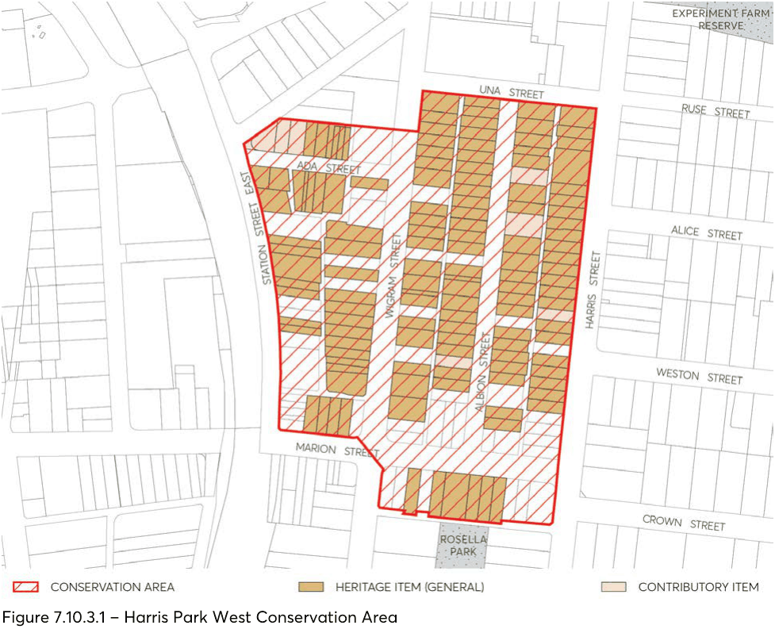
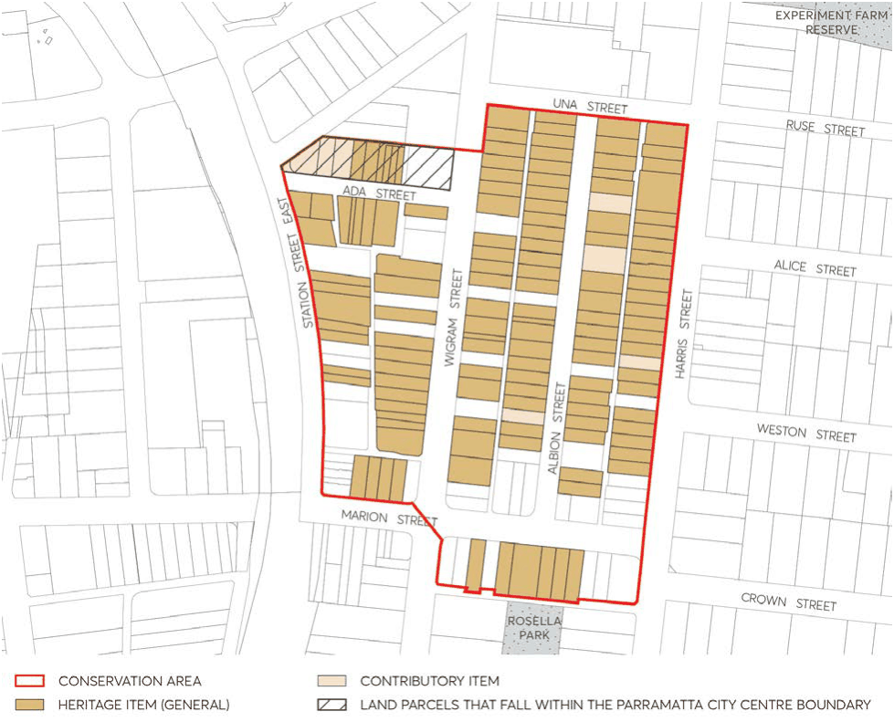

#### 7.10.3 HARRIS PARK WEST CONSERVATION AREA

The location of Harris Park West Conservation Area is depicted in Figure 7.10.3.1.

#### 7.10.3.1 HISTORY

The building of the railway from Sydney to Blacktown (completed in 1860), including a station at Harris Park, stimulated subdivision and closer settlement of this area which had been used for many years for pastoral purposes. The area close to the railway station at Harris Park was privately subdivided in the 1870s and 1880s, with lots narrower and smaller than those in the government subdivided town area. The majority of houses in this area were built before 1895.

#### 7.10.3.2 DISTINCTIVE CHARACTERISTICS

• Intimate scale of the area - allotments are mostly 30ft, compared to the wider allotments east of Harris Street.

• Predominance of small cottages (mostly single storey) with some terrace houses and other dwellings.

• Age of buildings - mostly developed in the late 19th century, with a few early 20th century dwellings and shops, and some flats from the 1960s.

> [Picture on page 57: a picture, saved as a picture (images/part-07-heritage-archaeology-page-57-1.gif, 150 dpi).]

Figure 7.10.3.1 – Harris Park West Conservation Area

#### 7.10.3.3 STATEMENT OF SIGNIFICANCE

The area demonstrates an early 1870s-90s subdivision and speculation of modest residential development part of colonial surgeon John Harris’ land grant, made in response to the railway. Many of the original houses remain and it retains a consistency of development with narrow lots, back lanes and small scale, simple form timber and brick cottages, built close together. The use of timber was typical in many parts of Sydney but is now rare. This area is important because it provides evidence of mid-19th century subdivisional and surveying practice and with the relative absence of modern development is the most consistent historical urban area in central Parramatta.

#### 7.10.3.4 PROVISIONS

Development should be in accordance with the general provisions under Section 7.4 of this DCP and the additional specific provisions below:

Objective

O.01 Protect all the attributes which contribute to the heritage value and character of the Harris Park West Conservation Area, and to maintain and improve its residential amenity.

Controls

Subdivision C.01 Maintain the subdivision pattern characterised by narrow allotments of a generally regular width, and back lanes.

New Development C.02 Wall height for new buildings and extensions to existing buildings should not exceed 3.6 metres or higher than the ridge line of the existing house.

C.03 Hipped and/or gabled roofs should have a pitch not greater than 45 degrees. C.04 Additional rooms above the main body of the house are not permitted where alteration to the existing roof shape would be needed.

C.05 Avoid use of dormer windows and mansard roofs. Rooms in the roof may be considered only where they are ventilated by flat in-plane skylights on the rear face of the roof.

C.06 For extensions, the same material as the existing house, or lighter weight materials, such as painted timber, fibro or corrugated iron should be used.

Utilities C.07 Aerials, antennae, air conditioning units, hot water systems, communication devices, rainwater tanks, roof vents, skylights, solar panels and the like should not be visible from the streetscape or a public place.

Garages C.08 Garages and carports are to be separated and detached from the main house, accessible from the rear lane.

C.09 Avoid new crossovers from streets, any garages or carport structures in the front yard and garages integrated with the house.

Fences C.10 New front fences are to be no higher than 1.2 metres. Timber picket fences will generally be appropriate.

C.11 For side and back boundaries, continue the use of timber paling fences and avoid modern metal clad fencing systems.

#### 7.10.3.5 EXISTING SIGNIFICANT BUILDINGS

The following buildings together help to demonstrate the history of the area and contribute to its significance. They should be retained.

• Ada Street: all buildings

• Albion Street: all buildings except nos. 1, 8, 22, 23, 24, 40

• Harris Street: all buildings except 56, 58, 60, 62, 74, 80

• Marion Street: 42*, 44*, 46*, 48*, 65*, 69*, 71*, 73*, 75*, 77*, 79*

• Station Street East: 22*, 24*, 34*, 36*, 38*, 42*

• Wigram Street: all buildings except 53, 55, 65a, 69, 73A, 81, 82, 86, 91, 96, 100, 104-108, 110, 116 * Heritage Item

#### 7.10.3.6 APPLICATION OF PART 9 – PARRAMATTA CITY CENTRE CONTROLS

The following land parcels within the Harris Park West HCA also fall within Part 9 – Parramatta City Centre. This is illustrated in Figure 7.10.3.2 below.

• Ada Street: 2A, 2, 4, 5, 8, 10

> [Picture on page 59: a picture, saved as a picture (images/part-07-heritage-archaeology-page-59-8.gif, 150 dpi).]

Figure 7.10.3.2 – Land parcels that fall within the Parramatta City Centre boundary
