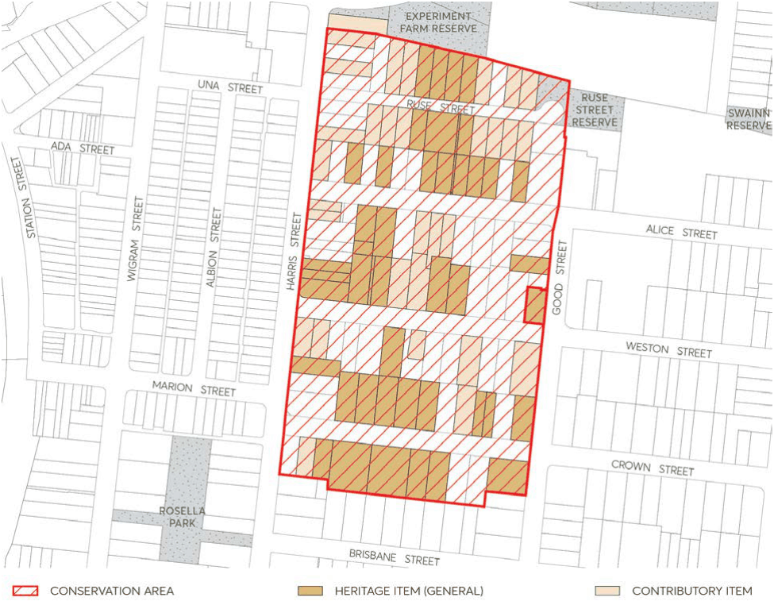

#### 7.10.4 EXPERIMENT FARM CONSERVATION AREA

The location of Experiment Farm Conservation Area is depicted in Figure 7.10.4.1.

#### 7.10.4.1 HISTORY

This Conservation Area largely consists of 30 acres of James Ruse’s Experiment Farm. Governor Phillip established a hut for Ruse in a clearing on this land in 1789, to test an experienced farmer’s ability to become self-supporting in this apparently alien land. By early 1791 the experiment had succeeded, and Ruse’s 30 acre grant was confirmed. In 1793 Ruse sold the land to Surgeon John Harris, whose large land grant stretched west from present day Good Street. Harris built Experiment Farm Cottage on the rise above Clay Cliff Creek in approximately 1829.

The land remained in open pasture until the Harris family began to subdivide in the 1870s. The first subdivisions were close to the railway station and it was not until the 1880s that subdivision began on the land east of Harris Street. However, development was slow and it was not until the period 1910-1930 that much of the housing was built with the greatest growth during the 1920s, Sydney’s great period of post-war suburban expansion.

In 1960 the National Trust purchased Harris cottage and in the 1970s a number of houses around Experiment Farm Cottage were demolished to provide it with a garden and appropriate setting.

#### 7.10.4.2 DISTINCTIVE CHARACTERISTICS

• A north facing hillside sloping form the top of the ridge in Crown Street down to Clay Cliff Creek (now channelled through parkland). The natural shape of the land remains visible as the houses have been built without cut and fill.

• A sense of spaciousness provided by wide straight streets (some with views east to the City Centre), generous lots, wide setbacks between houses and hipped roofs.

• The pattern of suburban development - mostly single storey free standing dwellings separated from the street and neighbours by planted garden space.

• Two subtly different residential precincts:

- South of Alice Street with a predominance of substantial houses of 1910-1930.

- North of Alice Street, a 1920s subdivision containing modest houses built over a short period of time and opening to views of parkland and the tree cover hills to the north.

• The predominance of brick as a building material, with tiles and occasionally slate, as a roof cladding.

• Each building stands parallel to the street.

• Front gardens uncluttered by garages and visible from the street over fences. A considerable number of original brick fences remain.

• The familiar suburban paling fence to side and back boundaries.

• Some very obvious intrusive buildings which disrupt the visual harmony of the area.

• The focus of the Conservation Area, Experiment Farm Cottage, on the rise above Clay Cliff Creek and surrounded by open space.

• Unifying and enclosing effect of street trees which also helps screen intrusive buildings of more recent construction and cools pavements in summer.

> [Picture on page 61: a picture, saved as a picture (images/part-07-heritage-archaeology-page-61-5.gif, 150 dpi).]

Figure 7.10.4.1 – Experiment Farm Conservation Area

#### 7.10.4.3 STATEMENT OF SIGNIFICANCE

Through its subdivision alignments this Conservation Area clearly shows the outline of the first grant proclaimed in Australia to James Ruse and the two periods of its subdivision from the Harris Estate. Many of the allotments retain the original house built after subdivision.

Though the consistency of development with large lots, age, scale, shape, siting, setbacks and materials, the houses provide a visual coherence representative of Sydney’s early 20th century middle class suburban development.

#### 7.10.4.4 PROVISIONS

Development should be in accordance with the general provisions under Section 7.4 of this DCP and the additional specific provisions below:

Objectives

O.01 Protect all the attributes which contribute to the heritage value and character of the Experiment Farm Conservation Area, and to maintain and improve its residential amenity.

O.02 Ensure that Experiment Farm will always have an appropriate setting so that it can continue to tell the history of Colonial Australia to citizens and international visitors.

O.03 Protect the pattern of the Harris estate subdivision and its remaining original houses. O.04 Maintain the low scale suburban character of the area.

Controls

Subdivision C.01 Maintain the historic 1880s and 1920s subdivision patterns. C.02 Avoid subdividing properties into narrower lots because it will change the pattern of subdivision.

Views C.03 Keep and enhance public views from streets and between houses to the City Centre and north over the Parramatta River.

C.04 Keep and where necessary, reinstate identified historic views including those identified in Appendix 3.

C.05 Keep the sense of space and private views between buildings. C.06 Wall height for new buildings and extensions to existing buildings should not exceed 3.6 metres, or higher than the ridge line of the existing house.

C.07 Hipped and/or gabled roofs should have a pitch not greater than 35 degrees. C.08 Additional rooms above the main body of the house are not permitted where alteration to the existing roof shape would be needed.

C.09 Avoid use of dormer windows and mansard roofs. Rooms in the roof may be considered only where they are ventilated by flat in-plane skylights on the rear face of the roof.

New development C.10 Keep and repeat use of face or common bricks (no hearted, speckled, multi coloured or textured bricks in light colours should be used) or painted timber, or painted timber, with terracotta tile, slate or corrugated iron roofing.

C.11 Avoid rendered and painted masonry external walls, imitation slate or obtrusively coloured roof covering.

C.12 Maintain the established pattern of back garden placement of garages, sheds and other utility buildings with one opening per allotment for single car access.

Driveways C.13 Driveways to be made of concrete, bitumen, gravel, dark bricks or other non- intrusive materials, which do not continue over footpath space. Wheel tracks with central grass/planting are preferred to fully paved driveway space.

C.14 Driveways should not continue over footpath space. Fences C.15 For new front fences, brick fences are not to be greater than 1.2 metres in height, picket fences will generally not be appropriate, except where established to replace a known original picket fence.

C.16 Encourage retention and use of timber paling fences to side and back boundaries. C.17 The following historically significant front fences must be retained:

• Alice Street, Nos 10*, 22*, 24*, 28*

• Crown Street, Nos 2*, 3, 4*, 10*, 14, 16*

• Ruse Street, Nos 3, 5, 6, 14, 15, 17, 19, 20, 2

• Good Street, Nos 144*

• Harris Street, Nos 59, 81, 83

• Weston Street, Nos 68, 77*, 85*, 86 *Heritage Item

#### 7.10.4.5 EXISTING SIGNIFICANT BUILDINGS

The following buildings together help to demonstrate the history of the area and contribute to its significance. They should be retained.

• Alice Street, Nos 2, 3*, 5*, 6*, 9, 10*, 11, 11A, 22*, 24*, 28*

• Crown Street, Nos 2*, 3, 4*, 5*, 6*, 7*, 8*, 10*, 11*, 14, 16* 18*, 22*

• Good Street, Nos 144*, 148*

• Harris Street, Nos 59*, 65*, 67*, 69*, 77, 79, 81, 89, 91, 93, 95

• Ruse Street, Nos 1, 3, 4, 5, 6, 14, 15, 16, 17, 19, 20, 21, 22

• Weston Street, Nos 68, 69*, 72, 77, 78, 79*, 80, 81, 83, 84, 85*, 86, 87* *Heritage Item
