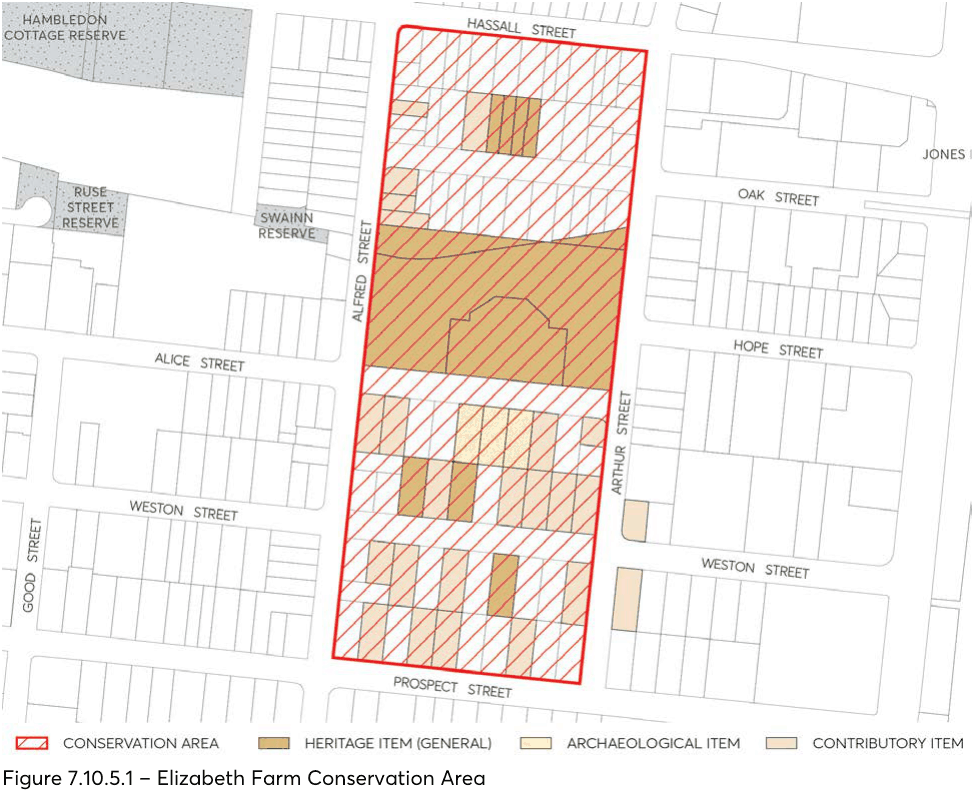

#### 7.10.5 ELIZABETH FARM CONSERVATION AREA

The location of Elizabeth Farm Conservation Area is depicted in Figure 7.10.5.1.

#### 7.10.5.1 HISTORY

From 1793, John McArthur was granted and acquired a vast estate of over 1000 acres where he and his wife Elizabeth carried out some of the first Australian experiments in merino sheep breeding and agriculture. Their house remains today as the oldest surviving European building on the continent with evidence of its growth from a humble cottage of 1793 to a comfortable family home completed in the 1830s.

The estate remained in pasture until the 1880s when some parts near Granville station were subdivided for suburban development, with other subdivisions quickly following. One of the last subdivisions of the estate was of the land left around the house, called the Macarthur Estate and auctioned in 1906.

It is this historic subdivision which forms the major part of this Conservation Area, part of a coordinated subdivision plan across Harris Park based on the standards for subdivision set down in

1829\. It straddled the municipal boundary (Clay Cliff Creek) between Parramatta (to the north of the creek) and Granville. By the 1930s most of the Granville allotments had been built on, and just over 50% of those houses remain, leaving a consistency of house age, style, size and materials still very apparent today.

The erratic flooding and course change of Clay Cliff Creek discouraged much suburban growth north of Elizabeth Farm House until after 1940 when the creek was channelled. This, combined with Australia’s post-war migration program, saw a rapid increase in population and another great period of suburban development. Some modest cottages dating from the time of subdivision were built. These remain today, surrounded by the brick and fibro cottages of the 1940s and 1950s.

#### 7.10.5.2 DISTINCTIVE CHARACTERISTICS

• Siting on the southern slopes of the Parramatta River valley with views into the precinct from roads, river and University, and views out to Parramatta River and valley slopes to the north.

• The central focus of the conservation area is the remnant colonial planting and glimpses of roofs and buildings of Elizabeth Farm and surrounding public reserve and the remaining historical views and visual relationships between the Farm and the other early buildings in the district.

• North/south orientation of most lots providing northerly aspect and private views for each house to houses, trees and parkland beyond the pattern of subdivision - most of the 1906 1 (one) chain (20m) x 2.5 chains (50m) government standard allotments and 10 chains (200m) street blocks remain.

• The pattern of development - single storey freestanding houses separated from street and neighbours by planted garden space.

• Sense of spaciousness provided by wide straight streets, generous lots, wide setbacks between houses and hipped roofs.

• Generous private back gardens.

• Front gardens uncluttered by garages.

• Front gardens visible from street over fences generally of brick, timber or wire on timber frame.

• Visual coherence and consistency of area provided by:

• Similarity of scale - single storey.

• Hipped and gabled roofs, most pitched at less than 35 degrees.

• Regular house setbacks of 6 - 8 metres.

• Houses sited parallel to street.

• Age of buildings - majority of the 1920s.

• Unity of materials - red-brown bricks, timber or fibro.

• Unifying and enclosing effect of street tree planting south of Alice Street.

> [Picture on page 65: a picture, saved as a picture (images/part-07-heritage-archaeology-page-65-14.gif, 150 dpi).]

Figure 7.10.5.1 – Elizabeth Farm Conservation Area

#### 7.10.5.3 STATEMENT OF SIGNIFICANCE

This area provides an appropriate low scale suburban setting for Elizabeth Farm House, and retains and provides opportunities to reinstate important historic views to and from the House from within and outside the area. It is the core of and demonstrates one of the last Macarthur grant subdivisions. This government standard subdivision pattern remains (including road widths and allotment size), together with most of the original houses and large gardens. Through the consistency of scale, form, siting setbacks, materials and street planting, the area retains a visual coherence representative of Sydney’s early 20th century middle class suburbs.

#### 7.10.5.4 PROVISIONS

Development should be in accordance with the general provisions under Section 7.4 of this DCP and the additional specific provisions below:

Objectives

O.01 Protect all the attributes which contribute to the heritage value and character of the Elizabeth Farm Conservation Area, and to maintain and improve its residential amenity.

O.02 Maintain the existing natural landform which helps explain the siting and setting of Elizabeth Farm.

O.03 Maintain and enhance public views from streets and between houses to the north over the Parramatta River.

Controls

Subdivision C.01 Maintain existing site levels. C.02 Maintain the historical pattern of the 1906 Macarthur Estate subdivision around Elizabeth Farm. Views C.03 Keep and, where necessary, reinstate identified historic views including those identified in Appendix A2.1.

C.04 Keep the sense of space and private views between buildings. C.05 Wall height for new buildings and extensions to existing buildings should not exceed 3.6 metres, or higher than the ridge line of the existing house.

C.06 Hipped and/or gabled roofs should have a pitch not greater than 35 degrees. C.07 Additional rooms above the main body of the house are not permitted where alteration to the existing roof shape would be needed.

C.08 Avoid use of dormer windows and mansard roofs. Rooms in the roof may be considered only where they are ventilated by flat in-plane skylights on the rear face of the roof.

New Development

C.09 New development should be single storey with a maximum wall height of 3.6 metres. C.10 Additions to existing buildings should not be higher than the ridge line of the existing house. C.11 Hipped and/or gabled roofs are desirable, with a pitch not exceeding 45 degrees. Rooms in the roof may be considered but only where they are ventilated by flat in-plane skylights on rear face of building.

C.12 A setback of at least 8 metres is required for any new house. C.13 Materials for new buildings should be face or common brick (no hearted, speckled, multi coloured or textured bricks in light colours should be used) or painted timber with terracotta tile, slate or corrugated steel roofs.

C.14 Avoid boundary to boundary development that does not enable garages and carports to be located in the backyard. In exceptional cases, where the lot is less than 10 metres wide, a front garage may be integrated with a new house, providing that it is set back from the front wall of the house by a minimum of 1 metre and its design and construction does not have a negative impact on the streetscape.

C.15 Avoid rendered and painted masonry external walls, imitation slate or obtrusively coloured roof covering

C.16 Avoid hearted, speckled, multi coloured or textured bricks in light colours. Utilities C.17 Aerials, antennae, air conditioning units, hot water systems, communication devices, rainwater tanks, roof vents, skylights, solar panels and the like should not be visible from the streetscape or a public place.

Garages C.18 Maintain the established pattern of back garden placement of garages, sheds and other utility buildings detached from the main house. Maintain the established pattern of one opening per allotment for single car access.

Driveways C.19 Driveways to be made of concrete, bitumen, gravel, dark bricks or other non-intrusive materials, which do not continue over footpath space. Wheel tracks with central grass/planting are preferred to fully paved driveway space.

Fences C.20 Continue the common practice of building front fences no higher than 1.2 metres and of varied unobtrusive lightweight materials such as timber or wire mesh on timber frame with hedges.

C.21 Where existing, timber framed fences sheeted with corrugated iron should be maintained, and where necessary replaced with fence of same height and materials.

C.22 Avoid establishing new brick fences, except where there is evidence of an earlier brick fence, lost or changed since its constructions.

C.23 Keep street amenity by continued use of front fences, which allows gardens to be viewed from the street.

C.24 Retain and use timber paling fences on side and back boundaries.

Archaeological permit C.25 The following properties contain known sites of former outbuildings to Elizabeth Farm. Any excavation work to these requires an archaeological permit under the Heritage Act 1977: Alice Street, Nos 61, 63, 65

#### 7.10.5.5 EXISTING SIGNIFICANT BUILDINGS

The following buildings together help to demonstrate the history of the area and contribute to its significance. They should be retained.

• Alice Street, Nos 53, 55, 61, 65, 71

• Alfred Street, Nos 105,107,109,115

• Oak Street, Nos 4*, 6*, 8*, 10*, 12*

• Prospect Street, Nos 35, 41, 43, 49

• Weston Street, Nos 24, 25, 27, 28, 29, 31, 33, 34*, 37*, 38, 39, 41, 42, 44 * Heritage Item
