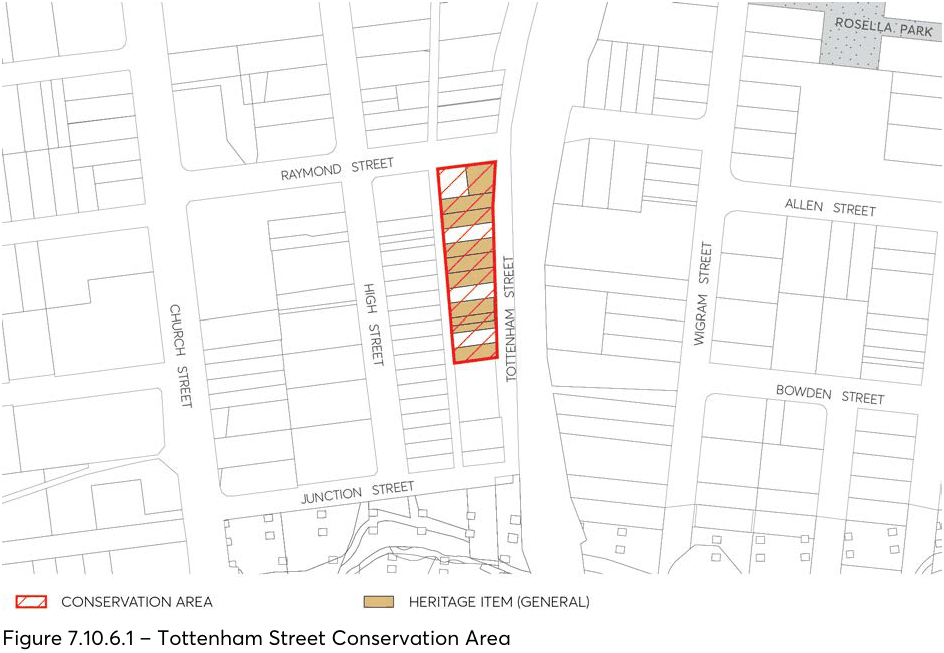

#### 7.10.6 TOTTENHAM STREET CONSERVATION AREA

The location of Tottenham Street Conservation Area is depicted in Figure 7.10.6.1

#### 7.10.6.1 STATEMENT OF SIGNIFICANCE

The buildings in Tottenham Street are significant as part of a group of small scale residential buildings in Tottenham Street, Granville. The group is largely intact externally and is significant for the variety of building styles and as a good representative example of early cottages dating from around the turn of the century. The buildings are significant for their form, scale and character which gives a good indication of the socio-economic makeup of the community at the time of construction. The group gives a good representative cross-section of modest scale residences at the turn of the century, and their location close to Parramatta and the railway provides evidence of the influence of these factors on the early development of Holroyd.

> [Picture on page 69: a picture, saved as a picture (images/part-07-heritage-archaeology-page-69-12.gif, 150 dpi).]

Figure 7.10.6.1 – Tottenham Street Conservation Area

#### 7.10.6.2 PROVISIONS

Development should be in accordance with the general provisions under Section 7.4 of this DCP and the additional specific provisions below.

Objectives

O.01 Buildings located within the Tottenham Street Heritage Conservation Area, shall retain their original materials, features and detailing.

O.02 Additions or extensions to buildings within a conservation area are designed to be consistent with original setbacks or involve the retention of front or side curtilages where these are a characteristic of the conservation area.

O.03 Redevelopment within a conservation area only involves non-original structures or buildings, and is designed to be consistent with the height, scale, proportion, predominant setbacks and character of buildings within the conservation area.

Controls

C.01 New dwellings on sites occupied by, adjoining or in the vicinity of an item of environmental heritage shall be designed and constructed in a manner that does not detract from the historic significance of that item or the area.

General C.02 When undertaking conservation or maintenance works on a building within a conservation area, the materials, colours and maintenance techniques used should be appropriate to the style and age and the context of the building.

C.03 The design of the building detailing such as windows or doors, should be in keeping with the age and style of the building and to the overall character of the conservation area.

C.04 Buildings within conservation areas should, where possible, retain original gates and fences or should use a style and materials that are appropriate to the age of the building and to the character of the conservation area.

C.05 When locating a new garage to a building within a conservation area, open sided carports are generally more acceptable and are less visually intrusive than solid structures. Where solid structures are proposed, these should generally be located away from the main house structure, or set back to the side or rear of the property

C.06 Where any alterations or additions are proposed to a building within a conservation area, these should be carefully designed to continue the specific scale and form of the building and the overall character of the conservation area.

C.07 Additions or extensions to buildings within a conservation area should be located away from the street frontage and are to be designed to complement the scale, form, style of the building and character of the conservation area.

C.08 Any proposed works on a building which has been identified as a heritage item within this conservation area should be designed to retain and conserve all original detailing, design features and materials characteristic of that building.

C.09 Where original design features such as bull nosed verandahs have been removed or replaced, these should be restored to original condition to improve the visual appearance and integrity of this group.

C.10 Where additions and extensions are proposed, these should be single storey only, and are to be located to the rear or side of the building so that they do not impact upon the presentation of the building from the street.

C.11 Any alterations and extensions to buildings within this conservation area should not alter the form or fabric of the roof as seen from the street. In general, roofs of single storey additions in this conservation area should be consistent with the existing roof in terms of form, pitch, eaves and ridge height.

C.12 Where redevelopment of non-original structures or buildings is proposed within this conservation area, the new development should be designed to be consistent with the height, scale, proportion, predominant setbacks and character of buildings within this conservation area.

Utilities C.13 Aerials, antennae, air conditioning units, hot water systems, communication devices, rainwater tanks, roof vents, skylights, solar panels and the like should not be visible from the streetscape or a public place.
