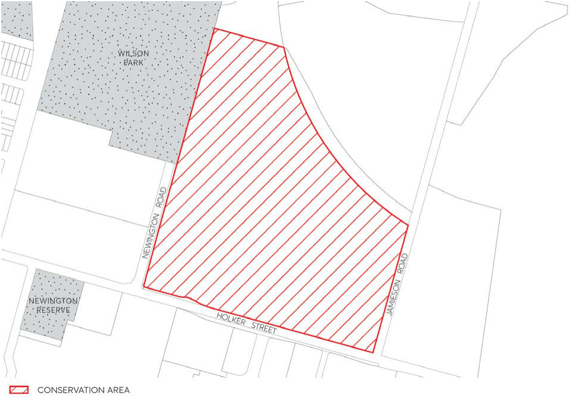

#### 7.10.7 SILVERWATER PRISON COMPLEX

The location of Silverwater Prison Complex Conservation Area is depicted in Figure 7.10.7.1

Please refer to the State Heritage Inventory for detailed information and provisions that apply to this

area. This includes the recommended management to ensure development does not compromise the significance of items or their setting.

#### 7.10.7.1 HISTORY

The Silverwater Prison Complex is an example of early to mid-19th century development, being the core remaining component of John Blaxland’s Newington Estate. The significant individual components of this complex include Newington House, Chapel, trees, Irwin House, former Engineer’s Cottage, former Superintendent’s Cottage and surrounding landscape.

In 1880, part of the site was acquired by the NSW Government to be used as a women’s asylum, with a Dormitory Block being built in 1896 to cater for this use. The asylum was converted in 1911- 1918 to be used as a State Hospital.

The current use of the site is Silverwater Correctional Facility.

> [Picture on page 72: a picture, saved as a picture (images/part-07-heritage-archaeology-page-72-15.gif, 150 dpi).]

Figure 7.10.7.1 – Silverwater Prison Complex Conservation Area

#### 7.10.7.2 STATEMENT OF SIGNIFICANCE

Silverwater Correctional Centre is of exceptional significance as: it is the core remaining part of John Blaxland’s Newington Estate and of the State Hospital & Asylum for Women, for its subdivision and subsequent use for a variety of institutional functions, as an expression of a philosophy regarding the care of the aged.

#### EPPING WARD
