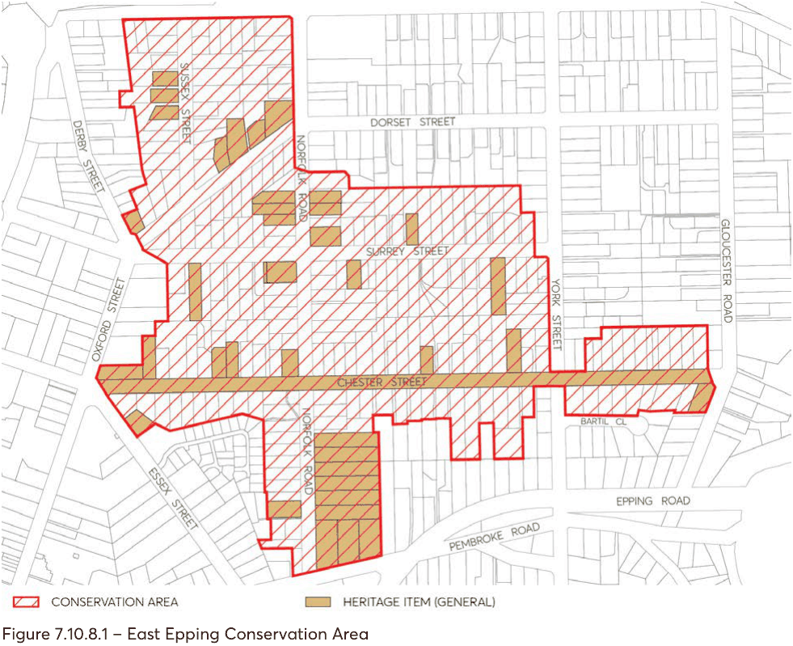

#### 7.10.8 EAST EPPING CONSERVATION AREA

The location of East Epping Conservation Area is depicted in Figure 7.10.8.1.

#### 7.10.8.1 HISTORY

The East Epping Heritage Conservation Area comprises part of the Field of Mars Common which was released for subdivision in 1886.

Opening of the railway line in 1886 and new road networks preceded a period of rapid development. Railway workers and wider population were attracted to the area and local farmers prospered having more access to markets.

The name “Epping” was officially adopted for the area in 1899, derived from the many trees in the area after “Epping Forest” in England. The streets were named after English counties or towns as the area was described like a “country village”.

Completion of Epping Road in 1940 and improvement of road networks led to an Inter-war period of subdivision and development. Further development continued into the 1950s Post-war period which saw a significant change to the character of the area.

#### 7.10.8.2 DISTINCTIVE CHARACTERISTICS

• The East Epping Heritage Conservation Area represents an area of housing that has remained largely intact. It retains many elements of the various housing styles and the early subdivision patterns from the 1886 to the period just after the Second World War.

• The housing styles characteristically include single detached houses from the Federation, Inter-war and Post-war periods with some earlier Victorian housing and late 20th century development located between.

• A number of heritage listed items are located within the area, many of which occupy prominent corner sites and make a positive visual contribution to the streetscapes. Some items are distinctive and unique features in the streetscape or are relatively rare examples in the local area.

• The area is characterised by wide, dual carriageways, wide grassed verges and pedestrian footpaths.

• A number of mature native and introduced, ornamental trees and plantings generally line the streets. Together with individual garden settings and plantings, the landscape elements enhance the built context.

• A number of houses retain original and complimentary fences which contribute to the suburban garden setting.

• The early natural character and topography of the area is indicated by extant rock forms, undulating streets, sloping sites and the number of native trees and plantings.

• The streets and subdivision generally comprises a regular grid type pattern, with the exception of Oxford Street, and Norfolk Road forming the main spine of the conservation area.

• The character of the area is unified by the similarity in allotment sizes, scale of building and openings, setbacks from the street, fencing, detailing and landscape elements.

> [Picture on page 75: a picture, saved as a picture (images/part-07-heritage-archaeology-page-75-5.gif, 150 dpi).]

Figure 7.10.8.1 – East Epping Conservation Area

#### 7.10.8.3 STATEMENT OF SIGNIFICANCE

The East Epping Heritage Conservation Area is of high local historic and aesthetic significance as a good representative example of late 19th century subdivision. It retains a good and largely intact example of Federation, Inter-War and Post-war period residential development that represents the major period of growth and development of the Epping area.

The area significantly retains most of its original 1886 subdivision and streetscape pattern with mostly single detached houses.

The built context is enhanced by the local topography and native plantings, wide street proportions, street trees and garden settings.

The Epping Public School site on Norfolk Road established in 1900 and the Inter-war period Uniting Church at the intersection of Chester, Oxford and Essex Streets are of historic and social significance to the locality.

#### 7.10.8.4 PROVISIONS

Development should be in accordance with the general provisions under Section 7.4 of this DCP and the additional specific provisions below.

Objectives

Please refer to the general provisions under Section 7.4 of this DCP and the additional specific objectives below:

Controls

Demolition C.01 Buildings from the Victorian, Federation, Inter-war and Post-war periods should be retained. Streetscape character C.02 Development should be single storey. C.03 New openings on the facades of heritage items and contributory buildings should be avoided. C.04 Windows should be vertically proportioned or broken up into vertically proportioned components.

C.05 Dormer windows should be located to the rear of buildings. C.06 Articulation should be used to break up building mass through the use of elements such as bay windows, entry gables and front verandahs.

C.07 Existing roof forms on heritage items and contributory buildings should be retained. C.08 Hipped and gabled roofs should be used. C.09 New development should be consistent with the existing scale of buildings, openings and setbacks from the street.

C.10 Extensive cut and fill or retaining walls that visually disrupt the natural landform or streetscape character should be avoided.

C.11 Development should retain large enough gardens in front and rear yards to include medium to large trees.

Materials and finishes C.12 Original building fabric, details and materials that are components of significant and contributory buildings or landscape elements should be retained.

C.13 Clean faced brick (red/brown colours) or weatherboards should be used for walls.

C.14 Rendered or painted brickwork, or timber joinery can be used for small areas or feature elements.

C.15 Existing face brick should not be painted or applied with a rendered finish. C.16 Traditional materials, such as slate or terracotta tiles should be used for new roofs. C.17 Replacement roofs should complement the period and style of the building. C.18 Replacement windows should match existing or complement the period and style of the building.

Fences and gates C.19 Original fences and gates should be retained. C.20 New fences and gates should complement the period and style of the building as indicated in Figure 7.4.12.

C.21 New front fences should be of a traditional low height, from 500mm to 900mm. C.22 Traditional timber fencing should be used for side fences. Side fences should be lower in height within the front garden to match the height of the front fence.

C.23 Metal sheet or Colorbond fencing should not be used. Utilities C.24 Aerials, antennae, air conditioning units, hot water systems, communication devices, rainwater tanks, roof vents, skylights, solar panels and the like should not be visible from the streetscape or a public place.

Garages C.25 Garages should be located behind the main building line and be separately articulated from the dwelling.

C.26 Traditional materials such as timber or face brick should be used. Carports C.27 Carports should be located behind the main building line and be separately articulated from the dwelling.

Driveways C.28 Changes to driveways should be avoided where street trees or mature plantings could be affected.

C.29 From the property boundary line, concrete strip driveways, gravel, stone or brick pavers should be used rather than slab or stencilled concrete.

Subdivision C.30 Altering the existing subdivision pattern through subdivision, amalgamation or boundary adjustments should be avoided.
