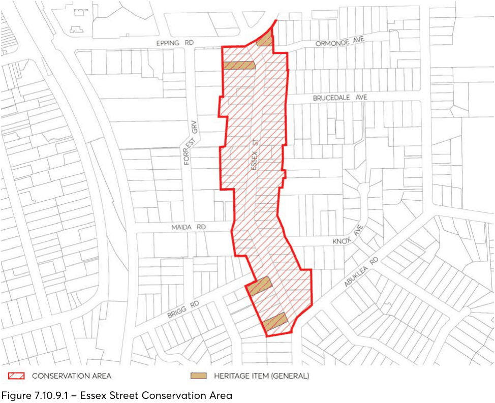

#### 7.10.9 ESSEX STREET CONSERVATION AREA

The location of Essex Street Conservation Area is depicted in Figure 7.10.9.1.

#### 7.10.9.1 HISTORY

The Essex Street (Epping) Heritage Conservation Area comprises part of the Field of Mars Common released for subdivision in 1899.

Opening of the railway line in 1886 and new road networks preceded a period of rapid development. Railway workers and wider population were attracted to the area and local farmers prospered having more access to markets.

At this time, the name “Epping” was officially adopted for the area, derived from the many trees in the area after “Epping Forest” in England. The streets were also named after English counties or towns as the area was described as being like a “country village”.

Completion of Epping Road in 1940 and improvement of road networks led to an Inter-war period of subdivision and development in the area. Further development continued into the Post-war period which saw a significant change in the character of the area during the 1950s.

During the 1960s to 1980s medium density development occurred closer to the railway line, followed by larger scale residential and commercial complexes during the late 20th and early 21st century.

#### 7.10.9.2 DISTINCTIVE CHARACTERISTICS

• The Essex Street (Epping) Heritage Conservation Area retains a good and largely intact example of housing styles from the Federation and Inter-war periods, representative of the early era of suburban development within Epping.

• The housing styles include substantial Federation red brick dwellings, Inter-war Bungalows, Post-war development with a number of late 20th and early 21st century period dwellings and residential complexes between.

• Recent changes are evident, however, the overall early 20th century character, streetscape pattern and historical integrity of the area remains.

> [Picture on page 79: a picture, saved as a picture (images/part-07-heritage-archaeology-page-79-1.gif, 150 dpi).]

Figure 7.10.9.1 – Essex Street Conservation Area

#### 7.10.9.3 STATEMENT OF SIGNIFICANCE

Refer to descriptions above.

#### 7.10.9.4 PROVISIONS

Development should be in accordance should be in accordance with the general provisions under Section 7.4 of this DCP and the additional specific controls below.

Controls

Demolition C.01 Buildings from Federation and Inter-war periods should be retained. C.02 Contributory buildings from the Post-war period should be retained. Streetscape character C.03 Development should be single storey or single storey with attic development. C.04 New openings on the facades of heritage items and contributory buildings should be avoided.

C.05 Windows should be vertically proportioned or broken up into vertically proportioned components.

C.06 Dormer windows should be located to the rear of buildings. C.07 Articulation should be used to break up building mass through the use of elements such as bay windows, entry gables and front verandahs.

C.08 Existing roof forms on heritage items and contributory buildings should be retained. C.09 Hipped and gabled roofs should be used. C.10 New development should be consistent with the existing scale of buildings, openings and setbacks from the street.

C.11 Extensive cut and fill or retaining walls that visually disrupt the natural landform or streetscape character should be avoided.

C.12 Development should retain large enough gardens in front and rear yards to include medium to large trees.

Materials and finishes C.13 Original building fabric, details and materials that are components of significant and contributory buildings or landscape elements should be retained.

C.14 Clean faced brick (red/brown colours) should be used for walls. Rendered or painted brickwork, or timber joinery can be used for small areas or feature elements.

C.15 Existing face brick should not be painted or applied with a rendered finish. C.16 Traditional materials, such as slate or terracotta tiles should be used for new roofs. C.17 Replacement roofs should complement the period and style of the building. C.18 Replacement windows should match existing or complement the period and style of the building.

Fences and gates C.19 Original fences and gates should be retained. C.20 New fences and gates should complement the period and style of the building as indicated in Figure 7.4.12.

C.21 New front fences should be of a traditional low height, from 500mm to 900mm. C.22 Traditional timber fencing should be used for side fences. Side fences should be lower in height within the front garden to match the height of the front fence.

C.23 Metal sheet or Colorbond fencing should not be used. Utilities C.24 Aerials, antennae, air conditioning units, hot water systems, communication devices, rainwater tanks, roof vents, skylights, solar panels and the like should not be visible from the streetscape or a public place.

Garages and carports

C.25 Garages and carports should be located behind the main building line and be separately articulated from the dwelling.

C.26 Traditional materials such as timber or face brick should be used. Driveways C.27 Changes to driveways should be avoided where street trees or mature plantings could be affected.

C.28 From the property boundary line, concrete strip driveways, gravel, stone or brick pavers should be used rather than slab or stencilled concrete.

Subdivision C.29 Altering the existing subdivision pattern through subdivision, amalgamation or boundary adjustments should be avoided.
