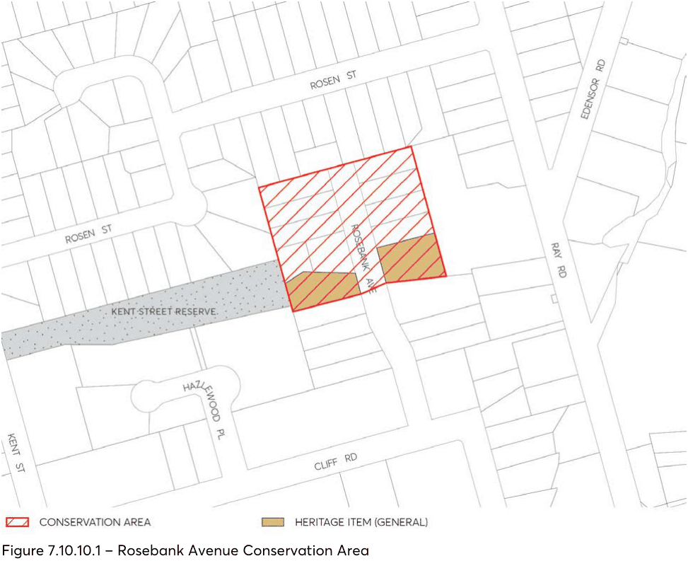

#### 7.10.10 ROSEBANK AVENUE CONSERVATION AREA

The location of Rosebank Avenue Conservation Area is depicted in Figure 7.10.10.1.

#### 7.10.10.1 HISTORY

Rosebank Avenue was originally part of the land granted to William Kent Junior, purchased by Pioneer settler, David Hazlewood in 1897. In 1908 David Hazlewood’s sons Walter and Harry Hazelwood developed a rose growing industry within the Hazelwood Estate, which became the Hazlewood Brothers Nursery and leading rose suppliers in the early twentieth century.

The first subdivision of the Hazlewood Estate was placed on sale in October 1921. In November 1929, two years after David Hazlewood’s death, the site of Rosebank Avenue went to auction sale as the Rosegrove Estate, one of the later estate subdivisions to occur within the Epping district.

The Estate consisted of 18 lots fronting Rosebank Avenue and three lots fronting Ray Road. 17 properties in separate ownership (one of which was constructed over two of the original lots) were developed for residential dwelling houses during the Inter-war period, between 1929 and 1942.

A “fine old rustic bridge” which was constructed over the existing creek by the Hazlewoods as part of their nursery operations was retained as an attractive element of the Estate.

A strict building ordinance was put in place to ensure that “each home will be worthy of its setting” and that the layout and lot sizes allowed “ample space for gardens, lawns and motor car entrance”.

#### 7.10.10.2 DISTINCTIVE CHARACTERISTICS

• A rare example of a good and highly intact Inter-war streetscape within the City of Parramatta.

• The group of Inter-war period dwellings illustrate various characteristic Inter-war architectural elements from the Bungalow, Tudor Revival and Spanish Mission styles.

• Generally the buildings retain their original scale, form, character and presentation, evidence of the original intent and covenants placed on the subdivision.

• Recent alterations and additions and minor modifications are evident, however, do not detract from the overall character and quality of the group and streetscape.

• The unifying character of the streetscape arises from the retention of the original subdivision pattern and street rhythm, consistent setbacks, style and character of the buildings, scale of buildings and openings, building materials and colours, fencing, paths, driveways, garages, and landscape elements.

• The gardens and landscaping reflect the typical characteristics and features of the Inter-war period.

• The single-laned bridge (modernised) associated with the Hazelwood Brothers Nursery and creek are still in existence and provides evidence of the early character of the area.

> [Picture on page 83: a picture, saved as a picture (images/part-07-heritage-archaeology-page-83-1.gif, 150 dpi).]

Figure 7.10.10.1 – Rosebank Avenue Conservation Area

#### 7.10.10.3 STATEMENT OF SIGNIFICANCE

Rosebank Avenue is of high local cultural significance as a fine representative example of an Inter-war period residential subdivision and development that remains largely intact and retains its historical subdivision pattern, built context and natural features.

Collectively the group form a unique precinct in the City of Parramatta.

The houses each retain their overall scale, character and varying stylistics details associated with the period and are enhanced by the wide street proportion, street trees and garden settings and remaining natural features.

#### 7.10.10.4 PROVISIONS

Development should be in accordance with the general provisions under Section 7.4 of this DCP and the additional specific controls below.

Controls

Demolition C.01 Buildings from the Inter-war period (constructed pre-1942) should be retained. Streetscape character C.02 Development should be single storey. C.03 New openings on the facades of existing buildings should be avoided. C.04 Existing hipped and gabled roof forms should be retained. C.05 New development should be consistent with the existing scale of buildings, openings, roof forms and setbacks from the street.

C.06 Windows should be vertically proportioned or broken up into vertically proportioned components.

C.07 Extensive cut and fill or retaining walls that visually disrupt the natural landform or streetscape character should be avoided.

C.08 Development should retain large enough gardens in front and rear yards to include medium to large trees.

C.09 Front garden layouts and plantings should complement the Inter-war period and style of the building.

Materials and finishes C.10 Original building fabric, details, materials and landscape elements should be retained. C.11 Clean faced brick (red/brown colours) or a rendered finish should be used for walls. C.12 Existing face brick should not be painted or applied with a rendered finish. C.13 Terracotta should be used for roofs. Fences and gates C.14 Original fences and gates should be retained. C.15 New fences and gates should complement the Inter-war period, materials and style of the building.

C.16 New front fences should be of a traditional low height, from 500mm to 900mm. Utilities C.17 Aerials, antennae, air conditioning units, hot water systems, communication devices, rainwater tanks, roof vents, skylights, solar panels and the like should not be visible from the streetscape or a public place.

Garages and carports C.18 Garages and carports should be located behind the main building line and be separately articulated from the dwelling.

C.19 Traditional materials such as timber or face brick should be used. Driveways

C.20 Changes to driveways should be avoided. C.21 From the property boundary line, concrete strip driveways should be used rather than full paved surface. Brick pavers or stone could also be used.

Subdivision C.22 Altering the existing subdivision pattern through subdivision, amalgamation or boundary adjustments should be avoided.
