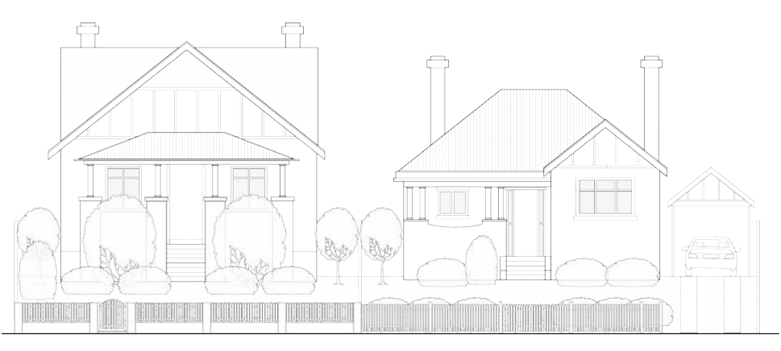
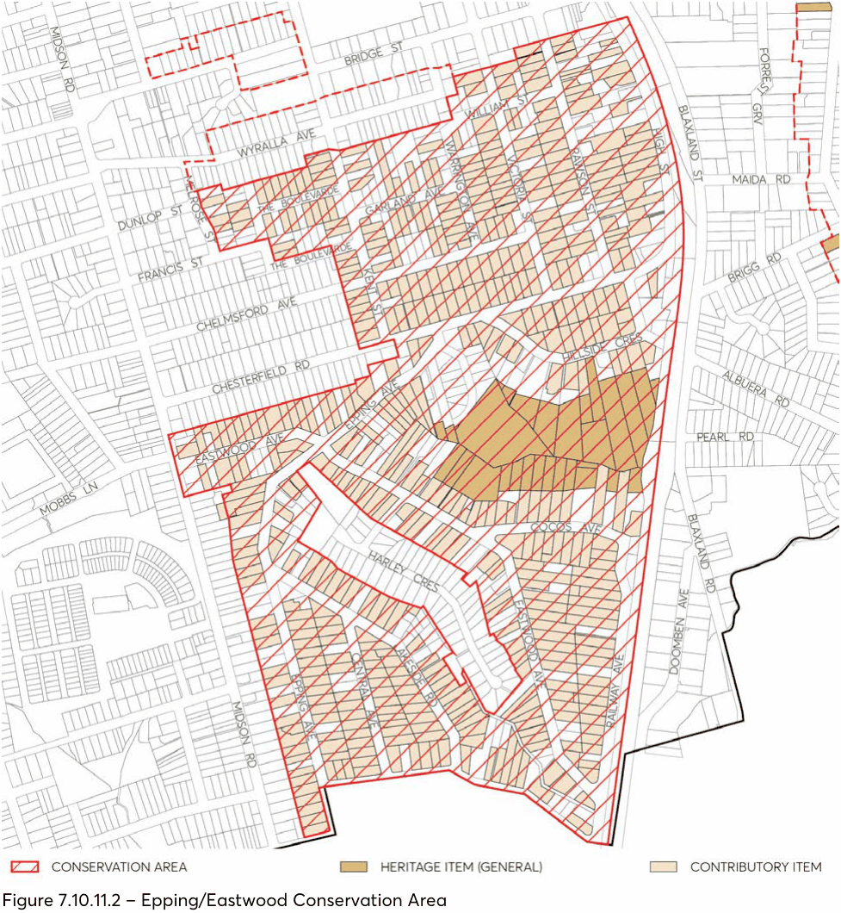
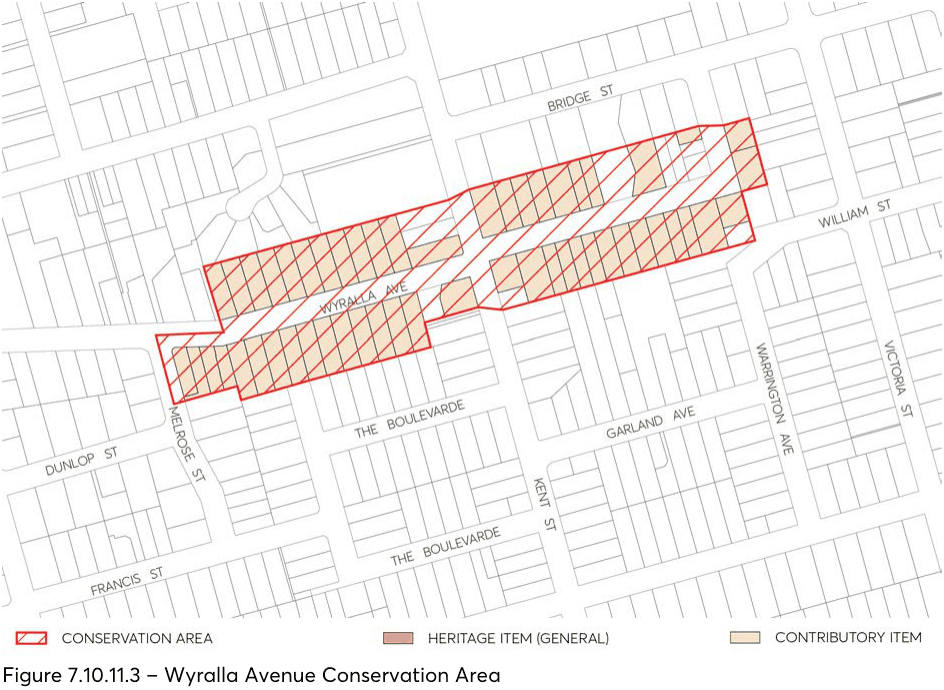
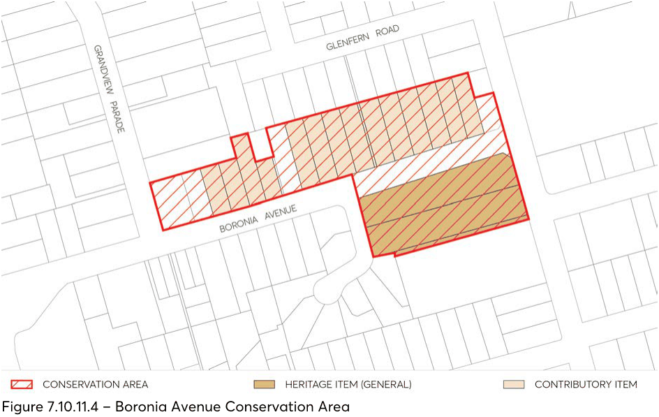

#### 7.10.11 EPPING/EASTWOOD, BORONIA AVENUE AND WYRALLA AVENUE

#### CONSERVATION AREAS

The locations of Epping/Eastwood Conservation Area, Wyralla Avenue Conservation Area, and Boronia Avenue Conservation area are depicted in Figure 7.10.11.2 to Figure 7.10.11.4.

#### 7.10.11.1 HISTORY

EPPING/EASTWOOD

This area is a sample of the suburban residential subdivisions near the railway line between Epping and Eastwood. It contains some outstanding large houses built from the 1910s to the 1940s and a variety of smaller houses built in the same period. It comprises parts of two large estates - the Eastwood House Estate and the Chesterfield Estate (with the common boundary along Chesterfield Road) - and the corner of a third estate cut off by the railway. The area was subdivided in the second decade of the twentieth century in five auctions from 1910 to 1915. In the late 1910s and early 1920s, Hepburn Pollock was a very active builder in this area. The standard and character of development was set with Terry’s Eastwood House Estate: the first portion, auctioned in 1907, was in Ryde Municipality; and the second portion, auctioned on 26 February 1910, is the centre of this area.

By October-November 1937, when this area was surveyed by the Water Board, most allotments were built upon, with some vacant lots in Hillside Crescent. The remaining vacant lots were built on in the 1940s and 1950s. There has been some recent two-storey development. A new street, Harley Crescent, has been introduced into the middle of this area and is not included in the listing.

In 2008, Council approval was given for the conservation area to be extended northwards to the boundary of the Wyralla Avenue Conservation Area. The extended area has similar characteristics and a similar subdivision pattern to the Epping/Eastwood Conservation Area.

Included in the extended area are streets with links to orchardists who lived in the area. The Boulevard incorporates part of the Greenwood estate, named after orchardist Herbert Greenwood. Garland Avenue commemorates Edward Garland, another pioneer orchardist in the Epping district.

WYRALLA AVENUE

The part of Wyralla Avenue which comprises the conservation area is a consistent streetscape of brick and timber cottages, which were mostly built in the 1910s and 1920s, and are similar in terms of their scale and design. There are few intrusive buildings and most houses have been altered very little.

Prior to subdivision for residential development, this area and surrounding locality were used predominantly as orchards and small scale farms. Between 1911 and 1912, in the midst of a subdivision and building boom in Epping, the greater portion of land within the conservation area was subdivided by Charles Sonter into two estates, known as Sonter’s Orchard Estate and Epping Station Estate. In addition, a small area at the eastern end of Wyralla Avenue was included in Vollmer’s Railway Estate. The street was initially known as ‘Railway Street’. Sands Directory first lists

cottages in the street in 1914. There was a slow but steady accretion of cottages along this part of the street in the next decade. Many of the houses in the street appear to have been erected by owner-occupiers who remained in the cottages for many years.

BORONIA AVENUE

The history of development of this conservation area is generally similar to that for Epping. Following the opening of the railway line from Strathfield to Hornsby in the mid-1880s land on the Western side of the railway line was subdivided into farm size allotments on which a number of fruit growing orchards were established. In the early years of the 20th century, many of the orchards were sold and the land was further subdivided and then offered for sale as residential building blocks. The construction in the interwar period of single storey bungalow residences in this conservation reflects the suburban growth of this period in Epping.

#### 7.10.11.2 DISTINCTIVE CHARACTERISTICS

EPPING/EASTWOOD

• The edge of a sandstone plateau falling in a series of spurs and gullies.

• Landform partially obscured by the pattern of roads, the development and the tree cover.

• Close and middle distance views dominated by trees and longer distant views of surrounding suburbs and the city from high land, particularly near the railway.

• A range of allotment sizes.

• Predominantly single storey brick bungalows built between 1910 and 1940, ranging from modest bungalows to substantial houses and grounds; houses have typical Sydney architectural details of their time, such as stone foundations, leadlight windows, and front porches; a small number of original timber houses.

• Some later post-war hoses in similar scale, including some two-storey houses in and near Chesterfield Road.

• Some substantial houses, e.g. in Railway Avenue, Chesterfield Road and High Street, mostly in Federation style.

• Houses in Railway Parade and High Street are sited at the top of the rise to take advantage of the views and have large mature front gardens.

• Some two storey extensions, most of which are designed to match the style and scale of the existing houses.

• Predominance of brick as a building material, with tiles, slate and a few houses with asbestos slates, as roof cladding.

• A considerable number of houses with original low brick fences and stone retaining walls as well as mature gardens with many plantings contemporary with the houses, and together they create a homogeneous area with attractive tree streetscapes.

• Grass verges and footpaths to each street with brick paving in some areas - such as the southern end of High Street.

• Most buildings well maintained.

• Lack of structures, garages, carports between the building line and the front fence.

• New townhouse and villa developments now eroding the characteristics that have made it attractive to residents.

• Gardens with plantings characteristic of the 1910s to 1930s - including date palms, brush box, etc; mature trees including some remnant indigenous trees.

• Municipal street planting along some of the thoroughfares dates from the 1920s.

WYRALLA AVENUE

• The conservation area is divided into two parts which differ in terms of the underlying topography and, to some extent, built form.

• In the area west of Kent Street, the land is roughly level along the length of the street, but falls from the south to the north across the street. This provides a distinctive character, with houses on one side perched up above the street and houses on the other side at street level, with the land falling away behind them. There is a mixture of timber and brick houses.

• In the area east of Kent Street, the street falls towards the east. Brick houses predominate.

• Views from within the conservation area tend to be terminated, due to changes in topography and the alignment of the street. This gives a relatively intimate scale.

• There is a range of allotment sizes, but the majority of allotments have a frontage of 50 feet (approximately 15 metres). This gives the streetscape a distinctive rhythm and a relatively intimate scale.

• All older houses are single storey, with a mixture of timber and brick construction. Houses were mostly built in the 1910s and 1920s. There is a considerable variety in architectural styles, ranging from simple symmetrical Edwardian cottages, to Federation and California bungalows.

• Roof cladding generally either clay tiles or ‘corrugated iron’, with some slate there is variety in roof forms but gables facing the street predominate.

• Brush box street trees and gardens with plantings characteristic of the 1910s - 1930s.

• Either no fences or low fences of brick or timber.

• Lack of structures, garages, carports between the building line and the front fence.

> [Picture on page 89: a picture, saved as a picture (images/part-07-heritage-archaeology-page-89-1.gif, 150 dpi).]

Figure 7.10.11.1 – Wyralla Avenue Conservation Area - streetscape character (significant elements such as: original windows, driveways, fences front garden chimneys carport and ancillary buildings porch and verandahs)

BORONIA AVENUE

• A continuous row of 15 single-storey detached brick bungalows, on the northern side of the street.

• Dwellings are similar in age and scale, and are all set back a similar distance from the front property boundary.

• Most dwellings have terracotta tiled hipped roofs, some with front gables, timber framed windows and driveways along one side providing vehicle access to garage structures located towards the rear of the property.

• Front yards of properties comprise traditional 20th century domestic landscape garden settings, consisting of lawns and garden beds of shrubs.

• Mature brush box trees planted at intervals along both sides of Boronia Avenue enhance the traditional aesthetic character of the streetscape and augment the heritage qualities of this group of buildings.

#### 7.10.11.3 STATEMENT OF SIGNIFICANCE

EPPING/EASTWOOD

An intact residential suburban area in the first quarter of the twentieth century developed alongside the railway and from earlier villa estates. It includes a variety of houses in size and style, with Federation houses and ‘between the-wars’ bungalows predominating. Mature trees, on private and public land (including remnant native trees), combine with the natural terrain to provide views, which are an integral part of the character of the area.

> [Picture on page 90: a picture, saved as a picture (images/part-07-heritage-archaeology-page-90-1.gif, 150 dpi).]

Figure 7.10.11.2 – Epping/Eastwood Conservation Area

WYRALLA AVENUE

Wyralla Avenue has a consistent streetscape which largely evolved within the space of ten years, shortly after this part of the street was subdivided. Almost all houses are intact and they demonstrate the style and mode of development in Epping at this time, when it evolved as a quality area with many people owning their own homes.

> [Picture on page 91: a picture, saved as a picture (images/part-07-heritage-archaeology-page-91-1.gif, 150 dpi).]

Figure 7.10.11.3 – Wyralla Avenue Conservation Area

BORONIA AVENUE

A row of fifteen single storey bungalow residences, constructed mainly during the interwar period, which collectively form a consistent streetscape character due to similarities in their overall scale, siting and use of building materials. With reasonably uniform setback distances from the front boundary, established front gardens and a series of rhythmic gabled roof forms visible from the street, these well-detailed residences have a cohesive special relationship, even though they demonstrate varying architectural styles. Some of the individual houses are good examples of particular interwar architectural styles.

Most of these properties have driveways along one side of the house leading to garage structures placed towards the rear of the allotment. The main entry doorway to several of the houses is located at the side.

Existing street trees (brush box) planted on both sides of Boronia Avenue enhance the traditional streetscape environment.

> [Picture on page 92: a picture, saved as a picture (images/part-07-heritage-archaeology-page-92-1.gif, 150 dpi).]

Figure 7.10.11.4 – Boronia Avenue Conservation Area

#### 7.10.11.4 PROVISIONS

Development should be in accordance with the general provisions under Section 7.4 of this DCP and the additional specific controls below.

Objectives

O.01 Continue the high standard of design achieved in recent years so that the original form and character of houses remains obvious.

Controls

Landform/Natural Characteristics C.01 Maintain remnant indigenous trees. C.02 Keep the natural slope of the land alongside buildings and in the grounds. C.03 Avoid high retaining walls and changes of land produced by cut and fill. Subdivision C.04 Maintain the width of allotments. C.05 Avoid development that involves the amalgamation of allotments and buildings that cross allotment boundaries.

C.06 Avoid re-subdivision in the Wyralla Avenue Conservation Area and Boronia Avenue Conservation Area.

C.07 In the Epping Eastwood Conservation Area, avoid re-subdivision along the length of the allotment. Re-subdivision across the line of subdivision, as in a battle-axe allotment, may be considered where it does not involve the demolition of an existing house, the loss of major mature trees or the obstruction of views.

Existing Significant Buildings C.08 Keep all existing significant buildings. C.09 Avoid painting, rendering or re-skinning of original brick walls. C.10 Avoid re-roofing of main body of house except to match original materials. C.11 Avoid removing any original historical exterior details including facade details. C.12 Avoid removing existing chimneys and fireplaces. C.13 Avoid enclosing open balconies and porches. C.14 Avoid re-cladding of timber houses except with timber weatherboards of a profile to match existing.

Siting and Garden Area C.15 Maintain the historical pattern of development of individual buildings on separate allotments of land separated by garden space.

C.16 Maintain front garden areas, lawns and associated pathways as traditional garden settings for houses.

C.17 Keep views around and between buildings. C.18 Maintain amenity and privacy of back garden space. C.19 Ensure adequate rainwater absorption area per allotment. C.20 Keep at least 60% of the site as garden space. Council will consider a minimum garden space of 50% where allotments are less than 700m².

C.21 Avoid extensions to the front or side of an existing house. C.22 Maintain the historical pattern of dwellings in Railway Parade at or near the top of the rise, with deep front gardens.

C.23 Reduce and avoid adverse impacts on the bushland in the Edna Hunt Sanctuary – avoid constructing new buildings at the rear of allotments within 7 metres of the Sanctuary/Edna Hunt Reserve.

C.24 Establish similar side boundary setbacks to those existing. C.25 Avoid new buildings closer than 8 metres to the front alignment. C.26 Avoid constructing side walls in excess of 7 metres in length. Alterations and Additions C.27 Throughout the area, dormer windows on the front façade of the roof and mansard roofs are not appropriate.

C.28 Council may consider extra rooms above the main body of a house or in a two-storey addition at the rear of a house provided:

i) the original design and features of the house are clearly apparent, and

ii) the scale of the building does not disrupt the continuity of the scale and character of houses when viewed from the street.

iii) Additions at the rear are encouraged in pavilion or skillion form, within existing side setbacks. Links to rear pavilion additions should be single storey and the roof space above the original house should not be integrated with the addition. Garages should not be integrated into the house or addition.

C.29 Any extra rooms above the existing main body of the house which require alteration of existing roof shape as seen from the street, particularly High Street and Railway Avenue should be avoided.

New Development C.30 Keep and repeat the single storey scale with maximum wall height to relate to nearby buildings listed below as existing significant buildings, other than those from 1940s and 1950s.

C.31 Avoid hearted, speckled, multicoloured or textured bricks in light colours. C.32 For new development, avoid using roofing materials other than clay tiles or corrugated iron. Roof forms should match those already present in the area, predominantly hipped or gabled.

C.33 Avoid using roofing materials in light colours. Garages, Carports & Utility C.34 Maintain the historical pattern of back garden placement of garages, sheds and other utility buildings.

C.35 Maintain garages and carports as utility buildings fully detached from the house. C.36 Maintain the established pattern of one opening per allotment for car access. C.37 Carports may be sited beside the house but only where they:

i) Are constructed of light weight frame of timber or metal, without architectural embellishments, such as period decorative features.

ii) Stand at least 1 metre back from the front wall of the building and would not be a feature in the streetscape.

iii) Are not attached to the building and would not obstruct light and air into the building.

C.38 Driveways should be made of concrete, bitumen, gravel, dark bricks or other non-obtrusive material. Wheel tracks with central grass/planting are preferred to fully paved driveway space.

Fences C.39 Encourage retention and use of low brick and masonry fences and associated gates on the front boundaries of properties. Sliding gates and automated gates are not supported.

C.40 Keep later period front fences designed to match the materials of the house. C.41 Where necessary, replace side and rear fences with a timber paling fence of same height to the original, or a fence of unobtrusive lightweight materials such as timber or wire mesh with covering plants.

C.42 Avoid high front privacy walls of brick, timber or brush.

C.43 Avoid new timber picket fences which were not a historical feature of the area. C.44 Lychgates and arbours may be acceptable if accurate reconstructions of originals. Public Lands C.45 Conserve and enhance those elements of the public domain which contribute to the history and streetscape of the area.

C.46 Retain the pattern of grass verges, footpaths and street tree planting. C.47 Maintain grass verges, footpaths and street trees. C.48 Avoid removal of healthy street trees. C.49 Retain and regenerate the bushland in the Edna Hunt Sanctuary within the Epping/Eastwood Heritage Conservation Area.

C.50 Maintain and restore sandstone kerbs and gutters. C.51 Plant trees where there are gaps in the street tree planting. C.52 Plant trees in the streets alongside the railway line where there are no street trees. C.53 Retain and repeat the use of a variety of street trees where they now occur, especially Prunus and Brush Box. New street tree plantings should consist of Brush Box.

C.54 Avoid designs that involve major changes to the street pavement, such as chicanes, wide paved speed bumps, or decorative paving.

#### 7.10.11.5 EXISTING SIGNIFICANT BUILDINGS

The following buildings together demonstrate the history of the heritage conservation area and contribute to its significance. They should be retained:

EPPING/EASTWOOD

• Central Avenue: Nos 1, 2, 3, 5, 6, 7, 8, 9, 10, 11, 12, 13, 14, 15, 16, 17, 18, 20, 21, 22, 23, 25, 29, 31, 33

• Chelmsford Avenue: Nos 2, 3, 4, 5, 6, 7, 8, 9, 10, 11, 12, 13, 14, 16, 18, 20, 22, 23, 24, 26

• Chesterfield Road: Nos 3, 4, 6, 8, 9, 10, 11, 12, 13, 14, 15, 16, 17, 18, 19, 20, 21, 22, 23, 24c, 25, 27, 29, 31, 33, 35, 37, 39, 41

• Cocos Avenue: Nos 1, 2, 3, 4, 6, 7, 8, 10, 11A, 12, 14, 15, 16, 21, 23, 25, 27, 29

• Eastwood Avenue: Nos 2, 4, 5, 6, 7, 10, 11A, 12, 14, 15, 16, 17, 19, 20, 21, 22, 23, 24, 25, 26, 28, 29, 30, 31, 32, 33, 34, 36, 37, 38, 40, 42, 43, 44, 45, 46, 48, 49, 50, 51, 52, 57, 58, 59, 60, 61, 62, 65, 67, 68, 69, 72, 73, 74, 75, 76, 77, 78, 80, 83, 84, 85, 86, 90, 91, 102, 104A, 105, 109

• Epping Avenue: Nos 1, 2, 3, 4, 5, 6, 7, 9, 10, 11, 11A, 12, 14, 16, 17, 19, 20, 21, 22, 23, 24, 25, 26, 28, 29, 32, 33, 34, 35, 38, 41, 43, 44, 45, 48, 50, 53, 55, 57, 59, 61, 67, 69, 69A, 73, 73A, 77, 79, 81, 85, 89, 91

• Garland Avenue: Nos 3, 4, 5, 6, 8, 9, 10, 12, 13, 15

• High Street: Nos 3, 5, 6, 8, 9, 10, 11, 12, 12A, 14, 16, 18, 19, 21, 22

• Hillside Crescent: Nos 1, 1A, 2, 3, 4, 5, 6, 7, 9,11

• Kent Street: Nos 1, 2, 3, 5, 6, 7, 8, 9, 10, 11, 12, 13, 14, 15, 16, 17, 19, 20, 23, 24, 25, 27, 29, 31, 33

• Melrose Street: Nos: 8, 10, 14

• Railway Avenue: Nos Cnr Eastwood Avenue (number unclear) 2, 3, 5, 6, 7, 8, 9, 10, 11, 12, 14, 15, 16, 17, 18, 19, 20, 21, 22, 23, 24, 25

• Rawson Street: Nos 1, 2, 3, 4, 6, 7, 8, 10, 11, 13, 15, 17, 18, 19, 20, 21, 22, 23, 24, 25, 26, 27, 29, 31, 32, 32A, 33, 34B, 35, 36, 37, 39, 40, 42, 44

• Lakeside Road: Nos 9, 11, 13, 15, 17, 19, 21, 23, 24, 25, 26, 27, 28, 29, 30, 31, 32, 34, 35, 36, 38, 39, 40, 42, 43, 44, 45, 46, 48, 59, 61, 65, 67

• The Boulevarde: Nos 7, 9, 11A, 12, 14, 16, 17, 19, 22z, 27, 28, 29, 30, 32, 34

• Victoria Street: Nos 2, 3, 4, 6, 7, 8, 9, 10, 11A, 14, 15, 16, 17, 18, 22, 23, 24, 27, 28, 29, 30

• Warrington Avenue: Nos 1, 2, 3, 4, 5, 6, 7, 8, 9, 10, 11, 12, 13, 14, 16, 17

• William Street: Nos 1, 4, 6, 12

• Wingate Avenue: Nos 5, 7, 9, 11, 11A, 15A, 17, 23, 25, 31, 33, 35, 37, 41 Intact houses of the 1940s and 1950s

• Chelmsford Avenue: Nos 28, 30

• Chesterfield Road: Nos 2B, 26, 26A, 26B, 43, 45

• Cocos Avenue: Nos 17, 19

• Eastwood Avenue: Nos 1, 54, 56, 79, 81, 82, 87, 88, 89, 92, 93, 94, 96, 98, 101, 103

• Epping Avenue: Nos 18, 30, 40, 48, 54, 60, 62, 64, 65A, 66, 68, 69B, 70

• High Street: No 1

• Hillside Crescent: Nos 6, 6A, 10, 10A, 12, 14, 20, 22, 24, 26

• Rawson Street: Nos 12, 14, 16, 34A

• Lakeside Road: Nos 41, 47, 51, 53, 55, 57

• Victoria Street: Nos 1, 5, 11, 19

• Wingate Avenue: Nos 1, 27, 29

WYRALLA AVENUE

• Wyralla Avenue: Nos. 4, 5, 6, 7, 8, 9, 10, 11, 12, 13, 14, 15, 16, 17, 18, 19, 20, 21, 22, 23, 24, 25, 26, 27, 29, 30, 31, 32, 34, 35, 37, 39, 40, 41, 42, 43, 44, 46, 48, 50, 52, 54, 56, 58, 60, 62, 64

• Kent Street: Nos. 35 & 37

In addition, the following buildings contribute to the heritage significance of the area because of their scale and architectural character but, because they are either older buildings that have been unsympathetically altered or buildings dated from no earlier than the 1940s, their conservation is encouraged but not essential to the character of the area:

• Wyralla Avenue: Nos. 1b, 28, 33, 34b, 36, 38

BORONIA AVENUE

• Boronia Avenue: No. 3, 5, 7, 9, 11, 11A, 15, 17, 19, 21, 25, 27, 29, 31

#### DUNDAS/NORTH ROCKS WARD
