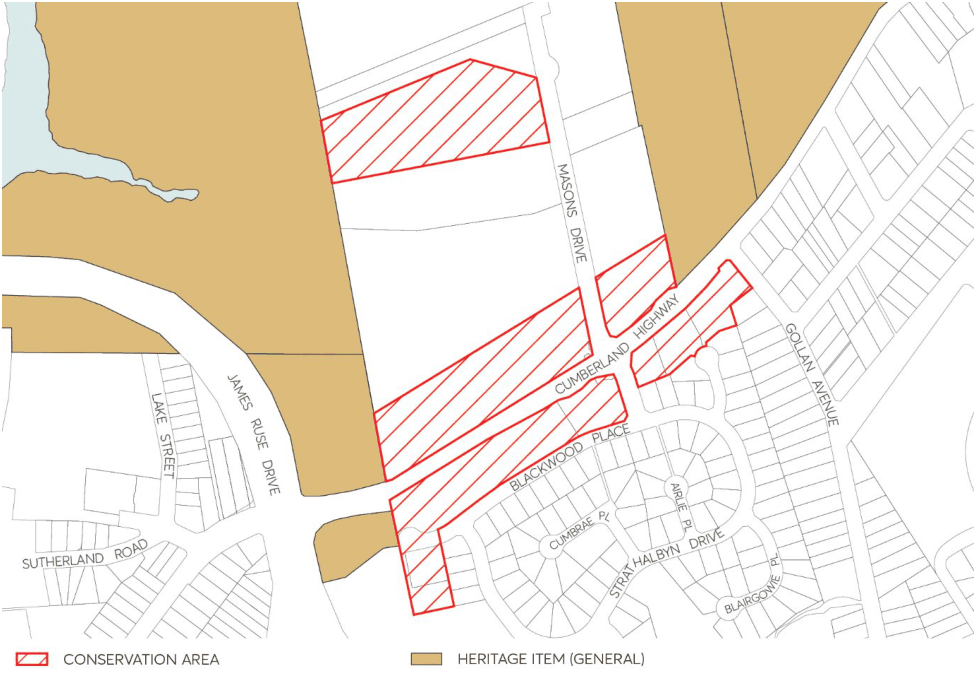

#### 7.10.12 BURNSIDE HOMES CONSERVATION AREA, NORTH PARRAMATTA

The location of Burnside Homes Conservation Area is depicted in Figure 7.10.12.1.

#### 7.10.12.1 HISTORY

Burnside Homes provides a great example of 20th century Classical Revival style architecture, part of the Burnside Homes Orphanage Group. The buildings include influence from Old Government House in Parramatta and makes a strong contribution to the streetscape. The buildings comprise of stuccoes brick walls, hipped roof and Marseilles tiles. The chimneys are constructed of brick with

cowl. Notable features include a set of three Tuscan columns flanking the doorway with Tuscan Pilasters, along with recessed arched windows with sandstone sills, and large sandstone gateposts with palisade iron gate.

#### 7.10.12.2 DISTINCTIVE CHARACTERISTICS

• The linear streetscape to Pennant Hills Road of fences, plantings and facades and grand facades featuring gables, porticos and towers.

• The resultant “village” grouping.

• The catalogue of architectural aspirations c1901—1930 shown by the facades.

• The attractive nature of the existing landscape. Though this is currently depleted, there are fine stands of native trees to the west of the site. The siting of the group on a ridge enhances the picturesque qualities of the whole. It should be noted that few of the buildings have interiors of note, and the most important elements are the main façades.

> [Picture on page 99: a picture, saved as a picture (images/part-07-heritage-archaeology-page-99-1.gif, 150 dpi).]

Figure 7.10.12.1 – Burnside Homes Conservation Area, North Parramatta

#### 7.10.12.3 STATEMENT OF SIGNIFICANCE

The Burnside Homes are evidence of a grandiose philanthropic social experiment for the care of orphans using domestic rather than institutional accommodation arranged in a village complex. While the village and first buildings were established by the Presbyterian Church many of the houses were built by private benefactors between 1911-1941. This building is part of that unique village child care complex and forms part of a picturesque catalogue of the development of domestic architectural aspirations in the period 1911-1941.

#### 7.10.12.4 PROVISIONS

Development should be in accordance with the general provisions under Section 7.4 of this DCP and the additional specific controls below.

Objectives

O.01 Ensure that new development is sympathetic to the identified heritage values. O.02 Provide guidance for development in relation to heritage items and heritage conservation areas.

O.03 Encourage an understanding of heritage significance and to promote the conservation of heritage.

Controls

C.01 New development is to be sited and designed so as not to adversely impact upon the existing or original landscape and spatial qualities of the area.

C.02 New buildings are to complement existing buildings of significance with respect to bulk, scale and façade geometry and be of a simple, contemporary design that avoids ‘heritage style’ architectural or decorative detail.

C.03 Applications for new buildings will need to consider the following as a minimum:

• the pitch and form of the roof (if any);

• the style, size, proportion, and position of the openings for windows and doors (if any); and

• the colour, texture, style, size, and type of finish of the materials to be used on the exterior of the building.

#### 7.10.12.5 EXISTING SIGNIFICANT BUILDINGS

The following buildings together help to demonstrate the history of the area and contribute to its significance. They must be retained.

• Blackwood Place: Nos 1-7, 9-29, 28, 30

• Masons Drive: Nos 1-3, 14-16

• Pennant Hills Road: No 61 *Heritage item

GLOSSARY OF HERITAGE TERMS
