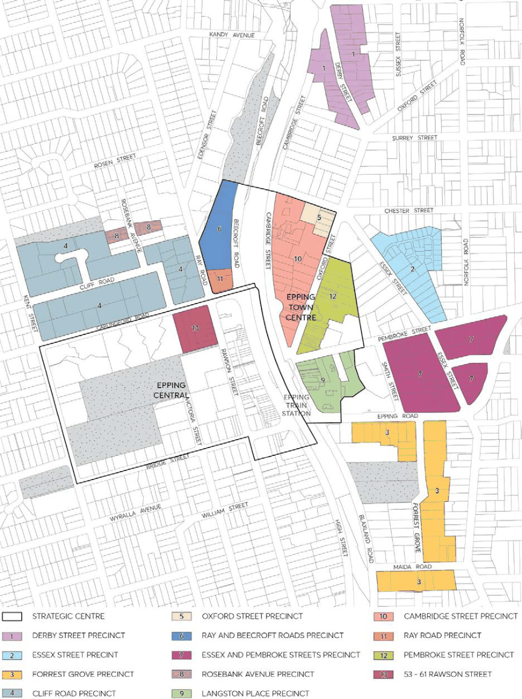

#### 8.1.1 EPPING STRATEGIC CENTRE

The Epping Strategic Centre comprises of Epping Central located to the west of the rail line, Epping Town Centre located to the east of the rail line, and its surrounding residential and commercial planned precincts (Figure 8.1.1). This centre is identified by its access to public transport (serviced by the Metro North West Line, Sydney Trains T9 Northern Line and NSW TrainLink Central Coast & Newcastle Line), provision of mixed-use commercial, retail and residential development, enhanced public domain, and significant heritage context.

> [Picture on page 7: a picture, saved as a picture (images/part-08-centres-precincts-special-character-areas-specific-page-7-10.gif, 150 dpi).]

Figure 8.1.1 – Epping Strategic Centre

STRATEGIC CENTRES

EPPING STRATEGIC CENTRE
