#### 8.1.1.1 EPPING CENTRAL

#### 8.1.1.1.1 DESIRED FUTURE CHARACTER

Epping Central is focused around Epping Railway Station and is characterised by a compact and vibrant Centre Core immediately adjacent to the station, surrounded by lower density development adjacent to the Core. The lower density area recognises the heritage significance and character of the area, in particular the heritage items and heritage conservation areas.

The Centre Core accommodates higher density commercial, retail and residential development in the form of high quality, tall slim-line towers in the areas fronting Rawson Street and Beecroft Road (between Bridge Street and Carlingford Road). The heights and densities of existing low rise residential flat buildings surrounding Boronia Park remain unchanged and provide a buffer between new high density development in the Centre Core and existing low density development at the periphery.

New development within the Centre Core contribute to public domain improvements, new laneway connections and active ground level uses (particularly along Rawson Street, Beecroft Road and new laneways) that provide high levels of pedestrian amenity and reinforce the role of these streets as a vibrant retail/commercial area. The number of vehicular access points along Rawson Street are minimised to maximise pedestrian safety and to ensure the fine grain pattern of ground floor uses are continued along the length of street with minimal interruption.

Building tower elements are suitably setback from all street alignments so that they do not visually dominate the street, allow a pedestrian scale to be maintained at street level, and reduce overshadowing impacts on the public domain.

Pedestrian connections are improved throughout the centre, and between the western and eastern side of the railway line. An above ground pedestrian link connecting new development in Beecroft Road directly into the Epping Railway Station is encouraged. New through site vehicular connections between Rawson Street car park and Carlingford Road alleviate vehicular movements at the existing Rawson Street/Carlingford Road intersection.

New development is designed and sited in a manner that protects the amenity of occupants on adjoining properties and, where relevant, provides a sympathetic response to heritage items and conservation areas. New development also protects the amenity of future building occupants by appropriately considering noise and vibration impacts from Beecroft and Carlingford Roads, and the railway line. High rise development must not result in wind tunnelling impacting upon both the public domain and new and existing development.

Where properties adjoin Boronia Park, new development address and casually survey the Park, whilst also minimising overshadowing impacts. The future use of the Council owned car park in Rawson Street is subject to future master planning and endorsement by the City of Parramatta Council.

STRATEGIC CENTRES

EPPING STRATEGIC CENTRE

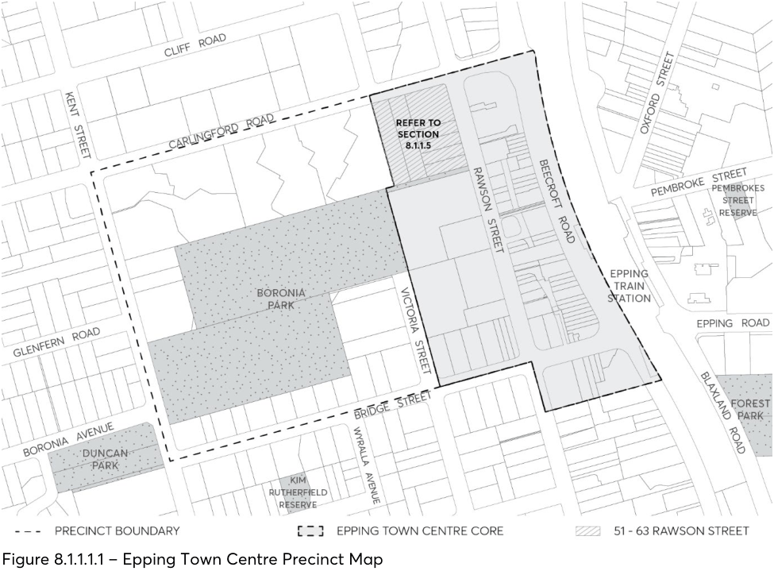

> [Picture on page 9: a picture, saved as a picture (images/part-08-centres-precincts-special-character-areas-specific-page-9-3.gif, 150 dpi).]

Figure 8.1.1.1.1 – Epping Town Centre Precinct Map

Objectives

In addition to general objectives listed in Part 8 of this DCP, specific objectives of this precinct are identified below. O.01 Ensure that new development provides a strong interface to Epping Railway Station and improves connections between the railway station and the eastern and western sides of the centre.

O.02 Provide high quality built form and to ensure that new buildings provide articulation, modulation and attractive composition of building elements.

O.03 Ensure that new development maintains and enhances the character and function of Rawson Street and Beecroft Road as a retail/commercial street by continuing the fine grain pattern of ground floor uses.

O.04 Ensure that new development responds well to heritage items and conservation areas. O.05 Ensure new development is suitably treated to reduce noise and vibration impacts from Beecroft Road and Railway Line.

Investigation Areas

As shown in Figure 8.1.1.1.2 Council will investigate future options for the use of the Council owned car park site in Rawson Street to determine the most appropriate future use of the site. This would be subject to a further Masterplan exercise and endorsement by City of Parramatta Council.

STRATEGIC CENTRES

EPPING STRATEGIC CENTRE

A ‘kiss and ride’ zone enabling commuters to be set down/picked up in Rawson Street near pedestrian lane links to the railway station to be considered in future redevelopment of Council’s car park site. Alternatively, this may be able to be achieved on the eastern side of Rawson Street, in consideration of the amalgamation of existing laneways between Beecroft Road and Rawson Street into redevelopment sites.

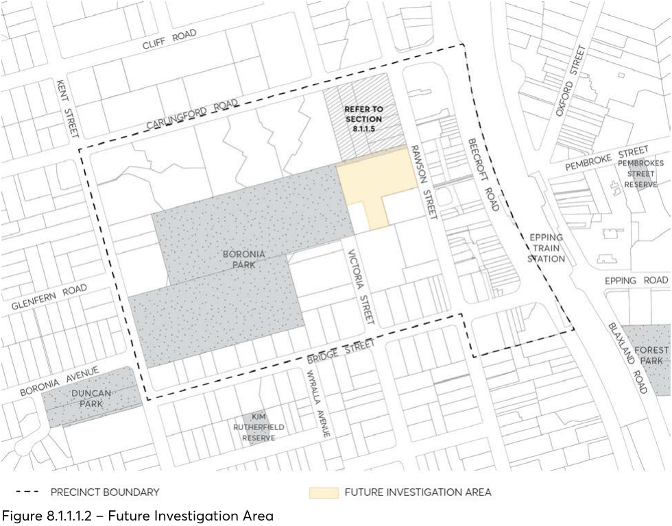

> [Picture on page 10: a picture, saved as a picture (images/part-08-centres-precincts-special-character-areas-specific-page-10-8.gif, 150 dpi).]

Figure 8.1.1.1.2 – Future Investigation Area

Controls

Note: Development must comply with the controls set out below and any relevant controls within this DCP. Where there is any inconsistency Part 8 will prevail. Pedestrian Connections and Laneways C.01 New and existing pedestrian connections, roads and laneways should be enhanced and provided in accordance with Figure 8.1.1.1.3.

C.02 New road connections, cycle ways and laneways should be provided to improve through block connections, extend existing connections and improve the interface to Epping Railway Station.

C.03 New pedestrian connections are to have a minimum width of 6 metres and are to be consistent in width for their full length. Where pedestrian connections are proposed to be shared with vehicles, these are to have a minimum width of 6.4 metres.

C.04 Pedestrian through site links are to:

STRATEGIC CENTRES

EPPING STRATEGIC CENTRE

a) have active ground floor frontages and encourage outdoor dining opportunities;

b) be legible and direct throughways for pedestrians, clear of obstructions (including columns, stairs and escalators);

c) provide public access 24 hours, 7 days per week;

d) be open to the air above and at each end however, Council may consider an ‘arcade style’ walkway where this replaces an existing arcade; and

e) have signage at the street entries indicating public accessibility and the street to which the through site link connects.

C.05 Laneways and through-site links should be dedicated to Council. C.06 Where an existing pedestrian link provides access between Beecroft Road and Rawson Street, any re-development of such land is to incorporate a 24-hour pedestrian link between these streets.

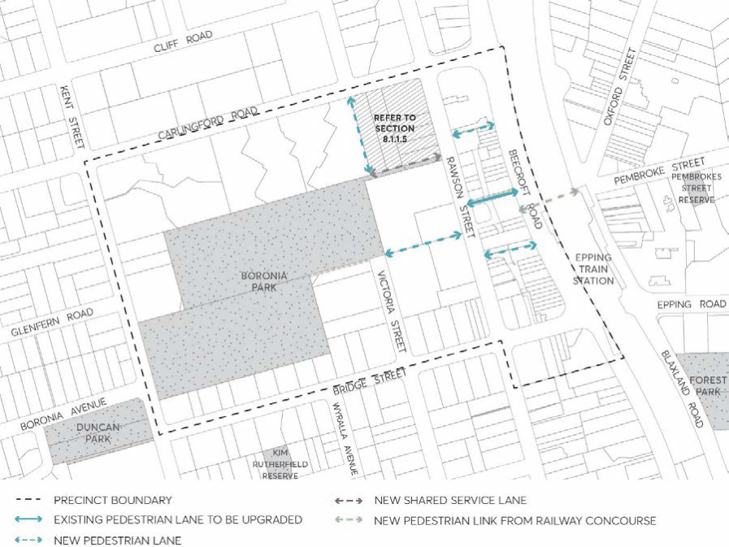

> [Picture on page 11: a picture, saved as a picture (images/part-08-centres-precincts-special-character-areas-specific-page-11-15.gif, 150 dpi).]

Figure 8.1.1.1.3 – Pedestrian Connections and Laneways

STRATEGIC CENTRES

EPPING STRATEGIC CENTRE

Landscaping & Public Domain

C.07 The Town Centre Core is to complement the existing landscaped character of the surrounding

area. To achieve this, podium planting, particularly along the street edge of a podium, is to be provided as part of development on sites identified at Figure 8.1.1.1.5.

C.08 Where podium planting is required, the planting is to be provided as illustrated at Figure 8.1.1.1.5, with the appropriate soil depth and width as illustrated at Figure 8.1.1.1.6.

C.09 Existing street trees are to be protected and maintained. New developments are to provide new street trees along the street frontage in line with Council’s specifications as detailed on a Public Domain Plan.

C.10 A Public Domain Plan is to be provided for all new developments, detailing upgrades to the surrounding public domain network, including foot paving, street tree planting, street furniture and the like. Details shall be in keeping with Council’s Parramatta Public Domain Guidelines and finishes/street trees specified should be in line with Council’s preferred palette for Epping Town Centre.

C.11 Paving at ground level within private land adjoining the public domain shall be consistent with the treatment provided within the public domain and should appear as an extension of the public domain.

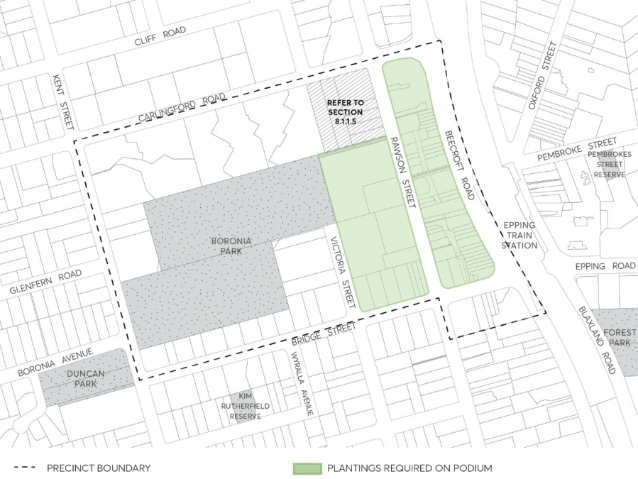

> [Picture on page 12: a picture, saved as a picture (images/part-08-centres-precincts-special-character-areas-specific-page-12-20.gif, 150 dpi).]

Figure 8.1.1.1.4 – Planting required on podium

STRATEGIC CENTRES

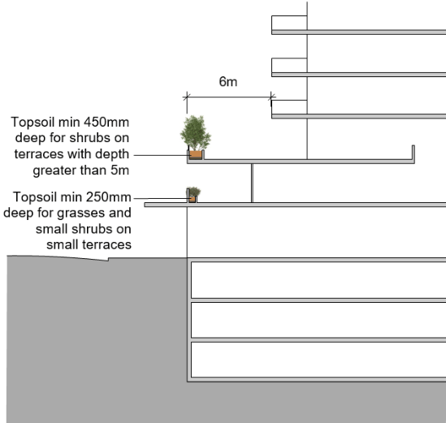

> [Picture on page 13: a picture, saved as a picture (images/part-08-centres-precincts-special-character-areas-specific-page-13-2.gif, 150 dpi).]

EPPING STRATEGIC CENTRE

Figure 8.1.1.1.5 – Podium planting provision

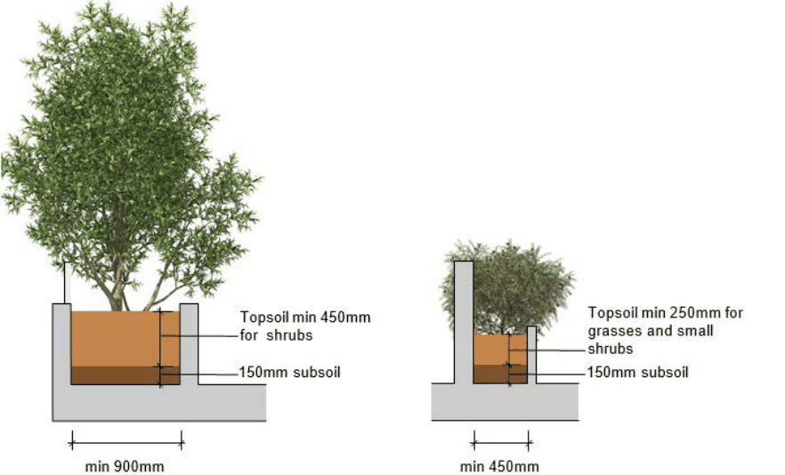

> [Picture on page 13: a picture, saved as a picture (images/part-08-centres-precincts-special-character-areas-specific-page-13-5.gif, 150 dpi).]

Figure 8.1.1.1.6 – Soil depth and width

Building Height C.12 The height of buildings in storeys should not exceed that corresponding the maximum Parramatta LEP 2023 height in metres under Table 8.1.1.1.1.

STRATEGIC CENTRES

EPPING STRATEGIC CENTRE

Table 8.1.1.1.1 – Maximum storey height

| Zone (Epping Town Centre) | Height in metres under LEP | Maximum number of storeys |
|---|---|---|
| R4 High Density Residential | 11 | 3 |
| E1 Local Centre | 18 48 72 | 5 15 22 |

Note: Refer to Section 8.1.1.5.1 for the building height controls for 53-61 Rawson Street, Epping.

Building Setbacks Front setbacks C.13 Basement car parking, podium and tower building setbacks are to be in accordance with Error! Reference source not found. and indicative sections provided at Figure 8.1.1.1.8, Figure 8.1.1.9, and Figure 8.1.1.10, and any additional controls set out below.

C.14 Where identified on Error! Reference source not found. 8.1.1.1.7 and Figure 8.1.1.1.8, the 2 metre ground level setback area along Rawson Street and the 1.5 metre ground level setback area along Beecroft Road, High Street and Bridge Street should be treated as an extension to the footpath to enhance pedestrian amenity and improve opportunities for outdoor dining and an active, lively street. The gradients, finished levels and treatment of this setback area are to match the adjoining footway and detailed on the Public Domain Plan. Access should be made available 24 hours per day, 7 days per week.

C.15 Podiums are to be a maximum of 2-3 storeys in height. Podiums of 3-4 storeys may be considered along Beecroft Road where the proposed use is to be non-residential.

C.16 Where the building alignment is setback from the street alignment, balconies or architectural elements may project up to 600mm into front building setbacks, provided the cumulative width of all balconies at that particular level totals no more than 50% of the horizontal width of the building façade.

C.17 Podium setbacks to new and existing laneways and road extensions are shown in Figure 8.1.1.1.7 and Figure 8.1.1.1.8. Podium setbacks can be aligned to the laneway except where accommodating outdoor dining opportunities or where building separation requirements of the Apartment Design Guide seeks increased setbacks. Note: The building setbacks to existing and desired laneways must ensure that the minimum widths specified in C.03 and C.04 are achieved. Further separation may be required for appropriate building separation between residential uses.

Side setbacks C.18 For the commercial/retail component of development within the E1 Local Centre Zone, a zero side setback is permissible for a building height of up to three storeys. That component of the development above 3 storeys is to be setback a minimum of 6 metres from the side boundary.

C.19 In all circumstances residential components of a development must comply with the minimum building separation distances prescribed under the Apartment Design Guide.

STRATEGIC CENTRES

EPPING STRATEGIC CENTRE

Rear setbacks C.20 Development should be setback a minimum of 6 metres from the rear boundary. Within the E1 Local Centre Zone, a zero rear setback may be considered for a maximum height of 3 storeys where a non-residential use adjoins another non-residential use.

C.21 In all circumstances, residential components of a development must comply with the minimum building separation distances prescribed under the Apartment Design Guide.

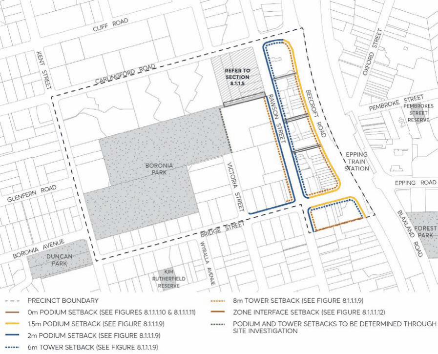

> [Picture on page 15: a picture, saved as a picture (images/part-08-centres-precincts-special-character-areas-specific-page-15-9.gif, 150 dpi).]

Figure 8.1.1.1.7 – Setbacks

Building bulk and depth C.22 Building floor plates above the podium are not to exceed the following:

a) For residential development, 700m² of gross floor area and 900m² inclusive of balconies, external walls, internal voids etc; or

b) For commercial development, 1,200m² of gross floor area.

C.23 Floor plates are to be limited to a maximum dimension of 40 metres.

STRATEGIC CENTRES

EPPING STRATEGIC CENTRE

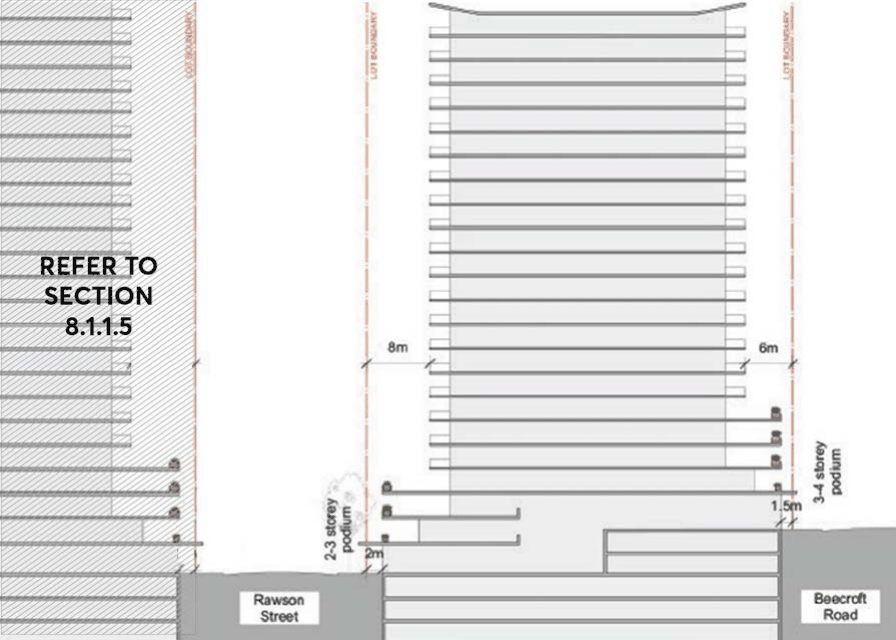

> [Picture on page 16: a picture, saved as a picture (images/part-08-centres-precincts-special-character-areas-specific-page-16-3.gif, 150 dpi).]

Figure 8.1.1.1.8 – Setbacks to Rawson Street and Beecroft Road

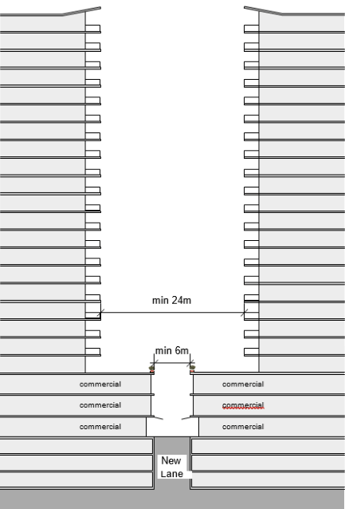

> [Picture on page 16: a picture, saved as a picture (images/part-08-centres-precincts-special-character-areas-specific-page-16-5.gif, 150 dpi).]

Figure 8.1.1.1.9 – Setbacks to New Lane connecting Rawson Street to Beecroft Road

STRATEGIC CENTRES

EPPING STRATEGIC CENTRE

Minimum site area, frontage and amalgamation C.24 Site amalgamation is encouraged to realise the development potential envisaged. For development exceeding six storeys in height, development sites must have a minimum area of 2,000m² with a minimum street frontage of 40 metres.

C.25 Site amalgamation patterns are to ensure through block amalgamation, particularly between Beecroft Road and Rawson Street.

C.26 Isolation of small sites may result in poor built form outcomes. The applicant needs to demonstrate how small lots (less than 2,000m²) will not be isolated by new development. Refer to Section 3.6.1 of this DCP – Site Consolidation and Development on Isolated Sites.

Development along Beecroft Road C.27 Development to Beecroft Road should incorporate up to four levels of retail and/or commercial floor space fronting Beecroft Road, to ensure the provision of employment space within the Town Centre and act as a noise buffer between the Railway Line, Beecroft Road and residential development to the west.

C.28 Development along Beecroft Road and directly opposite Epping Railway Station is to consider the opportunity for a direct overpass connection between the development site and Epping Railway Station.

C.29 The existing pedestrian bridge over Beecroft Road to the Railway Station is to be maintained, and allow pedestrians to access from Rawson Street through to the Railway Station.

Building Height Transition C.30 Development on sites that share a boundary with the R2 Low Density Residential Zone are to be a maximum height of 3 storeys within 15 metres of the shared boundary as shown in Figure 8.1.1.1.10.

C.31 In all other cases, where adjoining sites have different height limits, the height transition requirements detailed in Section 2.4 – Building Form and Massing of this DCP are to be adhered to.

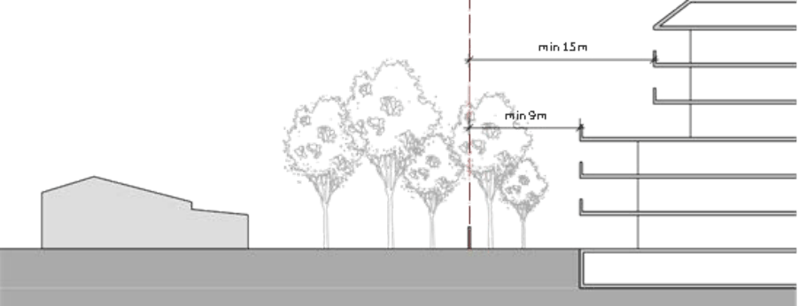

> [Picture on page 17: a picture, saved as a picture (images/part-08-centres-precincts-special-character-areas-specific-page-17-29.gif, 150 dpi).]

Figure 8.1.1.1.10 – Zone interface controls

STRATEGIC CENTRES

EPPING STRATEGIC CENTRE

Building Design C.32 Design of new buildings are to consider adjoining buildings, heritage buildings or buildings included within a Heritage Conservation Area in the in terms of:

a) appropriate alignment and street frontage heights;

b) setbacks above street frontage heights;

c) appropriate materials and finishes selection;

d) façade proportions include horizontal or vertical emphasis; and

e) side and rear setbacks.

C.33 Balconies and terraces should be provided, particularly where buildings overlook public spaces and on low rise parts of a building. Gardens on the top of setback areas of buildings are encouraged.

C.34 Façades are to be articulated so that they address the street and add visual interest. C.35 External walls are to be constructed of high quality and durable materials and finishes with ‘self-cleaning’ attributes such as face brickwork, rendered brickwork, stone, concrete and glass. Materials and finishes with high maintenance costs, and those susceptible to degradation or corrosion are to be avoided. The use of lightness and colour of materials is to be used to minimise the impacts of massing and respect lower traditional scale.

C.36 Opaque and blank walls for ground floor uses in the Town Centre Core are to be limited to a maximum of 30% of the street frontage.

C.37 Buildings are to be designed to create streetscapes that are characterised by:

a) Clearly defined edges and corners.

b) Architectural treatments that are interesting and that relate to the design and human scale of existing buildings.

c) Tall, slender buildings with massing and design that allows for light, separation and views between buildings.

C.38 Special emphasis is to be given to the design of corner buildings, including consideration of how the building addresses its neighbouring buildings, dual frontages and its turning of the corner, and incorporation of distinctive features.

Design Quality C.39 New buildings within the Town Centre Core are to provide for high quality urban design outcomes. Development Applications for all new buildings within the Town Centre Core are to be referred to the Design Excellence Advisory Panel for review.

C.40 A Design Competition process is encouraged for all developments greater than 45 metres in height.

Active street frontages and address C.41 Active frontages are required as identified at Figure 8.1.1.1.11. Active frontages are those which have a direct street entry to retail, commercial, or (to minimal extent) residential lobbies.

C.42 Active frontages uses are to include one or a combination of the following at street level:

STRATEGIC CENTRES

EPPING STRATEGIC CENTRE

a) Entrances to retail.

b) Shop fronts.

c) Glazed entries to commercial and residential lobbies occupying less than 50% of the street frontage to a maximum 6 metres of frontage. Glazing is to be clear and not tinted.

d) Active office uses such as reception, if visible from the street.

e) Public building if accompanied by an entry.

f) Café or restaurant if accompanied by an entry to the street.

g) Other non-residential uses such as business premises.

C.43 Active frontage controls:

a) Active frontages are to be at the same general level as the footpath and be accessible directly from the street.

b) Where active frontages are not required, non-residential uses at the ground floor should provide clear glazing to the street wherever possible.

c) Cafés and restaurants should consider providing openable shop fronts.

d) Retail, café and restaurant tenancies along streets to which active frontages are required are to have a width of 6-12 metres.

C.44 The following street address controls apply to ‘street address’ frontages identified at Error! Reference source not found..

a) Residential developments are to provide a clear street address and direct pedestrian access off the primary street front, to allow for residents to overlook surrounding streets.

b) On large development sites with multiple street frontages, entrances should be provided to each frontage if possible.

c) Provide direct ‘front door’ access from ground floor residential units.

C.45 Outdoor dining is encouraged within the Town Centre core, particularly along Rawson Street, as identified at Figure 8.1.1.1.11. Refer to the City of Parramatta Council’s Outdoor Dining Guidelines for more information relating to outdoor dining.

C.46 Continuous awnings are to be provided where active frontages are required by Figure 8.1.1.1.11. Where active frontages are not required, awnings to street level commercial and retail developments are encouraged for weather protection and pedestrian amenity. New awnings should have the same height, or the average of, the two adjacent awnings.

Vehicle access C.47 Driveways should be:

a) Provided from lanes and secondary streets rather than the primary street, wherever practical.

b) Located taking into account any services within the road reserve, such as power poles, drainage inlet pits and existing street trees.

c) Located a minimum of 10 metres from the perpendicular of any intersection of any two roads.

STRATEGIC CENTRES

EPPING STRATEGIC CENTRE

d) Designed so that vehicles can enter and leave in a forward direction without the need to make more than a three point turn.

e) Separated and clearly distinguished from pedestrian access.

f) Located at least 1.5 metres from the side boundary with any public domain area, street, lanes or parks, with the setback to be landscaped.

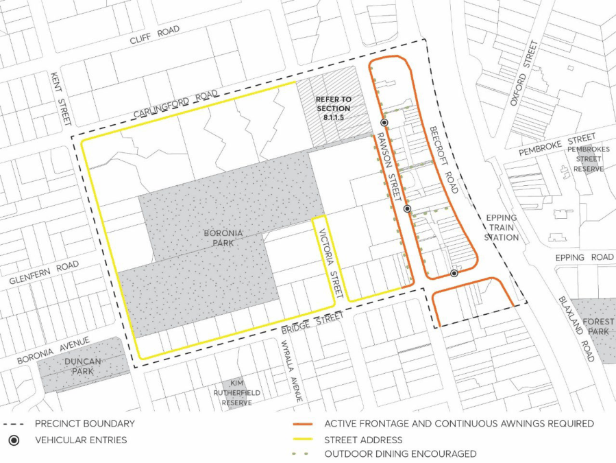

> [Picture on page 20: a picture, saved as a picture (images/part-08-centres-precincts-special-character-areas-specific-page-20-8.gif, 150 dpi).]

Figure 8.1.1.1.11 – Active frontages, street address, outdoor dining and vehicular entries

C.48 Shared basements are encouraged to minimise the number of vehicular crossings. C.49 A maximum 3 vehicular access points should be provided off the eastern side of Rawson Street. Preferred vehicular access points are identified at Figure 8.1.1.1.11. Opportunities for amalgamated or shared vehicular entry points are also encouraged along the western side of Rawson Street.

C.50 No new vehicular access points into a development site are permitted off Beecroft or Carlingford Roads. Any vehicular access required within Rawson Street should take into consideration the potential for shared basement access with adjoining sites.

C.51 Any site on the western side of Rawson Street, that has two street frontages, is not to be accessed off Rawson Street.

C.52 Vehicular crossing widths are to comply with AS 2890.1. C.53 Doors to vehicle access points are to be non-solid roller shutters or tilting doors fitted behind the building façade and to be of materials that integrate with the design of the building and contribute to a positive public domain.

STRATEGIC CENTRES

EPPING STRATEGIC CENTRE

Mixed use developments C.54 The ground floor of buildings within the E1 Local Centre Zone are to have a minimum floor to ceiling height of 3.6 metres. All retail and commercial floors above the ground floor are to have a minimum floor to ceiling height of 3.3 metres. The minimum floor to ceiling height for residential floors above the ground floor is 2.7 metres.

C.55 Commercial service areas in mixed use developments, including loading docks and waste areas, are to be separated from residential access, service areas and primary outlook and must not be visible from the public domain.

C.56 Within mixed use developments, residential entries and vertical circulation are to be clearly demarcated and separated from commercial entries and circulation. Residential entries should be clearly visible and directly accessible from the street or public domain.

C.57 Provide security access controls to all entrances into private areas, residential lobbies, car parks and internal courtyards and open space.

Deep soil zones C.58 Deep soil zones shall be provided in accordance with Part 2 – Design in Context of this DCP. C.59 Locate basement car parking predominately under the building footprint to maximise opportunities for deep soil areas.

C.60 For non-residential and mixed use developments, areas with soil depths of up to 1.2 metres should be provided in atria, courtyards and boundary setbacks.

Environmental management C.61 Wind mitigation:

a) A Wind Effects Report is to be submitted with a Development Application for all buildings greater than 32 metres in height.

b) For buildings over 50 metres in height, results of a wind tunnel test are to be included in the Development Application documentation.

Safety and security C.62 The design and use of buildings is to promote active uses fronting public streets and places. C.63 Landscaping is to reinforce the public realm without secluding areas where surveillance is limited.

C.64 The vehicle and pedestrian movement network is to be clearly delineated, including location of car parking near building entries, to minimise opportunities for conflict.

C.65 Entrances to buildings should be well lit, clear and well defined. Car Parking C.66 Car parking is to be provided below ground in basements within the E1 Local Centre and R4 High Density Residential Zones.

C.67 Car parking for non-residential, multi-unit residential and mixed use developments is to be provided to the rates set out at Table 8.1.1.1.2. For other forms of development refer to the applicable rates are in Part 6 – Traffic and Transport of this DCP.

STRATEGIC CENTRES

EPPING STRATEGIC CENTRE

C.68 In mixed use developments, residential parking should be secure and separated from parking allocated to the retail/commercial components of the development.

Table 8.1.1.1.2 – Parking Rates

| Type | Rate |  |
|---|---|---|
| Residential |  |  |
| Studios, 1, 2 and 3+ bedroom apartments – on land within 800 metres of Epping railway station | Maximum Car Parking Rate per bedroom |  |
|  | Studio | 0.4 spaces |
|  | 1 | 0.4 spaces |
|  | 2 | 0.7 spaces |
|  | 3 or more | 1.2 spaces |
|  | Car parking can be averaged across the residential component of the development. |  |
| Residential visitors – on land within 800 metres of Epping railway station | A minimum of 1 space per 7 dwellings |  |
| Studios, 1, 2 and 3+ bedroom apartments – beyond 800 metres of Epping railway station | Maximum Car Parking Rate per bedroom |  |
|  | Studio | 0.5 spaces |
|  | 1 | 0.75 spaces |
|  | 2 | 1 spaces |
|  | 3 or more | 1.5 spaces |
|  | Car parking can be averaged across the residential component of the development. |  |
| Residential visitors – on land beyond 800 metres of Epping railway station | A minimum of 1 space per 10 dwellings |  |
| Accessible parking spaces | Medium and high residential density residential development (including component within mixed use development) – a minimum of 1 space for every adaptable/accessible unit, appropriately designed for use by people with disabilities. Each space must be allocated specifically to the adaptable/accessible unit. Accessible parking is to be designed in accordance with the requirements of relevant Australian Standards. |  |
| Car share spaces | A minimum of 1 space is to be allocated to car share for developments with 50 or more dwellings. If agreement with a car share provider is not obtained then the car share space is to be used for additional visitor parking until such time as a car share provider agreement is obtained. |  |
| Storage Areas within Car Parking Areas | In medium/high density residential developments, each residential dwelling must have at least 10m3 of storage space provided. This can be provided within the car |  |

STRATEGIC CENTRES

EPPING STRATEGIC CENTRE

| Type | Rate parking area only where it can be demonstrated that the storage area does not impede area allocated for car parking. Where storage space is provided adjacent to car parking areas or within designated car parking spaces, it shall not impede or reduce the area allocated for car parking requirements as set out in the AS 2890 Parking Facilities series, including parking for bicycles and motor cycles. |
|---|---|
| Retail and commercial |  |
| Retail (including cafés, restaurants and the like) – on land within 800 metres of Epping railway station | Maximum of 1 space per 30m2 of gross floor area |
| Commercial (including medial and professional consulting) – on land within 800 metres of Epping railway station | Maximum of 1 space per 50m2 of gross floor area |
| Accessible parking spaces | Commercial – Minimum of 1-2% of all spaces to be provided as readily accessible spaces, appropriately designed for use by people with disabilities. Accessible parking is to be designed in accordance with the requirements of relevant Australian standards. |
| Motorcycle parking | Buildings with less than 25 car parking spaces – A minimum of one motor cycle space is to be provided as separate parking for a motor cycle. Buildings with more than 25 car parking spaces - An area equal to a minimum of one motor cycle space is to be provided as separate parking for motor cycles for every 25 onsite car parking spaces provided, or part thereof. Each motorcycle parking space is to be designated and located so that parked motorcycles are not vulnerable to being struck by a manoeuvering vehicle. |
| Bicycle retail/commercial parking | Bicycle parking for tenants and visitors is required at a minimum rate of 1 bicycle space per 200m² commercial/retail gross floor area or part thereof. Secure bicycle spaces for tenants can be provided individually (per tenancy) or collectively for the use of all tenants within a designated area. Visitor bicycle parking should be provided close to the street entrance of a commercial or mixed use development in accordance with Safer by Design |

STRATEGIC CENTRES

EPPING STRATEGIC CENTRE

| Type | Rate principles and be appropriately designated. Council’s consent will be required where visitor bicycle spaces are proposed on Council’s footpath. Bicycle parking and access should ensure that potential conflict with vehicles are minimised. Bicycle parking should be designed in accordance with AS 2890.3 Parking Facilities – Bicycle Parking Facilities. |
|---|---|
| Storage Areas within Car Parking Areas | Where storage space is provided adjacent to car parking areas or within designated car parking spaces, it shall not impede or reduce the area allocated for car parking requirements as set out in the AS 2890 Parking Facilities series, including parking for bicycles and motor cycles. |

C.69 The number of car parking spaces currently provided on-site in connection with the existing use shall not be reduced as a result of any new development.

C.70 Applications that depart from the on-site parking rate specified in Table 8.1.1.1.2 above must be accompanied by a Car Parking Demand Assessment demonstrating the justification for any departure from parking rates and addressing at minimum the following matters:

a) Any relevant parking policy.

b) The availability of alternative car parking in the locality of the land, including:

• efficiencies gained from the consolidation of shared car parking spaces on the same site,

• public car parks intended to serve the land,

• extent of existing on-street parking in non residential zones,

• extent of existing on-street parking in residential zones,

• the practicality of providing car parking on the site, particularly for constrained development sites,

• any car parking deficiency associated with the existing use of the site,

• local traffic management in the locality of the site,

• the impact of fewer car parking spaces on local amenity, including pedestrian amenity and the amenity of nearby residential areas,

• the need to create safe, functional and attractive parking areas,

• access to or provision of alternative transport modes to and from the land, and

• the character of the surrounding area and whether reducing the car parking provision would result in a quality/positive urban design outcome.

C.71 Before granting approval to depart from on-site parking rates specified in Table 8.1.1.1.2, Council will consider the Car Parking Demand Assessment and any other relevant planning consideration.

STRATEGIC CENTRES

EPPING STRATEGIC CENTRE

C.72 For residential flat buildings within 800 metres of Epping railway station, a condition of consent will be imposed by the consent authority requiring the following restrictions to be placed on the property title prior to the issue of the Occupation Certificate:

a) Apartment owners and tenants are excluded from participating in any future Council residential parking permit scheme; and

b) Car share car spaces cannot be reallocated as parking spaces for residents or as visitor parking.

C.73 For residential flat buildings within 800 metres of Epping railway station, a condition of consent will be imposed by the consent authority requiring a Travel Plan to be provided to the satisfaction of the City of Parramatta Council prior to the release of the Construction Certificate. A Travel Plan is a package of measures designed to reduce car trips and encourage the use of sustainable transport. It must include, at the minimum:

a) Analysis on the existing policy context.

b) Analysis on the existing transport conditions.

c) Objectives and targets.

d) Methods for encouraging modal shift which is to include at the minimum:

• Strategies: these focus on managing car use, promoting public transport, cycling and walking and other mechanisms, for example, a Transport Access Guide.

• Actions: this spells out the modal shift mechanisms, for example, reduced car parking rates, car sharing, car pooling and sales of car parking spaces.

• Targeted audience: this describes the audience at which the Strategies and Actions are targeted, for example, residents, visitors, employees and business owners.

• Timeline: an indication of when the action is delivered, for example, prior to or upon occupation, on-going, etc.

• Responsibility: this outlines the responsible body, for example, the proponent, Council, Building Manager, Residents, Travel Plan Coordinator, etc.

e) Management and Monitoring of the Travel Plan.

STRATEGIC CENTRES

EPPING STRATEGIC CENTRE
