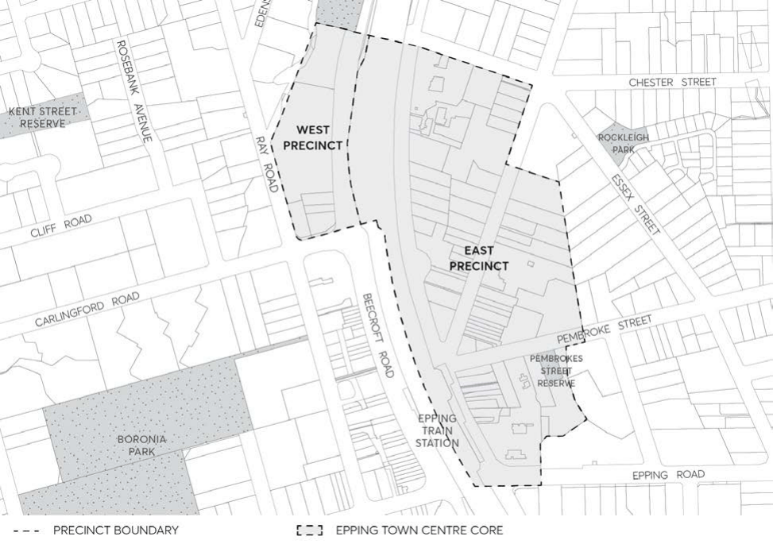
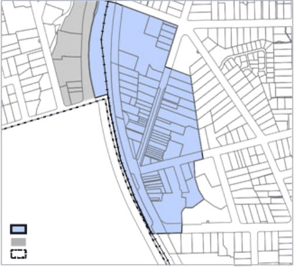
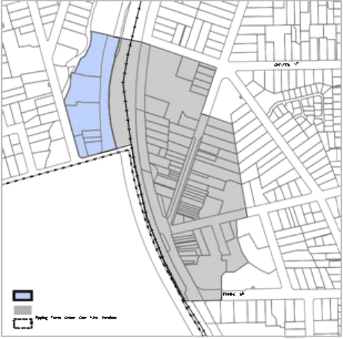
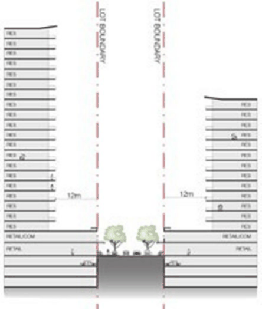
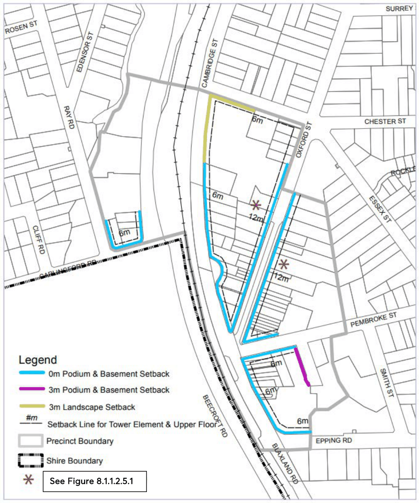
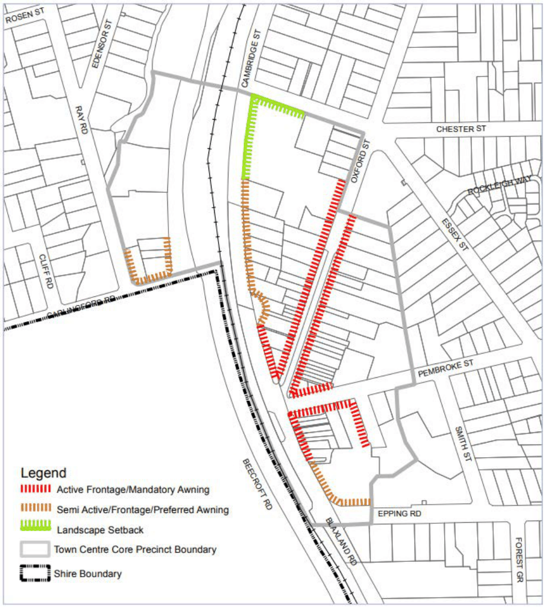
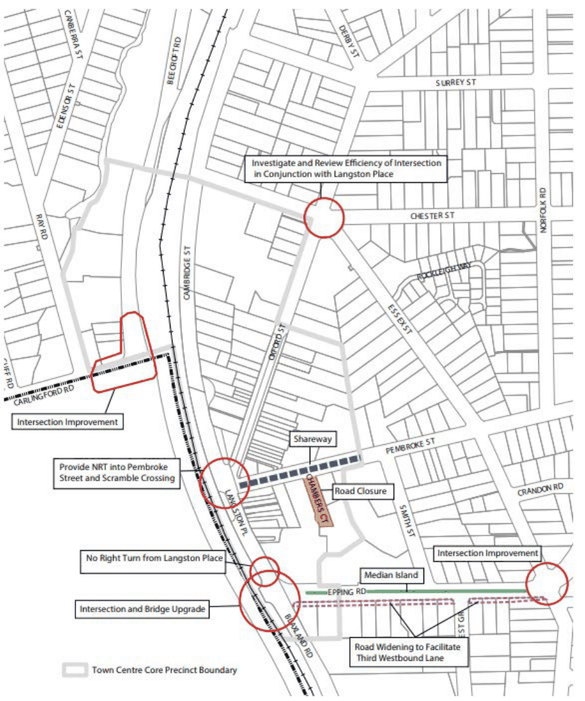
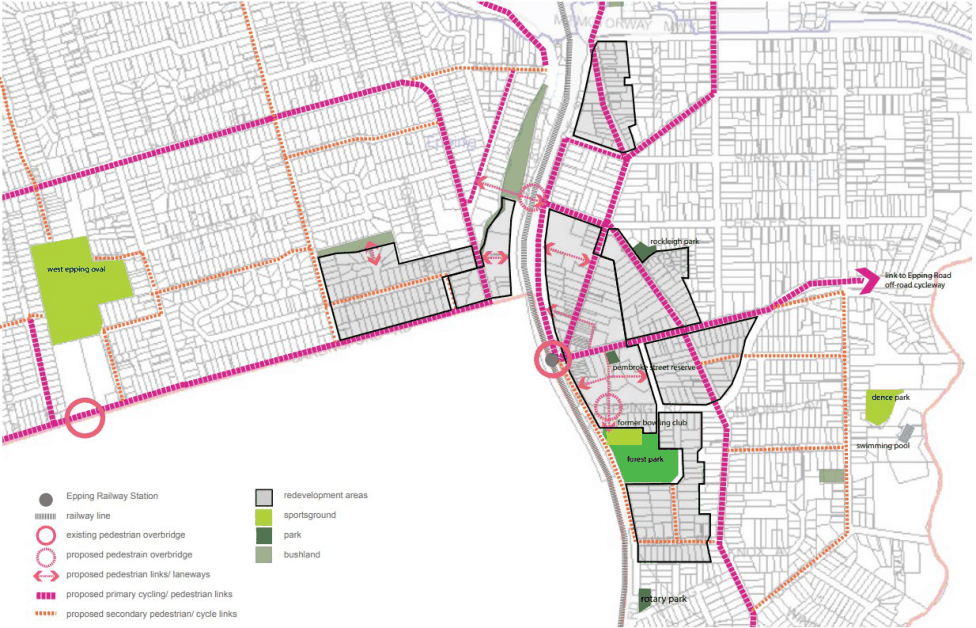

#### 8.1.1.2 EPPING TOWN CENTRE

The Epping Town Centre Core is located around the Epping Railway Station and has good access to public transport. The Epping Town Centre Core is divided into two planning precincts - East Precinct and West Precinct. The location of the Town Centre Core Planning Precincts is depicted in Figure 8.1.1.2.1 below. The following provides controls for development of land which is zoned E1 Local Centre and located within the East and West Precincts within the Epping Town Centre Core. Note: Controls for development of land within the Epping Town Centre Core which is zoned R4 High Density Residential is subject to the applicable built form controls in Part 3 – Residential Development of this DCP.

> [Picture on page 26: a picture, saved as a picture (images/part-08-centres-precincts-special-character-areas-specific-page-26-13.gif, 150 dpi).]

Figure 8.1.1.2.1 – Epping Town Centre Core Planning Precinct Boundaries

#### 8.1.1.2.1 DESIRED FUTURE CHARACTER

Epping Town Centre Core

The Epping Town Centre Core is a compact and vibrant town centre in an important strategic location. The town centre has grown and developed either side of Epping Railway Station and benefits from excellent rail access to most major employment locations in the Sydney metropolitan region through the main North Line, the Epping to Chatswood Link and the future North West Rail Link.

STRATEGIC CENTRES

EPPING STRATEGIC CENTRE

The Epping Town Centre Core encompasses main street retail/commercial activity, dispersed with civic/community uses and surrounded by residential development of varying density.

Responsive scale and built form

Epping Town Centre is the retail, commercial, residential and cultural heart of Epping. The town centre builds upon its compact character and increased activity occurs in the Town Centre Core, being areas with good access to the rail station. The majority of new residential dwellings are developed in the Town Centre Core along with a range of retail, commercial and cultural activities at the lower levels that meets the needs of the local population.

Higher density commercial, retail and residential development is achieved in the form of high quality towers located in the Town Centre Core. New buildings respond to the existing fine grain character of the street, using modulation to reduce the overall massing of a development. Tower elements are elegant with slim and slender proportions and setbacks from the podium to allow view and light corridors.

Better streets and local connections

New development within the Town Centre Core contribute to better quality streets, new and improved local connections, especially for pedestrians and cyclists, and a revitalised public domain.

A finer grain structure of local connections, reinforced by active and continuous ground level uses and clearer and safer connections, strengthen the role of the main streets as the core retail/commercial area, provide good pedestrian amenity, and assist pedestrian safety.

Epping Town Centre’s streets are defined and characterised by 2-3 storey podium development at the edge of the street, and provide a range of easily accessible retail, commercial, and other activities at the local level.

Improvements to local connections that benefit the town centre include: more effective and high quality pedestrian links across the railway line, new through site vehicular connections, better cycleway connections, and new/improved pedestrian connections. Development improves physical connections across the railway line, and link the western and eastern parts of the town centre. avenues of street trees along the main vehicular and pedestrian links enhance the visual quality of the area.

Better spaces and places

New development within the Town Centre Core contribute to better local parks, plazas, spaces and places that form part of a revitalised public domain.

Opportunities include a new civic space located on Pembroke Street to the north of Epping Branch Library.

Development along Oxford Street and other key streets strengthen the ‘main street’ shopping and dining character of the precinct. New buildings reinforce the traditional shopping centre character

STRATEGIC CENTRES

EPPING STRATEGIC CENTRE

of the precinct through well-scaled podium forms, a consistent street wall height, active frontages, and continuous awnings to primary and secondary streets that together contribute to the pedestrian experience and create a distinct character. Tower elements are set back from the podium and are located at prominent locations to provide focal points and enclosure to the public realm.

Building design provides a pedestrian scale at the base and incorporates a podium. Upper levels are setback to maximise solar access to the public domain and reduce the impact of the building bulk on the streetscape.

Epping is a vibrant and attractive place to live, shop, work and visit and provides a range of goods, services and employment opportunities.

The Epping Town Centre Core continues to be developed into two identifiable high density mixed use commercial/residential areas to the south, east and west of the Epping Transport Interchange and a high density residential precinct to the south and south east. Mixed use development are consistent with the individual characteristics of the areas as described in the following desired future character statements:

Epping Town Centre Core – East Precinct

The East Precinct continues to provide traditional main street activities for Epping Town Centre. The Precinct provides a range of housing, retail and commercial offices, food outlets and entertainment, and employment opportunities to support the larger centre and service the working and residential populations in the area.

Development promotes and enhances connections through the core and improve physical connections across the railway line, linking the western and eastern parts of the town centre.

Buildings within the East Precinct reinforce the traditional shopping centre character of the precinct though well scaled podium forms, a consistent street wall height, active frontages and continuous awnings to primary and secondary streets that together contribute to the pedestrian experience and create a distinct character.

The lower levels of development along Oxford Street, and parts of Langston Place, Pembroke Place and Cambridge Street incorporate active uses such as cafes, outdoor dining and other retail activities. Development strengthens the main street shopping and dining character of the precinct and preserves high value heritage buildings and facades that enhance the streetscape and contribute to the over sense of place of the precinct.

Buildings adjacent to the intersection of Langston Place, Pembroke Street, Oxford Street and Cambridge Place incorporate architectural elements that signify the focal point of the town centre.

Buildings adjacent to the proposed village green, plaza and library in Pembroke Place and Chambers Court integrate with the adjacent public domain. Development adjacent to this area facilitates this role by the provision of seats, shade and performance areas such as steps and terraces. Ground floor uses fronting the town square includes outdoor dining at cafes and

STRATEGIC CENTRES

EPPING STRATEGIC CENTRE

restaurants that encourage longer and more active use of the public domain outside core business hours.

Epping Town Centre Core - West Precinct

The West Precinct is a mixed use precinct separated from the ‘main street’ functions of the Town Centre Core by busy arterial roads and the railway line and station. The West Precinct supports the edge of centre’s functions and provides a transition into the adjoining lower density residential areas. Building bulk and scale steps down from Carlingford Road and Beecroft Road to the adjacent residential area to the north in terms of built form, scale and setting.

Setbacks to Beecroft Road encourage the retention of existing trees, and facilitate additional landscaping to screen development from Beecroft Road and the Railway Line.

Objectives

O.01 Development that contributes to the desired future character of the area.

Control

C.01 Development Applications should demonstrate compatibility with the statement of desired future character.

> [Picture on page 29: a picture, saved as a picture (images/part-08-centres-precincts-special-character-areas-specific-page-29-18.gif, 150 dpi).]

Figure 8.1.1.2.1.1 – East Precinct Boundary

STRATEGIC CENTRES

> [Picture on page 30: a picture, saved as a picture (images/part-08-centres-precincts-special-character-areas-specific-page-30-2.gif, 150 dpi).]

EPPING STRATEGIC CENTRE

Figure 8.1.1.2.1.2 – West Precinct Boundary

8.1.1.2.2 DESIGN QUALITY – SEPP 65

Objective

O.01 A built form which responds to the site, locality and landscape and includes appropriate innovation to respond to technical, social, aesthetic, economic and environmental challenges.

Control

C.01 Development Applications should be accompanied by a design verification from a qualified designer, including a statement that:

• they designed, or directed the design, of the development,

• that the design quality principles set out in State Environmental Planning Policy No 65 - Design Quality of Residential Apartment Development are achieved, and

• the design is consistent with the objectives of the Apartment Design Guide. Note: Development Applications should be accompanied by a statement of environmental effects which includes the following:

• an explanation of how the design addresses the design quality principles set out in Schedule 1 of State Environmental Planning Policy No 65 - Design Quality of Residential Apartment Development, namely:

• context and neighbourhood character; built form and scale; density; sustainability; landscape, amenity, safety; housing diversity and social interaction; and aesthetics.

• an explanation of how the design addresses the detailed provisions of the Apartment Design Guide.

STRATEGIC CENTRES

EPPING STRATEGIC CENTRE

• drawings of the proposed development in the context of surrounding development, including the streetscape;

• demonstration of compliance with building heights, setbacks and building envelope controls marked on plans, sections and elevations;

• drawings of the proposed landscape area, including species selected and materials to be used, presented in the context of the proposed development and the surrounding development and its context;

• if the proposed development is within an area in which the built form is changing, statements of the existing and likely future contexts;

• photomontages of the proposed development in the context of surrounding development;

• a sample board of the proposed materials and colours of the facade; and

• detailed drawings of proposed facades.

#### 8.1.1.2.3 SITE REQUIREMENTS

Objective

O.01 Encourage amalgamation of lots to achieve desired urban design outcomes and the efficient use of land to avoid the creation of isolated sites.

Controls

C.01 Development sites should have a minimum lot width of 30 metres measured at the street frontage.

C.02 Development sites should be of an area and width that can accommodate a building envelope consistent with the floor plate and setback controls in this DCP and the Apartment Design Guide.

C.03 Where a property is likely to be isolated by a proposed development and it cannot be demonstrated that the site can be developed to its full potential, applicants should provide documentary evidence that a genuine and reasonable attempt has been made to purchase the isolated site based on a fair market value. Note: Refer to Section 8.1.1.3 and 8.1.1.4 of this DCP for detailed provisions on Isolated Sites.

#### 8.1.1.2.4 SCALE

Objective

O.01 Development with a scale compatible with the role and function of the centre under the commercial centre’s hierarchy.

STRATEGIC CENTRES

EPPING STRATEGIC CENTRE

Controls

Floor Space Ratio C.01 The maximum floor space ratio for business lands shall be in accordance with the Parramatta LEP 2023 Floor Space Ratio Map. Notes: As detailed in Clause 4.5 of the Parramatta LEP 2023, the Floor Space Ratio of buildings on a site is the ratio of the gross floor area of all buildings within the site to the site area. See the Parramatta LEP 2023 for the definition of Gross Floor Area.

Floorplates C.02 Residential floorplates above the podium should have a maximum GFA of 700m². Balconies and terraces may project from this maximum.

C.03 Commercial floorplates above the podium should have a maximum GFA of 1,200m². Height C.04 Business zoned sites with the following maximum building height under Clause 4.3 of the Parramatta LEP 2023 should comply with the maximum number of storeys in Table 8.1.1.2.4.2 (excluding basement carparking). Table 8.1.1.2.4.1 – Translation of Height to Storeys

| Maximum Building Height (m) | Maximum Storeys Commercial building | Maximum Storeys Mixed use building |
|---|---|---|
| 48m | 12 storeys | 15 storeys |
| 72m | 18 storeys | 22 storeys |

C.05 Basement car parking that protrudes more than 1 metre above existing ground level is counted as a storey.

C.06 A podium should be provided in accordance with Figure 8.1.1.2.5.3. Buildings should incorporate a podium that:

• presents a human scale at the street frontage,

• incorporates commercial floor space, and

• has an active frontage to the public domain.

C.07 The podiums of buildings facing the junction of Langston Place, Pembroke Street, Oxford Street and Cambridge Street should be 2-3 storeys in height. Elsewhere, podiums should be 2 storeys in height.

C.08 A transition in building heights should be provided at sensitive interface areas adjacent to heritage items and adjacent residential areas outside the precinct.

Notes:

Building height (or height of building) means the vertical distance between ground level (existing) and the highest point of the building, including plant and lift overruns, but excluding communication devices, antennae, satellite dishes, masts, flagpoles, chimneys, flues and the like.

STRATEGIC CENTRES

EPPING STRATEGIC CENTRE

Storey means a space within a building that is situated between one floor level and the floor level next above, or if there is no floor above, the ceiling or roof above, but does not include:

a) a space that contains only a lift shaft, stairway or meter room, or

b) a mezzanine, or

c) an attic.

A mixed use building described above comprises a building with a commercial podium and residential floors above.

#### 8.1.1.2.5 SETBACKS

Objective

O.01 Well articulated building forms with a “pedestrian friendly” scale that encourages commercial activity along active frontages and provides for landscaping, open space and separation between buildings.

Controls

Street setbacks C.01 Ground floor minimum setbacks are illustrated on Figure 8.1.1.2.5.2. Buildings should incorporate a podium adjacent to the public domain setback in accordance with Figure 8.1.1.2.5.2.

> [Picture on page 33: a picture, saved as a picture (images/part-08-centres-precincts-special-character-areas-specific-page-33-19.gif, 150 dpi).]

Figure 8.1.1.2.5.1 - East Precinct – Illustration of Building Height and Street setbacks along Oxford Street

C.02 Basements should be located under the building footprint and setback in accordance with the prescribed building setbacks in Figure 8.1.1.2.5.2.

STRATEGIC CENTRES

EPPING STRATEGIC CENTRE

C.03 Buildings should incorporate a tower element above the 2 to 3 storey (8-12 metres) podium and setback in accordance with the Setbacks Map at Figure 8.1.1.2.5.2.

C.04 The tower element of buildings on Oxford Street may encroach within the 12 metre front setback to a minimum of 9 metres for up to 1/3 of the tower width.

C.05 The following minor structures are able to encroach into the prescribed setbacks:

• driveways or basement ramps up to 6 metres wide, with deep soil verges at least 2 metres wide adjacent to the side boundary,

• roof eaves and awnings,

• sunshades and screens, and

• blade columns which support roofs or sunshades.

C.06 An awning over the footpath should be provided in the locations nominated on the Frontages Map at Figure 8.1.1.2.5.3.

C.07 Where the building alignment is setback from the street alignment, balconies may project up to 600mm into the front building setback, provided the cumulative width of all balconies at that particular level totals no more than 50% of the horizontal width of the building facade.

C.08 Where landscape setbacks are identified in the Setbacks Map at Figure 8.1.1.2.5.2, a 3 metre setback between the boundary and the front building alignment is required. The landscape setback should include planting, large trees and turf. Car parking (including basement parking) and hard surfaces areas (excluding driveways and access paths) are not permitted within the setback.

Rear and Side Setback C.09 Zero side and rear setbacks for podiums are permissible where a commercial development adjoins another non residential or mixed use development. In other instances, and above the podium height, development should be setback at least 6 metres from the rear and side boundary.

C.10 Where a property adjoins a boundary with a residential land use, greater setbacks may apply to the upper storeys in accordance with the separation controls in Section 4.6.9 – Privacy and Security.

Notes: Greater setbacks may apply to the upper residential storeys in accordance with the separation controls in the Apartment Design Guide. Refer to Part 7 – Heritage and Archaeology of this DCP for additional heritage controls.

STRATEGIC CENTRES

EPPING STRATEGIC CENTRE

> [Picture on page 35: a picture, saved as a picture (images/part-08-centres-precincts-special-character-areas-specific-page-35-3.gif, 150 dpi).]
> Words printed on the picture (title and legend, copied from the PDF):
> See Figure 8.1.1.2.5.1

Figure 8.1.1.2.5.2 - Epping Town Centre Podium and Basement Setbacks

STRATEGIC CENTRES

EPPING STRATEGIC CENTRE

> [Picture on page 36: a picture, saved as a picture (images/part-08-centres-precincts-special-character-areas-specific-page-36-3.gif, 150 dpi).]

Figure 8.1.1.2.5.3 - Epping Town Centre Frontages

#### 8.1.1.2.6 DESIGN DETAILS

Objective

O.01 Development that contributes positively to the streetscape and the creation of a vibrant active precinct.

STRATEGIC CENTRES

EPPING STRATEGIC CENTRE

Controls

General C.01 Buildings should be designed with external appearances that provide for a distinctive base, middle and a top.

C.02 Tower forms should appear simple, yet elegant, with slim and slender proportions. C.03 Tower forms should have a delineated top to visually terminate the building. C.04 Towers should taper towards the sky to appear thinnest at the top. C.05 When commercial podiums are provided, the podiums should have minimal gaps in the street wall and maintain a consistent building line.

C.06 Facades above the podium, are to engage with the public domain through the extensive use of large windows and other openings and the avoidance of large expanses of blank walls.

C.07 A balance between horizontal and vertical elements should be provided through careful placement of windows, colour patterns and building materials.

C.08 Continuous awnings should be provided to provide shelter for pedestrians. Awnings should be consistent with the general alignment of awnings in the street and the desired future character of the area.

C.09 Corner buildings should be designed to:

• address its neighbouring buildings, dual frontage and its turning of the corner,

• step up at the corner,

• incorporate distinctive features to enhance the streetscape, (such as stepped parapet turrets, towers, clocks etc.), and

• incorporate a splayed or square recess treatment to give form to the intersection and provide more circulation space for pedestrians at the corner.

C.10 Roof fixtures and lift overruns or service plants should be incorporated into the design of the roof to minimise visual intrusiveness and support an integrated building design.

C.11 Materials should relate to the context of buildings within the precinct to achieve continuity and harmony.

C.12 Security shutters should be transparent or open grill design. Active Frontages C.13 The design and use of buildings should encourage active uses fronting public streets and places to contribute to the creation of a vibrant precinct. Entrances to buildings should be clear, well lit and well defined.

C.14 Buildings should embody active living principles. C.15 Active and semi active frontages should be provided in the locations nominated on the Frontage Map at Figure 8.1.1.2.5.3.

C.16 Active frontages are to contribute to the liveliness and vitality of streets by:

STRATEGIC CENTRES

EPPING STRATEGIC CENTRE

• maximising entries or display windows to shops and/or food and drink premises or other uses, customer service areas and activities which provide pedestrian interest and interaction,

• minimising fire escapes, service doors, plant and basement entries,

• providing elements of visual interest, such as display cases, or creative use of materials and architectural detailing where fire escapes, service doors and equipment hatches cannot be avoided, and

• providing a high standard of finish for shop fronts.

C.17 Driveways and service entries are not permitted on active frontages, unless it is demonstrated that there is no alternative.

C.18 Security grilles may only be fitted internally behind shop fronts and are to be fully retractable and at least 50% transparent when closed. Notes: Active frontages require 90% of the frontage to be shop and office windows and building entrances at street level. Semi active frontages require 30% of the frontage to be shop and office windows and building entrances at street level.

Facades C.19 Building facades should reinforce the continuity of the streetscape by:

• maintaining consistent building heights,

• maintaining consistent horizontal and vertical lines, and

• incorporating horizontal features that relate to the features on neighbouring buildings. Where these vary, an infill building should relate to and create a transition between the two buildings.

C.20 Materials should relate to the context of buildings within the precinct to achieve continuity and harmony. Contrasting materials should be used to provide diversity. However, material and colour should not dominate the streetscape.

C.21 Building materials and features may include:

• face brickwork or decorative brickwork,

• contrasting trim and details,

• rendered masonry or concrete,

• parapets incorporating decorative brickwork or render, and

• cantilevered steel, suspended awnings. Notes: To achieve active living principles, development should have regard to NSW Health’s Healthy Urban Development Checklist and the National Heart Foundation’s Blueprint for an Active Australia. Horizontal features include window heads and sills, verandas, balconies, balustrades, parapets, changes in materials, textures or colours and sun hoods.

STRATEGIC CENTRES

EPPING STRATEGIC CENTRE

Wind Effects C.22 A wind effects reports is to be submitted with a Development Application for buildings higher than 40m. The report is to be prepared by a suitable qualified engineer and is to:

• be based on wind tunnel testing, which compares and analyse the current and proposed wind conditions,

• report the impacts of wind on the pedestrian environment within the site and the public domain, and

• provide design solutions to minimise the impact of wind on the public and private domain.

C.23 Wind effects caused by development should not exceed:

• 10 metres per second for active frontages as shown on the Frontage Map at Figure 8.1.1.2.5.3.

• 16 metres per second for all other streets.

C.24 New development should incorporate design features that will ameliorate existing adverse wind conditions.

C.25 New development should minimise adverse wind impacts effects on recreation faculties and open space areas within development and within public domain areas.

Reflectivity C.26 A Reflectivity Report that analyses potential solar glare from the proposed building design may be required for taller buildings.

C.27 Generally, light reflectivity from building materials used on facades should not exceed 20%. External lighting C.28 External light fixtures should be integrated with the architecture of the building. C.29 External lighting should not disturb the amenity of residents in the locality. C.30 External lighting should minimise the light spill into the night sky.

#### 8.1.1.2.7 OPEN SPACES

Objectives

O.01 Development that incorporates passive and active recreation areas with privacy and access to sunlight.

O.02 Development that increases the amount and quality of open space available for use by workers, visitors and the residential population.

Controls

Pembroke Street Civic Park C.01 A central green space should be created which acts as a gathering and recreational area for the residents and workers of the precinct.

STRATEGIC CENTRES

EPPING STRATEGIC CENTRE

Shop Top Housing C.02 Every dwelling should be provided with a principal private open space in accordance with Table 8.1.1.2.7.1. Table 8.1.1.2.7.1 – Minimum Private Open Space

| Dwelling Type | Minimum Principal Private Open Space Area | Minimum Width |
|---|---|---|
| Studio | 4m2 | 2m |
| 1 bed unit | 8m2 | 2m |
| 2 bed unit | 10m2 | 2m |
| 3+ bed unit | 2m2 | 2.4m |
| Ground level apartments | 15m2 | 3m |

C.03 Private open spaces should be designed as “outdoor rooms” that adjoin interior living areas, with L-shaped or irregular floorplans that would accommodate a number of outdoor activities plus extensive screening to provide privacy and shade.

C.04 Each dwelling should have an external air clothes drying area that is separate from the principal private open space area. This facility is to be screened from public places and communal areas.

C.05 Enclosure of private open space areas as ‘wintergardens’ should be avoided. Wintergardens may be considered where the elevation of a building fronts Epping Road or a rail corridor.

Communal Open Space C.06 A principal communal open space area should be provided for any developments over 8 storeys with more than 10 dwellings as follows:

• be located on a podium,

• have a minimum area of 50m2,

• have a minimum dimension of 6 metres,

• be landscaped for active and/or passive recreation and encourage social interaction between residents,

• achieve a minimum 50% direct sunlight to the principal usable part of the communal open space for a minimum of 2 hours between 9am and 3pm on 21 June (mid-winter),

• be located to provide direct sight lines and convenient access from the building lobby, and

• be sited and designed to protect the amenity of adjacent dwellings.

#### 8.1.1.2.8 LANDSCAPING

Objectives

O.01 Development that contributes to attractive streetscapes by providing shade along pedestrian frontages and screen planting along boundaries.

STRATEGIC CENTRES

EPPING STRATEGIC CENTRE

O.02 Development that preserves significant trees that add to the environmental character of the commercial centre.

Controls

General C.01 Landscaping should be included in building setback areas to complement the appearance of the building.

C.02 Setbacks from sensitive areas should be fully landscaped. C.03 Primary and secondary retail frontages should be landscaped with tree-plantings combined with paving in accordance with the following:

• Trees should be planted as widely-spaced avenues along kerbsides, using a consistent range of species for each precinct, and

• Pavements within the Town Centre Core should be of a consistent design, constructed of durable and non-slip modular units that are resistant to fading, discolouration and chipping, and that may readily be removed and replaced following future installation of in-ground services.

Shop Top Housing C.04 Residential levels should be landscaped with native or exotic species in planter boxes watered by recycled grey water or stormwater to provide screening.

C.05 Where communal open space is provided, these spaces should include lawn areas surrounded by hedges of shrubs.

Retention of Landscape Features C.06 Buildings, driveways and service trenches should have a minimum setback that complies with

AS4970 from trees that have been assessed as significant or which are visually prominent streetscape elements.

Fencing C.07 Fencing is discouraged in the primary and secondary street frontage setbacks. C.08 Allotments adjoining residential lands should be fenced with appropriate residential style fencing.

C.09 Fencing enclosing private residential courtyards may be up to 1.8 metres high if constructed from lightweight materials with the design allowing at least 50% openings/ transparency.

Notes: Sensitive areas include any adjoining residential lands, community uses, educational uses, public open spaces and recreational areas.

STRATEGIC CENTRES

EPPING STRATEGIC CENTRE

#### 8.1.1.2.9 PRIVACY AND SECURITY

Objective

O.01 Development designed to provide reasonable privacy to proposed and adjacent residential properties and high levels of security.

Controls

Privacy C.01 For development at the interface of a commercial area and a residential zone, development should encourage views from the commercial area to the horizon rather than downward onto residential areas.

C.02 The commercial and residential component of development should be distinguished in terms of building entries and private, communal and public open space.

C.03 Orient dwelling’s living rooms and principal private open space areas primarily towards the front and rear of the site to promote privacy to dwellings.

C.04 Building separation should comply with Part 2F Building Separation of the Apartment Design Guide.

C.05 For properties with a boundary interface with a lower density zone, an additional 3 metre building separation should be provided.

C.06 Where communal open space is required, balconies, terraces or bedroom windows near communal areas should be screened or separated from the street and active communal areas by landscaping to protect the privacy of dwelling occupants.

C.07 Common residential lobbies that face a side boundary should be screened to prevent overlooking and the transfer of noise across side boundaries.

Security C.08 Identify safe, clear and direct pedestrian and cyclist entrances to the building from the primary street frontage.

C.09 Private open spaces, living room windows, commercial unit windows and lobbies should be designed and oriented to overlook the street and communal open spaces on the site.

C.10 Communal hallways, including access to entrance foyers, should be limited in length and desirably provide windows, so that hallways may overlook the street or communal areas.

C.11 Where a mix of land uses are proposed, separate, secure access should be provided to lift lobbies, basements and communal storage areas.

Notes: All developments should comply with the minimum building setback and separation controls within this DCP which will assist in achieving the desired outcome for privacy. A privacy screen means a screen that is at least 1.5 metres high, measured from the floor level, and has

STRATEGIC CENTRES

EPPING STRATEGIC CENTRE

no individual opening more than 30 millimetres wide, and has a total of all openings less than 30% of the surface area of the screen. A privacy screen required to protect an adjacent residence is to be fixed.

#### 8.1.1.2.10 SUNLIGHT AND VENTILATION

Objectives

O.01 Development that maximises solar access to the public domain, pedestrian areas and public open spaces.

O.02 Development designed to provide reasonable solar access and natural ventilation to residential living areas and open space areas.

Controls

C.01 On 22 June, public open space areas and plaza areas should receive 2 hours of sunlight between 9am and 3pm to at least 50% of the area.

C.02 On 22 June, at least 70% of dwellings should receive 2 or more hours of unobstructed sunlight access to at least half of the dwellings principal living room windows and principal private open space area between 9am and 3pm.

C.03 Every habitable room should have a window in an external wall with a total minimum glass area of not less than 10% of the floor area of the room.

C.04 A window should be visible from any point in a habitable room. C.05 At least 60% of dwellings should have dual aspect and natural cross ventilation.

#### 8.1.1.2.11 HOUSING CHOICE

Objective

O.01 A range of dwelling types that match the demographic diversity of the city and are accessible or may be adapted to meet the needs of people who have limited physical mobility.

Controls

C.01 Mixed-use developments should include a mix of 1, 2 and 3 bedroom dwellings. For developments with 10 or more dwellings, at least 10% of each dwelling type should be provided.

C.02 For developments with 10 or more dwellings:

• At least 10% of proposed dwellings should be Adaptable Housing, designed to meet the needs of residents as they age.

• At least 20% of proposed dwellings should be Universal Design Housing in accordance with the Livable Housing Guidelines 2012 silver level design features.

STRATEGIC CENTRES

EPPING STRATEGIC CENTRE

• Adaptable Housing and Universal Design Housing is to be equitably distributed through all types and sizes of dwellings Notes: See Section 3.1.3 of this DCP for more details on Universal Design and Adaptable Housing.

#### 8.1.1.2.12 VEHICLE ACCESS AND PARKING

Objective

O.01 Development that provides sufficient and convenient parking for residents and visitors with vehicular access that is simple, safe and direct.

Controls

Vehicular Access C.01 Access to garages and storage areas should be confined to side and rear facades, with access from main roads avoided.

C.02 Vehicle access should be consistent with the servicing strategy depicted in the Key Development Principles diagram.

Parking C.03 Resident and visitor parking should be provided within basements. C.04 All ramps are to be designed as two way ramps in accordance with AS 2890.1 and AS 2890.2. C.05 All ramps are to be designed in accordance with the exits and entry widths of AS 2890.1 and AS 2890.2.

C.06 Street level parking for shoppers should be provided in convenient proximity to primary retail frontages.

C.07 Any undercroft car parking should be screened and should not be located in a facade that faces a primary or secondary street frontage.

C.08 Parking for service and delivery vehicles should be integrated with the design of driveways and surrounding landscaped verges, and should not visually dominate any street frontage.

C.09 Parking requirements in Part 6 – Traffic and Transport of this DCP will apply, unless specified in this Section. If there is an inconsistency between the two, this section will prevail for development which this Section applies to.

C.10 The parking rate for sites located within the Epping Town Centre Core referred to in Table

8.1.1.2.12.2 refers to development sites that fall within those areas identified as “Town Centre Core” on Figure 8.1.1.2.1. Where a development site falls partly within the Epping Town Centre Core, the parking rate for the Town Centre Core is to apply to the whole development.

C.11 Motorcycle parking should be available as part of the common property for use by residents and visitors and should be provided in accordance with Table 8.1.1.2.12.1. Table 8.1.1.2.12.1 - Motor Cycle Parking (Epping Town Centre Core)

STRATEGIC CENTRES

EPPING STRATEGIC CENTRE

| Building Type | Motor Cycle Parking |
|---|---|
| On site car parking with less than 25 parking spaces | 1 space (minimum) |
| On site car parking with more than 25 parking spaces | 4 spaces (area equal to a minimum of one car parking space) |

Notes: The Motor Cycle Parking is in addition to the car parking required in Tables 8.1.1.2.12.1 and 8.1.1.2.12.2 for tenants and/or visitors (not service vehicles which are separately addressed). Motor Cycle Parking is not required for dwelling houses.

Table 8.1.1.2.12.2 - On Site Car Parking Rates (Epping Town Centre Core)

| Type of Development | Car Parking Requirement |
|---|---|
| Residential Accommodation |  |
| Residential flat buildings on land within 800 metres of Epping Town Centre (including Universal Design Housing)** |  |
| Studio | Maximum 0.4 space/dwelling |
| 1 Bedroom | Maximum 0.4 spaces/dwelling |
| 2 Bedroom | Maximum 0.7 spaces/dwelling |
| 3 or more bedrooms | Maximum 1.2 spaces/dwelling |
| Visitors (see Note ***) | Minimum of 1 space per 7 dwellings |
| Commercial Premises/Health Care - on land within 800 metres of Epping railway station |  |
| Business or Office Premises | Maximum of 1/50m² of GFA |
| Shops | Maximum of 1/30m2, GLFA |
| Restaurants or Cafes (ex drive-through take-away restaurants) Maximum of 1/30m2, GLFA Accessible Parking | Maximum of 1/30m2, GLFA Minimum of 1-2% of all spaces to be provided as readily accessible spaces, appropriately designed for use by people with disabilities. |
| Health Consulting Rooms/Medical Centres | Maximum of 1/50m² of GFA |
| Other Uses | as per Table 6.2.1 |
| A condition of consent will be imposed by the consent authority requiring the following restrictions to be placed on the property title prior to the issue of the Occupation Certificate: • Apartment owners and tenants are excluded from participating in any future Council residential parking permit scheme; and • Car share car spaces cannot be reallocated as parking spaces for residents or as visitor parking. |  |

STRATEGIC CENTRES

EPPING STRATEGIC CENTRE

Notes: *To ensure secondary dwellings do not have an oversized garage area and have the potential to covertly evolve into a larger dwelling that does not comply with the maximum secondary dwelling size in the Parramatta LEP 2023, a maximum of 2 car spaces/dwelling is permitted. ** All car parking spaces including Universal Design Housing should be in accordance with AS 2890.1. ***Visitor parking for medium/high residential development is required for development proposals comprising more than 5 dwellings. ****Parking requirements for Industrial Units is increased when ancillary retailing is permitted, or an ancillary office space component is in excess of 20% of the floor area. Gross Floor Area is as defined by the Parramatta LEP 2023. Gross leasable floor area means the sum of the area of each floor of a building where the area of each floor is taken to be the area within the internal faces of the walls, excluding stairs, amenities, lifts corridors and other public areas but including stock storage areas.

Car share C.12 A minimum of 1 space is to be allocated to car share for developments with 50 or more dwellings. If agreement with a car share provider is not obtained then the car share space is to be used for additional visitor parking until such time as a car share provider is obtained.

C.13 For developments which comprise 50 or more dwellings, Council may consider car share spaces in lieu of some resident parking, subject to evidence of an appropriate arrangement with a car share scheme provider.

Bicycle Parking C.14 Bicycle parking for medium and high density development (including mixed use and shop top component) should be provided at the following rate:

• secure resident bicycle parking at a minimum rate of 1 space per dwelling, and

• secure visitor bicycle parking at a minimum rate of 1 space per 10 dwellings.

C.15 Secure bicycle spaces for residents can be provided individually (per dwelling) or collectively for the use of all residents within a designated area. Bicycle parking and access should ensure that potential conflict with vehicles are minimised.

C.16 Visitor bicycle parking should be provided close to the street entrance of a residential or mixed use development in accordance with Safer by Design principles and be appropriately designated. Bicycle parking and access should ensure that potential conflict with vehicles is minimised. Council’s consent will be required where visitor bicycle spaces are proposed on Council’s footpath.

C.17 Access Network For large scale development that is 10 storeys or more:

• A Framework Travel Plan should accompany any Development Application; and

STRATEGIC CENTRES

EPPING STRATEGIC CENTRE

• A Final Travel Plan should be provided to Council prior to the issue of an Occupation Certificate. Notes: A Framework Travel Plan is a design tool to promote efficient and sustainable modes of transport in building and site planning. The Framework Travel Plan is required where the future tenants are unknown. A Final Travel Plan is a management tool that promotes the implementation and monitoring of a coordinated transport strategy to influence the travel behaviour of employers, employees, residents and visitors towards public transport, walking, cycling, car pooling and car sharing. For residential flat buildings within 800 metres of Epping railway station, a condition of consent will be imposed by the consent authority requiring a Travel Plan to be provided to the satisfaction of the City of Parramatta Council prior to the issue of the Construction Certificate. A Travel Plan is a package of measures designed to reduce car trips and encourage the use of sustainable transport. It must include, at the minimum:

a) Analysis on the existing policy context.

b) Analysis on the existing transport conditions.

c) Objectives and targets.

d) Methods for encouraging modal shift which is to include at the minimum:

• Strategies: these focus on managing car use, promoting public transport, cycling and walking and other mechanisms, for example, a Transport Access Guide.

• Actions: this spells out the modal shift mechanisms, for example, reduced car parking rates, car sharing, car pooling and sales of car parking spaces.

• Targeted audience: this describes the audience at which the Strategies and Actions are targeted at, for example, residents, visitors, employees and business owners.

• Timeline: an indication of when the action is delivered, for example, prior to or upon occupation, on-going, etc.

• Responsibility: this outlines the responsible body, for example, the proponent, Council, Building Manager, Residents, Travel Plan Coordinator, etc.

e) Management and Monitoring of the Travel Plan.

C.18 Bicycle parking should be designed in accordance with AS 2890.3 Parking Facilities – Bicycle Parking Facilities.

C.19 Accessible parking is to be designed in accordance with the requirements of relevant Australian Standards.

End-of-trip facilities C.20 For development that is within 800 metres of Epping railway station and includes 300m2 of commercial floor space, end-of-trip facilities including showers and lockers must be provided to adequately service the number of bicycle parking spaces required for the commercial floor space.

STRATEGIC CENTRES

EPPING STRATEGIC CENTRE

Ancillary Fixtures and Facilities C.21 Separate dedicated and secure storage areas for each dwelling should be provided in basement car parks suitable to accommodate larger items such as sporting equipment.

Public Domain C.22 Car parking areas at ground level should be screened by active uses from the street. C.23 Basement parking areas and structures should not protrude above the level of the adjacent street or public domain. Where they are visible, basement structures and vent grills should be integrated into the building and landscape design. Ventilation grills are to block views into basement areas and, in inappropriate locations, be screened by landscaping in garden beds with a minimum soil depth of 1m. Note: Refer to Part 6 – Traffic and Transport of this DCP for car parking and bicycle parking rates and ancillary general design requirements.

#### 8.1.1.2.13 PUBLIC DOMAIN AND TRAFFIC MANAGEMENT WORKS

Objectives

O.01 A public domain that encourages vitality around and within development precincts. O.02 Traffic management works that provide for the safe and efficient movement of vehicles to, from and within precincts.

Controls

Addressing the street and public domain C.01 Buildings should include high quality finishes and public art to enhance the public domain. C.02 Align breaks between buildings with the location of nearby streets, lanes and pedestrian links where possible.

Outdoor Dining C.03 Outdoor dining areas should be located in areas with good amenity, landscape, outlook, solar access in winter, shading in summer and a compatible local traffic environment. Note: Outdoor dining proposed on Council land should comply with Council’s Outdoor Dining Guidelines.

Traffic Management C.04 Traffic Management Works should be undertaken in accordance with the Traffic Management Improvement Plan Figure 8.1.1.2.13.1.

C.05 Council or the relevant authority will undertake the necessary traffic management improvement located on public land and roads. Development should be designed to accommodate and complement the proposed traffic improvements or offer alternative traffic management solutions.

STRATEGIC CENTRES

EPPING STRATEGIC CENTRE

> [Picture on page 49: a picture, saved as a picture (images/part-08-centres-precincts-special-character-areas-specific-page-49-3.gif, 150 dpi).]

Figure 8.1.1.2.13.1 - Traffic Management Improvement Plan

STRATEGIC CENTRES

EPPING STRATEGIC CENTRE

> [Picture on page 50: a picture, saved as a picture (images/part-08-centres-precincts-special-character-areas-specific-page-50-3.gif, 150 dpi).]

Figure 8.1.1.2.13.2 – Town Centre Linkages Plan

STRATEGIC CENTRES

EPPING STRATEGIC CENTRE
