#### 8.1.1.3 EPPING AREAS – RESIDENTIAL DEVELOPMENT

The following provides additional provisions for particular land zoned for medium density housing. This Section should be read in conjunction with Part 3 – Residential Development of this DCP. To the extent of any inconsistencies, the specific provisions within this Section shall prevail.

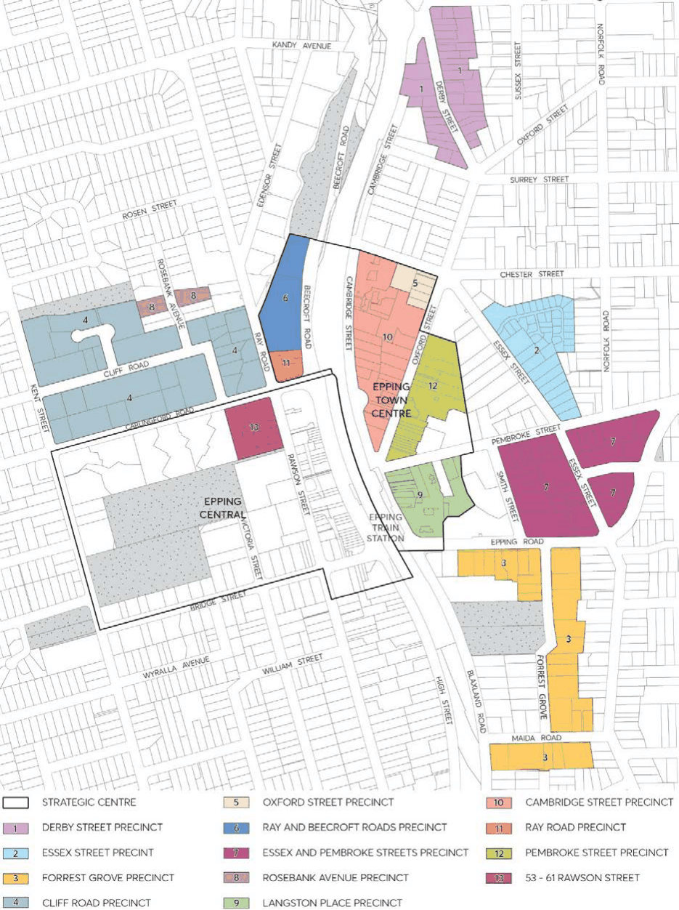

> [Picture on page 51: a picture, saved as a picture (images/part-08-centres-precincts-special-character-areas-specific-page-51-7.gif, 150 dpi).]

Figure 8.1.1.3.1 – Epping Strategic Centre

STRATEGIC CENTRES

EPPING STRATEGIC CENTRE

Objective

O.01 Promote development that is consistent with the principles in the relevant Key Development Principles Diagrams. Key Development Principles Diagrams apply to the following precincts:

1\. Derby Street, Epping Precinct,

2\. Essex Street, Epping Precinct,

3\. Epping Road/Forest Grove, Epping Precinct,

4\. Essex/Pembroke Street, Epping Precinct,

5\. Cliff Road, Epping Precinct,

6\. Oxford Street, Epping Precinct,

7\. Ray/Beecroft Roads, Epping Precinct,

8\. Rosebank Avenue, Epping Precinct, and

• Figure 8.1.1.2.13.1 – Traffic Management Improvement Plan, Epping Precincts

Controls

C.01 Development should be designed to embody the principles of the relevant precinct Key Development Principles Diagram.

C.02 Pedestrian thoroughfares should be provided in accordance with the Key Development Principles Diagrams and Town Centre Linkage diagrams as provided within this Section of this DCP (refer to Figures below).

C.03 Development in the vicinity of heritage items and Heritage Conservation Areas shown in the precinct diagrams should have regard to the Heritage provisions in Part 7 – Heritage and Archaeology of this DCP.

C.04 Development adjoining railway lines and arterial roads should incorporate appropriate measures to reduce the impact of road/rail noise vibration and disturbance.

Note: The Key Development Principles Diagrams are indicative only and are not to scale. The diagrams indicate unconstrained land that is available for redevelopment. Unless relevant setback, building form and landscaping controls are provided in this Section, refer to Parts 2, 3 and 4 of this DCP. If there is any inconsistency between this Sections and other Sections of this DCP, this Section prevails.

STRATEGIC CENTRES

EPPING STRATEGIC CENTRE

#### 8.1.1.3.1 DERBY STREET, EPPING PRECINCT

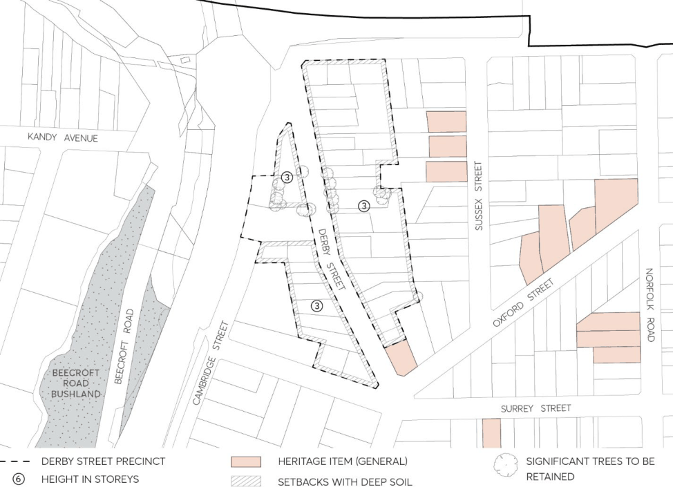

> [Picture on page 53: a picture, saved as a picture (images/part-08-centres-precincts-special-character-areas-specific-page-53-4.gif, 150 dpi).]

Figure 8.1.1.3.1.1 – Key principles diagram, Derby Street Precinct

Controls

Strategy C.01 Redevelopment should be predominantly three storey residential flat buildings and multi-dwelling housing.

Servicing C.02 Promote access from Derby Street. Landscape Setting C.03 Provide broad setbacks along street frontages and locate communal open spaces to retain existing trees that are prominent streetscape features.

C.04 Surround and screen new buildings with canopy trees and shrubs. C.05 Development should take into account bushfire, flooding and overland flow path provisions. Built Form C.06 Siting and design should provide at least two hours sunlight daily for living areas in 70% of new dwellings.

STRATEGIC CENTRES

EPPING STRATEGIC CENTRE

C.07 Design quality of facades should respond to visibility from all street frontages. C.08 Adjoining heritage items and conservation areas: ensure garden setbacks, heights, building forms and design features are compatible with values that are specified by the Heritage NSW State Heritage Inventory.

STRATEGIC CENTRES

EPPING STRATEGIC CENTRE

#### 8.1.1.3.2 ESSEX STREET, EPPING PRECINCT

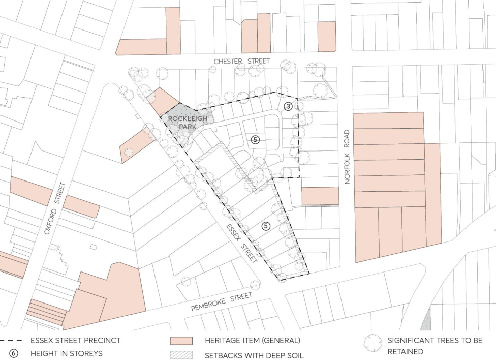

> [Picture on page 55: a picture, saved as a picture (images/part-08-centres-precincts-special-character-areas-specific-page-55-4.gif, 150 dpi).]

Figure 8.1.1.3.2.1 – Key principles diagram, Essex Street Precinct

Controls

Strategy C.01 Redevelopment should be predominantly residential flat buildings and multi-dwelling housing. Landscape Setting C.02 Provide broad setbacks along street frontages and locate communal open spaces to retain existing trees that are prominent streetscape features.

C.03 Surround and screen new buildings with canopy trees and shrubs. C.04 Development should take into account potential stormwater inundation and overland flow path provisions.

C.05 To reflect the established pattern of detached-dwellings: limit the width of new facades that would be visible from any street, and divide the floorspace of every new building into well-articulated pavilion forms that are separated by courtyards with canopy trees.

C.06 Siting and design should provide at least two hours sunlight daily for living areas in 70% of new dwellings.

C.07 Development should take into account bushfire, flooding and overland flow path provisions.

STRATEGIC CENTRES

EPPING STRATEGIC CENTRE

Built Form C.08 Design quality of facades should respond to visibility from all street frontages. C.09 Adjoining heritage items and conservation areas: ensure garden setbacks, heights, building forms and design features are compatible with values that are specified by the Heritage NSW State Heritage Inventory.

C.10 Employ setbacks and building forms that retain reasonable sunlight and privacy for existing neighbours.

STRATEGIC CENTRES

EPPING STRATEGIC CENTRE

#### 8.1.1.3.3 EPPING ROAD / FORREST GROVE, EPPING PRECINCT

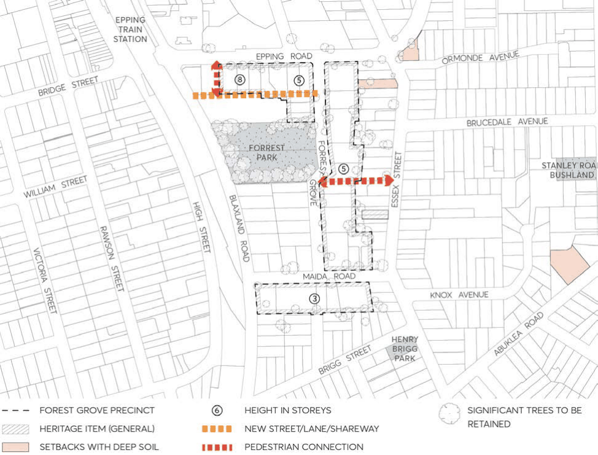

> [Picture on page 57: a picture, saved as a picture (images/part-08-centres-precincts-special-character-areas-specific-page-57-4.gif, 150 dpi).]

Figure 8.1.1.3.3.1 – Key principles diagram, Epping Road / Forest Grove Precinct

Controls

Strategy C.01 Redevelopment should be predominantly residential flat buildings of varying heights. Redevelopment along the southern side of Maida Road should be predominately three storey townhouses.

Servicing C.02 Promote access from Derby Street. Landscape Setting C.03 Provide broad setbacks along street frontages and locate communal open spaces to retain existing trees that are prominent streetscape features.

C.04 Surround and screen new buildings with canopy trees and shrubs. C.05 Development should take into account bushfire, flooding and overland flow path provisions. Pedestrian Link

STRATEGIC CENTRES

EPPING STRATEGIC CENTRE

C.06 Future widening of the pedestrian link to 3 metres, to allow for public domain improvements including seating and planting.

Built Form C.07 To reflect the established pattern of detached-dwellings: limit the width of new facades that would be visible from any street, and divide the floorspace of every new building into well-articulated pavilion forms that are separated by courtyards with canopy trees.

C.08 Siting and design should provide at least two hours sunlight daily for living areas in 70% of new dwellings.

C.09 Design quality of facades should respond to visibility from all street frontages. C.10 Adjoining heritage items and conservation areas: ensure garden setbacks, heights, building forms and design features are compatible with values that are specified by the Heritage NSW State Heritage Inventory.

C.11 Employ setbacks and building forms that retain reasonable sunlight and privacy for existing neighbours.

STRATEGIC CENTRES

EPPING STRATEGIC CENTRE

#### 8.1.1.3.4 ESSEX / PEMBROKE STREET, EPPING PRECINCT

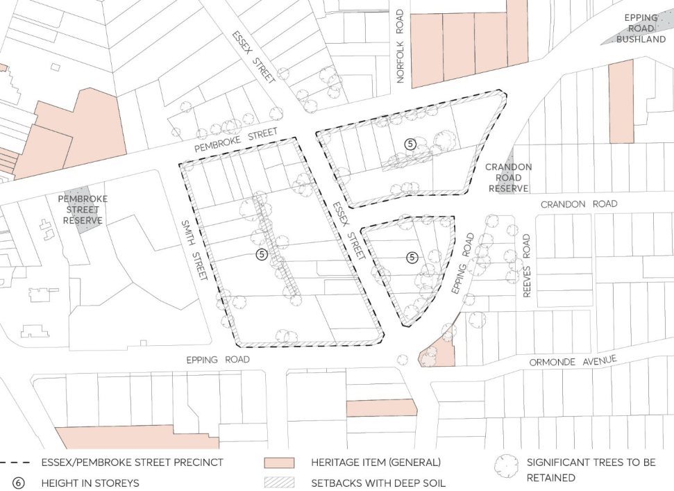

> [Picture on page 59: a picture, saved as a picture (images/part-08-centres-precincts-special-character-areas-specific-page-59-4.gif, 150 dpi).]

Figure 8.1.1.3.4.1 – Key principles diagram, Essex / Pembroke Street Precinct

Controls

Strategy C.01 Redevelopment should be predominantly five storey residential flat buildings in garden settings, with parking in basements.

Servicing C.02 Promote access from local streets. Limit access along Essex Street. C.03 If access along Epping Road is required, consolidate existing vehicle entrances. C.04 Accommodate potential intersection upgrade at Essex Street / Epping Road intersection. Landscape Setting C.05 Provide broad setbacks along street frontages and locate communal open spaces to retain existing trees that are prominent streetscape features.

C.06 Surround and screen new buildings with canopy trees and shrubs. C.07 Development should take into account potential stormwater inundation and overland flow path provisions.

STRATEGIC CENTRES

EPPING STRATEGIC CENTRE

Built Form C.08 To reflect the established pattern of detached-dwellings:  limit the width of new facades that would be visible from any street, and divide the floorspace of every new building into well-articulated pavilion forms that are separated by courtyards with canopy trees.

C.09 Siting and design should provide at least two hours sunlight daily for living areas in 70% of new dwellings.

C.10 Design quality of facades should respond to visibility from all street frontages. C.11 Employ setbacks and building forms that retain reasonable sunlight and privacy for existing neighbours.

STRATEGIC CENTRES

EPPING STRATEGIC CENTRE

#### 8.1.1.3.5 CLIFF ROAD, EPPING PRECINCT

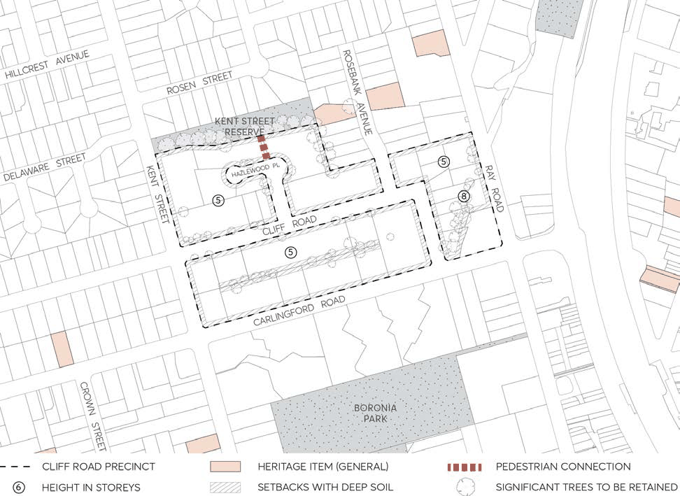

> [Picture on page 61: a picture, saved as a picture (images/part-08-centres-precincts-special-character-areas-specific-page-61-4.gif, 150 dpi).]

Figure 8.1.1.3.5.1 – Key principles diagram, Cliff Road Precinct

Controls

Strategy C.01 Redevelopment should be predominantly five storey residential flat buildings in garden settings, with parking in basements.

Servicing C.02 Promote access from local streets. C.03 If access is not available from the local streets, consolidate existing vehicle entrances on Carlingford Road.

C.04 Subject to amalgamation, close the end of Hazlewood Place and combine within a development site. Maintain pedestrian access from Hazlewood Place to Kent Street Reserve.

Landscape Setting C.05 Provide broad setbacks along street frontages and locate communal open spaces to retain existing trees that are prominent streetscape features.

C.06 Maintain the significant vegetation adjoining Kent Street Reserve to the north of the precinct. C.07 Surround and screen new buildings with canopy trees and shrubs.

STRATEGIC CENTRES

EPPING STRATEGIC CENTRE

C.08 Development should take into account flooding and overland flow path provisions. Built Form C.09 To reflect the established pattern of detached-dwellings: limit the width of new facades that would be visible from any street, and divide the floorspace of every new building into well-articulated pavilion forms that are separated by courtyards with canopy trees.

C.10 Siting and design should provide at least two hours sunlight daily for living areas in 70% of new dwellings.

C.11 Design quality of facades should respond to visibility from all street frontages. C.12 Employ setbacks and building forms that retain reasonable sunlight and privacy for existing neighbours

STRATEGIC CENTRES

EPPING STRATEGIC CENTRE

#### 8.1.1.3.6 OXFORD STREET, EPPING PRECINCT

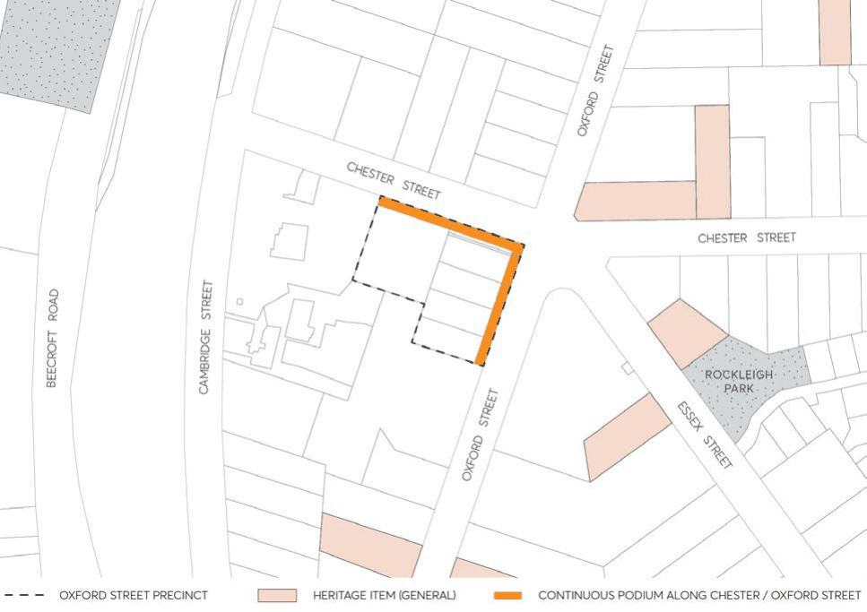

> [Picture on page 63: a picture, saved as a picture (images/part-08-centres-precincts-special-character-areas-specific-page-63-4.gif, 150 dpi).]

Figure 8.1.1.3.6.1 – Key principles diagram, Oxford Street Precinct

Controls

Strategy C.01 Redevelopment along the corner of Chester Street and Oxford Street should be predominantly fifteen storey residential flat buildings serviced by basement parking.

Landscaping C.02 Retain significant trees. C.03 Surround and screen new buildings with canopy trees and shrubs. C.04 Establish landscaped setbacks along street frontages. C.05 Landscaped areas should adjoin all primary and secondary property boundaries as follows:

• Achieve a minimum width of 4 metres for the length of the boundary, and

• Accommodate canopy trees that will reach mature heights of at least 10 to 12 metres.

C.06 Landscaped areas should be provided between 2 or more buildings located on development site, designed to:

• Have a minimum total width of 12 metres,

• Accommodate shrubs or small trees that will reach mature heights of at least 3 to 5 metres,

STRATEGIC CENTRES

EPPING STRATEGIC CENTRE

• Provide a minimum soil depth of 1 metre, and

• Be located on a podium above a basement car park.

Built form C.07 Provide a continuous podium of three storeys facing Chester Street and Oxford Street, plus an additional setback to tower elements above the podium

C.08 Ensure high levels of residential amenity for new and existing or approved dwellings by the appropriate siting and design of apartment towers.

C.09 Locate towers to achieve a co-ordinated network of open spaces upon adjoining properties, and also to provide at least two hours sunlight daily for living areas in 70% of dwellings.

C.10 Achievable suitable scale and bulk by dividing floorspace into tower structures that have compact floorplates which area separated by deep-soil landscaping.

C.11 Design quality of facades should respond to visibility from all quarters, and adjacent towers should display distinct variations in terms of height and profile.

Setbacks C.12 The minimum setbacks of all buildings and structures to the boundaries of the site in the Oxford Street, Epping precinct are prescribed in Table 8.1.1.3.6.1 below: Table 8.1.1.3.6.1 – Minimum boundary setbacks for the Oxford Street, Epping precinct

| Setback | Minimum Building Setback |
|---|---|
| Podium |  |
| Primary and secondary road boundary | 3m |
| Side or rear boundary adjoining an existing building | 6m |
| Basement parking setback | 3m from any primary and secondary road boundary, and 6m from side and rear boundaries to allow for deep soil landscaping |
| Tower element |  |
| Primary and secondary road boundary | 6m, which can be reduced to 4m for a maximum of 1/3 of the building width. |
| Side or rear boundary adjoining an existing building | Half of the required building separation prescribed in Part 2F Building Separation of the Apartment Design Guide. |
| Top-storey setback | 3m additional setback for exterior walls of the top-most two storeys, measured from the walls of the 4th storey. |

Setback encroachments C.13 Balconies are able to encroach within the prescribed boundary setbacks as follows:

• 4 metre setback to the primary and secondary road boundary for the tower element provided there is no impact on the achievement of daylight access, visual privacy and acoustic privacy.

C.14 Despite the above, the balcony encroachments for the top-most 2 storeys should not extend beyond the setback of the external walls below.

STRATEGIC CENTRES

EPPING STRATEGIC CENTRE

Floorplates C.15 The podium level adjacent to the public domain should provide for continuity in the building alignment, with minimal lengths of gaps in the street wall.

Articulation C.16 Facades should be expressed as 3 distinct levels; a base, middle and top. C.17 Asymmetric floor plans are preferred as they contribute to effective articulation. C.18 Facades that face the street may accommodate car parking and building services if the facades are designed architecturally to screen those facilities.

C.19 Building lobbies and entrances to residential courtyards should be visually prominent elements of the streetscape.

C.20 Avoid exterior walls that are long and straight by stepping wall alignments and attaching balconies that project (with the exception of side walls with a zero setback that adjoints a side wall of an existing building).

C.21 Balconies should provide effective articulation for tall buildings by:

• Being varied in form and design across each façade in a variety of shapes and dimensions repeated in semi-regular patterns,

• Not extended continuously across the full width of any façade, and

• Varying the form and design of balcony balustrades and limiting the use of masonry upstands to avoid bulky character.

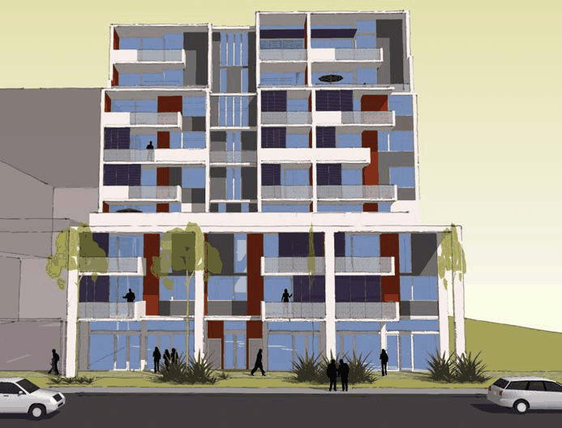

> [Picture on page 65: a picture, saved as a picture (images/part-08-centres-precincts-special-character-areas-specific-page-65-22.gif, 150 dpi).]

Figure 8.1.1.3.6.2 – Articulation of facades for the Oxford Street, Epping Precinct

Fencing C.22 Fencing is discouraged in the primary and secondary boundary setbacks. Podium planting

STRATEGIC CENTRES

EPPING STRATEGIC CENTRE

C.23 Where podium planting is proposed, planting is to be provided as illustrated in Figure 8.1.1.6.3, with the appropriate soil depth and width as illustrated in Figure 8.1.1.6.4.

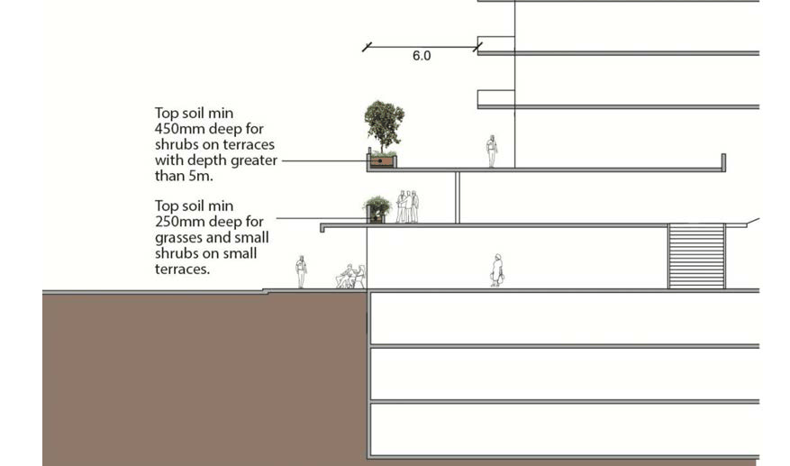

> [Picture on page 66: a picture, saved as a picture (images/part-08-centres-precincts-special-character-areas-specific-page-66-5.gif, 150 dpi).]

Figure 8.1.1.6.3 – Deep soil planting

> [Picture on page 66: a picture, saved as a picture (images/part-08-centres-precincts-special-character-areas-specific-page-66-7.gif, 150 dpi).]

Figure 8.1.1.6.4 – Soil depth

STRATEGIC CENTRES

EPPING STRATEGIC CENTRE

#### 8.1.1.3.7 RAY / BEECROFT ROADS, EPPING PRECINCT

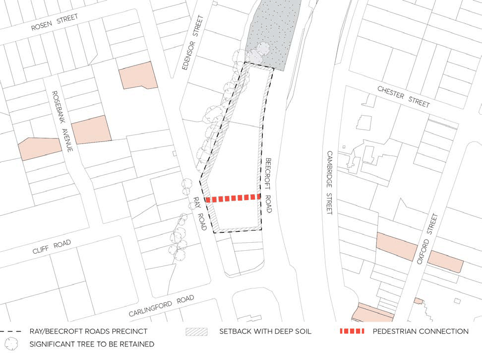

> [Picture on page 67: a picture, saved as a picture (images/part-08-centres-precincts-special-character-areas-specific-page-67-4.gif, 150 dpi).]

Figure 8.1.1.3.7.1 – Key principles diagram, Ray / Beecroft Roads Precinct

Controls

Strategy C.01 Redevelopment should be predominantly five storey residential flat buildings in garden settings, with parking in basements.

Servicing C.02 Promote access from local streets. C.03 If access is not available from the local streets, consolidate existing vehicle entrances on Carlingford Road.

C.04 Subject to amalgamation, close the end of Hazlewood Place and combine within a development site. Maintain pedestrian access from Hazlewood Place to Kent Street Reserve.

Landscape Setting C.05 Provide broad setbacks along street frontages and locate communal open spaces to retain existing trees that are prominent streetscape features.

C.06 Maintain the significant vegetation adjoining Kent Street Reserve to the north of the precinct. C.07 Surround and screen new buildings with canopy trees and shrubs.

STRATEGIC CENTRES

EPPING STRATEGIC CENTRE

C.08 Development should take into account flooding and overland flow path provisions. Built Form C.09 To reflect the established pattern of detached-dwellings:  limit the width of new facades that would be visible from any street, and divide the floorspace of every new building into well-articulated pavilion forms that are separated by courtyards with canopy trees.

C.10 Siting and design should provide at least two hours sunlight daily for living areas in 70% of new dwellings.

C.11 Design quality of facades should respond to visibility from all street frontages. C.12 Employ setbacks and building forms that retain reasonable sunlight and privacy for existing neighbours.

Open spaces C.13 Enclosure of private open space areas as wintergardens should be avoided. Wintergardens may be considered where the elevation of building fronts Epping Road or a rail corridor.

Podium planting C.14 Where podium planting is proposed, planting is to be provided as illustrated in Figure 8.1.1.7.2, with the appropriate soil depth and width as illustrated in Figure 8.1.1.7.3

Deep soil zones C.15 Landscaped areas should adjoin property boundaries, at 4 metres to 8 metres wide, and be designed to accommodate:

• deep soil landscaping for a minimum 50% of the front setback.

• canopy trees that will mature of at least 10 to 12 metres in the front and rear setback, and

• trees that will reach a mature height of at least 6 to 7 metres in the side setbacks.

C.16 Locate basement car parking predominately under the building footprint to provide opportunities for deep soil areas.

STRATEGIC CENTRES

EPPING STRATEGIC CENTRE

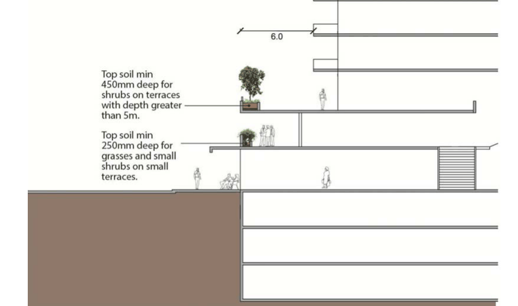

> [Picture on page 69: a picture, saved as a picture (images/part-08-centres-precincts-special-character-areas-specific-page-69-3.gif, 150 dpi).]

Figure 8.1.1.7.2 – Deep soil planting

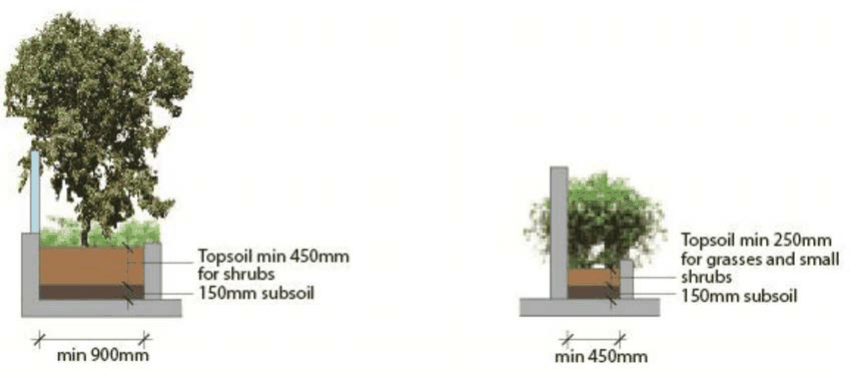

> [Picture on page 69: a picture, saved as a picture (images/part-08-centres-precincts-special-character-areas-specific-page-69-5.gif, 150 dpi).]

Figure 8.1.1.7.3 – Soil depth

STRATEGIC CENTRES

EPPING STRATEGIC CENTRE

#### 8.1.1.3.8 ROSEBANK AVENUE, EPPING PRECINCT

This Section applies to any 3 storey residential flat building development on 6-8 and 5-7 Rosebank Avenue which are adjacent to the Rosebank Avenue Heritage Conservation Area and heritage items at 9 and 10 Rosebank Avenue, as detailed in Figure 8.1.1.3.8.1.

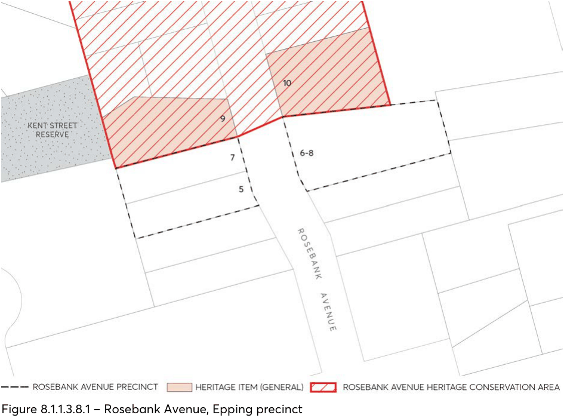

> [Picture on page 70: a picture, saved as a picture (images/part-08-centres-precincts-special-character-areas-specific-page-70-7.gif, 150 dpi).]

Figure 8.1.1.3.8.1 – Rosebank Avenue, Epping precinct

Objectives

O.01 Setbacks designed to ensure a sympathetic transition to the adjoining heritage item and heritage conservation area.

O.02 Setbacks that allow for trees to be retained and planted within the side setback boundaries to maintain the landscape amenity and setting of adjoining heritage items and heritage conservation areas.

Controls

C.01 The minimum site setback of residential flat buildings to the boundary of the site which sites adjacent to the Rosebank Avenue Heritage Conservation Area and heritage items sites should comply with the following:

• A minimum 6 metres to the boundary for the ground floor in accordance with Figures

8.1.1.3.8.2 and 8.1.1.3.8.3.

STRATEGIC CENTRES

EPPING STRATEGIC CENTRE

• A minimum of 9 metres to the boundary for the second and third storeys with Figures

8.1.1.3.8.2 and 8.1.1.3.8.3.

C.02 Minimise the removal of existing trees on the side boundary in order to retain the existing landscape setting of the heritage items and the heritage conservation area.

C.03 The side setback is to be retained as deep soil and basement car parking shall not intrude into the side setback to the boundary with the heritage item and heritage conservation area.

C.04 Landscaping on the site should be incorporated to include additional tree planting on the side boundary.

C.05 Balconies cannot protrude in the front, rear and side setbacks. C.06 New development located at 5 and 7 Rosebank Avenue shall minimise the number of balconies facing northward. Those balconies on the first and second floors facing west and north shall provide appropriate screening to minimise overlooking.

C.07 New development must demonstrate the protection of existing street trees along Rosebank Avenue.

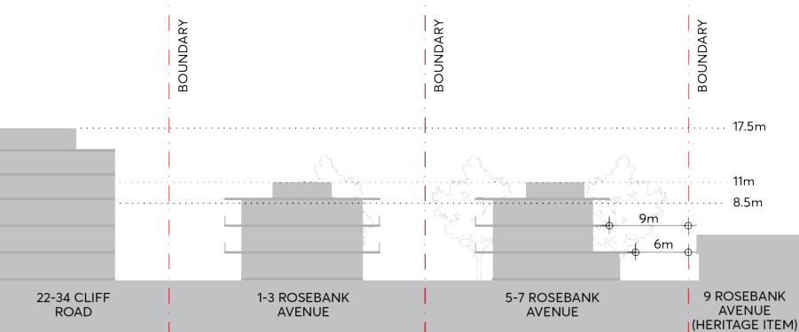

> [Picture on page 71: a picture, saved as a picture (images/part-08-centres-precincts-special-character-areas-specific-page-71-17.gif, 150 dpi).]

Figure 8.1.1.3.8.2 – Setback controls for 5-7 Rosebank Avenue

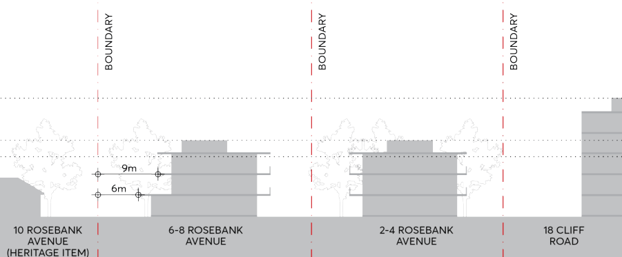

> [Picture on page 71: a picture, saved as a picture (images/part-08-centres-precincts-special-character-areas-specific-page-71-19.gif, 150 dpi).]

Figure 8.1.1.3.8.3 – Setback controls for 6-8 Rosebank Avenue

STRATEGIC CENTRES

EPPING STRATEGIC CENTRE
