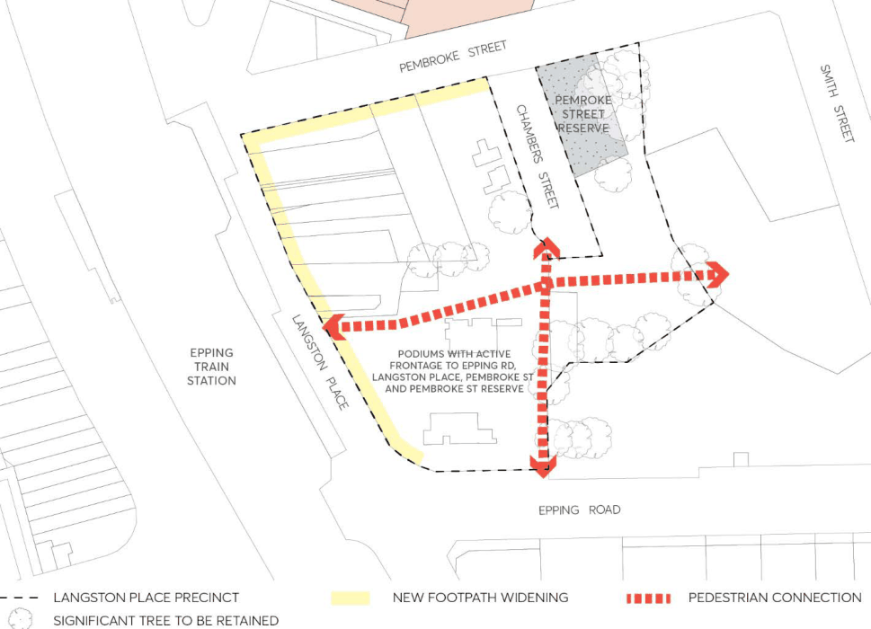
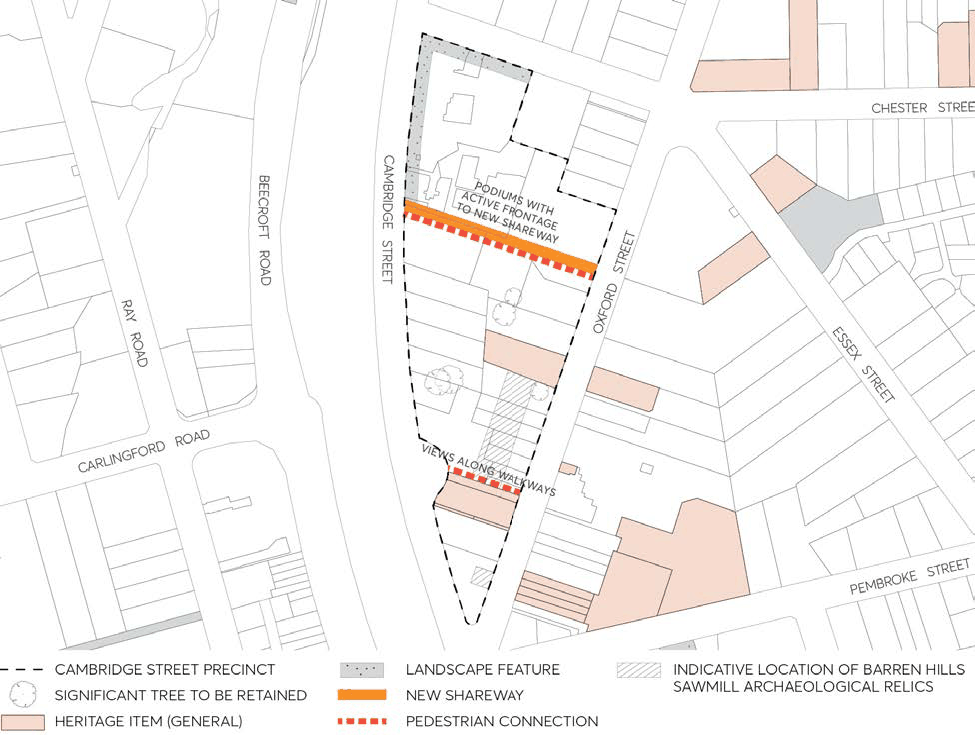
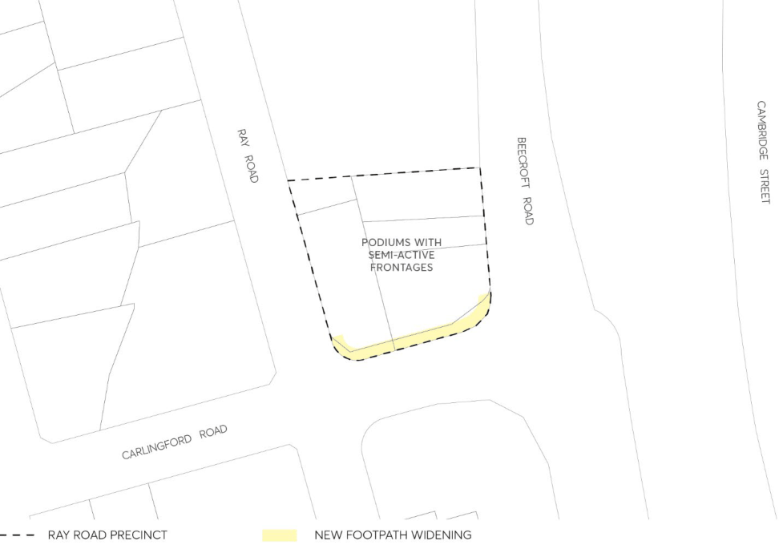
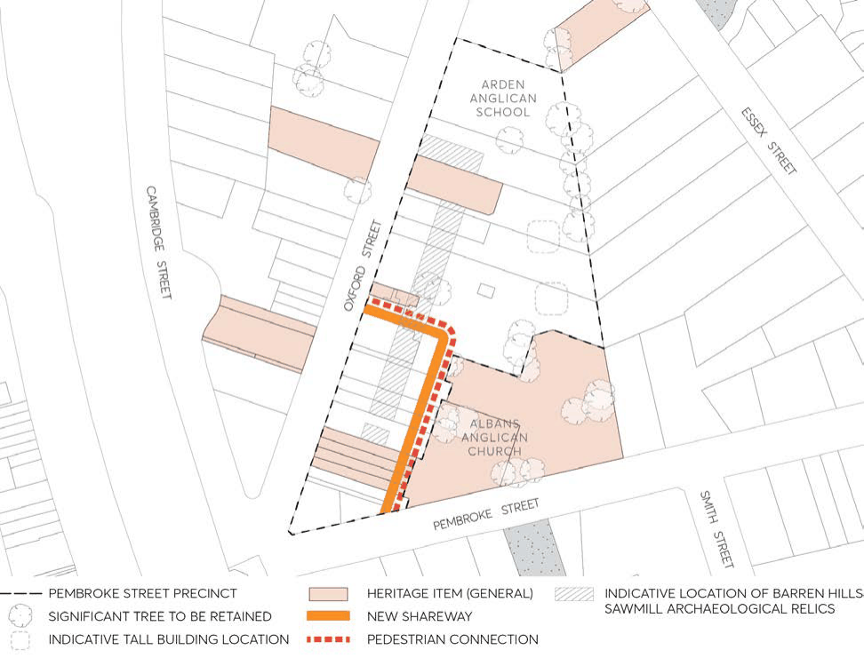

#### 8.1.1.4 EPPING AREAS – BUSINESS DEVELOPMENT

In addition to the general provisions set out in Section 8.1.1.2, the following specific provisions apply to specific land zoned E1 Local Centre as identified in this Section. This Section should be read in conjunction with Part 4 – Non-Residential Development of this DCP. To the extent of any inconsistencies, the specific provisions within this Section shall prevail.

Objective

O.01 Promote orderly development that is consistent with the requirements shown in the relevant Key Development Principles Diagrams. Key Development Principles Diagrams apply to the following precincts:

• Langston Place, Epping Precinct;

• Cambridge Street, Epping Precinct;

• Ray Road, Epping Precinct; and

• Pembroke Street, Epping Precinct. Note: The Key Development Principles Diagrams are indicative only and are not to scale. Relevant scale and site requirements are provided in Section 8.1.1.2 of this DCP.

Controls

C.01 Development should be designed to embody the principles of the relevant precinct Key Development Principles Diagram.

C.02 Pedestrian thoroughfares should be provided in accordance with the Key Development Principles Diagrams and Town Centre Linkage diagrams (see Figure 8.1.1.2.13.2).

C.03 Development in the vicinity of heritage items and Heritage Conservation Areas shown in the precinct diagrams should have regard to the Heritage provisions in Part 7 – Heritage and Archaeology of this DCP. Development adjoining railway lines and arterial roads should incorporate appropriate measures to reduce the impact of road/rail noise vibration and disturbance.

STRATEGIC CENTRES

EPPING STRATEGIC CENTRE

#### 8.1.1.4.1 LANGSTON PLACE, EPPING PRECINCT

> [Picture on page 73: a picture, saved as a picture (images/part-08-centres-precincts-special-character-areas-specific-page-73-4.gif, 150 dpi).]

Figure 8.1.1.4.1.1 – Key principles diagram, Langston Place Precinct

Controls

Strategy C.01 Redevelopment of up to twenty two storeys should accommodate residential flats, offices, business and/or retail premises, serviced by basement parking.

Servicing C.02 Provide access to basements and service areas from Pembroke Street/Chambers Court. Limit vehicle access from Langston Place.

C.03 No vehicle access to be provided from Epping Road. C.04 Chambers Court may be relocated to form a contiguous open space and should be redesigned as a shared space.

C.05 Street level retail and business premises to be serviced by kerbside parking. Public frontages C.06 A widened footpath is to be provided along Langston Place and Pembroke Street. C.07 Maximise activity facing all streets by siting lower storeys without any setback from footpaths and accommodating a nearly-continuous mix of shopfronts and building entrances.

STRATEGIC CENTRES

EPPING STRATEGIC CENTRE

Landscape setting C.08 Retain significant trees. C.09 Provide a landscaped plaza/public domain space adjacent to Chambers Court with active frontages.

C.10 Pedestrian connections should be provided north-south and east-west, linking Pembroke Street, Epping Road and Langston Place.

Built form C.11 Provide a continuous podium of up to three storeys facing all streets, and shape each podium to address major street corners.

C.12 Avoid extensive sheer vertical facades by setting upper storeys back from their podium. C.13 Achieve a varied skyline by providing different heights, profiles and roof forms for successive buildings. Siting and design should provide at least two hours sunlight daily for living areas in 70% of new dwellings.

STRATEGIC CENTRES

EPPING STRATEGIC CENTRE

#### 8.1.1.4.2 CAMBRIDGE STREET, EPPING PRECINCT

> [Picture on page 75: a picture, saved as a picture (images/part-08-centres-precincts-special-character-areas-specific-page-75-4.gif, 150 dpi).]

Figure 8.1.1.4.2.1 – Key principles diagram, Cambridge Street Precinct

Controls

Strategy C.01 Redevelopment of up to twenty two storeys should accommodate residential flats, offices, business and/or retail premises, serviced by basement parking.

Landscape setting C.02 Retain significant trees. C.03 Establish landscaped setbacks along non-active frontages. Investigate location of Barren Hills archaeological relics.

Public frontages C.04 Maximise activity along Oxford Street and Cambridge Street (south of the new shareway) and both sides of the new eastwest shareway by siting lower storeys without any setback from the footpath and accommodating a nearly-continuous mix of shop fronts and building entrances.

C.05 Consolidate entries to basement and service areas to protect desired levels of activity facing all active streets and new shareway.

STRATEGIC CENTRES

EPPING STRATEGIC CENTRE

Servicing C.06 Provide a new east-west shareway for access linking Oxford Street and Cambridge Street as part of any future redevelopment of 41 Oxford Street (existing Cambridge Business Park). The detailed design of the street including the width, direction and intersection treatments are to be determined in consultation with Council and supported by a Traffic Impact Assessment.

C.07 Provide access to basements and service areas from the shareway or Chester Street. If access is not available from these streets, consolidate vehicle entrances from Oxford Street.

Built form C.08 Provide a continuous podium of up to three storeys facing all streets, and shape each podium to address major street corners.

C.09 Achieve a varied skyline by providing different heights, profiles and roof forms for successive buildings. Siting and design should provide at least two hours sunlight daily for living areas in 70% of new dwellings.

STRATEGIC CENTRES

EPPING STRATEGIC CENTRE

#### 8.1.1.4.3 RAY ROAD, EPPING PRECINCT

> [Picture on page 77: a picture, saved as a picture (images/part-08-centres-precincts-special-character-areas-specific-page-77-4.gif, 150 dpi).]

Figure 8.1.1.4.3.1 – Key principles diagram, Ray Road Precinct

Controls

Strategy C.01 Redevelopment of up to fifteen storeys should accommodate residential flats, offices, business and/or retail premises, serviced by basement parking.

Servicing C.02 Provide access to basements and service areas from Beecroft Road or Ray Road. Public frontages C.03 Maximise activity facing all streets by siting lower storeys without any setback from footpaths and accommodating a nearly-continuous mix of shopfronts and building entrances.

C.04 Provide a pedestrian connection between Ray Road and Beecroft Road. C.05 Consolidate entries to basements and service areas to protect desired levels of activity facing all active streets.

Built form C.06 Siting and design should provide at least two hours sunlight daily for living areas in 70% of new dwellings.

STRATEGIC CENTRES

EPPING STRATEGIC CENTRE

#### 8.1.1.4.4 PEMBROKE STREET, EPPING PRECINCT

> [Picture on page 78: a picture, saved as a picture (images/part-08-centres-precincts-special-character-areas-specific-page-78-4.gif, 150 dpi).]

Figure 8.1.1.4.4.1 – Key principles diagram, Pembroke Street Precinct

Controls

Strategy C.01 Redevelopment of up to fifteen storeys should accommodate residential flats, offices, business and/or retail premises, serviced by basement parking.

C.02 Redevelopment should accommodate existing community and education facilities and heritage items.

Public frontages C.03 Maximise activity along Oxford Street and Pembroke Street by siting lower storeys without any setback from the footpath and accommodating a continuous mix of shop fronts and building entrances.

C.04 Consolidate entries to basement and service areas to protect desired levels of activity facing all active streets.

Landscape setting C.05 Retain significant trees.

STRATEGIC CENTRES

EPPING STRATEGIC CENTRE

C.06 Landscaped setbacks should be maintained around St Alban’s Anglican Church. C.07 Investigate location of Barren Hills archaeological relics. Servicing C.08 Provide a new laneway linking Oxford Street and Pembroke Street as part of the redevelopment of the site in order to provide additional street frontages. The detailed design of the street including the width, direction and intersection treatments are to be determined in consultation with Council and supported by a Traffic Impact Assessment.

C.09 Provide access to basements and retail service areas from the shareway and Pembroke Street. Limit vehicle access from Oxford Street.

Built form C.10 Provide a continuous podium of up to three storeys facing all streets and shape each podium to address major street corners.

C.11 Avoid extensive sheer vertical facades by setting upper storeys back from their podium. Towers should generally be aligned in an east-west direction.

C.12 Maintain heritage curtilage setbacks from St Alban’s Anglican Church. C.13 Maintain heritage shop fronts facades along Oxford Street with infill development behind. C.14 Achieve a varied skyline by providing different heights, profiles and roof forms for successive buildings.

C.15 Siting and design should provide at least two hours sunlight daily for living areas in 70% of new dwellings.

STRATEGIC CENTRES

EPPING STRATEGIC CENTRE
