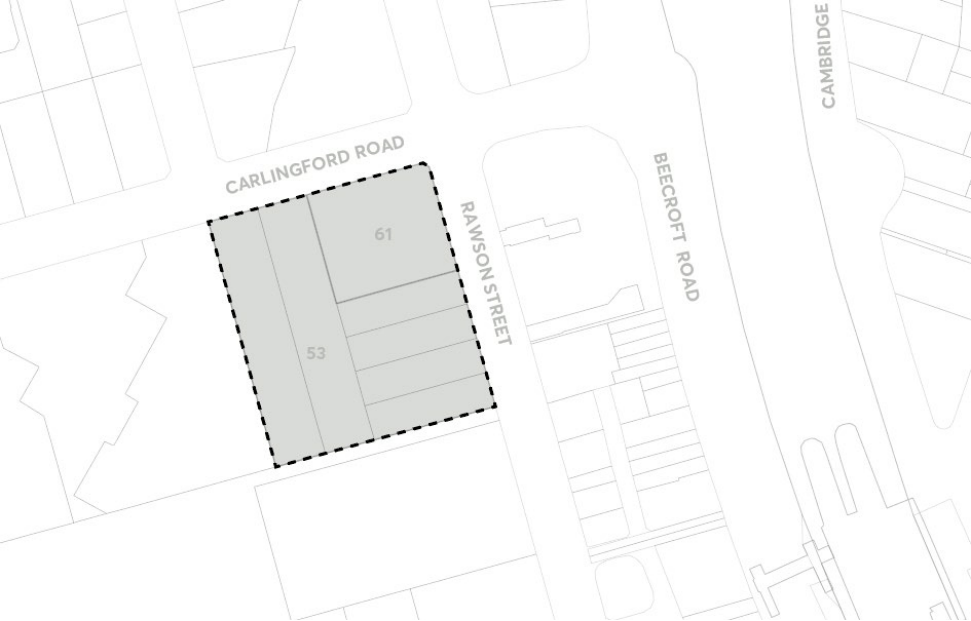
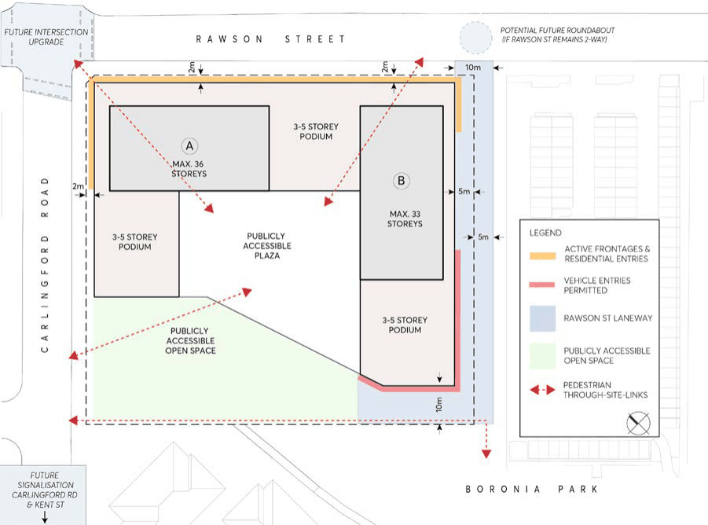
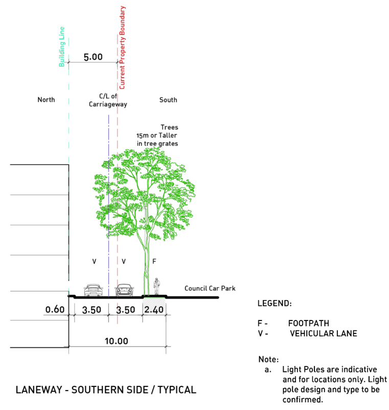
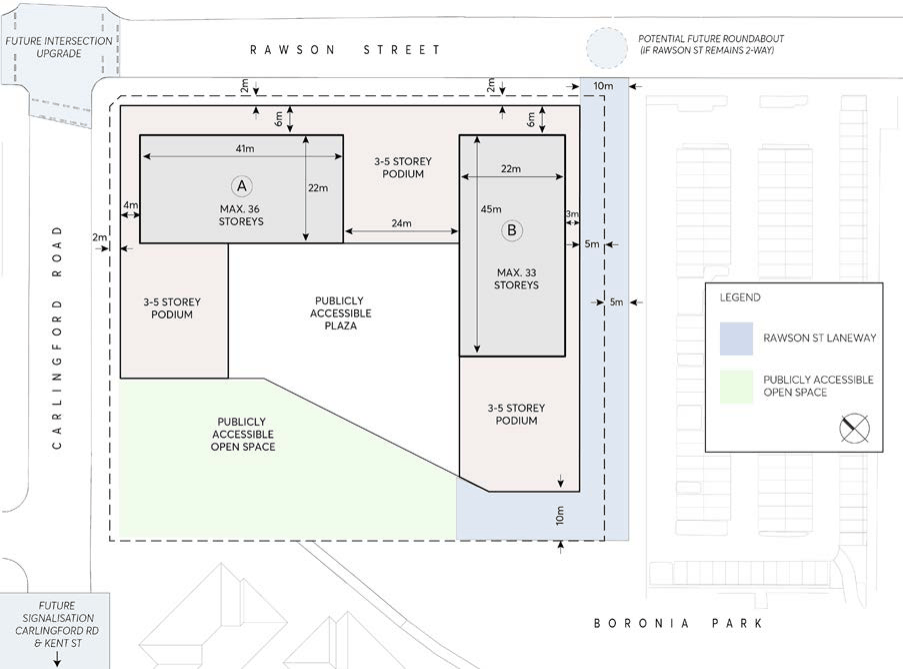

#### 8.1.1.5 EPPING AREAS – MIXED USE DEVELOPMENT

In addition to the general provisions set out in Section 8.1.1.1 – Epping Central, the following specific provisions apply to specific land zoned E1 Local Centre as identified in this Section. This Section should be read in conjunction with Part 4 – Non-Residential Development and Part 3 – Residential Development of this DCP. To the extent of any inconsistencies, the specific provisions within this Section shall prevail.

8.1.1.5.1 53-61 RAWSON STREET, EPPING PRECINCT

This Section applies to the site bounded by Rawson Street, Carlingford Road and adjoining sites in Epping. The subject site is illustrated in Figure 8.1.1.5.1.1.

The site comprises 3 individual land parcels as follows: 53 Rawson Street, Epping (Lots 4-7 in DP 19329 and Lots 8-9 in DP 975578) and 61 Rawson Street (Lot 1 in DP 71071).

> [Picture on page 80: a picture, saved as a picture (images/part-08-centres-precincts-special-character-areas-specific-page-80-14.gif, 150 dpi).]

Figure 8.1.1.5.1.1- Land application map

This DCP establishes principles, objectives and controls to be interpreted during preparation and assessment of development applications and supports the objectives of the LEP.

In addition to general objectives listed in Part 8 of this DCP, specific objectives of this site are identified below and within each section of this site-specific DCP.

STRATEGIC CENTRES

EPPING STRATEGIC CENTRE

Objectives

O.01 Reinforce the role of the site as a key retail and commercial destination. O.02 Provide a mix of residential and commercial uses to support high levels of activation within the site and to the surrounding streetscape.

PUBLIC DOMAIN AND PUBLICLY ACCESSIBLE OPEN SPACE

Objectives

O.01 Provide well-considered open space areas that are publicly accessible. O.02 The public domain and open spaces are to support wayfinding, legibility and through-site connections for residents and visitors.

O.03 Appropriately manage vehicular and pedestrian access between Carlingford Road, Rawson Street and Boronia Park.

> [Picture on page 81: a picture, saved as a picture (images/part-08-centres-precincts-special-character-areas-specific-page-81-14.gif, 150 dpi).]

Figure 8.1.1.5.1.2 – Indicative ground floor layout

Controls

C.01 Public domain and publicly accessible open space shall be generally in accordance with Figure

8.1.1.5.1.2 noting that alternative options will be considered. This includes the central plaza, a

STRATEGIC CENTRES

EPPING STRATEGIC CENTRE

widened footpath along Rawson Street, a minimum 10m wide laneway, and the publicly accessible open space area in the north-west portion of the site.

C.02 The designs of the public domain and publicly accessible open spaces are to:

a) Incorporate a palette of high-quality design treatments and finishes to facilitate active and passive recreation with consideration to Council public domain guidelines.

b) Incorporate an awning to street frontages.

c) Be accessible 24 hours a day seven days a week.

d) Include clear, accessible and safe links between Rawson Street, Carlingford Road and Boronia Park.

e) Provide visual links from within the site to Rawson Street and Carlingford Road.

f) Incorporate principles of Crime Prevention through Environmental Design to support safety and security of users.

g) Deliver a consistent footpath width and treatment along Rawson Street and Carlingford Road.

h) Be designed to allow universal access.

C.03 The design of the Publicly Accessible Plaza (as shown in Figure 8.1.1.5.1.2) is to:

a) Include a combination of hard surfaces and landscaping.

b) Provide outdoor spaces and seating areas that are protected from the elements (i.e., sun, wind, rain impacts) to allow for use all-year round.

c) Provide activated frontages and outdoor dining opportunities.

C.04 The design of the Publicly Accessible Open Space (as shown in Figure 8.1.1.5.1.2) is to:

a) Prioritise pedestrians over vehicles and ensure the safety of pedestrians.

b) Support urban tree canopy cover.

c) Provide deep soil zones on site.

d) Include Stormwater management treatments and a combination of indigenous, native and exotic vegetation.

e) Improve pedestrian connections from Carlingford Road to Boronia Park.

f) Provide passive recreation opportunities.

g) Clearly delineate public and private uses.

h) Be publicly accessible 24 hours a day seven days a week.

C.05 The laneway shall be delivered generally in accordance with Figures 8.1.1.5.1.2, - 8.1.1.5.1.4 and is to be dedicated to Council. Alternative laneway configuration options can be considered.

C.06 The laneway shall comprise:

a) Minimum width of 10m, with:

• Two 3.5m vehicular lanes in each direction,

STRATEGIC CENTRES

EPPING STRATEGIC CENTRE

• Minimum 2.4m wide footpath along the southern and western boundary to connect to Boronia Park,

• Trees in grates on the footpath,

• Kerb and gutter arrangement for the laneway.

b) Prioritise the safety of pedestrians in the area using appropriate materials.

c) Align with materials in the Parramatta Public Domain Guidelines.

d) Provide adequate flooding mitigation measures including but not limited to:

• a raised entrance crest to the basement level;

• flood gates;

• the first level with pedestrian access being located above the 1% AEP + freeboard and the PMF flood level (achieved in reference scheme);

• residential floors being above the PMF flood level (achieved in reference scheme); and

• a shelter-in-place strategy could be implemented if required.

> [Picture on page 83: a picture, saved as a picture (images/part-08-centres-precincts-special-character-areas-specific-page-83-16.gif, 150 dpi).]

Figure 8.1.1.5.1.3 – Indicative Southern Laneway cross sections

STRATEGIC CENTRES

EPPING STRATEGIC CENTRE

PODIUM AND STREET WALL

Objectives

O.01 Ensure buildings are sited to consider site constraints, topography, and surrounding uses. O.02 Provide an activated ground floor retail interface with fine grain uses to enhance the character and function of Rawson Street as a high street, and turn the corner to Carlingford Road.

O.03 Provide a street wall at an appropriate height to spatially define Carlingford Road and Rawson Street that is well proportioned, humanly scaled and finely grained, with facades of tactile material quality.

O.04 Create visual interest and variety in the streetscape within an overall framework of consistency in the definition of the street and its character.

> [Picture on page 84: a picture, saved as a picture (images/part-08-centres-precincts-special-character-areas-specific-page-84-13.gif, 150 dpi).]

Figure 8.1.1.5.1.4 – Indicative site layout and built form

Controls

C.01 The site layout and building envelope is to be generally consistent with Figure 8.1.1.5.1.4. C.02 Podiums should have a predominant street wall height of either 3 or 4 storeys along both Rawson Street and Carlingford Road, with a maximum of 5 storeys in line with the natural topography.

C.03 Podiums should have a predominant street wall height of either 3 or 4 storeys along both Rawson Street.

STRATEGIC CENTRES

EPPING STRATEGIC CENTRE

C.04 Podiums can comprise part 5 storeys on the western edge of the podiums due to the slope of the land in response to the natural topography.

C.05 The height of the podium parapet is to be consistent across the development to provide clear definition of the podium, streets and laneways.

C.06 Minimum floor to floor heights are to be provided as follows:

a) Lower ground floor retail – 5.5m.

b) Ground floor retail – 5m.

c) Podium commercial -4m.

d) Residential – 3.15m.

C.07 Minimum setbacks are to be in accordance with Table 8.1.1.5.1.1 below and consistent with Figure 8.1.1.5.1.4: Table 8.1.1.5.1.1 – Minimum podium and tower setbacks

| Setback | Minimum Building Setback |
|---|---|
| Basement and lower ground (below finished ground level) |  |
| Rawson Street | 0m |
| Carlingford Road | 0m |
| Southern Boundary | 5m |
| Western Boundary | 10m |
| Podium (from boundary) |  |
| Rawson Street | 2m |
| Carlingford Road | 2m |
| Southern Boundary | 5m |
| Western boundary | 10m |
| Tower (from podium edge) |  |
| Rawson Street | 6m |
| Carlingford Road | 4m |
| Southern podium edge | 3m |
| Western podium edge | 4m |

C.08 Podium setbacks should be built to align with the setbacks for their entire height and free of architectural treatments (including balconies, fins and the like.) to ensure a clear street wall.

C.09 Residential access is to be provided with a legible, direct street address from either Rawson Street or Carlingford Road. A primary residential address must not be provided from the laneway or plaza.

STRATEGIC CENTRES

EPPING STRATEGIC CENTRE

C.10 An active frontage should be provided at ground level along Rawson Street and part of Carlingford Road. These frontages should have individual commercial and residential entries which meet the street at existing ground level to minimise the need for vertical circulation.

C.11 Active uses must be provided consistent with Figure 8.1.1.5.1.2, excluding necessary services and vehicular access. Street wall facades should:

a) Be consistent in materiality and rich in detail.

b) Be of predominantly masonry character with no lightweight panel construction or curtain walling.

c) Be articulated with depth, relief, and shadow on the street facade. A minimum relief of 150mm between the masonry finish and glazing face must be achieved.

d) Utilise legible architectural elements and spatial types - doors, windows, pilasters, sills, plinths, frame and infill, etc. - not necessarily expressed in a literal traditional manner.

e) Awnings are thoughtfully integrated into the design.

C.12 Building services should be concealed and screened from the public domain. C.13 The street wall, particularly as articulated at the corner of Rawson Street and Carlingford Road, must be of solid architectural expression to ground the built form and frame the street.

C.14 Lower ground and basement levels must adhere to the podium setbacks in Table 8.1.1.5.1.1 and be located within the building footprint.

TOWERS

Objectives

O.01 Towers are set back above street walls as clearly distinct free-standing buildings to mitigate wind and urban heat impacts, enable views to the sky and protect amenity in streets and public places.

O.02 Orient towers to optimise solar access, natural ventilation and privacy while minimising overshadowing to Boronia Park and adjoining land.

O.03 Provide adequate separation between slender towers to allow for greater outlook from towers, and increased views to sky and solar access at ground level.

O.04 Establish an appropriate transition in height to surrounding development and Boronia Park through building configuration, setbacks and architectural treatments.

Controls

C.01 Built Form is to be in accordance with the following height in storeys in Table 8.1.1.5.1.2. Table 8.1.1.5.1.2 – Maximum building heights

| 53-61 Rawson Street | Maximum building height under the LEP (including 3m Plant) | Maximum number of storeys |
|---|---|---|

STRATEGIC CENTRES

| Built form | RL 103m (22m) RL 197 (112m) RL 206 (122m) | 5 33 36 |
|---|---|---|

EPPING STRATEGIC CENTRE

C.02 A maximum of two towers is permitted on the site. C.03 The maximum number of storeys shown in Table 8.1.1.5.2 includes the lower ground floor as a storey, which due to the slope of the land is partially recessed below natural ground level to the

west. The maximum number of storeys shall exclude the roof plant level.

C.04 The maximum height of buildings mapped for the site in PLEP 2023 includes a 3m height allowance for plant and is not to be used for the purpose of an additional residential and/or commercial storey.

C.05 The towers are to be clearly defined as discrete built form elements above the podium, as expressed in massing and materiality.

C.06 Any tower located directly adjacent to Carlingford Road should not be oriented parallel to Carlingford Road to minimise the residential amenity impacts of traffic noise and pollution.

C.07 Where possible, towers should be set back from the central plaza to minimise wind and visual bulk impacts.

C.08 Undercrofts or other interruptions of the street wall which expose the underside of the tower and amplify its presence on the street or in publicly accessible open spaces are not permitted.

C.09 A maximum of one step in the built form between the street wall and tower shall be provided. C.10 Floorplates are to be limited to a maximum dimension of 45m. C.11 Building floorplates above the podium are not to exceed 750m2 of gross floor area.

CENTRES, PRECINCTS, SPECIAL CHARACTER AREAS AND SPECIFIC SITES
