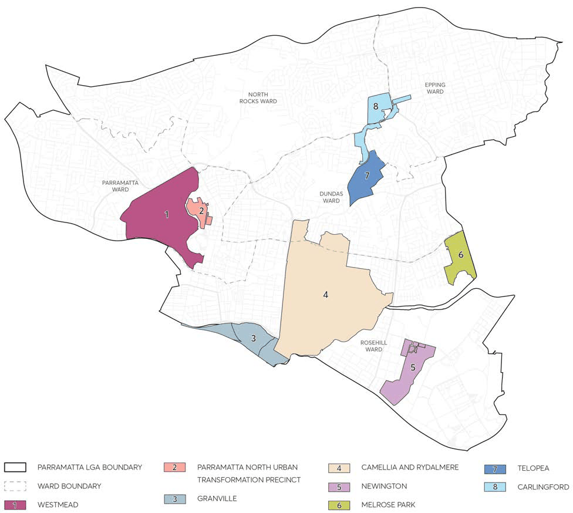

### 8.2 LOCAL CENTRES

This Section contains development controls for areas identified as Local Centres in Council's Local Strategic Planning Statement 2036. They are identified as being a focal point of neighbourhoods, are diverse, vary in size, with essential access to day-to-day goods and services. These centres are best served by and are generally in close proximity to public transport, public open spaces, schools, shops, and other community and commercial services. Local Centres' low-scale character and identity of suburban Parramatta are to be preserved and enhanced, while their mixed use business zones are to promote diverse and active uses at the street level to encourage lively neighborhoods with interest and vitality. Figure 8.2.1 illustrates each of the Local Centres across the City.

Where there are inconsistencies between the controls contained within this Section and other controls within this DCP, these controls prevail to the extent of the inconsistency.

> [Picture on page 88: a picture, saved as a picture (images/part-08-centres-precincts-special-character-areas-specific-page-88-13.gif, 150 dpi).]

Figure 8.2.1 – Local centres

CENTRES, PRECINCTS, SPECIAL CHARACTER AREAS AND SPECIFIC SITES

| 8.2 | LOCAL CENTRES ............................................................................................................................. 85 |
|---|---|
| 8.2.1 | WESTMEAD LOCAL CENTRE ....................................................................................................... 87 |
| 8.2.2 | PARRAMATTA NORTH URBAN TRANSFORMATION PRECINCT ....................................... 89 |
| 8.2.3 | GRANVILLE LOCAL CENTRE ....................................................................................................... 172 8.2.3.1 GRANVILLE TOWN CENTRE ..................................................................................................... 174 |
| 8.2.4 | CAMELLIA AND RYDALMERE ...................................................................................................... 182 |
| 8.2.5 | NEWINGTON LOCAL CENTRE ................................................................................................... 193 8.2.5.1 NEWINGTON SMALL VILLAGE................................................................................................. 194 8.2.5.2 NEWINGTON BUSINESS PARK PRECINCT .......................................................................... 196 8.2.5.3 NEWINGTON RESIDENTIAL PRECINCT .................................................................................199 |
| 8.2.6 | MELROSE PARK URBAN RENEWAL PRECINCT.................................................................... 223 |
| 8.2.7 | TELOPEA LOCAL CENTRE .......................................................................................................... 346 |
| 8.2.8 | CARLINGFORD LOCAL CENTRE ............................................................................................... 383 8.2.8.1 CARLINGFORD CENTRAL ......................................................................................................... 384 8.2.8.2 CARLINGFORD SOUTH ............................................................................................................. 439 8.2.8.3 CARLINGFORD EAST (BUSINESS)........................................................................................... 445 8.2.8.4 CARLINGFORD EAST (RESIDENTIAL) .................................................................................... 448 |

WESTMEAD LOCAL CENTRE
