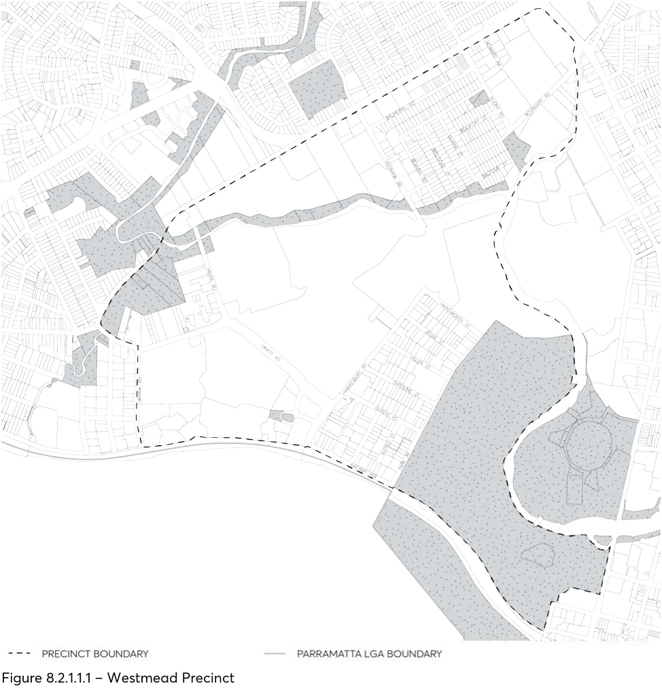

#### 8.2.1 WESTMEAD LOCAL CENTRE

#### 8.2.1.1 DESIRED FUTURE CHARACTER

The Westmead Strategic Precinct has a primary function of a regionally significant health and education hub. Westmead continues to have a strong residential component to support this primary function. Opportunities for residential, retail, business, hospital, education and community facility development are integrated with public transport facilities to improve public transport accessibility and to provide a more permeable pedestrian and bicycle network.

> [Picture on page 90: a picture, saved as a picture (images/part-08-centres-precincts-special-character-areas-specific-page-90-9.gif, 150 dpi).]

Figure 8.2.1.1.1 – Westmead Precinct

WESTMEAD LOCAL CENTRE

Objectives

O.01 Ensure new developments protect the amenity of existing residents. O.02 Facilitate physical and business research links to other precincts, especially the Parramatta City Centre, Camellia and Rydalmere Precincts.

O.03 Improve direct and efficient access to and through the precinct. O.04 Provide opportunities for a range of housing types. O.05 Develop a mixed use centre of retail, residential, business and community services at the transport node serving the precinct.

O.06 Preserve and improve significant open space areas within the precinct. O.07 Maximise pedestrian links and connectivity along the creek/river corridor, throughout significant open space areas and the precinct as a whole.

O.08 Protect and enhance the local and regional biodiversity, and maximise the extent and integrity of aquatic and natural land areas, in particular, the Parramatta River and Toongabbie Creek corridors.

Controls

C.01 New development is to address and activate public domain areas including open spaces, streets, pedestrian links, laneways and public spaces.

C.02 All new buildings and additions to existing buildings should not significantly impact upon sun access and accessibility of open space areas.

C.03 Land within proximity of the proposed Sydney West metro station is to be developed with consideration of the following:

• The impact of the development on the delivery of the Sydney West Metro Link.

• The impact of the proposed Sydney West Metro link on the development.

• The integration and interface between the development and any proposed station.

• The provisions of any relevant planning and development principles produced by Sydney Metro or its equivalent.

• The potential for land use to respond to the Sydney West Metro link in the future (e.g. maintain large development parcels without further subdivision in the short term).

PARRAMATTA NORTH URBAN TRANSFORMATION PRECINCT
