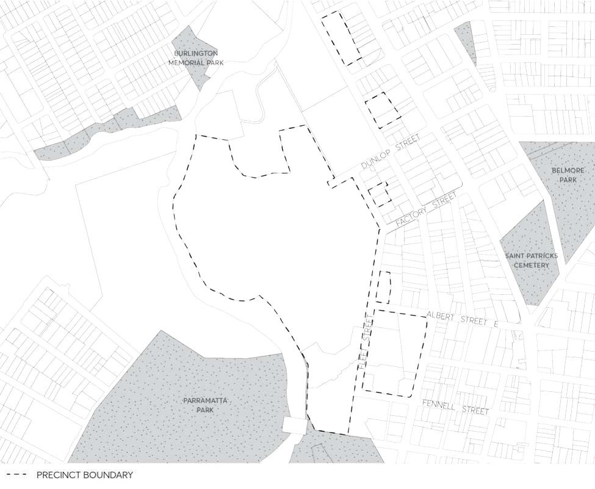

#### 8.2.2 PARRAMATTA NORTH URBAN TRANSFORMATION PRECINCT

#### 8.2.2.1 DESIRED FUTURE CHARACTER

The Parramatta North Urban Transformation (PNUT) is as a mixed use renewal precinct located adjacent to the Parramatta City Centre within a unique heritage, landscaped and river setting.

The precinct has a long history of Aboriginal, early colonial and later government institutional uses. This legacy is preserved and interpreted through the conservation and adaptation of heritage buildings (and other structures), the retention and interpretation of significant archaeology, the retention and enhancement of the key landscape characteristics of the site, including significant trees, and implementation of interpretive opportunities.

The precinct facilitates the long term preservation and interpretation of the Historic Core, which contains the key built and landscape elements of the sites that previously included the Parramatta Female Factory, Lunatic Asylum, Roman Catholic Orphanage, Parramatta Industrial School for Girls, Norma Parker Centre and Kamballa. The Historic Core contains non-residential uses that facilitate public access and interpretation of its significant heritage.

The precinct accommodates a network of connected public open spaces, including the central oval, local parks to the north and south, and along the Parramatta River foreshore. The open space incorporates heritage buildings and structures, mature landscapes, and preserves significant ecological values along the riparian corridor. Extensive landscaping provides a high-quality and high amenity setting for the precinct.

The vitality of the precinct is supported by the Parramatta Light Rail, which provides connections to the employment, educational, recreation and health precincts within the Greater Parramatta

area. New road, pedestrian and cycling networks support regional and local transport connections.

New buildings occur in a variety of forms, and generally scale down in height from east to west across the precinct. New development responds to significant views, vistas, cultural landscapes, plantings and historical (non-Aboriginal) archaeology and are suitably integrated with the retained heritage buildings and their settings.

New development are suitably set back, both at ground level and/or tower form so that they do not visually dominate the street, allow a pedestrian scale to be maintained at street level, are sympathetic to existing built form and respond to adjacent heritage buildings.

The eastern edge of the precinct contains the core of the precinct - a vibrant neighbourhood centre around the Factory Street extension. The centre offers opportunities for a range of retail, commercial and residential uses that serve the new and existing local communities. Development within the centre deliver a high-quality public domain, pedestrian through site links, street trees and wide footpaths. The centre has active ground floor uses that provide high levels of pedestrian amenity and reinforce the role of these streets as a vibrant and attractive retail/commercial centre.

PARRAMATTA NORTH URBAN TRANSFORMATION PRECINCT

> [Picture on page 93: a picture, saved as a picture (images/part-08-centres-precincts-special-character-areas-specific-page-93-2.gif, 150 dpi).]

Figure 8.2.2.1.1 - Parramatta North Urban Transformation Precinct

Note: Development must comply with the controls set out below and any relevant controls in Parramatta DCP 2023. Where there is any inconsistency the PNUT Special Precinct Provisions of this Part will prevail.

Objectives

O.01 Provide for the conservation and interpretation of the rich heritage values of the Parramatta North Historic Sites.

O.02 Recognise the unique quality and character of the site as the context and a reference for the architectural character of new buildings, structures and public spaces.

O.03 Provide a high-quality landscaped residential and commercial precinct in a well- connected location close to the Parramatta City Centre.

O.04 Ensure the design of new buildings and public spaces is of a high-quality and integrates with the unique heritage, landscape and cultural qualities of the site.

O.05 Ensure that development respects the greater Parramatta Park area and World Heritage listed Old Government House and Domain precinct.

PARRAMATTA NORTH URBAN TRANSFORMATION PRECINCT

O.06 Facilitate visual and physical access to the Parramatta River and opportunities for future connections across the river.

O.07 Provide new development, mainly in the form of residential apartments, that respects the existing heritage buildings and landscapes.

O.08 Facilitate improved active transport links to the surrounding area. O.09 Facilitate high-quality public transport connectivity with Westmead and Parramatta City Centre.

O.10 Ensure all development comply with the principles, policies and guidelines contained in the Parramatta North Historic Sites Conservation Management Plan (PNHS CMP).

Controls

C.01 Conserve and activate buildings of cultural significance through appropriate new uses. C.02 Interpret the diverse aspects of Aboriginal and European history and occupation of the site and river foreshore.

C.03 Locate new development to facilitate the retention of significant archaeology and include interpretation of significant past uses such as the Female Factory, the Mill Races, Marsden’s Mill and Mrs. Betts’ House and any other elements of state significant archaeology as confirmed through archaeological test excavation.

C.04 Retain and enhance the key landscape characteristics of the site, consistent with the PNUT Canopy Replenishment Strategy.

C.05 Scale, siting and location of development to respect key heritage views and vistas. C.06 That new development respects existing heritage buildings and structures through adherence to relevant development design controls contained in this Section of this DCP.
