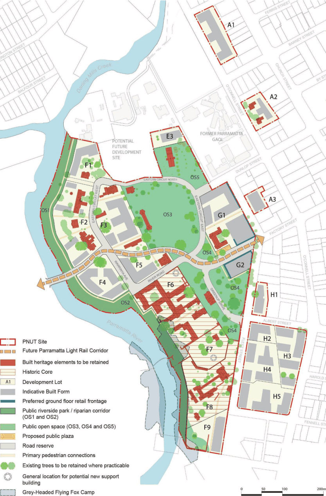

#### 8.2.2.3 SUBDIVISION

The Indicative Layout Plan (ILP) (Figure 8.2.2.3.1) has been prepared to inform the masterplanning, structure and development lot subdivision of the site. The ILP has been prepared in response to the heritage significance and history of the site and existing circulation networks.

Objectives

O.01 Ensure subdivision of the site is sympathetic to the existing street and public domain layout and is sensitive to the location of heritage buildings, their curtilages and landscape settings.

O.02 Provide a subdivision with a legible and logical public domain (of streets and open spaces) and future development site layout that responds to and respects the built and landscape heritage of the site.

O.03 Provide a range of development lots of suitable sizes and dimensions to support high-quality residential and mixed use development.

O.04 Facilitate the timely delivery of the street network, open space areas and supporting infrastructure.

O.05 Enable the protection and management of existing heritage buildings and proposed new buildings within development lots.

O.06 To not prejudice affect the future development of sites adjacent to the PNUT. O.07 Provide opportunities for connections with surrounding land. O.08 To ensure that development lots facilitate the conservation and interpretation of the Parramatta North Historic Sites as places of exceptional heritage significance.

PARRAMATTA NORTH URBAN TRANSFORMATION PRECINCT

Controls

C.01 Subdivision of the site is consistent with the intent of the Indicative Layout Plan shown in Figure

8.2.2.3.1 and the objectives and principles contained in this development control plan.

C.02 Provide development lots that facilitate a new local retail centre at Factory Street and Fleet Street.

C.03 Provide development lots that allow for new development to be sensitively located adjacent to existing heritage buildings and landscapes.

C.04 Allow for the provision of efficient and effective public transport options for the site. C.05 Subdivision is to create contiguous lots known as the ‘Historic Core’ of the site, shown as areas F6, F7 and F8 on Figure 8.2.2.3.1. The ‘Historic Core’ is to contain the key built and landscape elements of the sites that previously included the Parramatta Female Factory, Lunatic Asylum, Roman Catholic Orphanage, Parramatta Industrial School for Girls, Norma Parker Centre and Kamballa or as identified in the PNHS CMP.

C.06 The subdivision of the ‘Historic Core’ area is subject to an assessment of the historic and existing site boundaries, and any impacts on heritage significance and future ownership or management regimes.

C.07 Subdivision is to create a legible public domain of streets, and public open spaces that respects and responds to the heritage attributes of the PNUT.

C.08 Development Applications for subdivision are to be in accordance with the Street Types and Connections at Figure 8.2.2.5.1.

C.09 Proposals for further subdivision of the developments lots shown in the Indicative Layout Plan at Figure 8.2.2.3.1 must be subject to an assessment of heritage impact including analysis of any changed management regimes for buildings, landscaping or archaeological relics that may be impacted or as identified in the PNHS CMP.

C.10 Any proposals for subdivision adjoining or in proximity to the Parramatta Light Rail Corridor must be referred to Transport for NSW to ensure the subdivision facilitates the construction and operation of the Parramatta Light Rail.

C.11 The significance and character of any heritage item must not be adversely affected through subdivision.

C.12 Any subdivision involving heritage items or contributory buildings should not compromise the setting or curtilage of buildings/items on or adjoining the site.

PARRAMATTA NORTH URBAN TRANSFORMATION PRECINCT

> [Picture on page 97: a picture, saved as a picture (images/part-08-centres-precincts-special-character-areas-specific-page-97-2.gif, 150 dpi).]

Figure 8.2.2.3.1 - Parramatta North Urban Transformation Precinct Indicative Layout Plan

PARRAMATTA NORTH URBAN TRANSFORMATION PRECINCT
