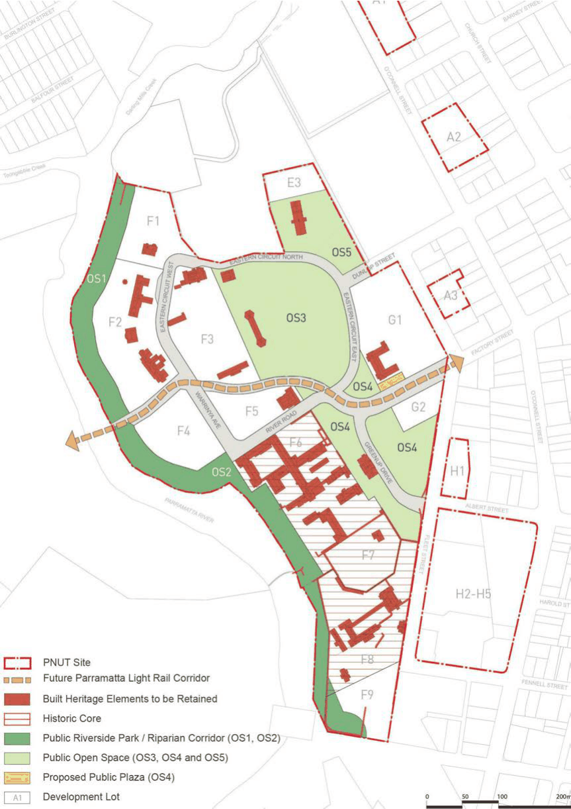

#### 8.2.2.4 PUBLIC DOMAIN AND OPEN SPACE

Objectives

O.01 Creation of an open space network within the site that provides for high-quality amenity. O.02 Creation of an open space network that retains, conserves and interprets the heritage of the site, including historic elements within the public domain and open space.

O.03 Creation of an open space network that accommodates a range of active and passive recreational uses.

O.04 Provide open space linkages to the Parramatta River foreshore, with consideration of the sensitive ecological values of the area.

O.05 Ensure that new buildings are designed, located and orientated to help activate and define open spaces.

O.06 Maximise public access to the open space network and provide an integrated pedestrian and cycle network.

O.07 Develop sustainable stormwater and ecological management systems. O.08 Enhance and expand connections of existing vegetation communities to the river foreshore. O.09 Enhance the existing mature landscape qualities of the site.

Controls

C.01 Provide a linear open space on the bank of the Parramatta River that contributes to local amenity and regional connectivity.

C.02 Provide an open space network that links to wider regional open spaces. C.03 Provide a hierarchy of open spaces that offer active and passive recreation. C.04 Make public open space areas accessible to the community. C.05 Ensure that the new uses for retained heritage buildings situated in the public domain enhance their relationship with the public domain.

C.06 Provide appropriate and activated interfaces between new and existing buildings, public open spaces, and the planned light rail route. These interfaces are to reflect sound urban design principles, and activate the spaces appropriately to provide safety.

C.07 New services infrastructure must be located underground to avoid visual impacts on significant cultural landscapes, in particular the curtilage and wider setting of significant buildings and structures, open space areas, cultural plantings and views.

C.08 Boundaries must be clearly articulated between public and private open space areas around and within development lots in a manner that respects and enhances the landscape qualities of the Parramatta North Historic Sites (PNHS).

C.09 Development Applications for subdivision are to be in accordance with the Open Space Plan at Figure 8.2.2.4.1 Open Space Provision.

PARRAMATTA NORTH URBAN TRANSFORMATION PRECINCT

C.10 New and retained buildings adjacent to the public plaza on the extension to Factory Street are to allow pedestrian access and actively address the plaza.

C.11 New and retained buildings adjacent to the planned light rail route are to positively address this space with building and development elements that allow pedestrian access and movement. Future development is to include consideration of opportunities to facilitate pedestrian and cyclist usage of this linear space as an east-west shared path.

C.12 Development is to comply with the principles and guidelines contained in the PNUT Public Domain Plan.

C.13 The significant elements, including archaeological resource and fabric, within the public domain and open space will be conserved in accordance with the Parramatta North Historic Sites Consolidated Conservation Management Plan. Interpretation of the history and heritage significance of the PNHS will be undertaken in accordance with the PNHS Heritage Interpretation Strategy and will adopt ‘best practice’ methods to deliver key themes and messages.

C.14 Any significant works along the riparian corridor shall be accompanied by a Vegetation Management Plan prepared by a qualified ecologist.

PARRAMATTA NORTH URBAN TRANSFORMATION PRECINCT

> [Picture on page 100: a picture, saved as a picture (images/part-08-centres-precincts-special-character-areas-specific-page-100-2.gif, 150 dpi).]

Figure 8.2.2.4.1 - Open Space Provision

PARRAMATTA NORTH URBAN TRANSFORMATION PRECINCT
